<br />

# Stochology — The Science and Ethics of Aim for Judgment and Decision-Making under Uncertainty

**Stochology** is the **scientific and ethical discipline** of judgment and decision-making under uncertainty when action must precede the outcome — structured by a **disciplinary program** across three interdependent axes: **epistemic margin** (structural diagnosis of missingness, non-Gaussian tails, and specification discrepancy), **vital margin** (protection of non-ergodic survival and buffering against ruin), and **fully apt agency under institutional governance** (performative accountability, cost-loss thresholds, and asymmetric responsibility; see [`notes/A Ética da Mira.md`](notes/A%20%C3%89tica%20da%20Mira.md)).

This repository provides the pure-Rust implementation (zero external dependencies) of **Stochology**'s auditable epistemological machine, normative kernel, transversal lenses, and verification architecture.

The repository brings together in a single verifiable workspace:

1. **Structural Diagnosis of the Three Ontological Layers ($L_1 \to L_2 \to L_3 \to L_1$):** Meng's Identity ($\rho_{R,Y}$), Manski's bounds under MNAR missingness, Jensen's Gap $\Delta_J = \mathbb{E}[f(X)] - f(\mathbb{E}[X])$, $\mathrm{CRPS}$ evaluation, **Performative Prediction** ($\theta_{\mathrm{SL}}, \theta_{\mathrm{PS}}, \theta_{\mathrm{PO}}$ of Stackelberg and contraction radius $\frac{\varepsilon \beta}{\gamma} < 1$), and the **4 Variants of Goodhart's Law** (`GoodhartTaxonomyAudit`: Regressional, Extremal, Causal, Adversarial).
2. **Uncertainty Typing and Severe Uncertainty:** **Kennedy-O'Hagan** Gaussian Process Structural Discrepancy ($\delta(x) \sim \mathcal{GP}(0, k(x, x'))$) and **Info-Gap Decision Theory** ($\hat{\alpha}, \hat{\beta}$, *zero-ing*) coupled with **Sniedovich's Global Maximin Safeguard** (Wald).
3. **The Five Transversal Lenses, Almost-Perfect Machine, and Authentic Model Form:**
   - **Information:** Data Processing Inequality (3-step Markov chain DPI), SDPI hierarchy ($\eta_{\chi^2} = \rho_m^2 \le \eta_{\mathrm{KL}} \le \eta_{\mathrm{TV}}$), and Fano's error floor.
   - **Time:** Itô variance drain, asymmetric optimal Kelly fraction ($f^* = \frac{p}{a} - \frac{1-p}{b}$), absorbing ruin states, and mixing time under Log-Sobolev Inequality.
   - **Scale and Tail:** Hill estimator ($\hat{\alpha}_{k,n}$) and moment existence regimes.
   - **Structure and Invariance:** Pearl's Causal Ladder, Invariant Causal Prediction (ICP), environment OLS invariance penalty, nonlinear NILE/IRM over orthonormal Hermite basis (`run_nonlinear_icp_nile`), 2nd-order worst-case loss, and hidden confounding threshold $\Lambda^*$.
   - **Decision and Calibration:** Cost-loss rule $p^* = \frac{C}{\eta L}$, $\mathrm{EVPI}$, quantile score, isotonic **CORP-Murphy** decomposition via the *Pool-Adjacent-Violators* (PAV) algorithm, and exact fair-coin calibration vs. decision benchmark (`ExactCoinCalibrationBenchmark`).
   - **Almost-Perfect Machine & First-Class Authentic Model Form (`machine.rs`):** $(\varepsilon, \delta)$-Almost-Perfect Machine $M = (T, \Phi, \theta)$ (`P1`–`P5`: Barron rate $C_f^2 / W$, DPI $\delta$-sufficiency, Fano/minimax optimality, Telgarsky $2^D$ linear regions, and Gram $d_{\mathrm{eff}}$) and `AuthenticModelForm` ($\delta(x) + \hat{S}^*$, named discarded atoms, 6 numerical identities, and 5-part criterion $A(\text{model})$).
   - **Relational Ontology (`relational/`), Physical/Analog/Wave Computing (`analog/`), Critical Theory of Stochastic Rationality (`critical/`), Stochary-Conjectural Cybernetics (`stocks/`), Triadic Technium (`triad/`), Strategic AI Accommodation (`strategic/`), & Coupled Public-Private Society (`society/`):** 6-axis relational complex systems synthesis (Prigogine Brusselator RK4, Schelling, *Daisyworld*), 5-axis physical/analog/wave computing synthesis (Horowitz 45nm CMOS energy wall, exact RLC-mechanical ODE isomorphism, AIMC "Analog Wall" threshold cliff vs. Noise-Aware Training, PKU 24-bit `HP-INV` + recursive $4\times 4$ `BlockAMC` block solver + `ABNAT / HaLoRA` attention stability, `SIREN` Helmholtz PDE & Stanford Wave-Equation RNN, and the $1.6 \times 10^8 : 1$ sensory DPI compression funnel + Turing deciban threshold), 4-axis Critical Theory synthesis (Adorno's liquidation of the *Non-Identical* $\Delta_{\text{Nichtidentische}}$, Marcuse/Rouvroy algorithmic preemption & "Stochastic Parrots" + 4 Goodhart variants, 300T token exhaustion & material collapse, and neurosymbolic/wave-interference overcoming), 4-axis Stochary-Conjectural & Cybernetic synthesis (150-node cybernetic graph, 4 Ontological Stock Axioms, Powell's 4 policy classes, Friston Variational Free Energy + simulated preposterior VoI [Expected Free Energy $G(\pi)$ is cited, not computed], Pearl Front-Door, Dierickx-Cool, Scarf $(S,s)$, Kingman VUT & MEIO decoupling `SupplyChainPhysicsAudit`, Simchi-Levi $\mathrm{TTS}/\mathrm{TTR}$, $\beta$-CVaR + WDRO, Ashby/Conant/Beer `VSM` S1–S5/`S3*`/Algedonic + `PLAT`/`PCCP`/`EvaluatedCompetenceCriterion`, and `PATE` Q1–Q4 matrix), 6-bridge Triadic ($\mathbb{C} \times \text{Fractals} \times \mathbb{T}^d$) & Technium synthesis (`ComplexFractalToroidalTechniumSynthesis`), 6-axis Strategic AI Six-Pair Methodological Accommodation (`StrategicAiAccommodationSynthesis`), and Coupled Public-Private Stock-Flow Consistent Society synthesis (`CoupledPublicPrivateSocietySynthesis`, `SfcFlowMatrix`, `H1aRegulatorCouplingAblation`, `H1bCreditScreeningAblation`, `H2VcgGreenLaffontCommonsAblation`).
4. **Structured Communication Contract:** The 4 Prohibitions, the 5 Boundary Invariants ($\Phi_1$–$\Phi_5$, including lock-free `SplitMix64::split(stream_id)` and `MonteCarloSplitTreeAudit`), **Moulton-Campbell** unequal-cluster correction ($\tilde{m} = \bar{m}(1 + \mathrm{CV}^2)$), quantile exceedance design effect ($\rho_I(p)$ and $n_{\mathrm{eff}}(p)$), and **Chouldechova's** algebraic impossibility audit.
5. **4-Filter Eliminatory Funnel and 8-Step SIGA Roadmap:** Executed end-to-end over the Epistemological Cards in [`cards/`](cards/) with sequential evidence processes (*e-processes*), executive memoranda in integer natural frequencies, and `AlertFatigueAudit` on Bridge $L_2 \to L_3$ coupling the $10\text{ bit/s}$ conscious cognitive ceiling and Turing-Good additive deciban evidence weights ($W = 10\log_{10}\mathrm{LR}$) to shift-level $\mathrm{PPV}$.
6. **Bitemporal Governance, Single-Opening Vault, and 4 Regimes of Drift:** Bitemporal Clock ($t_{\text{disp}} \ge t_{\text{ev}}$), canary column, SHA-256 Temporal Vault, Murphy-CORP circuit breaker, *Covariate Drift* adaptation (*ExTRA-WCP-T* + Lei & Candès bound), *Label Shift* adaptation via the 4 canonical estimators (**BBSE**, **MLLS/SLD**, **DFM**, and **OTTER**), and **Predetermined Change Control Plan (`PredeterminedChangeControlPlan`)** coupled to the **Profit and Loss Attribution Test (`ProfitLossAttributionTest` — Spearman $r_s$ + KS $D_{\mathrm{KS}}$ traffic-light)** and **`EvaluatedCompetenceCriterion`**.
7. **Transversal Real-Data Synthesis (`labs --real-data`, Lab 7):** End-to-end empirical audit across all **14 real datasets (`data/*.csv`)**, including the out-of-time (`nyc_flights_2013_h1.csv`, `nyc_flights_2023_h1.csv`) and out-of-domain (`houston_flights_2011.csv`) flight reserves, and the **4 canonical Epistemological Cards (`cards/*.yaml`)**.

---

## The Six Verification Pillars of Stochology

**Stochology** organizes **what is verified** across six verification pillars (`1`–`6`), operating above the **5 Boundary Invariants** ($\Phi_1$–$\Phi_5$) and the **8 Epistemological Gates** (`G1`–`G8`). The **SIGA Roadmap** (*Survey, Interrogate, Generate, Act*) defines **how the 8-step operational cycle runs**. Together, the six pillars partition all **27 negative defect proofs** (`4 + 5 + 3 + 4 + 3 + 8 = 27`):

| Pillar | Formal Guarantee | Rust Primitives | Gates | Negative Defect Proofs (`gates -- --defect`, `exit 1`) |
| :---: | :--- | :--- | :---: | :--- |
| **1** — **Calibrated** | Strictly proper out-of-sample calibration via isotonic PAV (`CORP` for Brier and Log scores), Murphy elementary cost-loss diagrams ($\int_0^1 \bar{S}_\theta\,d\theta = \frac{1}{2}\mathrm{BS}$), and Cromwell bounds ($p \in [\varepsilon, 1-\varepsilon]$), and the threshold-wise CORP decomposition of the CRPS. | `CorpPavDecomposition`, `MurphyDiagram`, `CorpRocMurphyTriptych`, `apply_cromwell_floor`, `CorpCrpsDecomposition` | `G6` | `cromwell`, `brier_dominance`, `concept_drift`, `crps_miscalibration` |
| **2** — **Anytime-valid** | Valid sequential evidence under optional stopping (`aGRAPA` / `GRO` betting martingales $E_t$, `SAVI` confidence sequences, `GREE` VaR/ES e-backtesting), Moulton-Campbell tail $n_{\mathrm{eff}}(p)$, and $\Phi_5$ resolution parity, and e-BH false discovery control over many e-values. | `EvidenceProcess`, `SaviConfidenceSequence`, `VarEsEBacktest`, `ExceedanceDesignEffect`, `verify_resolution_phi5`, `EBhMultiplicityAudit` | `G2/G3/G6` | `moulton`, `peeking`, `var_underreport`, `phi5`, `multiplicity` |
| **3** — **Performative-aware** | Separation of Performative Stability ($\theta_{\mathrm{PS}}$) from Stackelberg Optimality ($\theta_{\mathrm{PO}}$, `PerfGD`), RRM contraction ($\frac{\varepsilon\beta}{\gamma}<1$), Goodhart's 4 variants, and `Accumulate` vs. `Replace` synthetic recursion bounds, and a measured lower bound on $\varepsilon$ from randomized arms. | `PerformativeSystem`, `GoodhartTaxonomyAudit`, `GerstgrasserAccumulateAudit`, `SyntheticDataPolicy`, `PerformativePowerAudit` | `G6/G8` | `performativity`, `replace_collapse`, `understated_epsilon` |
| **4** — **Invariant** | Structural causal invariance across environments (`ICP` / nonlinear `NILE`), Meng's `ddc`/`DDI` + fractional Lee (2009) trimming bounds & tipping point $\delta_1^*$, anchored Kennedy-O'Hagan GP, and Info-Gap + Sniedovich Maximin floor, and anchor regression. | `MengAudit`, `ManskiBounds`, `run_nonlinear_icp_nile`, `KennedyOHaganDiscrepancy`, `InfoGapOption`, `AuthenticModelForm`, `AnchorRegressionAudit` | `G3/G6/G8` | `lee_point_estimate`, `sniedovich`, `machine`, `anchor_extrapolation` |
| **5** — **Bitemporal** | Strict event- vs. availability-time separation ($t_{\text{disp}} \ge t_{\text{ev}}$), synthetic canary mutual-information check ($I(\text{Canary}; Y)=0$), and single-opening SHA-256 `TemporalVault` with `PCCP` / `PLAT` governance, and real-time data vintages. | `BitemporalRecord`, `BitemporalClockAudit`, `TemporalVault`, `PredeterminedChangeControlPlan`, `ProfitLossAttributionTest`, `RealTimeVintageAudit` | `G7` | `clock`, `vault`, `vintage_leak` |
| **6** — **Auditing** | Eliminatory 4-Filter Funnel, Filter 4 cross-authorship, Chouldechova & KMR fairness impossibility audits, physical/analog `HP-INV` & wave computing, critical theory of stochastic rationality, VSM `S3*` / `PATE` cybernetics, Triadic ($\mathbb{C} \times \text{Fractals} \times \mathbb{T}^d$) & Technium synthesis, Strategic AI Six-Pair Accommodation, and Coupled Public-Private Stock-Flow Consistent Society Synthesis (`CoupledPublicPrivateSocietySynthesis`, `EmpiricalCoupledSocietyAudit`, `SfcFlowMatrix`), and three-way multicalibration. | `ChouldechovaAudit`, `AlertFatigueAudit`, `AnalogWaveComputingSynthesis`, `CriticalStochasticRationalitySynthesis`, `StocharyConjecturalCyberneticSynthesis`, `ComplexFractalToroidalTechniumSynthesis`, `EmpiricalTriadicTechniumAudit`, `StrategicAiAccommodationSynthesis`, `EmpiricalStrategicAccommodationAudit`, `CoupledPublicPrivateSocietySynthesis`, `EmpiricalCoupledSocietyAudit`, `SfcFlowMatrix`, `MulticalibrationAudit` | `G4/G8` | `chouldechova`, `analog_wall`, `instrumental_reason`, `stochary_cybernetics`, `triadic_technium`, `strategic_accommodation`, `coupled_society`, `subgroup_miscalibration` |

---

## Repository Structure

```text
.
├── AGENTS.md                                      # Binding governance and verification contract
├── .agents/                                       # Model-Agnostic Multi-Agent Harness (stochology-modeler, stochology-adversary, stochology-scribe, Phi3 hook)
├── docs/
│   └── PROTOCOL.md                                # Full formal specification and Rust mapping
├── cards/                                         # Canonical Epistemological Cards
│   ├── card_01_atlantic_storms_evacuation.yaml
│   ├── card_02_bank_queue_staffing.yaml
│   ├── card_03_nyc_flights_holding.yaml
│   └── card_04_dpi_civil_defense_triage.yaml
├── data/                                          # Real empirical datasets (CSV)
├── crates/
│   ├── stochology-core/                           # Layers, Meng, Manski, Jensen, Performativity, GP, Info-Gap, Phi1-Phi5, and YAML Card
│   ├── stochology-lenses/                         # The 5 Lenses + Almost-Perfect Machine M=(T,Phi,theta) & Authentic Model Form
│   ├── stochology-siga/                           # 4-Filter Eliminatory Funnel and 8-Step SIGA Roadmap
│   ├── stochology-governance/                     # Bitemporal Clock, Single-Opening Vault, and Drift (ExTRA-WCP-T, BBSE, MLLS, DFM, OTTER)
│   └── stochology-cli/                            # CLI binaries `labs` and `gates`
├── book.toml                                      # mdBook configuration
├── book-src/                                      # The interactive textbook (mdBook): preface + 27 chapters in 7 parts — I The Act of Conjecture, II The Five Laws of the Real, III–V the axes World⇄Model, Model⇄Decision, Decision⇄World (forward pair, reverse pair, axis synthesis), VI Cross-Pair Syntheses, VII Operation — plus Appendices A–E (see SUMMARY.md)
├── theme/                                         # mdBook favicon/theme overrides
├── mathjax.js                                     # MathJax 3 bootstrap for $...$ / $$...$$ rendering
└── scripts/
    └── verify.sh                                  # Complete positive and negative verification suite
```

---

## Quick Start

### 1. Full Verification (Formatting, Clippy, Tests, Laboratories, and Gates)

```bash
scripts/verify.sh
```

### 2. Methodological and Empirical Laboratories (`labs`)

```bash
cargo run --release --bin labs -- --all
cargo run --release --bin labs -- --layers        # Lab 1: Meng, Manski, Jensen, and Performativity
cargo run --release --bin labs -- --uncertainty   # Lab 2: Kennedy-O'Hagan GP and Info-Gap + Sniedovich
cargo run --release --bin labs -- --lenses        # Lab 3: The Five Transversal Lenses
cargo run --release --bin labs -- --invariants    # Lab 4: Phi1-Phi5, Moulton-Campbell, Exceedance, and Chouldechova
cargo run --release --bin labs -- --siga          # Lab 5: 4-Filter Funnel and SIGA Roadmap on the 4 YAML Cards
cargo run --release --bin labs -- --governance    # Lab 6: Bitemporal Clock, Vault, and 4 Regimes of Drift
cargo run --release --bin labs -- --real-data     # Lab 7: Transversal Synthesis across all 14 real CSVs & 4 YAML Cards
```

### 3. Epistemological Gates and Negative Proofs (`gates`)

```bash
# Positive audit of all 8 gates (G1-G8, exits with code 0)
cargo run --release --bin gates

# Negative blocking proofs (each command must block the pathology and exit with code 1)
cargo run --release --bin gates -- --defect cromwell
cargo run --release --bin gates -- --defect phi5
cargo run --release --bin gates -- --defect moulton
cargo run --release --bin gates -- --defect performativity
cargo run --release --bin gates -- --defect sniedovich
cargo run --release --bin gates -- --defect clock
cargo run --release --bin gates -- --defect vault
cargo run --release --bin gates -- --defect concept_drift
cargo run --release --bin gates -- --defect chouldechova
cargo run --release --bin gates -- --defect machine
cargo run --release --bin gates -- --defect analog_wall
cargo run --release --bin gates -- --defect instrumental_reason
cargo run --release --bin gates -- --defect stochary_cybernetics
cargo run --release --bin gates -- --defect peeking
cargo run --release --bin gates -- --defect brier_dominance
cargo run --release --bin gates -- --defect var_underreport
cargo run --release --bin gates -- --defect lee_point_estimate
cargo run --release --bin gates -- --defect replace_collapse
cargo run --release --bin gates -- --defect triadic_technium
cargo run --release --bin gates -- --defect strategic_accommodation
cargo run --release --bin gates -- --defect coupled_society
```
