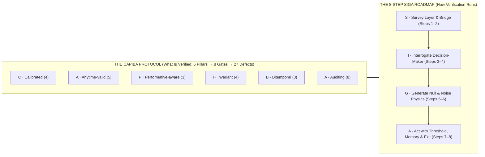

<figure class="stoch-figure stoch-logo-figure">
  <svg xmlns="http://www.w3.org/2000/svg" width="660" height="132" viewBox="0 0 660 132" fill="none" role="img" aria-labelledby="stochology-logo-title">
  <title id="stochology-logo-title">Stochology — Auditable Epistemological Machine (The CAPIBA Protocol)</title>
  <defs>
  <linearGradient id="logo-ring" x1="2" y1="103" x2="468" y2="103" gradientUnits="userSpaceOnUse">
  <stop offset="0%" stop-color="var(--logo-green, #10b981)"/>
  <stop offset="38%" stop-color="var(--logo-blue, #2563eb)"/>
  <stop offset="66%" stop-color="var(--logo-gold, #f59e0b)"/>
  <stop offset="100%" stop-color="var(--logo-crimson, #e11d48)"/>
  </linearGradient>
  <linearGradient id="logo-tail" x1="31" y1="86" x2="92" y2="48" gradientUnits="userSpaceOnUse">
  <stop offset="0%" stop-color="var(--logo-green, #10b981)" stop-opacity="0.32"/>
  <stop offset="42%" stop-color="var(--logo-blue, #2563eb)" stop-opacity="0.34"/>
  <stop offset="68%" stop-color="var(--logo-gold, #f59e0b)" stop-opacity="0.28"/>
  <stop offset="100%" stop-color="var(--logo-crimson, #e11d48)" stop-opacity="0.24"/>
  </linearGradient>
  <radialGradient id="logo-glow" cx="50%" cy="50%" r="50%">
  <stop offset="0%" stop-color="#38bdf8" stop-opacity="0.16"/>
  <stop offset="65%" stop-color="#fbbf24" stop-opacity="0.08"/>
  <stop offset="100%" stop-color="#38bdf8" stop-opacity="0"/>
  </radialGradient>
  </defs>
  <g>
  <circle cx="64" cy="66" r="46" fill="url(#logo-glow)"/>
  <path d="M 23.43 76.87 A 42 42 0 0 1 52.99 25.47" stroke="var(--logo-green, #10b981)" stroke-width="3.2" stroke-linecap="round"/>
  <path d="M 49.02 30.60 L 53.84 25.25 L 46.80 23.75" stroke="var(--logo-green, #10b981)" stroke-width="2.6" stroke-linecap="round" stroke-linejoin="round"/>
  <path d="M 74.87 25.43 A 42 42 0 0 1 104.61 76.73" stroke="var(--logo-blue, #2563eb)" stroke-width="3.2" stroke-linecap="round"/>
  <path d="M 102.15 70.73 L 104.37 77.58 L 109.19 72.23" stroke="var(--logo-blue, #2563eb)" stroke-width="2.6" stroke-linecap="round" stroke-linejoin="round"/>
  <path d="M 93.70 95.70 A 42 42 0 0 1 34.41 95.80" stroke="var(--logo-crimson, #e11d48)" stroke-width="3.2" stroke-linecap="round"/>
  <path d="M 40.83 96.67 L 33.79 95.18 L 36.01 102.02" stroke="var(--logo-crimson, #e11d48)" stroke-width="2.6" stroke-linecap="round" stroke-linejoin="round"/>
  <polygon points="64,24 100.37,87 27.63,87" stroke="#64748b" stroke-width="1.2" stroke-dasharray="3 3" opacity="0.55"/>
  <path id="stoch-logo-tail-fill" d="M 31 85 C 40 85, 45 46, 54 46 C 63 46, 68 74, 96 84 L 96 86 L 31 86 Z" fill="url(#logo-tail)"/>
  <path id="stoch-logo-tail-stroke" d="M 31 85 C 40 85, 45 46, 54 46 C 63 46, 68 74, 96 84" stroke="var(--logo-ink)" stroke-width="2.2" stroke-linecap="round"/>
  <line id="stoch-logo-cross-h" x1="41" y1="66.65" x2="87" y2="66.65" stroke="var(--logo-gold, #f59e0b)" stroke-width="2.2" stroke-dasharray="4 3" stroke-linecap="round"/>
  <line id="stoch-logo-cross-v" x1="72" y1="39" x2="72" y2="86" stroke="var(--logo-gold, #f59e0b)" stroke-width="2.2" stroke-dasharray="4 3" stroke-linecap="round"/>
  <circle id="stoch-logo-cross-dot" cx="72" cy="66.65" r="3.6" fill="var(--logo-gold, #f59e0b)" stroke="var(--logo-node-bg)" stroke-width="1.4"/>
  <circle cx="64" cy="24" r="7.5" fill="var(--logo-node-bg)" stroke="var(--logo-blue, #2563eb)" stroke-width="3"/>
  <circle cx="64" cy="24" r="3" fill="var(--logo-blue, #2563eb)"/>
  <circle cx="27.63" cy="87" r="7.5" fill="var(--logo-node-bg)" stroke="var(--logo-green, #10b981)" stroke-width="3"/>
  <circle cx="27.63" cy="87" r="3" fill="var(--logo-green, #10b981)"/>
  <circle cx="100.37" cy="87" r="7.5" fill="var(--logo-node-bg)" stroke="var(--logo-crimson, #e11d48)" stroke-width="3"/>
  <circle cx="100.37" cy="87" r="3" fill="var(--logo-crimson, #e11d48)"/>
  </g>
  <g transform="translate(148, 0)">
  <text x="0" y="62" fill="var(--logo-ink)" font-family="system-ui, -apple-system, 'Segoe UI', Roboto, sans-serif" font-size="42" font-weight="800" letter-spacing="2.5">STOCHOLOGY</text>
  <line x1="2" y1="90" x2="468" y2="90" stroke="url(#logo-ring)" stroke-width="1.5" stroke-opacity="0.75"/>
  <text x="2" y="106.5" textLength="302" lengthAdjust="spacing" fill="var(--logo-meta)" font-family="ui-monospace, 'Cascadia Code', monospace" font-size="11.5" font-weight="600" letter-spacing="0.8">L₁ → L₂ → L₃ → L₁  |  Φ₁–Φ₅  |  G1–G8  |</text>
  <g id="stoch-svg-seed-group" class="stoch-svg-seed-group">
  <rect id="stoch-svg-seed-box" x="310" y="93" width="158" height="20" rx="5" fill="var(--elevated-bg, rgba(16, 185, 129, 0.12))" stroke="var(--logo-green, #10b981)" stroke-width="1.2"/>
  <text id="stoch-svg-seed-fallback" x="318" y="106.5" fill="var(--logo-green, #10b981)" font-family="ui-monospace, 'Cascadia Code', monospace" font-size="11.5" font-weight="700" letter-spacing="0.6">SEED = <tspan id="stoch-svg-seed-tspan">2026</tspan> ✎</text>
  <foreignObject x="310" y="93" width="158" height="20" class="stoch-svg-seed-fo">
  

  <label for="stoch-svg-seed-input" class="stoch-svg-seed-label">SEED =</label>
  <input id="stoch-svg-seed-input" name="seed" class="stoch-svg-seed-input" type="number" inputmode="numeric" enterkeyhint="done" autocomplete="off" autocorrect="off" autocapitalize="off" spellcheck="false" min="1" max="999999999" step="1" value="2026" aria-describedby="stoch-seed-bar-status" title="Click or type to change the active SplitMix64 seed on the home page" />
  ✎
  

  </foreignObject>
  </g>
  </g>
</svg>
  <figcaption class="stoch-seed-bar" id="stoch-seed-bar">
    

      

        <label for="stoch-home-seed-input" class="stoch-seed-bar-label">Φ₁ Seed (editable in SVG above or here):</label>
        <input id="stoch-home-seed-input" name="home_seed" class="stoch-seed-bar-input" type="number" inputmode="numeric" enterkeyhint="done" autocomplete="off" autocorrect="off" autocapitalize="off" spellcheck="false" min="1" max="999999999" step="1" value="2026" aria-describedby="stoch-seed-bar-status" />
      

      

        <button type="button" class="stoch-seed-pill" data-seed-preset="2026" aria-pressed="true" title="Canonical textbook and CLI default (DEFAULT_SEED = 2026)">2026 · Canonical</button>
        <button type="button" class="stoch-seed-pill" data-seed-preset="31" aria-pressed="false" title="Shaped application profile seed (examples/clay/card_clay_night_shift_overflow.yaml)">31 · Clay Profile</button>
        <button type="button" class="stoch-seed-pill" data-seed-preset="2035" aria-pressed="false" title="Development multi-seed acceptance block (2026..=2045)">2035 · Dev Block</button>
        <button type="button" class="stoch-seed-pill" data-seed-preset="9000000" aria-pressed="false" title="Sealed confirmation seed block (9_000_000..=9_000_399)">9000000 · Confirm</button>
        <button type="button" class="stoch-seed-pill" id="stoch-seed-step-btn" title="Step to next deterministic seed">🎲 +1 Seed</button>
      

    

    

      <code>SplitMix64::new(2026).next_u64()</code> → <code>0xdb9c559891948d23</code> (u₁ = 0.8579)
      Configurable in code: <code id="stoch-seed-rust-inline">SplitMix64::new(2026)</code> (<a href="../crates/stochology-core/src/rng.rs"><code>rng.rs</code></a>) or <code id="stoch-seed-yaml-inline">protocol_profile.seed: 2026</code> (<a href="#41-changing-the-seed-in-code-and-in-application-profiles-kernel-vs-clay">see §4.1 ↓</a>)
    

  </figcaption>
</figure>

# Preface: The Invisible Target and the Foundations of Stochology

  

    CAPIBA PROTOCOL · 6 PILLARS
    Φ₁ SPLITMIX64 · SEED = 2026 (EDITABLE)
    8 GATES (G1–G8) · 27 DEFECT PROOFS
    13 DATASETS · 16 INTERACTIVE LABS
  

  
An <strong>auditable epistemological machine</strong> implemented in pure Rust (zero external dependencies) where every quantitative claim, physical generating process (<strong>L₁</strong>), mathematical compression (<strong>L₂</strong>), and operational decision rule (<strong>L₃</strong>) is coupled to an executable null model, a structured Epistemological Card, and algorithmic gates that reject flawed claims.

  

    <a class="stoch-hero-btn stoch-hero-btn-primary" href="01-layers-six-pairs.html">Start Reading: Part I (Three Layers, Six Pairs) →</a>
    <a class="stoch-hero-btn stoch-hero-btn-secondary" id="stoch-hero-lab-link" href="lab/index.html?seed=2026">Launch Interactive Laboratory (/lab) ↗</a>
    <a class="stoch-hero-btn" href="#preface-lab-widget">Try In-Page Bayes &amp; Deciban Lab ↓</a>
    <a class="stoch-hero-btn" href="appendix-protocol.html">Full Protocol Specification</a>
  

  

<!-- competency-pillars:begin -->
    

      
PILLAR C · CALIBRATED

      
4 pathways · 15 competencies

      

        <a href="09-lenses.html">⊥ brier_dominance</a>
        <a href="15-decision-models-curvature-scoring.html">⊥ cromwell</a>
        <a href="15-decision-models-curvature-scoring.html">⊥ crps_miscalibration</a>
        <a href="21-decision-worlds-governance.html">⊥ concept_drift</a>
      

    

    

      
PILLAR A · ANYTIME-VALID

      
5 pathways · 10 competencies

      

        <a href="08-severe-testing-martingales-conformal.html">⊥ peeking</a>
        <a href="08-severe-testing-martingales-conformal.html">⊥ multiplicity</a>
        <a href="08-severe-testing-martingales-conformal.html">⊥ var_underreport</a>
        <a href="20-decision-worlds-regime.html">⊥ moulton</a>
        <a href="20-decision-worlds-regime.html">⊥ phi5</a>
      

    

    

      
PILLAR P · PERFORMATIVE-AWARE

      
3 pathways · 17 competencies

      

        <a href="19-world-decisions-performativity.html">⊥ performativity</a>
        <a href="19-world-decisions-performativity.html">⊥ understated_epsilon</a>
        <a href="19-world-decisions-performativity.html">⊥ replace_collapse</a>
      

    

    

      
PILLAR I · INVARIANT

      
4 pathways · 11 competencies

      

        <a href="02-uncertainty-typology.html">⊥ sniedovich</a>
        <a href="09-lenses.html">⊥ anchor_extrapolation</a>
        <a href="10-world-models-missingness-bounds.html">⊥ lee_point_estimate</a>
        <a href="11-world-models-discrepancy-authentic-form.html">⊥ machine</a>
      

    

    

      
PILLAR B · BITEMPORAL

      
3 pathways · 16 competencies

      

        <a href="21-decision-worlds-governance.html">⊥ clock</a>
        <a href="21-decision-worlds-governance.html">⊥ vintage_leak</a>
        <a href="21-decision-worlds-governance.html">⊥ vault</a>
      

    

    

      
PILLAR A · AUDITING

      
8 pathways · 31 competencies

      

        <a href="13-model-worlds-analog-wave-computing.html">⊥ analog_wall</a>
        <a href="14-triadic-synthesis.html">⊥ triadic_technium</a>
        <a href="18-critical-stochastic-rationality.html">⊥ instrumental_reason</a>
        <a href="20-decision-worlds-regime.html">⊥ chouldechova</a>
        <a href="20-decision-worlds-regime.html">⊥ subgroup_miscalibration</a>
        <a href="23-stochary-conjectural-cybernetics.html">⊥ stochary_cybernetics</a>
        <a href="24-strategic-ai-accommodation.html">⊥ strategic_accommodation</a>
        <a href="25-coupled-society-sfc.html">⊥ coupled_society</a>
      

    

    

      
PRACTICUM THREAD

      
Cross-cutting practice that runs across every pathway: prune the question, shape the protocol, face the real data, and verify.

      

        <a href="26-funnel-siga.html">Prune a question through the 4 Filters and run the 8-step SIGA Roadmap</a>
        <a href="26-funnel-siga.html">Shape the protocol's clay for a new application with a pre-registered profile</a>
        <a href="27-empirical-synthesis.html">Face every lens and bridge with the 14 real datasets</a>
        <a href="appendix-b-verification.html">Run the gates, the negative proofs, and the full verification suite</a>
      

    

<!-- competency-pillars:end -->
  

  <nav class="stoch-toc-strip" aria-label="On this page">
    In This Preface:
    <a href="#1-the-decision-before-the-answer">§1 Decision Before Answer</a>
    <a href="#the-six-mnemonic-pillars-of-the-capiba-protocol-and-the-27-disjoint-defect-proofs">§1.3 Six CAPIBA Pillars</a>
    <a href="#2-the-three-traditions-joined-together">§2 Three Traditions</a>
    <a href="#3-foundations-probability-without-mystery">§3 Probability &amp; Decibans</a>
    <a href="#4-reproducible-chance-why-a-fixed-seed-seed--2026-matters">§4 Reproducible Seed (2026)</a>
    <a href="#5-the-three-structural-questions-and-the-four-prohibitions">§5 Questions, Prohibitions &amp; Failures</a>
    <a href="#6-end-to-end-algorithmic-verification">§6 Verification CLI</a>
    <a href="#7-interactive-experimentation-in-lab">§7 Interactive /lab</a>
    <a href="#8-reading-by-competency-one-graph-twenty-seven-pathways">§8 Competency Graph &amp; 27 Pathways</a>
  </nav>

## 1. The Decision Before the Answer

On a Tuesday morning, an emergency-room physician examines a 54-year-old man complaining of chest pain. She has an electrocardiogram, his vital signs, his clinical history, and fifteen minutes. She must choose between admitting him to the coronary care unit or discharging him home. If she admits him and the pain is benign reflux, the hospital spends a scarce intensive-care bed that a critical patient may need an hour later. If she sends him home and he is experiencing an atypical myocardial infarction, the catastrophic cost falls on his life.

**The decision must be taken before the truth is known.**

Almost every consequential human and institutional action shares this condition. A civil defense director must order or withhold a coastal evacuation twenty-four hours before a tropical cyclone makes landfall. A central bank adjusts interest rates before next year's inflation materializes. A call-center operations manager commits shift schedules weeks before customers pick up the phone. An airline dispatcher holds or releases connecting flights before a cold front reaches the runway.

**Stochology** is the science and operational art of judgment and decision-making under uncertainty.

### Where the Name Comes From: *Stókhos* and *Lógos*

In classical Greek, *stókhos* ($\sigma\tau\acute{o}\chi\omicron\varsigma$) names the narrow post or mark at which an archer aims, and by extension a well-aimed conjecture directed at a hidden truth. Combined with *lógos* ($\lambda\acute{o}\gamma\omicron\varsigma$, reasoned discourse and structured method), **Stochology** is the disciplined study of aiming well when the target cannot be seen directly.

Tracing the Greek root also separates the discipline cleanly from near-homophones while illuminating its cybernetic synthesis:
- It is not *eschatology* (from *éskhatos*, the theological study of final things);
- It is not *stomatology* (*Estomatologia*, from Greek *stóma* $\sigma\tau\acute{o}\mu\alpha$, the clinical/dental study of the mouth);
- It is not *tocology* (from *tókos*, obstetrics and childbirth);
- While distinct from passive warehouse bookkeeping, the **Stochastic-Conjectural** lineage (*stókhos*, aiming at a future target under uncertainty) unites with the **Stochary-Accumulative** lineage (*stocks*, *buffers*, and strategic asset accumulation) as the physical and informational memory that sustains non-ergodic survival over time.

In 1713, eight years after Jacob Bernoulli's death, his *Ars Conjectandi* (*The Art of Conjecturing*) was published. In Book IV, Bernoulli coined the Latinized Greek term *ars conjectandi sive stochastice*, the art of measuring the probabilities of things as accurately as possible so that in our judgments and actions we may always choose what is healthier, better, and more grounded in reason. Over the next two centuries, however, textbook usage narrowed the word "stochastic" until it meant only "random" or "noisy." It kept the dice and forgot the archer.

Stochology restores the full loop: **the noisy world that generates the observations, the mathematical model that compresses them, and the responsible agent who must act and answer for the consequences.**

### Dedication and the Name of the Protocol: **The CAPIBA Protocol**

While **Stochology** names the scientific discipline, the operational and auditing architecture formalized in this treatise is named the **CAPIBA Protocol** (*Calibrated, Anytime-valid, Performative-aware, Invariant, Bitemporal Auditing Protocol*):
- **CAPIBA** defines the **six mnemonic pillars** of what is audited across the eight epistemological gates (`G1`–`G8`) and their twenty-seven negative defect proofs (`--defect`);
- **SIGA** (*Survey, Interrogate, Generate, Act*) defines the **eight-step operational roadmap** of how a decision-maker and auditor traverse the cycle from raw observation to action.

The name **CAPIBA** is a tribute to **Lourenço da Fonseca Barbosa (Capiba)** (Surubim, Pernambuco, 28 October 1904 – Recife, Pernambuco, 31 December 1997). Across a century of Brazilian intellectual and musical life, Capiba practiced two crafts that rarely meet in the same person: by day, a career official at the *Banco do Brasil* (admitted by public competitive examination in 1930), working amid ledgers, clearing balances, and institutional risk; by night and by vocation, the master of Pernambucan *frevo* and a central composer of Ariano Suassuna's *Movimento Armorial*. In the physics of the street carnival of Recife, *frevo* (from *ferver*, to boil, a turbulent, non-equilibrium brass polyphony) lives on the edge of kinetic instability, and the *passista* dances across that turbulence without falling by wielding the *sombrinha* (umbrella) as a dynamic pendulum counterweight. Ledgers and syncopation, rigorous accounting and high-volatility equilibrium: that pairing captures the spirit of this treatise.

### The Six Mnemonic Pillars of the CAPIBA Protocol and the 27 Disjoint Defect Proofs

To give students and auditors an immediate mental map of the entire treatise, the **CAPIBA Protocol** partitions every epistemological check across **six orthogonal pillars (`C-A-P-I-B-A`)**. Together, these six pillars partition all **27 negative defect proofs** (`4 + 5 + 3 + 4 + 3 + 8 = 27`) enforced by the `gates` binary:

| Pillar | Verification Axis | Primary Mathematical & Rust Primitives | Gates | Disjoint Negative Defect Proofs (`--defect`) |
| :---: | --- | --- | :---: | --- |
| **C** — **Calibrated** | Out-of-sample probabilistic honesty and non-dogmatic bounds | Isotonic PAV `CorpPavDecomposition`, `MurphyDiagram` ($\int_0^1 \bar{S}_\theta d\theta = \frac{1}{2}\mathrm{BS}$), `CorpRocMurphyTriptych`, Cromwell's Rule $p \in [\varepsilon, 1-\varepsilon]$, and the CORP decomposition of the CRPS `CorpCrpsDecomposition` | `G6` | `cromwell`, `brier_dominance`, `concept_drift`, `crps_miscalibration` (4) |
| **A** — **Anytime-valid** | Sequential evidence under optional stopping and cluster/resolution parity | Betting martingales `EvidenceProcess` (`aGRAPA`/`GRO`), `SaviConfidenceSequence`, `VarEsEBacktest` (`GREE`), Moulton-Campbell `ExceedanceDesignEffect`, $\Phi_5$ `verify_resolution_phi5`, and e-BH false discovery control `EBhMultiplicityAudit` | `G2/G3/G6` | `moulton`, `peeking`, `var_underreport`, `phi5`, `multiplicity` (5) |
| **P** — **Performative-aware** | Endogenous feedback loops $L_3 \to L_1$, Goodhart collapse, and synthetic recursion | `PerformativeSystem` ($\theta_{\mathrm{PS}}$ vs. Stackelberg $\theta_{\mathrm{PO}}$, `PerfGD`, $r_{\mathrm{RRM}} = \frac{\varepsilon\beta}{\gamma} < 1$), `GoodhartTaxonomyAudit`, `GerstgrasserAccumulateAudit` ($\le c\pi^2/6$), and measured performative power `PerformativePowerAudit` | `G6/G8` | `performativity`, `replace_collapse`, `understated_epsilon` (3) |
| **I** — **Invariant** | Structural stability across regimes, missingness bounds, and severe uncertainty | `MengAudit` (`ddc`/`DDI`), `ManskiBounds` + Lee (2009) trimming & tipping point $\Delta^*$, Hermite `run_nonlinear_icp_nile`, `KennedyOHaganDiscrepancy`, `InfoGapOption` + Sniedovich Wald floor, `AuthenticModelForm`, and `AnchorRegressionAudit` | `G3/G6/G8` | `lee_point_estimate`, `sniedovich`, `machine`, `anchor_extrapolation` (4) |
| **B** — **Bitemporal** | Causality of event vs. availability clocks and cryptographic holdout seals | `BitemporalRecord` ($t_{\text{disp}} \ge t_{\text{ev}}$), synthetic canary $I(\text{Canary}; Y)=0$, single-opening `HMAC-SHA256` `TemporalVault`, `PredeterminedChangeControlPlan`, `ProfitLossAttributionTest`, and real-time data vintages `RealTimeVintageAudit` | `G7` | `clock`, `vault`, `vintage_leak` (3) |
| **A** — **Auditing** | Eliminatory funnel, fairness trilemmas, analog/wave physics, cybernetics, triadic synthesis, and coupled SFC society | 4-Filter Funnel, `ChouldechovaAudit`, `AlertFatigueAudit`, `AnalogWaveComputingSynthesis` (`HP-INV`), `CriticalStochasticRationalitySynthesis`, `StocharyConjecturalCyberneticSynthesis`, `ComplexFractalToroidalTechniumSynthesis`, `StrategicAiAccommodationSynthesis`, `CoupledPublicPrivateSocietySynthesis`, and `MulticalibrationAudit` | `G4/G8` | `chouldechova`, `analog_wall`, `instrumental_reason`, `stochary_cybernetics`, `triadic_technium`, `strategic_accommodation`, `coupled_society`, `subgroup_miscalibration` (8) |

---

## 2. The Three Traditions Joined Together

Traditional courses in statistics, econometrics, and machine learning often produce fragile systems in production because they teach isolated parameter-fitting techniques inside a mathematical vacuum. A student learns how to minimize mean squared error or cross-entropy on a clean table of numbers ($X, Y$), without asking how that table was filtered out of physical reality or how deploying the fitted formula will deform the reality it measures.

To close that gap, Stochology brings together three intellectual traditions that grew up in separate university departments and rarely audit one another:

<figure class="stoch-figure">
  <svg xmlns="http://www.w3.org/2000/svg" width="1120" height="410" viewBox="0 0 1120 410" fill="none" role="img" aria-labelledby="title-fig-00-traditions">
  <title id="title-fig-00-traditions">The Three Intellectual Traditions Joined in the Stochology Protocol</title>
  <defs>
  <marker id="arr-sky" viewBox="0 0 10 10" refX="8" refY="5" markerWidth="7" markerHeight="7" orient="auto">
  <path d="M 0 1 L 9 5 L 0 9 z" fill="var(--sky)"/>
  </marker>
  <marker id="arr-violet" viewBox="0 0 10 10" refX="8" refY="5" markerWidth="7" markerHeight="7" orient="auto">
  <path d="M 0 1 L 9 5 L 0 9 z" fill="var(--violet)"/>
  </marker>
  <marker id="arr-emerald" viewBox="0 0 10 10" refX="8" refY="5" markerWidth="7" markerHeight="7" orient="auto">
  <path d="M 0 1 L 9 5 L 0 9 z" fill="var(--emerald)"/>
  </marker>
  
  </defs>
  <rect x="1" y="1" width="1118" height="408" rx="14" fill="var(--canvas)" stroke="var(--border)" stroke-width="1.5"/>
  <rect x="240" y="18" width="640" height="104" rx="12" fill="var(--elevated)" stroke="var(--sky)" stroke-width="2.2"/>
  <text x="560" y="50" text-anchor="middle" fill="var(--sky)" class="mono" font-size="11.5" font-weight="700" letter-spacing="0.06em">TRADITION 1 · EPISTEMOLOGY OF SCIENCE</text>
  <text x="560" y="78" text-anchor="middle" fill="var(--ink)" font-size="15.5" font-weight="800">Philosophy of Induction &amp; Severe Refutation</text>
  <text x="560" y="103" text-anchor="middle" fill="var(--muted)" font-size="12.5">Hume · Peirce · Popper · Duhem-Quine · Lakatos · Mayo</text>
  <line x1="560" y1="122" x2="560" y2="150" stroke="var(--sky)" stroke-width="2.6" marker-end="url(#arr-sky)"/>
  <rect x="230" y="158" width="660" height="102" rx="14" fill="var(--surface)" stroke="var(--border)" stroke-width="2"/>
  <text x="560" y="188" text-anchor="middle" fill="var(--ink)" class="mono" font-size="13" font-weight="800" letter-spacing="0.08em">STOCHOLOGY PROTOCOL · CLOSED LOOP</text>
  <rect x="265" y="202" width="170" height="42" rx="8" fill="var(--sky-bg)" stroke="var(--sky)" stroke-width="1.6"/>
  <text x="350" y="228" text-anchor="middle" fill="var(--ink)" font-size="13" font-weight="750">World (L₁)</text>
  <text x="455" y="228" text-anchor="middle" fill="var(--muted)" font-size="15" font-weight="700">↔</text>
  <rect x="475" y="202" width="170" height="42" rx="8" fill="var(--violet-bg)" stroke="var(--violet)" stroke-width="1.6"/>
  <text x="560" y="228" text-anchor="middle" fill="var(--ink)" font-size="13" font-weight="750">Model (L₂)</text>
  <text x="665" y="228" text-anchor="middle" fill="var(--muted)" font-size="15" font-weight="700">↔</text>
  <rect x="685" y="202" width="170" height="42" rx="8" fill="var(--emerald-bg)" stroke="var(--emerald)" stroke-width="1.6"/>
  <text x="770" y="228" text-anchor="middle" fill="var(--ink)" font-size="13" font-weight="750">Agent (L₃)</text>
  <rect x="24" y="290" width="524" height="100" rx="12" fill="var(--elevated)" stroke="var(--violet)" stroke-width="2.2"/>
  <text x="286" y="320" text-anchor="middle" fill="var(--violet)" class="mono" font-size="11.5" font-weight="700" letter-spacing="0.06em">TRADITION 2 · CALCULUS OF PLAUSIBILITY</text>
  <text x="286" y="348" text-anchor="middle" fill="var(--ink)" font-size="15" font-weight="800">Probability Theory &amp; Statistical Inference</text>
  <text x="286" y="373" text-anchor="middle" fill="var(--muted)" font-size="12">Bernoulli · Bayes · Laplace · Ramsey · Neyman · Manski</text>
  <rect x="572" y="290" width="524" height="100" rx="12" fill="var(--elevated)" stroke="var(--emerald)" stroke-width="2.2"/>
  <text x="834" y="320" text-anchor="middle" fill="var(--emerald)" class="mono" font-size="11.5" font-weight="700" letter-spacing="0.06em">TRADITION 3 · DYNAMICS &amp; ERGODICITY</text>
  <text x="834" y="348" text-anchor="middle" fill="var(--ink)" font-size="15" font-weight="800">Stochastic Processes &amp; Non-Equilibrium Time</text>
  <text x="834" y="373" text-anchor="middle" fill="var(--muted)" font-size="12">Markov · Langevin · Itô · Kelly · Prigogine · Peters</text>
  <path d="M 340 290 L 400 264" stroke="var(--violet)" stroke-width="2.6" marker-end="url(#arr-violet)"/>
  <path d="M 780 290 L 720 264" stroke="var(--emerald)" stroke-width="2.6" marker-end="url(#arr-emerald)"/>
</svg>
  <figcaption><strong>Figure 0.1 — The Three Intellectual Traditions Joined in the Stochology Protocol</strong></figcaption>
</figure>

1. **The Philosophy of Induction and Severe Refutation:** David Hume demonstrated that no finite collection of past observations logically proves that tomorrow will resemble yesterday. The sun having risen ten thousand mornings does not deductively entail that it will rise tomorrow; every defense of induction assumes the uniformity of nature it tries to prove. Karl Popper answered that empirical science advances by exposing bold claims to **refutation** (*falsification*) rather than accumulating confirming anecdotes. A million white swans do not prove the universal claim "all swans are white," whereas a single black swan refutes it.
2. **Probability Theory and Statistical Inference:** Blaise Pascal, Pierre de Fermat, Jacob Bernoulli, Thomas Bayes, Pierre-Simon Laplace, and Andrey Kolmogorov built the mathematical calculus of plausibility and relative frequency. Frank Ramsey, Bruno de Finetti, Jerzy Neyman, Egon Pearson, and Ronald Fisher turned that calculus into rules for updating beliefs, bounding estimation error, and testing hypotheses under finite samples.
3. **Stochastic Processes, Non-Equilibrium Dynamics, and Time:** Andrey Markov, Paul Langevin, Kiyosi Itô, and Ilya Prigogine studied how randomness unfolds sequentially across time. A single coin toss is memoryless; a sequence of compounded gains and losses is path-dependent. As we will see in Chapters 4 and 9, averaging across a million parallel gamblers at a single instant (*ensemble average*) gives a completely different answer from following a single gambler through a million consecutive bets (*time average*).

### How to Repair a Theory Honestly: Duhem, Quine, and Lakatos

In real life, when a model's prediction fails in production, nobody immediately throws away the entire discipline. Pierre Duhem and Willard Van Orman Quine pointed out a basic logical constraint: **an empirical failure never refutes an isolated hypothesis alone.** A prediction is derived from a core theory *jointly* with a bundle of auxiliary assumptions (that the sensors were calibrated, that there was no selection bias, that the environment stayed stationary). When observation contradicts prediction, logic tells us only that *something* in the bundle is broken.

Because you can always save a pet theory by blaming an auxiliary assumption, Imre Lakatos divided scientific adjustments into two categories:

- **A Progressive Repair** adjusts the model in a way that *predicts a brand-new, previously unseen fact* that can itself be tested and refuted. In the 1840s, the observed orbit of Uranus deviated persistently from Newton's laws of gravitation. Urbain Le Verrier did not abandon Newton, nor did he invent an untestable excuse. He hypothesized an unseen outer planet perturbing Uranus, calculated its exact coordinates in the night sky, and in 1846 Johann Galle pointed his telescope there and discovered **Neptune**.
- **A Degenerative Repair** modifies the model *only after the fact* to patch the broken prediction, generating zero new testable consequences. When a financial forecasting model crashes in a crisis and its authors add an *ad hoc* dummy variable for that specific month, or blame "unforeseen market sentiment," they are performing a degenerative rescue.

History adds an important qualification. In 1859, Le Verrier tried the same approach to explain the anomalous precession of Mercury's perihelion, postulating an inner planet named **Vulcan**. Vulcan was not a dishonest excuse: it made concrete predictions about solar transits that astronomers actively searched for and failed to find. Only in 1915 did Albert Einstein's General Relativity resolve Mercury's orbit by replacing the core theory itself.

The lesson for Stochology is operational: **every time a model is recalibrated, re-specified, or patched after an error, the protocol must record the attempt counter ($K \ge 1$) and demand an out-of-sample or out-of-time test that the repair could genuinely fail.**

---

## 3. Foundations: Probability Without Mystery

The elementary building blocks of uncertainty (the five meanings that can wear the same probability, coherence and the Dutch Book, natural-frequency trees, and Bayes' rule in odds with Turing's decibans) open Part I in [Chapter 2](02-uncertainty-typology.md), §2.1, where they serve as the first return from abstraction to formula.

---

## 4. Reproducible Chance: Why a Fixed Seed (`seed = 2026`) Matters

Every stochastic simulation, bootstrap interval, and Monte Carlo integral in this textbook relies on random draws. Yet if a student in São Paulo, an auditor in Zurich, and a continuous-integration server on GitHub run the same verification script and obtain three slightly different numbers, auditing breaks down. Any bug can hide behind the excuse: *"It gave a slightly different number because of random sampling."*

Stochology eliminates this ambiguity through **reproducible chance**. Computers generate sequences that behave statistically like random noise by applying a deterministic mathematical recurrence to an initial integer called the **seed**.

To see how a deterministic rule produces an irregular-looking sequence, consider a toy linear congruential generator: *"Multiply the current number by $5$, add $3$, and keep the remainder after dividing by $16$"* ($x\_{t+1} = (5x\_t + 3) \bmod 16$), starting from seed $x\_0 = 7$:

| Step ($t$) | Deterministic Arithmetic | Remainder ($\bmod 16$) | Uniform Fraction ($x\_t / 16$) |
| --- | --- | --- | --- |
| $1$ | $5 \times 7 + 3 = 38 = 2 \times 16 + 6$ | $6$ | $0.3750$ |
| $2$ | $5 \times 6 + 3 = 33 = 2 \times 16 + 1$ | $1$ | $0.0625$ |
| $3$ | $5 \times 1 + 3 = 8 = 0 \times 16 + 8$ | $8$ | $0.5000$ |
| $4$ | $5 \times 8 + 3 = 43 = 2 \times 16 + 11$ | $11$ | $0.6875$ |

Anyone in the world who starts from $x\_0 = 7$ will obtain the exact sequence $6, 1, 8, 11$. In this repository (`crates/stochology-core/src/rng.rs`), we use Sebastiano Vigna's 64-bit **`SplitMix64`** generator anchored at **`seed = 2026`** (Invariant $\Phi\_1$). When a Monte Carlo simulation or multi-agent tree branches into parallel fork-join tasks, calling `SplitMix64::split(stream_id)` or `split_fork_join_pair(branch_tag)` derives statistically independent, lock-free child substreams by hashing the parent state and `stream_id` through a Stafford Mix13-style avalanche finalizer (shifts 30/27/31) and adding an odd increment $\gamma = (\text{stream\_id} \cdot c\_1 \oplus c\_2) \mid 1$ built from two fixed 64-bit constants (Steele, Lea & Flood 2014; Steele & Vigna 2021 LXM, verified in `MonteCarloSplitTreeAudit`).

However, you must keep three concepts separate:
1. **Reproducibility:** Running the same code on the same dataset with `seed = 2026` produces the exact same floating-point output on every machine. The fixed seed guarantees this floor.
2. **Replicability:** Collecting a *new* dataset in a *new* hospital, city, or year and observing that the scientific conclusion still holds. No random seed can buy replicability; only invariant causal structure (Chapters 4 and 9) and out-of-time/out-of-domain governance (Chapter 21) can test it.
3. **Validity:** Whether the mathematical equation in the code actually measures what the claim says it measures. A fixed seed reproduces a wrong formula just as faithfully as a right one. For that reason, our protocol combines fixed-seed reproducibility with **algebraic identity closure**, **multi-seed acceptance over 20 development seeds plus 200 sealed confirmation seeds**, and **27 negative defect proofs** (Appendix B).

### 4.1. Changing the Seed in Code and in Application Profiles (Kernel vs. Clay)

While **`DEFAULT_SEED = 2026`** is the canonical seed used across this textbook and the default CLI laboratories, **the seed is not hardcoded to `2026`**. In the CAPIBA architecture (**Kernel and Clay**, `docs/PROTOCOL.md` §1.6), the **Kernel** is the invariant mechanism—declaring a fixed seed *before* fitting and sealing it into the SHA-256 `preregistration_hash` ($\Phi_1, \Phi_3$)—whereas the specific integer `2026` is **Clay** that any researcher, engineer, or domain application can change in three places:

1. **Directly in Rust Code (`crates/stochology-core/src/rng.rs`):**
   Pass any `u64` seed to `SplitMix64::new(seed)` or to any simulation/bootstrap primitive (`block_bootstrap_ci`, `paired_bootstrap_delta`, `MonteCarloSplitTreeAudit::evaluate`), and derive independent parallel substreams via `.split(stream_id)` or `.split_fork_join_pair(branch_tag)`:

~~~rust
use stochology_core::rng::{SplitMix64, DEFAULT_SEED, MonteCarloSplitTreeAudit};

// 1. Canonical default (DEFAULT_SEED == 2026) vs. any custom pre-registered seed:
let mut canonical_rng = SplitMix64::new(DEFAULT_SEED);
let mut custom_rng = SplitMix64::new(31); // Assumed custom seed (e.g., examples/clay/)

// 2. Deterministic lock-free substreams for parallel branches or agents:
let mut worker_a = custom_rng.split(1);
let mut worker_b = custom_rng.split(2);
let (left_branch, right_branch) = custom_rng.split_fork_join_pair(42);
let tree_audit = MonteCarloSplitTreeAudit::evaluate(31, 4, 256);
~~~

2. **Per Application in an Epistemological Card (`ProtocolProfile` in `crates/stochology-core/src/card/profile.rs`):**
   Any domain card (`cards/*.yaml` or `examples/clay/card_clay_night_shift_overflow.yaml`) can declare its own pre-registered seed inside the optional `protocol_profile` block (an **assumed** design input under Claim Provenance Discipline, sealed into `preregistration_hash` so post-hoc seed cherry-picking is blocked by `PHI3_PREREGISTRATION_HASH`):

~~~yaml
protocol_profile:
  name: "clay_night_shift_overflow_v1"
  seed: 31                 # Assumed custom seed sealed into preregistration_hash (Phi_3)
  inv_alpha: 20.0          # Assumed significance threshold 1/alpha = 20 (alpha = 0.05)
~~~

   Audit any custom-seeded card from the terminal with:

~~~bash
cargo run --release --bin gates -- --audit-card examples/clay/card_clay_night_shift_overflow.yaml
~~~

3. **Across Multi-Seed Acceptance Sweeps (`crates/stochology-lenses/src/acceptance.rs`):**
   To prove that no scientific claim in this repository is a brittle fluke of `seed = 2026`, Gate `G8` automatically evaluates every simulated synthesis across **20 development seeds (`2026..=2045`)** and **200 sealed confirmation seeds (`9_000_000..=9_000_199` and `9_000_200..=9_000_399`)**, requiring at least a $95\%$ pass rate on both sets (`data/preregistration/acceptance_registry.txt`).

  

    <strong>Live <code>SplitMix64</code> Seed &amp; Code Inspector (Synced with SVG Emblem Above)</strong>
    Edit <code>SEED = …</code> inside the SVG at the top of the page to inspect its exact 64-bit draws and copy the corresponding Rust / YAML configuration.
  

  

    

      
RUST CALL SITE (<code>crates/stochology-core/src/rng.rs</code>)

      <pre><code id="stoch-inspector-rust-code">let mut rng = SplitMix64::new(2026);
let u1 = rng.next_f64(); // 0.8578542296281548
let child = rng.split(1);</code></pre>
    

    

      
CARD PROFILE (<code>protocol_profile.seed</code> IN YAML)

      <pre><code id="stoch-inspector-yaml-code">protocol_profile:
  name: "custom_application_profile"
  seed: 2026 # Sealed into preregistration_hash</code></pre>
    

  

  

    <table class="stoch-seed-inspector-table">
      <thead>
        <tr>
          <th>Draw ($t$)</th>
          <th>Generator Call</th>
          <th>64-Bit State Output (<code>u64</code> Hex)</th>
          <th>Uniform Draw $u_t \in [0, 1)$</th>
          <th>Substream <code>.split(t)</code> First Draw</th>
        </tr>
      </thead>
      <tbody id="stoch-inspector-draws-tbody">
        <tr><td>1</td><td><code>rng.next_u64()</code></td><td><code>0xdb9c559891948d23</code></td><td><code>0.85785423</code></td><td><code>0.60619645</code></td></tr>
        <tr><td>2</td><td><code>rng.next_u64()</code></td><td><code>0x78bc927ded35455d</code></td><td><code>0.47162738</code></td><td><code>0.15928321</code></td></tr>
        <tr><td>3</td><td><code>rng.next_u64()</code></td><td><code>0xaad71e75cde2b88e</code></td><td><code>0.66734496</code></td><td><code>0.75257274</code></td></tr>
        <tr><td>4</td><td><code>rng.next_u64()</code></td><td><code>0x59fb3b2cf97f1d96</code></td><td><code>0.35148973</code></td><td><code>0.21469102</code></td></tr>
      </tbody>
    </table>
  

---

## 5. The Three Structural Questions and the Four Prohibitions

Before fitting any parameter, training any neural network, or estimating any probability distribution, every technical claim in the Stochology Protocol must auditably answer **three structural questions**:

1. **In which ontological layer can the system fail:** the physical **World ($L\_1$)**, the mathematical **Model ($L\_2$)**, or the deciding **Agent ($L\_3$)**?
2. **Which class of uncertainty threatens inference validity:** **Aleatory** noise ($L\_1$), **Parametric Epistemic** ignorance ($L\_2$), **Structural Epistemic** misspecification ($L\_2$), or **Knightian** deep uncertainty ($L\_3$)?
3. **Which severe test,** with genuine empirical or logical refutation power, supports the confidence placed in the claim?

To enforce these three questions in code, the protocol establishes **Four Golden Prohibitions** (summarized on one page in Chapter 1 and developed in full in Chapters 15, 17, and 19):
- **Prohibition 1 (No Free Prose Between Agents):** Inter-module and inter-agent claims never travel as ambiguous natural-language paragraphs; they transit exclusively through structured **Epistemological Cards** (`cards/*.yaml`) validated by `EpistemologicalCard::audit()`.
- **Prohibition 2 (No Lone Mean):** Under nonlinear payoffs, multiplicative dynamics, or heavy tails, reporting only the mean $\mathbb{E}[X]$ or $f(\mathbb{E}[X])$ is forbidden.
- **Prohibition 3 (No Confusing Fit with Performative Validity):** Low predictive error on a passive holdout set never proves that deploying the model will not deform the environment ($L\_3 \to L\_1$).
- **Prohibition 4 (No Dogmatic Extremes and No Omitted Attempts):** Probabilities of $0\%$ and $100\%$ are banned (Cromwell's Rule), out-of-sample forecasts must be audited via the isotonic **CORP-Murphy** decomposition, and the counter of attempted specifications $K \ge 1$ must be declared.

### 5.1. Five Canonical Operational Failure Modes and Their CAPIBA Antidotes

Across industrial, clinical, and financial deployments, five recurring pathologies illustrate why an auditable epistemological machine is necessary:

| # | Operational Failure Mode | Quantitative Pathology (simulated at `seed = 2026` unless a literature source is named) | CAPIBA Antidote & Treatise Location |
| :---: | --- | --- | --- |
| **1** | **Adjective Laundering in Free-Text Multi-Agent Pipelines** | Upstream rhetorical fluency can mask surface-correlational "Stochastic Parrots" ($P(w_t \mid w_{1:t-1})$). In a simulated toy world (not a measurement on language models), a proxy predictor's passive holdout error $\mathrm{MSE}_{e_0} = 0.012$ explodes by three orders of magnitude to $\mathrm{MSE}_{\mathrm{do}(X)} = 19.13$ under a simulated intervention; prose has no field in which that gap must be reported. | **Prohibition 1 (`EpistemologicalCard::audit()`):** Bans unstructured inter-agent prose; an empty Moulton-Campbell $n_{\mathrm{eff}}(p)$, Jensen's Gap $\Delta_J$, or threshold $p^* = \frac{C}{\eta L}$ cannot hide behind an eloquent verb (**Chapters 17, 18**). |
| **2** | **Outcome Bias & The Unshattered Porcelain Cup (`PATE` Quadrants `Q2` vs. `Q3`)** | Outcome-only committees (`classify_outcome_only`) reward an unbuffered Just-in-Time team (`Q3`: $\mathrm{TTS}/\mathrm{TTR} = 0.45 < 1.0, \mathrm{REL}_{\mathrm{CORP}} = 0.085, \sigma = 0.24$) that hit record profit by pure luck, while punishing a calibrated, buffered team (`Q2`: $\mathrm{TTS}/\mathrm{TTR} = 1.33 \ge 1.0, \mathrm{REL}_{\mathrm{CORP}} = 0.004, \sigma = 0.03$) hit by an exogenous tail storm in $\mathrm{UNC}_0$. | **Telic-Scopic Audit Matrix (`PateQuadrant::classify`):** Separates internal *Telos* from external *Skopos*, institutionalizes Cicero and Alexander of Aphrodisias's exoneration (*facere omnia quae possit*) in `Q2`, and fires VSM Channel `S3*`'s Algedonic alarm in `Q3` to block fragility bonuses (**Chapter 23**). |
| **3** | **Alert Fatigue Across the $10\text{ bit/s}$ Conscious Bottleneck (Bridge $L_2 \to L_3$)** | While the retinal cones of the $20\text{ W}$ human brain transduce $1.6 \times 10^9\text{ bit/s}$, the sensory funnel compresses it by $1.6 \times 10^8 : 1$ to a $10\text{ bit/s}$ conscious ceiling (Zheng & Meister). In its external validation (Wong et al. 2021), the Epic Sepsis Model ($\mathrm{AUC} = 0.63, \mathrm{PPV} = 0.120$, alarming on $18\%$ of hospitalizations) produced $88\%$ false alarms ($7.33\text{ FA/TP}$, $W = +2.86\text{ dB}$), which under an assumed shift burst is a $12.6\text{ bit/s} > 10\text{ bit/s}$ load. | **CORP-Calibrated Deciban Triage (`AlertFatigueAudit`):** Requires additive Turing-Good evidence before an alarm reaches the operator; an assumed, unmeasured design operating point ($\mathrm{TPR} = 0.82, \mathrm{FPR} = 0.045$, $W = +12.61\text{ dB}$) would give $\mathrm{PPV} = 0.563 \ge p^* = 0.20$ ($0.78\text{ FA/TP}$) and a $3.2\text{ bit/s} \le 10\text{ bit/s}$ load (**Chapters 13, 16**). |
| **4** | **The "Boeing 299" Pre-Flight Failure (Training Dead-on-Arrival Models)** | Teams spend GPU budgets before checking whether $\mathrm{EVPI} > C_{\text{total}}$, whether *Homo clausus* clustering shrinks $n = 500$ individuals by $\mathrm{DEFF} = 5.81\times$ down to $n_{\mathrm{eff}}(0.90) = 86.0$, whether inference passes synthetic SBC $\chi^2$, or whether the test vault is sealed. | **The 4 Eliminatory Filters (`stochology_siga::funnel`):** Evaluates Economic/Resolution ($\Phi_5$), Moulton-Campbell/Collider ($\Phi_2$), SBC/SHELF ($\Phi_1$), and SHA-256/Cross-Authorship/Exit ($\Phi_3, \Phi_4$) with immediate short-circuiting (**Chapter 26**). |
| **5** | **The Material Collapse Triad of Brute-Force Binary AI** | Brute-force scaling faces three walls reported in the literature (informative values, not computed here): exhaustion of $\sim 300\text{T}$ human tokens (2026–2032, Epoch AI) + synthetic autophagy (`Replace` diverging linearly as $\frac{\sigma^2 d}{T-d-1}n$), Horowitz's $711\times$ DRAM-to-FP32 energy asymmetry ($640\text{ pJ}$ vs. $0.9\text{ pJ}$, alongside the IEA projection of $945\text{ TWh}$ data-center demand by 2030), and Ferran Alia's analog noise cliff ($98\% \to 25\%$ at $\sigma = 0.80$). | **Post-Digital Wave & Neurosymbolic Synthesis:** Accumulate-with-constraints preserves the Basel asymptote $\le \frac{\sigma^2 d}{T-d-1}\frac{\pi^2}{6}$ and, in simulation, keeps symmetry and $\sigma_G^2/\sigma_0^2 \ge 0.90$ in $100\%$ of 200 constrained runs ($0.95$ at `seed = 2026`), paired with PKU 24-bit `HP-INV` RRAM ($7\text{ W}$, $100\times$ less system power than a $700\text{ W}$ H100), `SIREN` ($40\times$ wave compression), and Tsinghua `ACCEL` ($74\text{,}800\text{ TOPS/W}$, informative) (**Chapters 13, 14, 18**). |

---

## 6. End-to-End Algorithmic Verification

Every mathematical identity, statistical estimator, and epistemological invariant in this treatise is implemented in pure Rust (with zero external dependencies) and anchored to thirteen empirical datasets (`data/*.csv`) and four canonical Epistemological Cards (`cards/*.yaml`).

At any moment, a single command in the terminal executes the complete verification suite across the entire repository:

~~~bash
scripts/verify.sh
~~~

This command checks code formatting (`cargo fmt`), enforces zero compiler or linter warnings (`cargo clippy -- -D warnings`), executes all unit and integration tests (`cargo test`), runs all seven methodological and empirical laboratories (`labs --all`), verifies that the eight epistemological gates approve the canonical system (`gates` exiting with `0`), and proves that all twenty-seven negative defect proofs are caught and blocked (`gates -- --defect <name>` exiting with `1`).

---

## 7. Interactive Experimentation in `/lab`

Reading equations on a static page is never enough to build physical intuition for tail risk, variance drain, or performative feedback. Every chapter of this textbook is coupled to an **Interactive Laboratory Widget** synchronized with **[`/lab`](./lab/index.html?seed=2026)**:

- **In-Page Deterministic Simulation (`seed = 2026`):** Move the parameter sliders directly inside any chapter to watch the mathematical curves, natural-frequency trees, and epistemological gates update in real time.
- **Deep-Link State Sharing (`Open in /lab ↗`):** Every slider adjustment updates the deep-link query string (`/lab/?module=<id>&seed=2026&...`), allowing instructors and auditors to share exact reproducible configurations on GitHub Pages.
- **Embedded Sandbox & CLI Parity (`Sandbox (/lab/embed)` & `Copy CLI Audit`):** Toggle the embedded sandbox frame from `/lab/embed/` or copy the exact `cargo run --release --bin ...` command to verify the same numbers in the pure-Rust terminal suite.

Try the interactive Gigerenzer Natural-Frequency & Turing Deciban Laboratory below:

---

## 8. Reading by Competency: One Graph, Twenty-Seven Pathways

This book has no reader-role tracks. It is organized as an **acyclic graph of competencies**. Each competency states what the reader can do, names the chapters that teach it, and lists the competencies it requires. Each one is evidenced by a runnable command, and some also by a negative proof. The graph lives in one data file, `docs/competencies.toml`; this section, the cards at the top of the preface, and Appendix E are generated from it.

A **pathway** is everything a single negative proof depends on. Take the competency that carries `gates -- --defect <name>`, gather all of its prerequisites, and read them in an order that never meets a competency before its prerequisites. There are 27 negative proofs, so there are **27 pathways**, each ending at a test that must exit with code `1`. Choose the proofs you need; the union of their pathways is your reading plan. The **practicum thread** (the Funnel and SIGA Roadmap, Protocol Profiles, the real-data synthesis, and the verification suite) runs across all of them. The Core and Full tracks of the course are not paths but a depth tag on each competency. A pathway is Core when every competency in it is Core.

The graph is an authorial pedagogical frame over the book, like the course syllabus; it is not part of the protocol. It is held to the same discipline as the code. `crates/stochology-cli/tests/competency_dag.rs` and `CompetencyDag::audit` verify that:
- the graph is acyclic;
- no edge points to a chapter read later, and the edges form a transitive reduction;
- a Core competency never requires a Full one;
- every chapter is taught by some competency;
- each of the 27 proofs closes exactly one distinct pathway;
- each pathway's depth and Movement agree with `docs/SYLLABUS.md`.

In the graph below, dashed boxes are Full competencies and thick boxes carry a negative proof (⊥).

```mermaid
flowchart TB
  subgraph part0["Part I"]
    layers_six_pairs["Separate World, Model, and Decision, and name the six ordered pairs<br/><small>Ch 1</small>"]
    uncertainty_typing["Type uncertainty as aleatory, parametric, structural, or Knightian<br/><small>Ch 2 · ⊥ sniedovich</small>"]
    natural_frequencies["Translate probabilities into natural frequencies and decibans<br/><small>Ch 2</small>"]
  end
  subgraph part1["Part II"]
    convexity_jensen["Reason with quantiles and Jensen's inequality instead of the mean<br/><small>Ch 3</small>"]
    markov_dags["Read Markov chains, stochastic time, and causal DAGs<br/><small>Ch 4</small>"]
    dynamics_odes["Integrate open dynamical systems with RK4 and read entropy production<br/><small>Ch 5</small>"]
    sampling_unit["Find the independent unit and estimate through a sampling design<br/><small>Ch 6</small>"]
    approximation_spectral["Bound what a finite model can approximate with bases, spectra, and minimax rates<br/><small>Ch 7</small>"]
    severe_testing["Test severely and keep evidence valid under continuous monitoring<br/><small>Ch 8 · ⊥ peeking</small>"]
    multiplicity_ebh["Control false discoveries over many e-values with e-BH and name every discarded hypothesis<br/><small>Ch 8 · ⊥ multiplicity</small>"]
    var_es_backtest["Backtest VaR and Expected Shortfall with e-values<br/><small>Ch 8 · ⊥ var_underreport</small>"]
    lens_information["Apply the Information lens: data processing inequality, contraction, and Fano's floor<br/><small>Ch 9</small>"]
    lens_time["Apply the Time lens: Itô variance drain, Kelly fraction, and ruin<br/><small>Ch 9</small>"]
    lens_tail["Apply the Tail lens: Hill index, moment regimes, and tail quantiles<br/><small>Ch 9</small>"]
    lens_invariance["Apply the Invariance lens: ICP and nonlinear NILE across environments<br/><small>Ch 9</small>"]
    anchor_regression["Trade in-sample fit for shift robustness with anchor regression and read anchor stability<br/><small>Ch 9 · ⊥ anchor_extrapolation</small>"]
    lens_decision["Apply the Decision lens: cost-loss boundary, EVPI, and CORP-Murphy decomposition<br/><small>Ch 9 · ⊥ brier_dominance</small>"]
  end
  subgraph part2["Part III"]
    missingness_bounds["Bound what the world did not show: Meng's identity, Rubin's classes, Manski and Lee bounds<br/><small>Ch 10 · ⊥ lee_point_estimate</small>"]
    authentic_form["Separate structural core from residual: Kennedy-O'Hagan discrepancy and Authentic Model Form<br/><small>Ch 11 · ⊥ machine</small>"]
    seeds_acceptance["Build seeded null models and accept claims across many seeds<br/><small>Ch 12</small>"]
    analog_wave["Audit physical computing worlds: the analog wall, noise-aware training, and wave solvers<br/><small>Ch 13 · ⊥ analog_wall</small>"]
    triadic["Test the triadic synthesis of phase, fractal scale, and toroidal recurrence<br/><small>Ch 14 · ⊥ triadic_technium</small>"]
  end
  subgraph part3["Part IV"]
    curvature_scoring["Score curved consequences: Jensen's gap, CRPS, proper scores, and the Cromwell floor<br/><small>Ch 15 · ⊥ cromwell</small>"]
    crps_decomposition["Decompose the CRPS of continuous forecasts into miscalibration, discrimination, and uncertainty<br/><small>Ch 15 · ⊥ crps_miscalibration</small>"]
    thresholds_evidence["Turn calibrated probability into action within the human attention budget<br/><small>Ch 16</small>"]
    card_preregistration["Put the analyst's choices on record: card, attempt counter, and SHA-256 pre-registration<br/><small>Ch 17</small>"]
    critical_rationality["Expose what instrumental stochastic reason silences: amputated tails and correlational parrots<br/><small>Ch 18 · ⊥ instrumental_reason</small>"]
  end
  subgraph part4["Part V"]
    performativity["Separate performative stability from optimality and audit RRM contraction and Goodhart<br/><small>Ch 19 · ⊥ performativity</small>"]
    performative_power["Measure a lower bound on performative sensitivity from randomized action arms<br/><small>Ch 19 · ⊥ understated_epsilon</small>"]
    synthetic_recursion["Keep recursive training anchored: Accumulate versus Replace<br/><small>Ch 19 · ⊥ replace_collapse</small>"]
    clustering_neff["Count tail information in clusters: Moulton-Campbell n_eff(p)<br/><small>Ch 20 · ⊥ moulton</small>"]
    resolution_phi5["Match the question's resolution to the decision unit (Phi5)<br/><small>Ch 20 · ⊥ phi5</small>"]
    fairness["Name who pays for error under Chouldechova's impossibility<br/><small>Ch 20 · ⊥ chouldechova</small>"]
    multicalibration["Audit calibration inside every subgroup and bin, and say when the cells are too small to tell<br/><small>Ch 20 · ⊥ subgroup_miscalibration</small>"]
    bitemporal_clock["Keep event time and availability time apart with a synthetic canary<br/><small>Ch 21 · ⊥ clock</small>"]
    real_time_vintages["Backtest on the data vintages that existed at decision time<br/><small>Ch 21 · ⊥ vintage_leak</small>"]
    temporal_vault["Open a sealed out-of-time reserve exactly once<br/><small>Ch 21 · ⊥ vault</small>"]
    drift_adaptation["Detect and adapt to covariate, label, and concept drift<br/><small>Ch 21 · ⊥ concept_drift</small>"]
    relational_complex["Model relations and open systems: Brusselator, Schelling, and Daisyworld<br/><small>Ch 22</small>"]
    stocks_cybernetics["Govern with stocks and buffers, and judge process apart from outcome<br/><small>Ch 23 · ⊥ stochary_cybernetics</small>"]
  end
  subgraph part5["Part VI"]
    strategic_accommodation["Repair the six AI shortcuts across all six ordered pairs<br/><small>Ch 24 · ⊥ strategic_accommodation</small>"]
    coupled_society["Close the stock-flow loop between a public regulator and private credit<br/><small>Ch 25 · ⊥ coupled_society</small>"]
  end
  subgraph part6["Part VII"]
    funnel_siga["Prune a question through the 4 Filters and run the 8-step SIGA Roadmap<br/><small>Ch 26</small>"]
    protocol_profiles["Shape the protocol's clay for a new application with a pre-registered profile<br/><small>Ch 17, Ch 26</small>"]
    empirical_synthesis["Face every lens and bridge with the 14 real datasets<br/><small>Ch 27</small>"]
  end
  subgraph part7["Appendices"]
    verification_suite["Run the gates, the negative proofs, and the full verification suite<br/><small>App. A, App. B</small>"]
  end
  layers_six_pairs --> uncertainty_typing
  layers_six_pairs --> natural_frequencies
  layers_six_pairs --> convexity_jensen
  convexity_jensen --> markov_dags
  convexity_jensen --> dynamics_odes
  uncertainty_typing --> sampling_unit
  convexity_jensen --> sampling_unit
  sampling_unit --> approximation_spectral
  sampling_unit --> severe_testing
  severe_testing --> multiplicity_ebh
  severe_testing --> var_es_backtest
  markov_dags --> lens_information
  markov_dags --> lens_time
  sampling_unit --> lens_tail
  markov_dags --> lens_invariance
  approximation_spectral --> lens_invariance
  lens_invariance --> anchor_regression
  convexity_jensen --> lens_decision
  natural_frequencies --> lens_decision
  sampling_unit --> missingness_bounds
  lens_information --> authentic_form
  lens_invariance --> authentic_form
  severe_testing --> seeds_acceptance
  missingness_bounds --> seeds_acceptance
  authentic_form --> seeds_acceptance
  dynamics_odes --> analog_wave
  seeds_acceptance --> analog_wave
  analog_wave --> triadic
  lens_tail --> triadic
  lens_decision --> curvature_scoring
  curvature_scoring --> crps_decomposition
  curvature_scoring --> thresholds_evidence
  severe_testing --> thresholds_evidence
  missingness_bounds --> card_preregistration
  thresholds_evidence --> card_preregistration
  card_preregistration --> critical_rationality
  lens_tail --> critical_rationality
  lens_invariance --> critical_rationality
  lens_decision --> performativity
  markov_dags --> performativity
  severe_testing --> performativity
  performativity --> performative_power
  performativity --> synthetic_recursion
  seeds_acceptance --> synthetic_recursion
  lens_tail --> clustering_neff
  clustering_neff --> resolution_phi5
  thresholds_evidence --> fairness
  fairness --> multicalibration
  severe_testing --> bitemporal_clock
  lens_information --> bitemporal_clock
  bitemporal_clock --> real_time_vintages
  bitemporal_clock --> temporal_vault
  card_preregistration --> temporal_vault
  bitemporal_clock --> drift_adaptation
  curvature_scoring --> drift_adaptation
  lens_invariance --> drift_adaptation
  dynamics_odes --> relational_complex
  lens_information --> relational_complex
  lens_time --> stocks_cybernetics
  performativity --> stocks_cybernetics
  relational_complex --> stocks_cybernetics
  seeds_acceptance --> strategic_accommodation
  card_preregistration --> strategic_accommodation
  performativity --> strategic_accommodation
  clustering_neff --> strategic_accommodation
  stocks_cybernetics --> coupled_society
  missingness_bounds --> coupled_society
  fairness --> coupled_society
  resolution_phi5 --> funnel_siga
  seeds_acceptance --> funnel_siga
  temporal_vault --> funnel_siga
  funnel_siga --> protocol_profiles
  funnel_siga --> empirical_synthesis
  seeds_acceptance --> verification_suite
  classDef full stroke-dasharray: 5 4
  classDef proof stroke-width: 3px
  class dynamics_odes,multiplicity_ebh,anchor_regression,analog_wave,triadic,crps_decomposition,critical_rationality,performative_power,synthetic_recursion,multicalibration,real_time_vintages,drift_adaptation,relational_complex,stocks_cybernetics,strategic_accommodation,coupled_society,protocol_profiles full
  class uncertainty_typing,severe_testing,multiplicity_ebh,var_es_backtest,anchor_regression,lens_decision,missingness_bounds,authentic_form,analog_wave,triadic,curvature_scoring,crps_decomposition,critical_rationality,performativity,performative_power,synthetic_recursion,clustering_neff,resolution_phi5,fairness,multicalibration,bitemporal_clock,real_time_vintages,temporal_vault,drift_adaptation,stocks_cybernetics,strategic_accommodation,coupled_society proof
```

<!-- competency-dag:begin -->

<!-- competency-dag:end -->

<!-- competency-pathways:begin -->
| # | Pathway (negative proof) | Pillar | Depth | Competencies | Route (chapters, in order) |
| :-: | --- | --- | :-: | :-: | --- |
| 1 | `sniedovich` — Type uncertainty as aleatory, parametric, structural, or Knightian | I · Invariant | Core | 2 | [Ch 1](01-layers-six-pairs.md) → [Ch 2](02-uncertainty-typology.md) |
| 2 | `peeking` — Test severely and keep evidence valid under continuous monitoring | A · Anytime-valid | Core | 5 | [Ch 1](01-layers-six-pairs.md) → [Ch 2](02-uncertainty-typology.md) → [Ch 3](03-random-variables-convexity.md) → [Ch 6](06-sampling-estimation-linear-algebra.md) → [Ch 8](08-severe-testing-martingales-conformal.md) |
| 3 | `multiplicity` — Control false discoveries over many e-values with e-BH and name every discarded hypothesis | A · Anytime-valid | Full | 6 | [Ch 1](01-layers-six-pairs.md) → [Ch 2](02-uncertainty-typology.md) → [Ch 3](03-random-variables-convexity.md) → [Ch 6](06-sampling-estimation-linear-algebra.md) → [Ch 8](08-severe-testing-martingales-conformal.md) |
| 4 | `var_underreport` — Backtest VaR and Expected Shortfall with e-values | A · Anytime-valid | Core | 6 | [Ch 1](01-layers-six-pairs.md) → [Ch 2](02-uncertainty-typology.md) → [Ch 3](03-random-variables-convexity.md) → [Ch 6](06-sampling-estimation-linear-algebra.md) → [Ch 8](08-severe-testing-martingales-conformal.md) |
| 5 | `anchor_extrapolation` — Trade in-sample fit for shift robustness with anchor regression and read anchor stability | I · Invariant | Full | 8 | [Ch 1](01-layers-six-pairs.md) → [Ch 2](02-uncertainty-typology.md) → [Ch 3](03-random-variables-convexity.md) → [Ch 4](04-markov-chains-causal-graphs.md) → [Ch 6](06-sampling-estimation-linear-algebra.md) → [Ch 7](07-approximation-complexity-spectral.md) → [Ch 9](09-lenses.md) |
| 6 | `brier_dominance` — Apply the Decision lens: cost-loss boundary, EVPI, and CORP-Murphy decomposition | C · Calibrated | Core | 4 | [Ch 1](01-layers-six-pairs.md) → [Ch 2](02-uncertainty-typology.md) → [Ch 3](03-random-variables-convexity.md) → [Ch 9](09-lenses.md) |
| 7 | `lee_point_estimate` — Bound what the world did not show: Meng's identity, Rubin's classes, Manski and Lee bounds | I · Invariant | Core | 5 | [Ch 1](01-layers-six-pairs.md) → [Ch 2](02-uncertainty-typology.md) → [Ch 3](03-random-variables-convexity.md) → [Ch 6](06-sampling-estimation-linear-algebra.md) → [Ch 10](10-world-models-missingness-bounds.md) |
| 8 | `machine` — Separate structural core from residual: Kennedy-O'Hagan discrepancy and Authentic Model Form | I · Invariant | Core | 9 | [Ch 1](01-layers-six-pairs.md) → [Ch 2](02-uncertainty-typology.md) → [Ch 3](03-random-variables-convexity.md) → [Ch 4](04-markov-chains-causal-graphs.md) → [Ch 6](06-sampling-estimation-linear-algebra.md) → [Ch 7](07-approximation-complexity-spectral.md) → [Ch 9](09-lenses.md) → [Ch 11](11-world-models-discrepancy-authentic-form.md) |
| 9 | `analog_wall` — Audit physical computing worlds: the analog wall, noise-aware training, and wave solvers | A · Auditing | Full | 14 | [Ch 1](01-layers-six-pairs.md) → [Ch 2](02-uncertainty-typology.md) → [Ch 3](03-random-variables-convexity.md) → [Ch 4](04-markov-chains-causal-graphs.md) → [Ch 5](05-dynamical-systems-odes-waves.md) → [Ch 6](06-sampling-estimation-linear-algebra.md) → [Ch 7](07-approximation-complexity-spectral.md) → [Ch 8](08-severe-testing-martingales-conformal.md) → [Ch 9](09-lenses.md) → [Ch 10](10-world-models-missingness-bounds.md) → [Ch 11](11-world-models-discrepancy-authentic-form.md) → [Ch 12](12-model-worlds-simulation-acceptance.md) → [Ch 13](13-model-worlds-analog-wave-computing.md) |
| 10 | `triadic_technium` — Test the triadic synthesis of phase, fractal scale, and toroidal recurrence | A · Auditing | Full | 16 | [Ch 1](01-layers-six-pairs.md) → [Ch 2](02-uncertainty-typology.md) → [Ch 3](03-random-variables-convexity.md) → [Ch 4](04-markov-chains-causal-graphs.md) → [Ch 5](05-dynamical-systems-odes-waves.md) → [Ch 6](06-sampling-estimation-linear-algebra.md) → [Ch 7](07-approximation-complexity-spectral.md) → [Ch 8](08-severe-testing-martingales-conformal.md) → [Ch 9](09-lenses.md) → [Ch 10](10-world-models-missingness-bounds.md) → [Ch 11](11-world-models-discrepancy-authentic-form.md) → [Ch 12](12-model-worlds-simulation-acceptance.md) → [Ch 13](13-model-worlds-analog-wave-computing.md) → [Ch 14](14-triadic-synthesis.md) |
| 11 | `cromwell` — Score curved consequences: Jensen's gap, CRPS, proper scores, and the Cromwell floor | C · Calibrated | Core | 5 | [Ch 1](01-layers-six-pairs.md) → [Ch 2](02-uncertainty-typology.md) → [Ch 3](03-random-variables-convexity.md) → [Ch 9](09-lenses.md) → [Ch 15](15-decision-models-curvature-scoring.md) |
| 12 | `crps_miscalibration` — Decompose the CRPS of continuous forecasts into miscalibration, discrimination, and uncertainty | C · Calibrated | Full | 6 | [Ch 1](01-layers-six-pairs.md) → [Ch 2](02-uncertainty-typology.md) → [Ch 3](03-random-variables-convexity.md) → [Ch 9](09-lenses.md) → [Ch 15](15-decision-models-curvature-scoring.md) |
| 13 | `instrumental_reason` — Expose what instrumental stochastic reason silences: amputated tails and correlational parrots | A · Auditing | Full | 16 | [Ch 1](01-layers-six-pairs.md) → [Ch 2](02-uncertainty-typology.md) → [Ch 3](03-random-variables-convexity.md) → [Ch 4](04-markov-chains-causal-graphs.md) → [Ch 6](06-sampling-estimation-linear-algebra.md) → [Ch 7](07-approximation-complexity-spectral.md) → [Ch 8](08-severe-testing-martingales-conformal.md) → [Ch 9](09-lenses.md) → [Ch 10](10-world-models-missingness-bounds.md) → [Ch 15](15-decision-models-curvature-scoring.md) → [Ch 16](16-decision-models-thresholds-evidence.md) → [Ch 17](17-model-decisions-card-preregistration.md) → [Ch 18](18-critical-stochastic-rationality.md) |
| 14 | `performativity` — Separate performative stability from optimality and audit RRM contraction and Goodhart | P · Performative-aware | Core | 9 | [Ch 1](01-layers-six-pairs.md) → [Ch 2](02-uncertainty-typology.md) → [Ch 3](03-random-variables-convexity.md) → [Ch 4](04-markov-chains-causal-graphs.md) → [Ch 6](06-sampling-estimation-linear-algebra.md) → [Ch 8](08-severe-testing-martingales-conformal.md) → [Ch 9](09-lenses.md) → [Ch 19](19-world-decisions-performativity.md) |
| 15 | `understated_epsilon` — Measure a lower bound on performative sensitivity from randomized action arms | P · Performative-aware | Full | 10 | [Ch 1](01-layers-six-pairs.md) → [Ch 2](02-uncertainty-typology.md) → [Ch 3](03-random-variables-convexity.md) → [Ch 4](04-markov-chains-causal-graphs.md) → [Ch 6](06-sampling-estimation-linear-algebra.md) → [Ch 8](08-severe-testing-martingales-conformal.md) → [Ch 9](09-lenses.md) → [Ch 19](19-world-decisions-performativity.md) |
| 16 | `replace_collapse` — Keep recursive training anchored: Accumulate versus Replace | P · Performative-aware | Full | 16 | [Ch 1](01-layers-six-pairs.md) → [Ch 2](02-uncertainty-typology.md) → [Ch 3](03-random-variables-convexity.md) → [Ch 4](04-markov-chains-causal-graphs.md) → [Ch 6](06-sampling-estimation-linear-algebra.md) → [Ch 7](07-approximation-complexity-spectral.md) → [Ch 8](08-severe-testing-martingales-conformal.md) → [Ch 9](09-lenses.md) → [Ch 10](10-world-models-missingness-bounds.md) → [Ch 11](11-world-models-discrepancy-authentic-form.md) → [Ch 12](12-model-worlds-simulation-acceptance.md) → [Ch 19](19-world-decisions-performativity.md) |
| 17 | `moulton` — Count tail information in clusters: Moulton-Campbell n_eff(p) | A · Anytime-valid | Core | 6 | [Ch 1](01-layers-six-pairs.md) → [Ch 2](02-uncertainty-typology.md) → [Ch 3](03-random-variables-convexity.md) → [Ch 6](06-sampling-estimation-linear-algebra.md) → [Ch 9](09-lenses.md) → [Ch 20](20-decision-worlds-regime.md) |
| 18 | `phi5` — Match the question's resolution to the decision unit (Phi5) | A · Anytime-valid | Core | 7 | [Ch 1](01-layers-six-pairs.md) → [Ch 2](02-uncertainty-typology.md) → [Ch 3](03-random-variables-convexity.md) → [Ch 6](06-sampling-estimation-linear-algebra.md) → [Ch 9](09-lenses.md) → [Ch 20](20-decision-worlds-regime.md) |
| 19 | `chouldechova` — Name who pays for error under Chouldechova's impossibility | A · Auditing | Core | 10 | [Ch 1](01-layers-six-pairs.md) → [Ch 2](02-uncertainty-typology.md) → [Ch 3](03-random-variables-convexity.md) → [Ch 6](06-sampling-estimation-linear-algebra.md) → [Ch 8](08-severe-testing-martingales-conformal.md) → [Ch 9](09-lenses.md) → [Ch 15](15-decision-models-curvature-scoring.md) → [Ch 16](16-decision-models-thresholds-evidence.md) → [Ch 20](20-decision-worlds-regime.md) |
| 20 | `subgroup_miscalibration` — Audit calibration inside every subgroup and bin, and say when the cells are too small to tell | A · Auditing | Full | 11 | [Ch 1](01-layers-six-pairs.md) → [Ch 2](02-uncertainty-typology.md) → [Ch 3](03-random-variables-convexity.md) → [Ch 6](06-sampling-estimation-linear-algebra.md) → [Ch 8](08-severe-testing-martingales-conformal.md) → [Ch 9](09-lenses.md) → [Ch 15](15-decision-models-curvature-scoring.md) → [Ch 16](16-decision-models-thresholds-evidence.md) → [Ch 20](20-decision-worlds-regime.md) |
| 21 | `clock` — Keep event time and availability time apart with a synthetic canary | B · Bitemporal | Core | 8 | [Ch 1](01-layers-six-pairs.md) → [Ch 2](02-uncertainty-typology.md) → [Ch 3](03-random-variables-convexity.md) → [Ch 4](04-markov-chains-causal-graphs.md) → [Ch 6](06-sampling-estimation-linear-algebra.md) → [Ch 8](08-severe-testing-martingales-conformal.md) → [Ch 9](09-lenses.md) → [Ch 21](21-decision-worlds-governance.md) |
| 22 | `vintage_leak` — Backtest on the data vintages that existed at decision time | B · Bitemporal | Full | 9 | [Ch 1](01-layers-six-pairs.md) → [Ch 2](02-uncertainty-typology.md) → [Ch 3](03-random-variables-convexity.md) → [Ch 4](04-markov-chains-causal-graphs.md) → [Ch 6](06-sampling-estimation-linear-algebra.md) → [Ch 8](08-severe-testing-martingales-conformal.md) → [Ch 9](09-lenses.md) → [Ch 21](21-decision-worlds-governance.md) |
| 23 | `vault` — Open a sealed out-of-time reserve exactly once | B · Bitemporal | Core | 15 | [Ch 1](01-layers-six-pairs.md) → [Ch 2](02-uncertainty-typology.md) → [Ch 3](03-random-variables-convexity.md) → [Ch 4](04-markov-chains-causal-graphs.md) → [Ch 6](06-sampling-estimation-linear-algebra.md) → [Ch 8](08-severe-testing-martingales-conformal.md) → [Ch 9](09-lenses.md) → [Ch 10](10-world-models-missingness-bounds.md) → [Ch 15](15-decision-models-curvature-scoring.md) → [Ch 16](16-decision-models-thresholds-evidence.md) → [Ch 17](17-model-decisions-card-preregistration.md) → [Ch 21](21-decision-worlds-governance.md) |
| 24 | `concept_drift` — Detect and adapt to covariate, label, and concept drift | C · Calibrated | Full | 14 | [Ch 1](01-layers-six-pairs.md) → [Ch 2](02-uncertainty-typology.md) → [Ch 3](03-random-variables-convexity.md) → [Ch 4](04-markov-chains-causal-graphs.md) → [Ch 6](06-sampling-estimation-linear-algebra.md) → [Ch 7](07-approximation-complexity-spectral.md) → [Ch 8](08-severe-testing-martingales-conformal.md) → [Ch 9](09-lenses.md) → [Ch 15](15-decision-models-curvature-scoring.md) → [Ch 21](21-decision-worlds-governance.md) |
| 25 | `stochary_cybernetics` — Govern with stocks and buffers, and judge process apart from outcome | A · Auditing | Full | 14 | [Ch 1](01-layers-six-pairs.md) → [Ch 2](02-uncertainty-typology.md) → [Ch 3](03-random-variables-convexity.md) → [Ch 4](04-markov-chains-causal-graphs.md) → [Ch 5](05-dynamical-systems-odes-waves.md) → [Ch 6](06-sampling-estimation-linear-algebra.md) → [Ch 8](08-severe-testing-martingales-conformal.md) → [Ch 9](09-lenses.md) → [Ch 19](19-world-decisions-performativity.md) → [Ch 22](22-relational-ontology.md) → [Ch 23](23-stochary-conjectural-cybernetics.md) |
| 26 | `strategic_accommodation` — Repair the six AI shortcuts across all six ordered pairs | A · Auditing | Full | 21 | [Ch 1](01-layers-six-pairs.md) → [Ch 2](02-uncertainty-typology.md) → [Ch 3](03-random-variables-convexity.md) → [Ch 4](04-markov-chains-causal-graphs.md) → [Ch 6](06-sampling-estimation-linear-algebra.md) → [Ch 7](07-approximation-complexity-spectral.md) → [Ch 8](08-severe-testing-martingales-conformal.md) → [Ch 9](09-lenses.md) → [Ch 10](10-world-models-missingness-bounds.md) → [Ch 11](11-world-models-discrepancy-authentic-form.md) → [Ch 12](12-model-worlds-simulation-acceptance.md) → [Ch 15](15-decision-models-curvature-scoring.md) → [Ch 16](16-decision-models-thresholds-evidence.md) → [Ch 17](17-model-decisions-card-preregistration.md) → [Ch 19](19-world-decisions-performativity.md) → [Ch 20](20-decision-worlds-regime.md) → [Ch 24](24-strategic-ai-accommodation.md) |
| 27 | `coupled_society` — Close the stock-flow loop between a public regulator and private credit | A · Auditing | Full | 19 | [Ch 1](01-layers-six-pairs.md) → [Ch 2](02-uncertainty-typology.md) → [Ch 3](03-random-variables-convexity.md) → [Ch 4](04-markov-chains-causal-graphs.md) → [Ch 5](05-dynamical-systems-odes-waves.md) → [Ch 6](06-sampling-estimation-linear-algebra.md) → [Ch 8](08-severe-testing-martingales-conformal.md) → [Ch 9](09-lenses.md) → [Ch 10](10-world-models-missingness-bounds.md) → [Ch 15](15-decision-models-curvature-scoring.md) → [Ch 16](16-decision-models-thresholds-evidence.md) → [Ch 19](19-world-decisions-performativity.md) → [Ch 20](20-decision-worlds-regime.md) → [Ch 22](22-relational-ontology.md) → [Ch 23](23-stochary-conjectural-cybernetics.md) → [Ch 25](25-coupled-society-sfc.md) |
<!-- competency-pathways:end -->

  

    NEXT IN PART I — ONTOLOGY
    <h3>Chapter 1: Three Layers, Six Pairs (L₁ ⇄ L₂ ⇄ L₃)</h3>
    
Move from the foundations of probability and natural frequencies to the ontological architecture of the CAPIBA Protocol: how the physical World (L₁), the mathematical Model (L₂), and the deciding Agent (L₃) interact across three implemented forward bridges and three reverse reading frames, enforced by the Four Golden Prohibitions.

  

  

    <a class="stoch-hero-btn stoch-hero-btn-primary" href="01-layers-six-pairs.html">Continue to Chapter 1 →</a>
    <a class="stoch-hero-btn" href="lab/index.html?module=gigerenzer-bayes&amp;seed=2026">Open Full /lab Explorer ↗</a>
  

