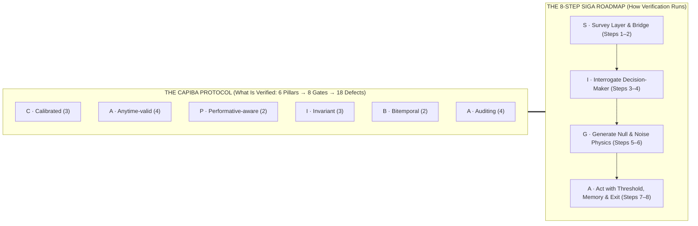

<figure class="stoch-figure stoch-logo-figure">
  <svg xmlns="http://www.w3.org/2000/svg" width="660" height="132" viewBox="0 0 660 132" fill="none" role="img" aria-labelledby="stochology-logo-title">
  <title id="stochology-logo-title">Stochology — Auditable Epistemological Machine (The CAPIBA Protocol)</title>
  <defs>
  <linearGradient id="logo-ring" x1="2" y1="103" x2="468" y2="103" gradientUnits="userSpaceOnUse">
  <stop offset="0%" stop-color="var(--logo-green, #10b981)"/>
  <stop offset="38%" stop-color="var(--logo-blue, #2563eb)"/>
  <stop offset="66%" stop-color="var(--logo-gold, #f59e0b)"/>
  <stop offset="100%" stop-color="var(--logo-crimson, #e11d48)"/>
  </linearGradient>
  <linearGradient id="logo-tail" x1="31" y1="86" x2="92" y2="48" gradientUnits="userSpaceOnUse">
  <stop offset="0%" stop-color="var(--logo-green, #10b981)" stop-opacity="0.32"/>
  <stop offset="42%" stop-color="var(--logo-blue, #2563eb)" stop-opacity="0.34"/>
  <stop offset="68%" stop-color="var(--logo-gold, #f59e0b)" stop-opacity="0.28"/>
  <stop offset="100%" stop-color="var(--logo-crimson, #e11d48)" stop-opacity="0.24"/>
  </linearGradient>
  <radialGradient id="logo-glow" cx="50%" cy="50%" r="50%">
  <stop offset="0%" stop-color="#38bdf8" stop-opacity="0.16"/>
  <stop offset="65%" stop-color="#fbbf24" stop-opacity="0.08"/>
  <stop offset="100%" stop-color="#38bdf8" stop-opacity="0"/>
  </radialGradient>
  </defs>
  <g>
  <circle cx="64" cy="66" r="46" fill="url(#logo-glow)"/>
  <path d="M 23.43 76.87 A 42 42 0 0 1 52.99 25.47" stroke="var(--logo-green, #10b981)" stroke-width="3.2" stroke-linecap="round"/>
  <path d="M 49.02 30.60 L 53.84 25.25 L 46.80 23.75" stroke="var(--logo-green, #10b981)" stroke-width="2.6" stroke-linecap="round" stroke-linejoin="round"/>
  <path d="M 74.87 25.43 A 42 42 0 0 1 104.61 76.73" stroke="var(--logo-blue, #2563eb)" stroke-width="3.2" stroke-linecap="round"/>
  <path d="M 102.15 70.73 L 104.37 77.58 L 109.19 72.23" stroke="var(--logo-blue, #2563eb)" stroke-width="2.6" stroke-linecap="round" stroke-linejoin="round"/>
  <path d="M 93.70 95.70 A 42 42 0 0 1 34.41 95.80" stroke="var(--logo-crimson, #e11d48)" stroke-width="3.2" stroke-linecap="round"/>
  <path d="M 40.83 96.67 L 33.79 95.18 L 36.01 102.02" stroke="var(--logo-crimson, #e11d48)" stroke-width="2.6" stroke-linecap="round" stroke-linejoin="round"/>
  <polygon points="64,24 100.37,87 27.63,87" stroke="#64748b" stroke-width="1.2" stroke-dasharray="3 3" opacity="0.55"/>
  <path d="M 31 85 C 40 85, 45 46, 54 46 C 63 46, 68 74, 96 84 L 96 86 L 31 86 Z" fill="url(#logo-tail)"/>
  <path d="M 31 85 C 40 85, 45 46, 54 46 C 63 46, 68 74, 96 84" stroke="var(--logo-ink)" stroke-width="2.2" stroke-linecap="round"/>
  <line x1="41" y1="66.65" x2="87" y2="66.65" stroke="var(--logo-gold, #f59e0b)" stroke-width="2.2" stroke-dasharray="4 3" stroke-linecap="round"/>
  <line x1="72" y1="39" x2="72" y2="86" stroke="var(--logo-gold, #f59e0b)" stroke-width="2.2" stroke-dasharray="4 3" stroke-linecap="round"/>
  <circle cx="72" cy="66.65" r="3.6" fill="var(--logo-gold, #f59e0b)" stroke="var(--logo-node-bg)" stroke-width="1.4"/>
  <circle cx="64" cy="24" r="7.5" fill="var(--logo-node-bg)" stroke="var(--logo-blue, #2563eb)" stroke-width="3"/>
  <circle cx="64" cy="24" r="3" fill="var(--logo-blue, #2563eb)"/>
  <circle cx="27.63" cy="87" r="7.5" fill="var(--logo-node-bg)" stroke="var(--logo-green, #10b981)" stroke-width="3"/>
  <circle cx="27.63" cy="87" r="3" fill="var(--logo-green, #10b981)"/>
  <circle cx="100.37" cy="87" r="7.5" fill="var(--logo-node-bg)" stroke="var(--logo-crimson, #e11d48)" stroke-width="3"/>
  <circle cx="100.37" cy="87" r="3" fill="var(--logo-crimson, #e11d48)"/>
  </g>
  <g transform="translate(148, 0)">
  <text x="0" y="62" fill="var(--logo-ink)" font-family="system-ui, -apple-system, 'Segoe UI', Roboto, sans-serif" font-size="42" font-weight="800" letter-spacing="2.5">STOCHOLOGY</text>
  <line x1="2" y1="90" x2="468" y2="90" stroke="url(#logo-ring)" stroke-width="1.5" stroke-opacity="0.75"/>
  <text x="2" y="103" fill="var(--logo-meta)" font-family="ui-monospace, 'Cascadia Code', monospace" font-size="11.5" font-weight="600" letter-spacing="0.8">L₁ → L₂ → L₃ → L₁  |  Φ₁–Φ₅  |  G1–G8  |  SEED = 2026</text>
  </g>
</svg>
</figure>

# Preface: The Invisible Target and the Foundations of Stochology

## 1. The Decision Before the Answer

On a Tuesday morning, an emergency-room physician examines a 54-year-old man complaining of chest pain. She has an electrocardiogram, his vital signs, his clinical history, and fifteen minutes. She must choose between admitting him to the coronary care unit or discharging him home. If she admits him and the pain is benign reflux, the hospital spends a scarce intensive-care bed that a critical patient may need an hour later. If she sends him home and he is experiencing an atypical myocardial infarction, the catastrophic cost falls on his life.

**The decision must be taken before the truth is known.**

Almost every consequential human and institutional action shares this condition. A civil defense director must order or withhold a coastal evacuation twenty-four hours before a tropical cyclone makes landfall. A central bank adjusts interest rates before next year's inflation materializes. A call-center operations manager commits shift schedules weeks before customers pick up the phone. An airline dispatcher holds or releases connecting flights before a cold front reaches the runway.

**Stochology** is the science and operational art of judgment and decision-making under uncertainty.

### Where the Name Comes From: *Stókhos* and *Lógos*

In classical Greek, *stókhos* ($\sigma\tau\acute{o}\chi\omicron\varsigma$) names the narrow post or mark at which an archer aims, and by extension a well-aimed conjecture directed at a hidden truth. Combined with *lógos* ($\lambda\acute{o}\gamma\omicron\varsigma$, reasoned discourse and structured method), **Stochology** is the disciplined study of aiming well when the target cannot be seen directly.

Tracing the Greek root also separates the discipline cleanly from near-homophones while illuminating its cybernetic synthesis:
- It is not *eschatology* (from *éskhatos*, the theological study of final things);
- It is not *stomatology* (*Estomatologia*, from Greek *stóma* $\sigma\tau\acute{o}\mu\alpha$, the clinical/dental study of the mouth);
- It is not *tocology* (from *tókos*, obstetrics and childbirth);
- While distinct from passive warehouse bookkeeping, the **Stochastic-Conjectural** lineage (*stókhos*, aiming at a future target under uncertainty) unites with the **Stochary-Accumulative** lineage (*stocks*, *buffers*, and strategic asset accumulation) as the physical and informational memory that sustains non-ergodic survival over time.

In 1713, eight years after Jacob Bernoulli's death, his *Ars Conjectandi* (*The Art of Conjecturing*) was published. In Book IV, Bernoulli coined the Latinized Greek term *ars conjectandi sive stochastice*, the art of measuring the probabilities of things as accurately as possible so that in our judgments and actions we may always choose what is healthier, better, and more grounded in reason. Over the next two centuries, however, textbook usage narrowed the word "stochastic" until it meant only "random" or "noisy." It kept the dice and forgot the archer.

Stochology restores the full loop: **the noisy world that generates the observations, the mathematical model that compresses them, and the responsible agent who must act and answer for the consequences.**

### Dedication and the Name of the Protocol: **The CAPIBA Protocol**

While **Stochology** names the scientific discipline, the operational and auditing architecture formalized in this treatise is named the **CAPIBA Protocol** (*Calibrated, Anytime-valid, Performative-aware, Invariant, Bitemporal Auditing Protocol*):
- **CAPIBA** defines the **six mnemonic pillars** of what is audited across the eight epistemological gates (`G1`–`G8`) and their nineteen negative defect proofs (`--defect`);
- **SIGA** (*Survey, Interrogate, Generate, Act*) defines the **eight-step operational roadmap** of how a decision-maker and auditor traverse the cycle from raw observation to action.

The name **CAPIBA** is a tribute to **Lourenço da Fonseca Barbosa (Capiba)** (Surubim, Pernambuco, 28 October 1904 – Recife, Pernambuco, 31 December 1997). Across a century of Brazilian intellectual and musical life, Capiba practiced two crafts that rarely meet in the same person: by day, a career official at the *Banco do Brasil* (admitted by public competitive examination in 1930), working amid ledgers, clearing balances, and institutional risk; by night and by vocation, the master of Pernambucan *frevo* and a central composer of Ariano Suassuna's *Movimento Armorial*. In the physics of the street carnival of Recife, *frevo* (from *ferver*, to boil, a turbulent, non-equilibrium brass polyphony) lives on the edge of kinetic instability, and the *passista* dances across that turbulence without falling by wielding the *sombrinha* (umbrella) as a dynamic pendulum counterweight. Ledgers and syncopation, rigorous accounting and high-volatility equilibrium: that pairing captures the spirit of this treatise.

### The Six Mnemonic Pillars of the CAPIBA Protocol and the 18 Disjoint Defect Proofs

To give students and auditors an immediate mental map of the entire treatise, the **CAPIBA Protocol** partitions every epistemological check across **six orthogonal pillars (`C-A-P-I-B-A`)**. Together, these six pillars partition all **19 negative defect proofs** (`3 + 4 + 2 + 3 + 2 + 5 = 19`) enforced by the `gates` binary:

| Pillar | Verification Axis | Primary Mathematical & Rust Primitives | Gates | Disjoint Negative Defect Proofs (`--defect`) |
| :---: | --- | --- | :---: | --- |
| **C** — **Calibrated** | Out-of-sample probabilistic honesty and non-dogmatic bounds | Isotonic PAV `CorpPavDecomposition`, `MurphyDiagram` ($\int_0^1 \bar{S}_\theta d\theta = \frac{1}{2}\mathrm{BS}$), `CorpRocMurphyTriptych`, and Cromwell's Rule $p \in [\varepsilon, 1-\varepsilon]$ | `G6` | `cromwell`, `brier_dominance`, `concept_drift` (3) |
| **A** — **Anytime-valid** | Sequential evidence under optional stopping and cluster/resolution parity | Betting martingales `EvidenceProcess` (`aGRAPA`/`GRO`), `SaviConfidenceSequence`, `VarEsEBacktest` (`GREE`), Moulton-Campbell `ExceedanceDesignEffect`, and $\Phi_5$ `verify_resolution_phi5` | `G2/G3/G6` | `moulton`, `peeking`, `var_underreport`, `phi5` (4) |
| **P** — **Performative-aware** | Endogenous feedback loops $L_3 \to L_1$, Goodhart collapse, and synthetic recursion | `PerformativeSystem` ($\theta_{\mathrm{PS}}$ vs. Stackelberg $\theta_{\mathrm{PO}}$, `PerfGD`, $r_{\mathrm{RRM}} = \frac{\varepsilon\beta}{\gamma} < 1$), `GoodhartTaxonomyAudit`, and `GerstgrasserAccumulateAudit` ($\le c\pi^2/6$) | `G6/G8` | `performativity`, `replace_collapse` (2) |
| **I** — **Invariant** | Structural stability across regimes, missingness bounds, and severe uncertainty | `MengAudit` (`ddc`/`DDI`), `ManskiBounds` + Lee (2009) trimming & tipping point $\Delta^*$, Hermite `run_nonlinear_icp_nile`, `KennedyOHaganDiscrepancy`, `InfoGapOption` + Sniedovich Wald floor, and `AuthenticModelForm` | `G3/G6/G8` | `lee_point_estimate`, `sniedovich`, `machine` (3) |
| **B** — **Bitemporal** | Causality of event vs. availability clocks and cryptographic holdout seals | `BitemporalRecord` ($t_{\text{disp}} \ge t_{\text{ev}}$), synthetic canary $I(\text{Canary}; Y)=0$, single-opening `HMAC-SHA256` `TemporalVault`, `PredeterminedChangeControlPlan`, and `ProfitLossAttributionTest` | `G7` | `clock`, `vault` (2) |
| **A** — **Auditing** | Eliminatory funnel, fairness trilemmas, analog/wave physics, cybernetics, and triadic synthesis | 4-Filter Funnel, `ChouldechovaAudit`, `AlertFatigueAudit`, `AnalogWaveComputingSynthesis` (`HP-INV`), `CriticalStochasticRationalitySynthesis`, `StocharyConjecturalCyberneticSynthesis`, and `ComplexFractalToroidalTechniumSynthesis` | `G4/G8` | `chouldechova`, `analog_wall`, `instrumental_reason`, `stochary_cybernetics`, `triadic_technium` (5) |

---

## 2. The Three Traditions Joined Together

Traditional courses in statistics, econometrics, and machine learning often produce fragile systems in production because they teach isolated parameter-fitting techniques inside a mathematical vacuum. A student learns how to minimize mean squared error or cross-entropy on a clean table of numbers ($X, Y$), without asking how that table was filtered out of physical reality or how deploying the fitted formula will deform the reality it measures.

To close that gap, Stochology brings together three intellectual traditions that grew up in separate university departments and rarely audit one another:

<figure class="stoch-figure">
  <svg xmlns="http://www.w3.org/2000/svg" width="1120" height="410" viewBox="0 0 1120 410" fill="none" role="img" aria-labelledby="title-fig-00-traditions">
  <title id="title-fig-00-traditions">The Three Intellectual Traditions Joined in the Stochology Protocol</title>
  <defs>
  <marker id="arr-sky" viewBox="0 0 10 10" refX="8" refY="5" markerWidth="7" markerHeight="7" orient="auto">
  <path d="M 0 1 L 9 5 L 0 9 z" fill="var(--sky)"/>
  </marker>
  <marker id="arr-violet" viewBox="0 0 10 10" refX="8" refY="5" markerWidth="7" markerHeight="7" orient="auto">
  <path d="M 0 1 L 9 5 L 0 9 z" fill="var(--violet)"/>
  </marker>
  <marker id="arr-emerald" viewBox="0 0 10 10" refX="8" refY="5" markerWidth="7" markerHeight="7" orient="auto">
  <path d="M 0 1 L 9 5 L 0 9 z" fill="var(--emerald)"/>
  </marker>
  
  </defs>
  <rect x="1" y="1" width="1118" height="408" rx="14" fill="var(--canvas)" stroke="var(--border)" stroke-width="1.5"/>
  <rect x="240" y="18" width="640" height="104" rx="12" fill="var(--elevated)" stroke="var(--sky)" stroke-width="2.2"/>
  <text x="560" y="50" text-anchor="middle" fill="var(--sky)" class="mono" font-size="11.5" font-weight="700" letter-spacing="0.06em">TRADITION 1 · EPISTEMOLOGY OF SCIENCE</text>
  <text x="560" y="78" text-anchor="middle" fill="var(--ink)" font-size="15.5" font-weight="800">Philosophy of Induction &amp; Severe Refutation</text>
  <text x="560" y="103" text-anchor="middle" fill="var(--muted)" font-size="12.5">Hume · Peirce · Popper · Duhem-Quine · Lakatos · Mayo</text>
  <line x1="560" y1="122" x2="560" y2="150" stroke="var(--sky)" stroke-width="2.6" marker-end="url(#arr-sky)"/>
  <rect x="230" y="158" width="660" height="102" rx="14" fill="var(--surface)" stroke="var(--border)" stroke-width="2"/>
  <text x="560" y="188" text-anchor="middle" fill="var(--ink)" class="mono" font-size="13" font-weight="800" letter-spacing="0.08em">STOCHOLOGY PROTOCOL · CLOSED LOOP</text>
  <rect x="265" y="202" width="170" height="42" rx="8" fill="var(--sky-bg)" stroke="var(--sky)" stroke-width="1.6"/>
  <text x="350" y="228" text-anchor="middle" fill="var(--ink)" font-size="13" font-weight="750">World (L₁)</text>
  <text x="455" y="228" text-anchor="middle" fill="var(--muted)" font-size="15" font-weight="700">↔</text>
  <rect x="475" y="202" width="170" height="42" rx="8" fill="var(--violet-bg)" stroke="var(--violet)" stroke-width="1.6"/>
  <text x="560" y="228" text-anchor="middle" fill="var(--ink)" font-size="13" font-weight="750">Model (L₂)</text>
  <text x="665" y="228" text-anchor="middle" fill="var(--muted)" font-size="15" font-weight="700">↔</text>
  <rect x="685" y="202" width="170" height="42" rx="8" fill="var(--emerald-bg)" stroke="var(--emerald)" stroke-width="1.6"/>
  <text x="770" y="228" text-anchor="middle" fill="var(--ink)" font-size="13" font-weight="750">Agent (L₃)</text>
  <rect x="24" y="290" width="524" height="100" rx="12" fill="var(--elevated)" stroke="var(--violet)" stroke-width="2.2"/>
  <text x="286" y="320" text-anchor="middle" fill="var(--violet)" class="mono" font-size="11.5" font-weight="700" letter-spacing="0.06em">TRADITION 2 · CALCULUS OF PLAUSIBILITY</text>
  <text x="286" y="348" text-anchor="middle" fill="var(--ink)" font-size="15" font-weight="800">Probability Theory &amp; Statistical Inference</text>
  <text x="286" y="373" text-anchor="middle" fill="var(--muted)" font-size="12">Bernoulli · Bayes · Laplace · Ramsey · Neyman · Manski</text>
  <rect x="572" y="290" width="524" height="100" rx="12" fill="var(--elevated)" stroke="var(--emerald)" stroke-width="2.2"/>
  <text x="834" y="320" text-anchor="middle" fill="var(--emerald)" class="mono" font-size="11.5" font-weight="700" letter-spacing="0.06em">TRADITION 3 · DYNAMICS &amp; ERGODICITY</text>
  <text x="834" y="348" text-anchor="middle" fill="var(--ink)" font-size="15" font-weight="800">Stochastic Processes &amp; Non-Equilibrium Time</text>
  <text x="834" y="373" text-anchor="middle" fill="var(--muted)" font-size="12">Markov · Langevin · Itô · Kelly · Prigogine · Peters</text>
  <path d="M 340 290 L 400 264" stroke="var(--violet)" stroke-width="2.6" marker-end="url(#arr-violet)"/>
  <path d="M 780 290 L 720 264" stroke="var(--emerald)" stroke-width="2.6" marker-end="url(#arr-emerald)"/>
</svg>
  <figcaption><strong>Figure 0.1 — The Three Intellectual Traditions Joined in the Stochology Protocol</strong></figcaption>
</figure>

1. **The Philosophy of Induction and Severe Refutation:** David Hume demonstrated that no finite collection of past observations logically proves that tomorrow will resemble yesterday. The sun having risen ten thousand mornings does not deductively entail that it will rise tomorrow; every defense of induction assumes the uniformity of nature it tries to prove. Karl Popper answered that empirical science advances by exposing bold claims to **refutation** (*falsification*) rather than accumulating confirming anecdotes. A million white swans do not prove the universal claim "all swans are white," whereas a single black swan refutes it.
2. **Probability Theory and Statistical Inference:** Blaise Pascal, Pierre de Fermat, Jacob Bernoulli, Thomas Bayes, Pierre-Simon Laplace, and Andrey Kolmogorov built the mathematical calculus of plausibility and relative frequency. Frank Ramsey, Bruno de Finetti, Jerzy Neyman, Egon Pearson, and Ronald Fisher turned that calculus into rules for updating beliefs, bounding estimation error, and testing hypotheses under finite samples.
3. **Stochastic Processes, Non-Equilibrium Dynamics, and Time:** Andrey Markov, Paul Langevin, Kiyosi Itô, and Ilya Prigogine studied how randomness unfolds sequentially across time. A single coin toss is memoryless; a sequence of compounded gains and losses is path-dependent. As we will see in Chapters 5 and 6, averaging across a million parallel gamblers at a single instant (*ensemble average*) gives a completely different answer from following a single gambler through a million consecutive bets (*time average*).

### How to Repair a Theory Honestly: Duhem, Quine, and Lakatos

In real life, when a model's prediction fails in production, nobody immediately throws away the entire discipline. Pierre Duhem and Willard Van Orman Quine pointed out a basic logical constraint: **an empirical failure never refutes an isolated hypothesis alone.** A prediction is derived from a core theory *jointly* with a bundle of auxiliary assumptions (that the sensors were calibrated, that there was no selection bias, that the environment stayed stationary). When observation contradicts prediction, logic tells us only that *something* in the bundle is broken.

Because you can always save a pet theory by blaming an auxiliary assumption, Imre Lakatos divided scientific adjustments into two categories:

- **A Progressive Repair** adjusts the model in a way that *predicts a brand-new, previously unseen fact* that can itself be tested and refuted. In the 1840s, the observed orbit of Uranus deviated persistently from Newton's laws of gravitation. Urbain Le Verrier did not abandon Newton, nor did he invent an untestable excuse. He hypothesized an unseen outer planet perturbing Uranus, calculated its exact coordinates in the night sky, and in 1846 Johann Galle pointed his telescope there and discovered **Neptune**.
- **A Degenerative Repair** modifies the model *only after the fact* to patch the broken prediction, generating zero new testable consequences. When a financial forecasting model crashes in a crisis and its authors add an *ad hoc* dummy variable for that specific month, or blame "unforeseen market sentiment," they are performing a degenerative rescue.

History adds an important qualification. In 1859, Le Verrier tried the same approach to explain the anomalous precession of Mercury's perihelion, postulating an inner planet named **Vulcan**. Vulcan was not a dishonest excuse: it made concrete predictions about solar transits that astronomers actively searched for and failed to find. Only in 1915 did Albert Einstein's General Relativity resolve Mercury's orbit by replacing the core theory itself.

The lesson for Stochology is operational: **every time a model is recalibrated, re-specified, or patched after an error, the protocol must record the attempt counter ($K \ge 1$) and demand an out-of-sample or out-of-time test that the repair could genuinely fail.**

---

## 3. Foundations: Probability Without Mystery

Before we examine complex models, we must be clear about the elementary building blocks of uncertainty: **probability**, **coherence**, **natural frequencies**, and **Bayes' theorem**.

### Five Meanings Wearing the Same Number

Suppose a meteorologist says: *"There is a 70% probability of rain tomorrow."* Depending on who speaks and how it was computed, that single number $0.70$ can carry five distinct meanings:

| Interpretation | Founders | What "70%" Means | Primary Ontological Layer |
| --- | --- | --- | --- |
| **1. Classical** | Cardano, Laplace | Out of $10$ symmetric, equally possible configurations of the model, $7$ produce rain. | **Model ($L\_2$)** |
| **2. Frequentist** | Venn, von Mises, Fisher | In a long historical sequence of days with identical atmospheric conditions, it rained on $70\%$ of them. | **World ($L\_1$)** |
| **3. Propensity** | Peirce, Popper | The current physical state of the atmosphere has an objective physical disposition of strength $0.70$ to generate rain. | **World ($L\_1$)** |
| **4. Logical / Evidential** | Keynes, Jeffreys, Carnap | Given the formal propositions in our evidence database, the rational degree of logical entailment for rain is $0.70$. | **Model ($L\_2$)** |
| **5. Subjective / Personalist** | Ramsey, de Finetti, Savage | The decision-maker is willing to buy or sell a contract paying USD 1.00 if it rains for a fair price of USD 0.70. | **Agent ($L\_3$)** |

Stochology does not force a philosophical war among these five interpretations. Instead, **it types every probability by the layer from which it came.** Many costly errors in courtrooms, hospitals, and trading desks happen when a number computed as a symmetry of a *Model* ($L\_2$) or a subjective hunch of an *Agent* ($L\_3$) is treated as a verified physical frequency of the *World* ($L\_1$).

### Coherence and the Dutch Book

Degrees of belief must obey the mathematical axioms of probability, namely that probabilities lie between $0$ and $1$, that mutually exclusive events add up ($P(A \cup B) = P(A) + P(B)$), and that totality sums to $1$.

Frank Ramsey (1926) and Bruno de Finetti (1937) gave a concrete operational reason for these rules: **to avoid a Dutch Book**, a combination of bets that guarantees a sure loss no matter what happens in the real world.

Imagine a friend who believes there is a $60\%$ chance it will rain tomorrow and a $50\%$ chance it will not rain. He is willing to buy a ticket that pays USD 1.00 if it rains for USD 0.60, and a second ticket that pays USD 1.00 if it does not rain for USD 0.50. You sell him both tickets and collect $USD 0.60 + USD 0.50 = USD 1.10$ upfront. Tomorrow, either it rains or it does not rain. In either case, exactly one of the two tickets wins, so you pay him back USD 1.00. Your friend has lost USD 0.10 with $100\%$ certainty before looking out the window.

Yet Stochology emphasizes an asymmetry that elementary textbooks often miss: **internal coherence is cheap; external calibration against the World is expensive.** If your friend revises his beliefs to $60\%$ rain and $40\%$ no rain, no bookmaker can Dutch-book him in a single round because $0.60 + 0.40 = 1.00$. He is now internally coherent. But if he lives in a desert where it actually rains on only $5\%$ of days, anyone who knows the World ($L\_1$) will bankrupt him over time. Coherence only polices the Agent ($L\_3$); **calibration** polices the bridge between the Agent and the World.

### Natural Frequencies vs. Percentages: Why Intuition Fails and How Trees Fix It

Consider a classic clinical screening problem investigated by Gerd Gigerenzer and Ulrich Hoffrage (1995):
- In a routine screening population, the prevalence of a condition is $1\%$.
- If a patient has the condition, the diagnostic test is positive $90\%$ of the time (*sensitivity* $= 0.90$).
- If a patient is healthy, the test still triggers a false alarm $9\%$ of the time (*false-positive rate* $= 0.09$, or *specificity* $= 0.91$).

A patient receives a positive test result. What is the probability that she actually has the condition?

When asked in percentages, most physicians and analysts guess "around $80\%$ or $90\%$," confusing the accuracy of the test given the disease, $P(\text{Positive} \mid \text{Disease}) = 0.90$, with the probability of the disease given the test, $P(\text{Disease} \mid \text{Positive})$.

The confusion disappears when we replace abstract percentages with **Gigerenzer Natural Frequencies**, counting whole people in a concrete cohort of $10\text{,}000$ patients:

<figure class="stoch-figure">
  <svg xmlns="http://www.w3.org/2000/svg" width="1080" height="410" viewBox="0 0 1080 410" fill="none" role="img" aria-labelledby="title-fig-00-gigerenzer">
  <title id="title-fig-00-gigerenzer">Gigerenzer Natural-Frequency Tree: 10,000 Patients Screened</title>
  <defs>
  <marker id="g-sky" viewBox="0 0 10 10" refX="8" refY="5" markerWidth="6.5" markerHeight="6.5" orient="auto">
  <path d="M 0 1 L 9 5 L 0 9 z" fill="var(--sky)"/>
  </marker>
  <marker id="g-amber" viewBox="0 0 10 10" refX="8" refY="5" markerWidth="6.5" markerHeight="6.5" orient="auto">
  <path d="M 0 1 L 9 5 L 0 9 z" fill="var(--amber)"/>
  </marker>
  <marker id="g-emerald" viewBox="0 0 10 10" refX="8" refY="5" markerWidth="6.5" markerHeight="6.5" orient="auto">
  <path d="M 0 1 L 9 5 L 0 9 z" fill="var(--emerald)"/>
  </marker>
  
  </defs>
  <rect x="1" y="1" width="1078" height="408" rx="14" fill="var(--canvas)" stroke="var(--border)" stroke-width="1.5"/>
  <rect x="330" y="18" width="420" height="68" rx="10" fill="var(--elevated)" stroke="var(--sky)" stroke-width="2.2"/>
  <text x="540" y="48" text-anchor="middle" fill="var(--ink)" font-size="15.5" font-weight="800">10,000 Patients Screened</text>
  <text x="540" y="70" text-anchor="middle" fill="var(--muted)" class="mono" font-size="11.5">Representative Clinical Cohort (L₁)</text>
  <line x1="450" y1="86" x2="285" y2="124" stroke="var(--amber)" stroke-width="2.2" marker-end="url(#g-amber)"/>
  <line x1="630" y1="86" x2="795" y2="124" stroke="var(--emerald)" stroke-width="2.2" marker-end="url(#g-emerald)"/>
  <rect x="105" y="128" width="340" height="68" rx="10" fill="var(--amber-bg)" stroke="var(--amber)" stroke-width="2"/>
  <text x="275" y="157" text-anchor="middle" fill="var(--ink)" font-size="15" font-weight="800">100 With Disease</text>
  <text x="275" y="179" text-anchor="middle" fill="var(--amber)" class="mono" font-size="11.5" font-weight="700">Prevalence = 1.0%</text>
  <rect x="635" y="128" width="340" height="68" rx="10" fill="var(--emerald-bg)" stroke="var(--emerald)" stroke-width="2"/>
  <text x="805" y="157" text-anchor="middle" fill="var(--ink)" font-size="15" font-weight="800">9,900 Healthy</text>
  <text x="805" y="179" text-anchor="middle" fill="var(--emerald)" class="mono" font-size="11.5" font-weight="700">Complement = 99.0%</text>
  <line x1="215" y1="196" x2="145" y2="232" stroke="var(--amber)" stroke-width="2" marker-end="url(#g-amber)"/>
  <line x1="335" y1="196" x2="405" y2="232" stroke="var(--amber)" stroke-width="2" marker-end="url(#g-amber)"/>
  <line x1="745" y1="196" x2="675" y2="232" stroke="var(--emerald)" stroke-width="2" marker-end="url(#g-emerald)"/>
  <line x1="865" y1="196" x2="935" y2="232" stroke="var(--emerald)" stroke-width="2" marker-end="url(#g-emerald)"/>
  <rect x="20" y="236" width="244" height="72" rx="10" fill="var(--surface)" stroke="var(--amber)" stroke-width="2.2"/>
  <text x="142" y="267" text-anchor="middle" fill="var(--ink)" font-size="14.5" font-weight="800">90 Test (+)</text>
  <text x="142" y="290" text-anchor="middle" fill="var(--amber)" class="mono" font-size="11.5" font-weight="700">True Alarms (Sens 90%)</text>
  <rect x="284" y="236" width="244" height="72" rx="10" fill="var(--elevated)" stroke="var(--border)" stroke-width="1.6"/>
  <text x="406" y="267" text-anchor="middle" fill="var(--ink)" font-size="14.5" font-weight="700">10 Test (-)</text>
  <text x="406" y="290" text-anchor="middle" fill="var(--muted)" class="mono" font-size="11.5">Missed Cases (10%)</text>
  <rect x="552" y="236" width="244" height="72" rx="10" fill="var(--surface)" stroke="var(--rose)" stroke-width="2.2"/>
  <text x="674" y="267" text-anchor="middle" fill="var(--ink)" font-size="14.5" font-weight="800">891 Test (+)</text>
  <text x="674" y="290" text-anchor="middle" fill="var(--rose)" class="mono" font-size="11.5" font-weight="700">False Alarms (FPR 9%)</text>
  <rect x="816" y="236" width="244" height="72" rx="10" fill="var(--elevated)" stroke="var(--border)" stroke-width="1.6"/>
  <text x="938" y="267" text-anchor="middle" fill="var(--ink)" font-size="14.5" font-weight="700">9,009 Test (-)</text>
  <text x="938" y="290" text-anchor="middle" fill="var(--muted)" class="mono" font-size="11.5">Clear (Spec 91%)</text>
  <path d="M 142 308 C 142 338, 250 350, 310 354" stroke="var(--sky)" stroke-width="2.2" marker-end="url(#g-sky)"/>
  <path d="M 674 308 C 674 334, 620 344, 585 348" stroke="var(--sky)" stroke-width="2.2" marker-end="url(#g-sky)"/>
  <rect x="190" y="326" width="700" height="64" rx="10" fill="var(--sky-bg)" stroke="var(--sky)" stroke-width="2"/>
  <text x="540" y="354" text-anchor="middle" fill="var(--ink)" font-size="13.5" font-weight="800">Total Positive Alarms: 90 + 891 = 981 Patients</text>
  <text x="540" y="376" text-anchor="middle" fill="var(--sky)" class="mono" font-size="12" font-weight="700">Posterior P(Disease | +) = 90 / 981 ≈ 9.17% (about 1 in 11)</text>
</svg>
  <figcaption><strong>Figure 0.2 — Gigerenzer Natural-Frequency Tree: 10,000 Patients Screened</strong></figcaption>
</figure>

Two groups of patients received a positive test result:
- $90$ sick patients tested positive;
- $891$ healthy patients also tested positive ($9\%$ of $9\text{,}900$).
- In total, $90 + 891 = 981$ patients hold a positive test slip in their hands.

The fraction of those $981$ positive alarms who actually have the disease is:

$$P(\text{Disease} \mid \text{Positive}) = \frac{90}{90 + 891} = \frac{90}{981} \approx 0.0917 \quad (\text{about } 1 \text{ in } 11)$$

The percentage formula and the natural-frequency tree are mathematically identical, yet the natural-frequency tree makes the **base rate** ($100$ vs. $9\text{,}900$) visually inescapable. That is why Step 8 of the Stochology SIGA Roadmap (`crates/stochology-siga/src/roadmap.rs`) translates every operational model into an integer natural-frequency tree before presenting it to a human decision-maker.

### Bayes' Rule in Odds and Turing's Decibans

When we want to update beliefs across multiple pieces of evidence, the cleanest formulation of **Bayes' Theorem** is written in **odds** (the ratio of the probability that a hypothesis $H$ is true to the probability that it is false, $\neg H$):

$$\underbrace{\frac{P(H \mid E)}{P(\neg H \mid E)}}\_{\text{Posterior Odds}} = \underbrace{\frac{P(E \mid H)}{P(E \mid \neg H)}}\_{\text{Likelihood Ratio } (\mathrm{LR})} \times \underbrace{\frac{P(H)}{P(\neg H)}}\_{\text{Prior Odds}}$$

In our screening example:
- The **Prior Odds** are $\frac{100}{9900} = \frac{1}{99}$.
- The **Likelihood Ratio** of a positive test is $\mathrm{LR} = \frac{\text{Sensitivity}}{\text{False-Positive Rate}} = \frac{0.90}{0.09} = 10$.
- Multiplying them gives the **Posterior Odds**: $10 \times \frac{1}{99} = \frac{10}{99}$ (which is $10$ sick patients for every $99$ healthy patients, or $\frac{10}{10 + 99} = \frac{10}{109} \approx 0.0917$).

During World War II at Bletchley Park, Alan Turing and I. J. Good took one step further. By taking ten times the base-$10$ logarithm of the likelihood ratio, they defined the **deciban ($\mathrm{dB}$)** as the unit of weight of evidence:

$$W(E) \triangleq 10 \log\_{10}\left(\frac{P(E \mid H)}{P(E \mid \neg H)}\right) \text{ decibans}$$

The deciban is useful for students and auditors because logarithms turn multiplication into addition:
- A likelihood ratio of $10:1$ adds $+10\text{ dB}$ of evidence.
- A likelihood ratio of $100:1$ adds $+20\text{ dB}$ of evidence.
- Starting from prior odds of $1:99$ ($\approx -19.96\text{ dB}$), a $+10\text{ dB}$ positive test brings us to $-9.96\text{ dB}$ (still roughly $1:10$ against).

Turing's scale also exposes the trap of **redundant evidence**. Two positive tests are worth $+10\text{ dB} + 10\text{ dB} = +20\text{ dB}$ *only if the two tests are conditionally independent given the patient's state*. If two diagnostic tests fail for the same physical reason (for instance, dense tissue triggering the same imaging artifact twice), the second test carries far less than $+10\text{ dB}$ of fresh information. Confusing correlated repetitions with independent evidence is the root of **pseudoreplication**, which we formalize via Intra-Class Correlation (Chapter 14) and the Moulton-Campbell design effect ($\Phi\_2$) in Chapter 16.

---

## 4. Reproducible Chance: Why a Fixed Seed (`seed = 2026`) Matters

Every stochastic simulation, bootstrap interval, and Monte Carlo integral in this textbook relies on random draws. Yet if a student in São Paulo, an auditor in Zurich, and a continuous-integration server on GitHub run the same verification script and obtain three slightly different numbers, auditing breaks down. Any bug can hide behind the excuse: *"It gave a slightly different number because of random sampling."*

Stochology eliminates this ambiguity through **reproducible chance**. Computers generate sequences that behave statistically like random noise by applying a deterministic mathematical recurrence to an initial integer called the **seed**.

To see how a deterministic rule produces an irregular-looking sequence, consider a toy linear congruential generator: *"Multiply the current number by $5$, add $3$, and keep the remainder after dividing by $16$"* ($x\_{t+1} = (5x\_t + 3) \bmod 16$), starting from seed $x\_0 = 7$:

| Step ($t$) | Deterministic Arithmetic | Remainder ($\bmod 16$) | Uniform Fraction ($x\_t / 16$) |
| --- | --- | --- | --- |
| $1$ | $5 \times 7 + 3 = 38 = 2 \times 16 + 6$ | $6$ | $0.3750$ |
| $2$ | $5 \times 6 + 3 = 33 = 2 \times 16 + 1$ | $1$ | $0.0625$ |
| $3$ | $5 \times 1 + 3 = 8 = 0 \times 16 + 8$ | $8$ | $0.5000$ |
| $4$ | $5 \times 8 + 3 = 43 = 2 \times 16 + 11$ | $11$ | $0.6875$ |

Anyone in the world who starts from $x\_0 = 7$ will obtain the exact sequence $6, 1, 8, 11$. In this repository (`crates/stochology-core/src/rng.rs`), we use Sebastiano Vigna's 64-bit **`SplitMix64`** generator anchored at **`seed = 2026`** (Invariant $\Phi\_1$). When a Monte Carlo simulation or multi-agent tree branches into parallel fork-join tasks, calling `SplitMix64::split(stream_id)` or `split_fork_join_pair(branch_tag)` derives statistically independent, lock-free child substreams by hashing the parent state and `stream_id` through Stafford's `Mix13` avalanche finalizer and deriving an odd Weyl additive increment $\gamma = \mathrm{mix64}(\text{stream\_id}) \mid 1$ (Steele, Lea & Flood 2014; Steele & Vigna 2021 LXM, verified in `MonteCarloSplitTreeAudit`).

However, you must keep three concepts separate:
1. **Reproducibility:** Running the same code on the same dataset with `seed = 2026` produces the exact same floating-point output on every machine. The fixed seed guarantees this floor.
2. **Replicability:** Collecting a *new* dataset in a *new* hospital, city, or year and observing that the scientific conclusion still holds. No random seed can buy replicability; only invariant causal structure (Chapters 5–6) and out-of-time/out-of-domain governance (Chapter 19) can test it.
3. **Validity:** Whether the mathematical equation in the code actually measures what the claim says it measures. A fixed seed reproduces a wrong formula just as faithfully as a right one. For that reason, our protocol combines fixed-seed reproducibility with **algebraic identity closure**, **multi-seed acceptance over 20 pre-declared seeds**, and **19 negative defect proofs** (Chapter 23).

---

## 5. The Three Structural Questions and the Four Prohibitions

Before fitting any parameter, training any neural network, or estimating any probability distribution, every technical claim in the Stochology Protocol must auditably answer **three structural questions**:

1. **In which ontological layer can the system fail:** the physical **World ($L\_1$)**, the mathematical **Model ($L\_2$)**, or the deciding **Agent ($L\_3$)**?
2. **Which class of uncertainty threatens inference validity:** **Aleatory** noise ($L\_1$), **Parametric Epistemic** ignorance ($L\_2$), **Structural Epistemic** misspecification ($L\_2$), or **Knightian** deep uncertainty ($L\_3$)?
3. **Which severe test,** with genuine empirical or logical refutation power, supports the confidence placed in the claim?

To enforce these three questions in code, the protocol establishes **Four Golden Prohibitions** (developed in full in Chapter 15):
- **Prohibition 1 (No Free Prose Between Agents):** Inter-module and inter-agent claims never travel as ambiguous natural-language paragraphs; they transit exclusively through structured **Epistemological Cards** (`cards/*.yaml`) validated by `EpistemologicalCard::audit()`.
- **Prohibition 2 (No Lone Mean):** Under nonlinear payoffs, multiplicative dynamics, or heavy tails, reporting only the mean $\mathbb{E}[X]$ or $f(\mathbb{E}[X])$ is forbidden.
- **Prohibition 3 (No Confusing Fit with Performative Validity):** Low predictive error on a passive holdout set never proves that deploying the model will not deform the environment ($L\_3 \to L\_1$).
- **Prohibition 4 (No Dogmatic Extremes and No Omitted Attempts):** Probabilities of $0\%$ and $100\%$ are banned (Cromwell's Rule), out-of-sample forecasts must be audited via the isotonic **CORP-Murphy** decomposition, and the counter of attempted specifications $K \ge 1$ must be declared.

---

## 6. End-to-End Algorithmic Verification

Every mathematical identity, statistical estimator, and epistemological invariant in this treatise is implemented in pure Rust (with zero external dependencies) and anchored to thirteen empirical datasets (`data/*.csv`) and four canonical Epistemological Cards (`cards/*.yaml`).

At any moment, a single command in the terminal executes the complete verification suite across the entire repository:

~~~bash
scripts/verify.sh
~~~

This command checks code formatting (`cargo fmt`), enforces zero compiler or linter warnings (`cargo clippy -- -D warnings`), executes all unit and integration tests (`cargo test`), runs all seven methodological and empirical laboratories (`labs --all`), verifies that the eight epistemological gates approve the canonical system (`gates` exiting with `0`), and proves that all nineteen injected methodological defects are caught and blocked (`gates -- --defect <name>` exiting with `1`).

---

## 7. Interactive Experimentation in `/lab`

Reading equations on a static page is never enough to build physical intuition for tail risk, variance drain, or performative feedback. Every chapter of this textbook is coupled to an **Interactive Laboratory Widget** synchronized with **[`/lab`](./lab/index.html?seed=2026)**:

- **In-Page Deterministic Simulation (`seed = 2026`):** Move the parameter sliders directly inside any chapter to watch the mathematical curves, natural-frequency trees, and epistemological gates update in real time.
- **Deep-Link State Sharing (`Open in /lab ↗`):** Every slider adjustment updates the deep-link query string (`/lab/?module=<id>&seed=2026&...`), allowing instructors and auditors to share exact reproducible configurations on GitHub Pages.
- **Embedded Sandbox & CLI Parity (`Sandbox (/lab/embed)` & `Copy CLI Audit`):** Toggle the embedded sandbox frame from `/lab/embed/` or copy the exact `cargo run --release --bin ...` command to verify the same numbers in the pure-Rust terminal suite.

Try the interactive Gigerenzer Natural-Frequency & Turing Deciban Laboratory below:

