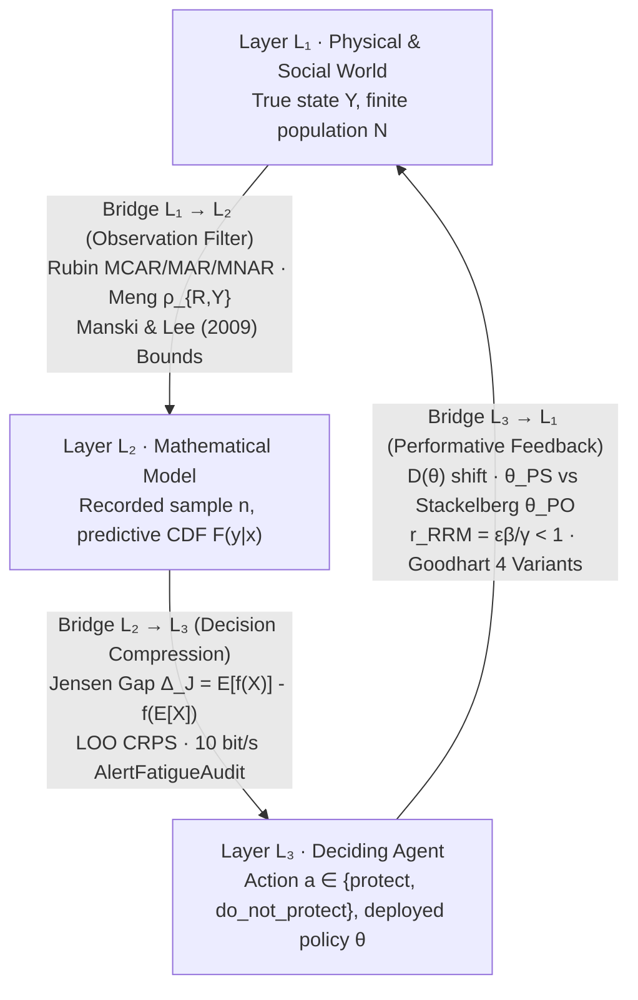

# 1. Three Layers, Six Pairs

## The Territory, the Map, and the Driver

Imagine driving through an unfamiliar city during a heavy rainstorm. Three distinct realities are operating at the same time:
1. **The Territory (The World, $L\_1$):** The physical streets of asphalt and concrete, the flooded underpass, the delivery truck double-parked around a blind corner, and the thousands of other drivers reacting to the storm. You never see the entire city at once.
2. **The Map (The Model, $L\_2$):** A simplified representation on your dashboard screen. By design, the map omits almost everything in the physical city (the texture of the pavement, the color of the buildings, the mood of the pedestrians) so that it can fit on a screen and compute routes quickly. Yet the map is always incomplete and potentially out of date.
3. **The Driver (The Agent, $L\_3$):** You, with limited time, finite attention, a specific destination, and an asymmetric cost function (arriving ten minutes late to dinner is a minor annoyance; driving into a flooded underpass is catastrophic).

This structural separation defines **the Bridge Thesis**:

> **Most analytical failures in science, engineering, finance, and public policy occur on the three bridges connecting the Territory ($L\_1$), the Map ($L\_2$), and the Driver ($L\_3$), rather than inside the arithmetic of the Map ($L\_2$).**

Consider, as a thought experiment, how all three bridge failures could occur in a single institution: **a hypothetical municipal health clinic** (every figure in the three bullets below, including the $92\%$ satisfaction and the $18$-minute recorded wait, is invented for illustration and computed from no dataset).

- **Failure on Bridge $L\_1 \to L\_2$ (The Invisible Filter):** The clinic director wants to know how satisfied patients are with waiting times. She places a tablet survey at the exit of the consultation room. The spreadsheet ($L\_2$) reports an average satisfaction of $92\%$. The arithmetic is flawless, but the data arrived **filtered**: the patients who waited three hours in the lobby and walked out in frustration never entered the consultation room and never touched the tablet.
- **Failure on Bridge $L\_2 \to L\_3$ (The Misread Summary):** The clinic can serve $\mu = 12$ patients per hour. Looking at the annual ledger, the manager observes that an average of $\bar{\lambda} = 8$ patients arrive per hour. Plugging $\lambda = 8$ and $\mu = 12$ into the standard queueing formula gives a comfortable average wait of $10$ minutes. The manager ($L\_3$) concludes there is plenty of slack and refuses to hire a relief nurse. What the average hid is that on half the days the clinic is calm ($\lambda = 5$ per hour, wait $\approx 3.6$ minutes) and on the other half it surges ($\lambda = 11$ per hour, wait $= 55$ minutes). The average arrival rate is still $\frac{5 + 11}{2} = 8$, but the average wait across days is $\frac{3.6 + 55}{2} = 29.3$ minutes, and because $11$ patients per hour arrive on the bad days versus $5$ on the calm days, $\frac{11}{16} \approx 69\%$ of all patients walk in on the $55$-minute day.
- **Failure on Bridge $L\_3 \to L\_1$ (Performativity):** Alarmed by emergency-room crowding, the regional health authority announces that any clinic whose recorded waiting time exceeds $30$ minutes will lose its quarterly budget bonus. Within two months, the recorded waiting time drops to $18$ minutes. Patient care did not improve; receptionists simply stopped registering patients at the front desk until a doctor was ready to call them, shifting the queue from the waiting room onto the sidewalk outside. **The decision ($L\_3$) deformed the physical process ($L\_1$) it was trying to measure.**

---

## 1.1 Overview of the Closed Loop ($L\_1 \to L\_2 \to L\_3 \to L\_1$)

Every stochastic system in the protocol is mapped across three ontological layers and three directed bridges:

<figure class="stoch-figure">
  <svg xmlns="http://www.w3.org/2000/svg" width="1200" height="460" viewBox="0 0 1200 460" fill="none" role="img" aria-labelledby="title-fig-01-layers">
  <title id="title-fig-01-layers">Closed-Loop Ontological Architecture: World (L1), Model (L2), Agent (L3), and the Three Audited Bridges</title>
  <defs>
  <marker id="arrow-sky" viewBox="0 0 10 10" refX="8" refY="5" markerWidth="7" markerHeight="7" orient="auto">
  <path d="M 0 1 L 9 5 L 0 9 z" fill="var(--sky)"/>
  </marker>
  <marker id="arrow-violet" viewBox="0 0 10 10" refX="8" refY="5" markerWidth="7" markerHeight="7" orient="auto">
  <path d="M 0 1 L 9 5 L 0 9 z" fill="var(--violet)"/>
  </marker>
  <marker id="arrow-emerald" viewBox="0 0 10 10" refX="8" refY="5" markerWidth="7" markerHeight="7" orient="auto">
  <path d="M 0 1 L 9 5 L 0 9 z" fill="var(--emerald)"/>
  </marker>
  
  </defs>
  <rect x="1" y="1" width="1198" height="458" rx="14" fill="var(--canvas)" stroke="var(--border)" stroke-width="1.5"/>
  <rect x="20" y="42" width="356" height="136" rx="12" fill="var(--elevated)" stroke="var(--sky)" stroke-width="2.5"/>
  <text x="44" y="76" fill="var(--sky)" class="mono" font-size="12" font-weight="700" letter-spacing="0.06em">LAYER L₁ · REALITY</text>
  <text x="44" y="108" fill="var(--ink)" font-size="19" font-weight="800">WORLD (L₁)</text>
  <text x="44" y="136" fill="var(--muted)" font-size="12.5">Generating Process, Physical</text>
  <text x="44" y="156" fill="var(--muted)" font-size="12.5">Conservation &amp; Noise Physics</text>
  <rect x="824" y="42" width="356" height="136" rx="12" fill="var(--elevated)" stroke="var(--violet)" stroke-width="2.5"/>
  <text x="848" y="76" fill="var(--violet)" class="mono" font-size="12" font-weight="700" letter-spacing="0.06em">LAYER L₂ · FORMAL MAP</text>
  <text x="848" y="108" fill="var(--ink)" font-size="19" font-weight="800">MODEL (L₂)</text>
  <text x="848" y="136" fill="var(--muted)" font-size="12.5">Reduced Simulable Equations,</text>
  <text x="848" y="156" fill="var(--muted)" font-size="12">Executable Null &amp; Discrepancy δ(x)</text>
  <rect x="400" y="304" width="400" height="136" rx="12" fill="var(--elevated)" stroke="var(--emerald)" stroke-width="2.5"/>
  <text x="424" y="338" fill="var(--emerald)" class="mono" font-size="12" font-weight="700" letter-spacing="0.06em">LAYER L₃ · DECISION &amp; ACTION</text>
  <text x="424" y="370" fill="var(--ink)" font-size="19" font-weight="800">AGENT (L₃)</text>
  <text x="424" y="398" fill="var(--muted)" font-size="12.5">Human, Committee, or Controller</text>
  <text x="424" y="418" fill="var(--muted)" font-size="12.5">Asymmetric Loss, Threshold p* &amp; Act</text>
  <path d="M 376 114 L 816 114" stroke="var(--sky)" stroke-width="3" fill="none" marker-end="url(#arrow-sky)"/>
  <rect x="390" y="16" width="420" height="70" rx="10" fill="var(--surface)" stroke="var(--border)" stroke-width="1.5"/>
  <text x="600" y="44" text-anchor="middle" fill="var(--sky)" font-size="12.5" font-weight="800">Bridge L₁ → L₂ (Observation &amp; Filtering)</text>
  <text x="600" y="67" text-anchor="middle" fill="var(--muted)" class="mono" font-size="10.8">Rubin (MCAR/MAR/MNAR) · Meng ρ(R,Y) · Manski</text>
  <path d="M 1002 178 C 1002 290, 900 360, 808 372" stroke="var(--violet)" stroke-width="3" fill="none" marker-end="url(#arrow-violet)"/>
  <rect x="760" y="208" width="420" height="70" rx="10" fill="var(--surface)" stroke="var(--border)" stroke-width="1.5"/>
  <text x="970" y="236" text-anchor="middle" fill="var(--violet)" font-size="12.5" font-weight="800">Bridge L₂ → L₃ (Reading &amp; Valuation)</text>
  <text x="970" y="259" text-anchor="middle" fill="var(--muted)" class="mono" font-size="11">Jensen's Gap Δ_J · Quantiles · CRPS / Brier</text>
  <path d="M 400 372 C 300 360, 198 290, 198 186" stroke="var(--emerald)" stroke-width="3" fill="none" marker-end="url(#arrow-emerald)"/>
  <rect x="20" y="208" width="420" height="70" rx="10" fill="var(--surface)" stroke="var(--border)" stroke-width="1.5"/>
  <text x="230" y="236" text-anchor="middle" fill="var(--emerald)" font-size="12.5" font-weight="800">Bridge L₃ → L₁ (Performativity)</text>
  <text x="230" y="259" text-anchor="middle" fill="var(--muted)" class="mono" font-size="11">Induced D(θ) · θ_PS vs. θ_PO · RRM &lt; 1</text>
</svg>
  <figcaption><strong>Figure 1.1 — The Closed Epistemological Loop (L₁ → L₂ → L₃ → L₁)</strong></figcaption>
</figure>

| Layer | Code | Ontological Definition | Typical Outbound Bridge Error | Formal Bridge Audit |
| --- | --- | --- | --- | --- |
| **World** | $L\_1$ | Physical, biological, or socioeconomic reality generating the data, never observed in its entirety. | **Bridge $L\_1 \to L\_2$ (Invisible Filter):** selection, censoring, or survivorship bias. | Meng's Identity ($\rho\_{R,Y} \neq 0$), Rubin's missingness taxonomy (`MCAR`, `MAR`, `MNAR`), and Manski's non-parametric bounds. |
| **Model** | $L\_2$ | Formal, reduced, computationally simulable mathematical representation. | **Bridge $L\_2 \to L\_3$ (Misreading):** treating $\mathbb{E}[X]$ as a sufficient summary of a nonlinear payoff/loss $f(X)$. | Quantification of Jensen's Gap $\Delta\_J = \mathbb{E}[f(X)] - f(\mathbb{E}[X])$ and strictly proper scoring rules ($\mathrm{CRPS}$, Brier). |
| **Agent** | $L\_3$ | Human decision-maker, institutional committee, or algorithmic controller. | **Bridge $L\_3 \to L\_1$ (Performativity):** decisions based on the model deform the very distribution $\mathcal{D}(\theta)$ being measured. | Induced distribution map $\mathcal{D}(\theta)$, separation between Performative Stability ($\theta\_{\mathrm{PS}}$) and Performative Optimality ($\theta\_{\mathrm{PO}}$), and RRM contraction $\frac{\varepsilon\beta}{\gamma} < 1$. |

## Peirce's Three Modes of Inference and the Three Senses of "Bias"

Before writing equations for the three bridges, two distinctions clarify how reasoning travels around this loop.

First, the philosopher and logician **Charles Sanders Peirce** showed that all scientific reasoning consists of three distinct operations linking a *Rule*, a *Case*, and a *Result*:
1. **Deduction** (*Rule + Case $\to$ Result*): "All beans in this bag are white; these beans came from this bag; therefore, these beans are white." Deduction is **truth-preserving** and lives entirely inside the Model ($L\_2$). If the premises hold, the conclusion is guaranteed, but it adds no new empirical knowledge about the World.
2. **Induction** (*Case + Result $\to$ Rule*): "These beans came from this bag; these beans are white; therefore, all beans in this bag are white." Induction crosses Bridge $L\_1 \to L\_2$, generalizing from a finite sample to a population law. It is **ampliative**: it claims more than was observed, and can fail whenever the sample was filtered.
3. **Abduction** (*Rule + Result $\to$ Case*): "All beans in this bag are white; these beans on the table are white; perhaps these beans came from this bag." Abduction is the creative leap that proposes a candidate hypothesis or causal mechanism to explain a surprising observation. It is the birthplace of every model, and also the birthplace of the **Prosecutor's Fallacy** whenever an agent mistakes a plausible explanation ($P(\text{Evidence} \mid \text{Hypothesis})$) for a proven truth ($P(\text{Hypothesis} \mid \text{Evidence})$).

Second, the word **"bias"** changes meaning depending on which layer you occupy:
- In the **World ($L\_1$)**, *selection bias* means the recorded sample $n$ systematically over-represents some parts of the population $N$.
- In the **Model ($L\_2$)**, *estimator bias* means the expected value of a mathematical formula $\mathbb{E}[\hat{\theta}]$ differs from the true parameter $\theta$.
- In the **Agent ($L\_3$)**, *cognitive or strategic bias* means the decision-maker's mental shortcuts or institutional incentives distort how forecasts are interpreted or acted upon.

When an analyst says "we corrected for bias," your first question must always be: **in which layer?**

## 1.2 Map of the Six Directed Pairs Across the Three Layers

Among three ontological layers $\{L\_1, L\_2, L\_3\}$, there are $3 \times 2 = 6$ ordered pairs. Three of them are the canonical clockwise bridges implemented in the protocol ($L\_1 \to L\_2$ via `MengAudit` and `ManskiBounds`, $L\_2 \to L\_3$ via `NonlinearSummary` and `AlertFatigueAudit`, and $L\_3 \to L\_1$ via `PerformativeSystem` and `GoodhartTaxonomyAudit`, all in `crates/stochology-core/src/layers.rs` except `AlertFatigueAudit` in `crates/stochology-siga/src/roadmap.rs`), and the other three reverse directions complete the **Six Directed Pairs** that structure Parts III–V of this book. The reverse pairs are a reading frame over existing code (seeded null models and multi-seed acceptance; the attempt counter $K \ge 1$, named discarded atoms, and SHA-256 pre-registration; the Stirling-Walker class with Info-Gap and the Sniedovich floor, $n\_{\mathrm{eff}}(p)$, and $\Phi\_5$), not new bridges; the six-pair architecture itself is authorial. Each Part closes with an **Axis Synthesis** (Chapters 14, 18, and 22–23) that reads both directions of its axis together and is not assigned to a single pair:

| Directed Pair | Direction | Core Epistemological Question | Textbook Chapters |
| --- | --- | --- | --- |
| **1. World Models** | $L\_1 \to L\_2$ *(Bridge 1)* | How does the physical/social World get filtered into a recorded sample and a discrepancy-aware Model? | [Chapter 10](10-world-models-missingness-bounds.md) (Missingness, Meng, Manski & Lee) & [Chapter 11](11-world-models-discrepancy-authentic-form.md) (Kennedy-O'Hagan $\delta(x)$ & Authentic Form) |
| **2. Model Worlds** | $L\_2 \to L\_1$ *(Synthetic Counterpart, reading frame)* | What artificial or physical worlds can a Model generate before touching real outcomes, and where do digital/analog substrates break? | [Chapter 12](12-model-worlds-simulation-acceptance.md) (SplitMix64, SBC & Multi-Seed Acceptance) & [Chapter 13](13-model-worlds-analog-wave-computing.md) (Analog/Wave Computing); axis synthesis in [Chapter 14](14-triadic-synthesis.md) |
| **3. Decision Models** | $L\_2 \to L\_3$ *(Bridge 2)* | How is a Model's full distribution compressed into a calibrated score, a threshold $p^*$, and an anytime-valid evidence process for an Agent? | [Chapter 15](15-decision-models-curvature-scoring.md) (Jensen's Gap, CRPS & CORP-Murphy) & [Chapter 16](16-decision-models-thresholds-evidence.md) ($p^* = \frac{C}{\eta L}$, EVPI, SAVI & Alert Fatigue) |
| **4. Model Decisions** | $L\_3 \to L\_2$ *(Contract Counterpart, reading frame)* | How do an Agent's loss function, fairness constraints, and pre-registration contract constrain which Models are admissible? | [Chapter 17](17-model-decisions-card-preregistration.md) (Epistemological Card, Chouldechova/KMR & SHA-256 Pre-Registration); axis synthesis in [Chapter 18](18-critical-stochastic-rationality.md) |
| **5. World Decisions** | $L\_3 \to L\_1$ *(Bridge 3)* | How does deploying an Agent's decision rule deform the physical or social World it acts upon? | [Chapter 19](19-world-decisions-performativity.md) (Performative Stability $\theta\_{\mathrm{PS}}$ vs. Stackelberg $\theta\_{\mathrm{PO}}$, RRM & Goodhart's 4 Variants) |
| **6. Decision Worlds** | $L\_1 \to L\_3$ *(Regime Counterpart, reading frame)* | How do regime shifts, non-stationarity, and bitemporal delays in the World force an Agent to adapt, hedge, or trigger an exit clause? | [Chapter 20](20-decision-worlds-regime.md) (Info-Gap $\hat{\alpha}$ & Sniedovich Floor) & [Chapter 21](21-decision-worlds-governance.md) (Bitemporal Clock, Drift & Temporal Vault); axis synthesis in [Chapter 22](22-relational-ontology.md) & [Chapter 23](23-stochary-conjectural-cybernetics.md) |

## 1.3 The Protocol Contract on One Page

Every claim in the repository is audited against the **Four Prohibitions** and **Five Boundary Invariants** before it can pass `gates`:

| Rule / Invariant | Operational Ban or Requirement | Primary Chapter |
| --- | --- | --- |
| **`PROHIBITION_1`** | Ban on unstructured free natural language between modules; require `EpistemologicalCard`. | [Chapter 17](17-model-decisions-card-preregistration.md) |
| **`PROHIBITION_2`** | Ban on reporting the lone mean under nonlinearity or heavy tails; require $\Delta\_J$, quantiles, and $\mathrm{CRPS}$. | [Chapter 15](15-decision-models-curvature-scoring.md) |
| **`PROHIBITION_3`** | Ban on confusing predictive fit with causal truth under performativity; separate $\theta\_{\mathrm{PS}}$ from $\theta\_{\mathrm{PO}}$. | [Chapter 19](19-world-decisions-performativity.md) |
| **`PROHIBITION_4`** | Ban on dogmatic $0\%/100\%$ probabilities (Cromwell's Rule) and unrecorded attempts $K \ge 1$. | [Chapter 15](15-decision-models-curvature-scoring.md) & [Chapter 17](17-model-decisions-card-preregistration.md) |
| **$\Phi\_1$ — Simulability** | Deterministic `SplitMix64` (`seed = 2026`), lock-free `.split(stream_id)`, and executable null model. | [Chapter 12](12-model-worlds-simulation-acceptance.md) |
| **$\Phi\_2$ — Independent Unit** | Moulton-Campbell unequal-cluster correction $\tilde{m} = \bar{m}(1 + \mathrm{CV}^2)$ and tail $n\_{\mathrm{eff}}(p)$. | [Chapter 6](06-sampling-estimation-linear-algebra.md) & [Chapter 20](20-decision-worlds-regime.md) |
| **$\Phi\_3$ — Severe Test & Missingness** | Explicit Rubin class (`MCAR`/`MAR`/`MNAR`), Meng's $\rho\_{R,Y}$, Manski/Lee bounds, and SHA-256 seal. | [Chapter 10](10-world-models-missingness-bounds.md) & [Chapter 17](17-model-decisions-card-preregistration.md) |
| **$\Phi\_4$ — Scope, Fairness & Exit** | Cost-loss threshold $p^* = \frac{C}{\eta L}$, Chouldechova/KMR audit, and numeric exit clause. | [Chapter 20](20-decision-worlds-regime.md) & [Chapter 17](17-model-decisions-card-preregistration.md) |
| **$\Phi\_5$ — Question Resolution** | Ban on answering a shift/daily operational decision with coarse annual/monthly aggregates ($R\_0$). | [Chapter 20](20-decision-worlds-regime.md) & [Chapter 16](16-decision-models-thresholds-evidence.md) |

---

## Computational Audit in Rust

The three clockwise bridges of the closed loop ($L\_1 \to L\_2$, $L\_2 \to L\_3$, and $L\_3 \to L\_1$) are executed in **Laboratory 1** (`cargo run --release --bin labs -- --layers`, implemented in `crates/stochology-core/src/layers.rs`), whose three output blocks are audited in detail in [Chapter 10](10-world-models-missingness-bounds.md) (Bridge $L\_1 \to L\_2$ Meng/Manski/Lee), [Chapter 15](15-decision-models-curvature-scoring.md) (Bridge $L\_2 \to L\_3$ Jensen's Gap and LOO $\mathrm{CRPS}$), and [Chapter 19](19-world-decisions-performativity.md) (Bridge $L\_3 \to L\_1$ Performative Stability vs. Stackelberg Optimality). Explore how Meng's selection correlation $\rho\_{R,Y}$ on Bridge $L\_1 \to L\_2$ and Performative Sensitivity $\varepsilon$ on Bridge $L\_3 \to L\_1$ interact in the interactive laboratory below:

## Exercises

1. **(Concept — Bridge Diagnosis)** Classify each of the following failures by its primary bridge ($L\_1 \to L\_2$, $L\_2 \to L\_3$, or $L\_3 \to L\_1$):
   - *(a)* A wartime air force armors the fuselage sections where returning bombers have the most bullet holes, forgetting that planes hit in the engines never returned to be counted (Abraham Wald's survivorship paradox).
   - *(b)* An agricultural planner computes the crop yield at the average annual rainfall, ignoring that a drought year followed by a flood year destroys the harvest in both years.
   - *(c)* A navigation app sends ten thousand drivers down a quiet residential side street because its historical travel-time model predicted zero congestion there, creating a two-hour gridlock.

<strong>Analytical &amp; Computational Solutions (Click to Expand)</strong>

1. **Bridge Diagnosis:**
   - *(a)* **Bridge $L\_1 \to L\_2$ (`MNAR` Survivorship Filter):** Recording $R\_i = 1$ (returning to base) depends directly on the unseen outcome $Y\_i$ (engine survival).
   - *(b)* **Bridge $L\_2 \to L\_3$ (Jensen's Inequality):** Crop yield $Y(r)$ is a concave function of rainfall $r$ ($Y''(r) < 0$), so $\mathbb{E}[Y(R)] < Y(\mathbb{E}[R])$.
   - *(c)* **Bridge $L\_3 \to L\_1$ (Performativity):** Deploying routing policy $\theta$ deforms the physical traffic distribution from $\mathcal{D}$ to $\mathcal{D}(\theta)$.

## Summary

- Every model operates inside the closed feedback loop **World ($L\_1$) $\to$ Model ($L\_2$) $\to$ Agent ($L\_3$) $\to$ World ($L\_1$)**.
