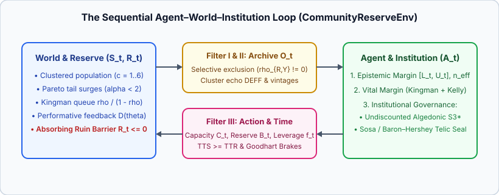

# Chapter 1 — The Sequential Loop and the Naive Optimizer

In Reinforcement Learning (Sutton & Barto), an agent interacts with an environment across discrete time steps $t = 0, 1, 2, \dots, T-1$. At each step, the agent receives a state or observation, chooses an action, and observes a scalar reward and the next state.

Why does that clean textbook abstraction break down when we move from a board game to a hospital emergency network, a municipal water reserve, a public credit guarantee fund, or a civil-defense evacuation system? Because in human and physical institutions, **four structural realities** intervene between the world and the decision-maker:

1. **The Archive is Mutilated:** The decision-maker never sees the latent world state $S\_t$ directly; the decision-maker sees an institutional archive $O\_t$ that arrives in correlated clusters and systematically under-records the most vulnerable strata ($\rho\_{R,Y} \ne 0$).
2. **Harm is Convex and Tails are Heavy:** Demand surges follow power-law tails ($\alpha < 2$), and when service utilization $\rho\_t = S\_t / C\_t$ approaches $100\\%$, queue waiting times and unmet human needs explode nonlinearly according to Kingman's heavy-traffic law $\frac{\rho\_t}{1 - \rho\_t}$.
3. **The World Reacts Performatively:** High-powered bureaucratic targets on proxy metrics ($\beta\_{\mathrm{proxy}} \to 1$) induce strategic gaming and erode the underlying capacity of the institution over subsequent steps.
4. **Time is Irreversible and Ruin is Absorbing:** The community depends on a finite vital reserve $R\_t \ge 0$. If over-leverage or unbuffered overload drains $R\_{t+1} \le 0$ before the institution can recover ($\mathrm{TTS} < \mathrm{TTR}$), the system hits an absorbing ruin barrier.



---

## 1.1 The Evolving Environment: "The Community and the Reserve" (`CommunityReserveEnv`)

In [`crates/stochology/src/engine.rs`](../crates/stochology/src/engine.rs), [`CommunityReserveEnv`](../crates/stochology/src/engine.rs#L309-L316) formalizes this sequential loop over $T = 24$ shifts under a pre-registered [`SplitMix64`](../crates/stochology/src/rng.rs#L14-L16) stream (`DEFAULT_SEED = 2026`):

- **Latent Community Demand ($S\_t$):** At each shift $t$, the community consists of $C = 6$ neighborhood clusters of $10$ individuals each ($N = 60$). Clusters $c \in \\{0, 1, 2, 3\\}$ are well-served neighborhoods; clusters $c \in \\{4, 5\\}$ are high-vulnerability neighborhoods experiencing higher baseline need ($+12.0$ units) and stronger exposure to Pareto tail surges ($\alpha = 1.45$) on crisis shifts.
- **Selective Archive Recording ($O\_t$):** While well-served neighborhoods have a $95\\%$ recording propensity in the administrative database, vulnerable neighborhoods suffer $60\\%$ non-recording (`MNAR` exclusion). Consequently, the raw archive mean $\bar{O}\_t$ systematically underestimates true community need $S\_t$, while intra-cluster shocks inflate the variance of $\bar{O}\_t$.
- **Agent Action (`AgentDecision`):** Given [`ArchiveObservation`](../crates/stochology/src/engine.rs#L29-L42), any policy implementing [`AgentPolicy`](../crates/stochology/src/engine.rs#L116-L122) chooses an [`AgentDecision`](../crates/stochology/src/engine.rs#L46-L63):
  - an epistemic demand interval $[L\_t, U\_t]$ and recognized effective sample size $n\_{\mathrm{eff}}$;
  - provisioned shift capacity $C\_t$, vital reserve buffer $B\_t$, and growth leverage $f\_t$;
  - proxy incentive pressure $\beta\_{\mathrm{proxy}}$, frontline testimonial discount $\delta\_{\mathrm{cred}}$, and whether the constitutional emergency brake ($S3^\*$) is active.

---

## 1.2 Why the `NaiveOptimizer` Collapses

Consider the standard point-optimizing benchmark, [`NaiveOptimizer`](../crates/stochology/src/engine.rs#L130):

```rust
impl AgentPolicy for NaiveOptimizer {
    fn name(&self) -> &str {
        "NaivePointOptimizer"
    }

    fn act(&mut self, obs: &ArchiveObservation) -> AgentDecision {
        let all_obs: Vec<f64> = obs
            .observed_clusters
            .iter()
            .flat_map(|c| c.iter().copied())
            .collect();
        let raw_mean = mean(&all_obs);
        let raw_n = all_obs.len() as f64;
        // Optimizes for the lone mean with 96% utilization ("lean efficiency") and tiny 2% margin
        AgentDecision {
            epistemic_demand_bounds: (raw_mean - 0.5, raw_mean + 0.5),
            recognized_n_eff: raw_n,
            provisioned_capacity: raw_mean / 0.96,
            vital_reserve_allocation: 0.02 * obs.current_reserve,
            growth_leverage_f: 1.35,
            proxy_incentive_pressure: 0.85,
            frontline_testimonial_discount: 0.60,
            constitutional_brake_active: false,
        }
    }
}
```

By treating the raw archive mean $\bar{O}\_t$ as the exact truth ($n\_{\mathrm{eff}} = n$), sizing capacity for "lean" $96\\%$ utilization of that downward-biased mean, applying unshrunk leverage $f\_t = 1.35$, imposing high proxy pressure ($\beta\_{\mathrm{proxy}} = 0.85$), and discounting frontline algedonic warnings by $\delta\_{\mathrm{cred}} = 0.60$, `NaiveOptimizer` violates all three axes of the Nuclear Triad simultaneously.

---

## 1.3 Chapter 1 Laboratory: Naive Optimizer vs. Stochological Agent

Running Chapter 1 (`cargo run --release --bin stochology -- --chapter 1`, Simulated, `seed = 2026`, $T = 24$, $R\_0 = 45.0$) compares [`NaiveOptimizer`](../crates/stochology/src/engine.rs#L130) against the complete [`StochologicalAgent::full()`](../crates/stochology/src/engine.rs#L177-L183):

```text
=== Chapter 1: The Sequential Loop (CommunityReserveEnv, seed=2026, T=24) ===
  NaivePointOptimizer      -> coverage=0.0%, mean_harm=105.80, terminal_reserve=0.00, ruin_step=Some(3)
  StochologicalAgent(Full) -> coverage=100.0%, mean_harm=2.23, terminal_reserve=66.50, ruin_step=None, triad=IntactTriad
```

- **The Naive Optimizer (`NaivePointOptimizer`, Simulated):** Its narrow point interval $[\bar{O}\_t - 0.5, \bar{O}\_t + 0.5]$ misses the true community demand on **100% of shifts** (`coverage = 0.0%`). Because true demand exceeds its downward-biased "lean" capacity, Kingman queue congestion explodes (`mean_harm = 105.80`), and the vital reserve is completely exhausted at shift $t = 3$ (`ruin_step = Some(3)`, `terminal_reserve = 0.00`).
- **The Stochological Agent (`StochologicalAgent::full()`, Simulated):** By combining the **Epistemic Margin** (Manski bounds + Meng selection correction + Moulton cluster adjustment), the **Vital Margin** (Jensen convexity correction + Kingman slack $\rho \le 0.76$ + Baker–McHale epistemic Kelly shrinkage), and **Institutional Governance** (low proxy distortion + undiscounted frontline algedonic brake), the agent covers true community demand on **100.0% of shifts**, reduces mean social harm by **$97.9\\%$** (`2.23` vs. `105.80`), never hits ruin (`ruin_step = None`), and grows the community's vital reserve from $45.00$ to $66.50$.

In Chapters 2 through 9, we open the hood of `StochologicalAgent` and construct each of these mathematical, physical, and institutional safeguards step by step.

---

## Exercises

1. **Lean Utilization Trap:** In `NaiveOptimizer::act`, change `provisioned_capacity` from `raw_mean / 0.96` to `raw_mean / 0.75` while keeping `use_epistemic_margin = false`. Why does the agent still underestimate crisis surges when vulnerable clusters ($c \ge 4$) suffer $60\\%$ missingness?
2. **Reproducible Split Trees:** Inspect [`SplitMix64::split`](../crates/stochology/src/rng.rs#L35-L41) in `CommunityReserveEnv::run_trajectory`. Why does splitting an independent substream `rng.split(t as u64)` per time step guarantee that changing an agent's internal random draws never shifts the environment's exogenous shocks?

