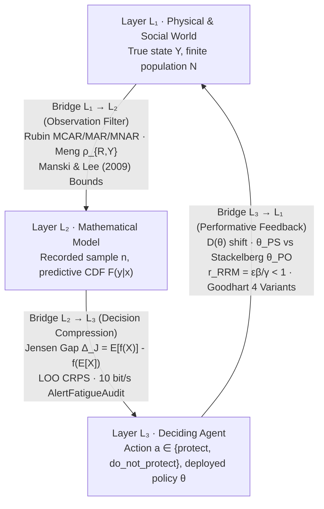

# 2. The Three Ontological Layers ($L\_1 \to L\_2 \to L\_3 \to L\_1$)

## The Territory, the Map, and the Driver

Imagine driving through an unfamiliar city during a heavy rainstorm. Three distinct realities are operating at the same time:
1. **The Territory (The World, $L\_1$):** The physical streets of asphalt and concrete, the flooded underpass, the delivery truck double-parked around a blind corner, and the thousands of other drivers reacting to the storm. You never see the entire city at once.
2. **The Map (The Model, $L\_2$):** A simplified representation on your dashboard screen. By design, the map omits almost everything in the physical city (the texture of the pavement, the color of the buildings, the mood of the pedestrians) so that it can fit on a screen and compute routes quickly. Yet the map is always incomplete and potentially out of date.
3. **The Driver (The Agent, $L\_3$):** You, with limited time, finite attention, a specific destination, and an asymmetric cost function (arriving ten minutes late to dinner is a minor annoyance; driving into a flooded underpass is catastrophic).

This structural separation defines **the Bridge Thesis**:

> **Most analytical failures in science, engineering, finance, and public policy occur on the three bridges connecting the Territory ($L\_1$), the Map ($L\_2$), and the Driver ($L\_3$), rather than inside the arithmetic of the Map ($L\_2$).**

Consider how all three bridge failures occur in a single institution: **a municipal health clinic**.

- **Failure on Bridge $L\_1 \to L\_2$ (The Invisible Filter):** The clinic director wants to know how satisfied patients are with waiting times. She places a tablet survey at the exit of the consultation room. The spreadsheet ($L\_2$) reports an average satisfaction of $92\%$. The arithmetic is flawless, but the data arrived **filtered**: the patients who waited three hours in the lobby and walked out in frustration never entered the consultation room and never touched the tablet.
- **Failure on Bridge $L\_2 \to L\_3$ (The Misread Summary):** The clinic can serve $\mu = 12$ patients per hour. Looking at the annual ledger, the manager observes that an average of $\bar{\lambda} = 8$ patients arrive per hour. Plugging $\lambda = 8$ and $\mu = 12$ into the standard queueing formula gives a comfortable average wait of $10$ minutes. The manager ($L\_3$) concludes there is plenty of slack and refuses to hire a relief nurse. What the average hid is that on half the days the clinic is calm ($\lambda = 5$ per hour, wait $\approx 3.6$ minutes) and on the other half it surges ($\lambda = 11$ per hour, wait $= 55$ minutes). The average arrival rate is still $\frac{5 + 11}{2} = 8$, but the average wait across days is $\frac{3.6 + 55}{2} = 29.3$ minutes, and because $11$ patients per hour arrive on the bad days versus $5$ on the calm days, $\frac{11}{16} \approx 69\%$ of all patients walk in on the $55$-minute day.
- **Failure on Bridge $L\_3 \to L\_1$ (Performativity):** Alarmed by emergency-room crowding, the regional health authority announces that any clinic whose recorded waiting time exceeds $30$ minutes will lose its quarterly budget bonus. Within two months, the recorded waiting time drops to $18$ minutes. Patient care did not improve; receptionists simply stopped registering patients at the front desk until a doctor was ready to call them, shifting the queue from the waiting room onto the sidewalk outside. **The decision ($L\_3$) deformed the physical process ($L\_1$) it was trying to measure.**

---

## 2.1 Overview of the Closed Loop ($L\_1 \to L\_2 \to L\_3 \to L\_1$)

Every stochastic system in the protocol is mapped across three ontological layers and three directed bridges:

<figure class="stoch-figure">
  <svg xmlns="http://www.w3.org/2000/svg" width="1200" height="460" viewBox="0 0 1200 460" fill="none" role="img" aria-labelledby="title-fig-01-layers">
  <title id="title-fig-01-layers">Closed-Loop Ontological Architecture: World (L1), Model (L2), Agent (L3), and the Three Audited Bridges</title>
  <defs>
  <marker id="arrow-sky" viewBox="0 0 10 10" refX="8" refY="5" markerWidth="7" markerHeight="7" orient="auto">
  <path d="M 0 1 L 9 5 L 0 9 z" fill="var(--sky)"/>
  </marker>
  <marker id="arrow-violet" viewBox="0 0 10 10" refX="8" refY="5" markerWidth="7" markerHeight="7" orient="auto">
  <path d="M 0 1 L 9 5 L 0 9 z" fill="var(--violet)"/>
  </marker>
  <marker id="arrow-emerald" viewBox="0 0 10 10" refX="8" refY="5" markerWidth="7" markerHeight="7" orient="auto">
  <path d="M 0 1 L 9 5 L 0 9 z" fill="var(--emerald)"/>
  </marker>
  
  </defs>
  <rect x="1" y="1" width="1198" height="458" rx="14" fill="var(--canvas)" stroke="var(--border)" stroke-width="1.5"/>
  <rect x="20" y="42" width="356" height="136" rx="12" fill="var(--elevated)" stroke="var(--sky)" stroke-width="2.5"/>
  <text x="44" y="76" fill="var(--sky)" class="mono" font-size="12" font-weight="700" letter-spacing="0.06em">LAYER L₁ · REALITY</text>
  <text x="44" y="108" fill="var(--ink)" font-size="19" font-weight="800">WORLD (L₁)</text>
  <text x="44" y="136" fill="var(--muted)" font-size="12.5">Generating Process, Physical</text>
  <text x="44" y="156" fill="var(--muted)" font-size="12.5">Conservation &amp; Noise Physics</text>
  <rect x="824" y="42" width="356" height="136" rx="12" fill="var(--elevated)" stroke="var(--violet)" stroke-width="2.5"/>
  <text x="848" y="76" fill="var(--violet)" class="mono" font-size="12" font-weight="700" letter-spacing="0.06em">LAYER L₂ · FORMAL MAP</text>
  <text x="848" y="108" fill="var(--ink)" font-size="19" font-weight="800">MODEL (L₂)</text>
  <text x="848" y="136" fill="var(--muted)" font-size="12.5">Reduced Simulable Equations,</text>
  <text x="848" y="156" fill="var(--muted)" font-size="12">Executable Null &amp; Discrepancy δ(x)</text>
  <rect x="400" y="304" width="400" height="136" rx="12" fill="var(--elevated)" stroke="var(--emerald)" stroke-width="2.5"/>
  <text x="424" y="338" fill="var(--emerald)" class="mono" font-size="12" font-weight="700" letter-spacing="0.06em">LAYER L₃ · DECISION &amp; ACTION</text>
  <text x="424" y="370" fill="var(--ink)" font-size="19" font-weight="800">AGENT (L₃)</text>
  <text x="424" y="398" fill="var(--muted)" font-size="12.5">Human, Committee, or Controller</text>
  <text x="424" y="418" fill="var(--muted)" font-size="12.5">Asymmetric Loss, Threshold p* &amp; Act</text>
  <path d="M 376 114 L 816 114" stroke="var(--sky)" stroke-width="3" fill="none" marker-end="url(#arrow-sky)"/>
  <rect x="390" y="16" width="420" height="70" rx="10" fill="var(--surface)" stroke="var(--border)" stroke-width="1.5"/>
  <text x="600" y="44" text-anchor="middle" fill="var(--sky)" font-size="12.5" font-weight="800">Bridge L₁ → L₂ (Observation &amp; Filtering)</text>
  <text x="600" y="67" text-anchor="middle" fill="var(--muted)" class="mono" font-size="10.8">Rubin (MCAR/MAR/MNAR) · Meng ρ(R,Y) · Manski</text>
  <path d="M 1002 178 C 1002 290, 900 360, 808 372" stroke="var(--violet)" stroke-width="3" fill="none" marker-end="url(#arrow-violet)"/>
  <rect x="760" y="208" width="420" height="70" rx="10" fill="var(--surface)" stroke="var(--border)" stroke-width="1.5"/>
  <text x="970" y="236" text-anchor="middle" fill="var(--violet)" font-size="12.5" font-weight="800">Bridge L₂ → L₃ (Reading &amp; Valuation)</text>
  <text x="970" y="259" text-anchor="middle" fill="var(--muted)" class="mono" font-size="11">Jensen's Gap Δ_J · Quantiles · CRPS / Brier</text>
  <path d="M 400 372 C 300 360, 198 290, 198 186" stroke="var(--emerald)" stroke-width="3" fill="none" marker-end="url(#arrow-emerald)"/>
  <rect x="20" y="208" width="420" height="70" rx="10" fill="var(--surface)" stroke="var(--border)" stroke-width="1.5"/>
  <text x="230" y="236" text-anchor="middle" fill="var(--emerald)" font-size="12.5" font-weight="800">Bridge L₃ → L₁ (Performativity)</text>
  <text x="230" y="259" text-anchor="middle" fill="var(--muted)" class="mono" font-size="11">Induced D(θ) · θ_PS vs. θ_PO · RRM &lt; 1</text>
</svg>
  <figcaption><strong>Figure 2.1 — The Closed Epistemological Loop (L₁ → L₂ → L₃ → L₁)</strong></figcaption>
</figure>

| Layer | Code | Ontological Definition | Typical Outbound Bridge Error | Formal Bridge Audit |
| --- | --- | --- | --- | --- |
| **World** | $L\_1$ | Physical, biological, or socioeconomic reality generating the data, never observed in its entirety. | **Bridge $L\_1 \to L\_2$ (Invisible Filter):** selection, censoring, or survivorship bias. | Meng's Identity ($\rho\_{R,Y} \neq 0$), Rubin's missingness taxonomy (`MCAR`, `MAR`, `MNAR`), and Manski's non-parametric bounds. |
| **Model** | $L\_2$ | Formal, reduced, computationally simulable mathematical representation. | **Bridge $L\_2 \to L\_3$ (Misreading):** treating $\mathbb{E}[X]$ as a sufficient summary of a nonlinear payoff/loss $f(X)$. | Quantification of Jensen's Gap $\Delta\_J = \mathbb{E}[f(X)] - f(\mathbb{E}[X])$ and strictly proper scoring rules ($\mathrm{CRPS}$, Brier). |
| **Agent** | $L\_3$ | Human decision-maker, institutional committee, or algorithmic controller. | **Bridge $L\_3 \to L\_1$ (Performativity):** decisions based on the model deform the very distribution $\mathcal{D}(\theta)$ being measured. | Induced distribution map $\mathcal{D}(\theta)$, separation between Performative Stability ($\theta\_{\mathrm{PS}}$) and Performative Optimality ($\theta\_{\mathrm{PO}}$), and RRM contraction $\frac{\varepsilon\beta}{\gamma} < 1$. |

## Peirce's Three Modes of Inference and the Three Senses of "Bias"

Before writing equations for the three bridges, two distinctions clarify how reasoning travels around this loop.

First, the philosopher and logician **Charles Sanders Peirce** showed that all scientific reasoning consists of three distinct operations linking a *Rule*, a *Case*, and a *Result*:
1. **Deduction** (*Rule + Case $\to$ Result*): "All beans in this bag are white; these beans came from this bag; therefore, these beans are white." Deduction is **truth-preserving** and lives entirely inside the Model ($L\_2$). If the premises hold, the conclusion is guaranteed, but it adds no new empirical knowledge about the World.
2. **Induction** (*Case + Result $\to$ Rule*): "These beans came from this bag; these beans are white; therefore, all beans in this bag are white." Induction crosses Bridge $L\_1 \to L\_2$, generalizing from a finite sample to a population law. It is **ampliative**: it claims more than was observed, and can fail whenever the sample was filtered.
3. **Abduction** (*Rule + Result $\to$ Case*): "All beans in this bag are white; these beans on the table are white; perhaps these beans came from this bag." Abduction is the creative leap that proposes a candidate hypothesis or causal mechanism to explain a surprising observation. It is the birthplace of every model, and also the birthplace of the **Prosecutor's Fallacy** whenever an agent mistakes a plausible explanation ($P(\text{Evidence} \mid \text{Hypothesis})$) for a proven truth ($P(\text{Hypothesis} \mid \text{Evidence})$).

Second, the word **"bias"** changes meaning depending on which layer you occupy:
- In the **World ($L\_1$)**, *selection bias* means the recorded sample $n$ systematically over-represents some parts of the population $N$.
- In the **Model ($L\_2$)**, *estimator bias* means the expected value of a mathematical formula $\mathbb{E}[\hat{\theta}]$ differs from the true parameter $\theta$.
- In the **Agent ($L\_3$)**, *cognitive or strategic bias* means the decision-maker's mental shortcuts or institutional incentives distort how forecasts are interpreted or acted upon.

When an analyst says "we corrected for bias," your first question must always be: **in which layer?**

---

## 2.2 Bridge $L\_1 \to L\_2$: Rubin's Taxonomy, Meng's Identity, and Manski's Bounds

### Foundations: What Happens When Data Are Missing or Filtered?

Suppose a target population consists of $N$ units (for instance, all $N$ workers in a labor market or all $N$ patients visiting an emergency department), each carrying an outcome of interest $Y\_i$. We want to know the true population average:

$$\bar{Y}\_N = \frac{1}{N}\sum\_{i=1}^N Y\_i$$

However, we only observe a subset of $n < N$ units. To make the filter visible in mathematics, we define a binary **recording indicator** $R\_i$ for every unit $i \in \lbrace 1, \dots, N \rbrace$:

$$R\_i = \begin{cases} 1, & \text{if unit } i \text{ is recorded in our dataset,} \\\\ 0, & \text{if unit } i \text{ is missing or excluded.} \end{cases}$$

The total sample size is $n = \sum\_{i=1}^N R\_i$, the sampling fraction is $f = \frac{n}{N}$, and the sample mean we actually compute on our computer is:

$$\bar{Y}\_n = \frac{\sum\_{i=1}^N R\_i Y\_i}{\sum\_{i=1}^N R\_i}$$

Donald Rubin (1976) classified the physical mechanism governing $R\_i$ into three regimes:
1. **`MCAR` (Missing Completely at Random):** Whether a record is observed ($R\_i$) is statistically independent of both the observed covariates $X\_i$ and the unseen outcome $Y\_i$ ($R \perp (X, Y)$). *Example:* A laboratory technician accidentally drops one out of twenty blood vials on the floor. Under `MCAR`, the sample mean $\bar{Y}\_n$ is an unbiased estimate of $\bar{Y}\_N$.
2. **`MAR` (Missing at Random):** Conditional on the covariates $X\_i$ that we *did* record, missingness no longer depends on the unseen outcome $Y\_i$ ($R \perp Y \mid X$). *Example:* Younger respondents are less likely to answer a telephone survey, but *within* each age bracket, respondents and non-respondents have the same income distribution. Under `MAR`, we can recover $\bar{Y}\_N$ by reweighting across the observed strata $X$.
3. **`MNAR` (Missing Not at Random):** Even after conditioning on all observed variables $X\_i$, the probability of being recorded still depends directly on the unobserved outcome $Y\_i$ itself ($R \not\perp Y \mid X$). *Example:* People with severely depressed earnings self-select into a government training program, or dissatisfied customers leave a platform without filling out the exit survey.

### Xiao-Li Meng's Identity (2018) and the "Big Data Paradox"

A widespread myth in data science holds that *"if the dataset is massive enough ($n$ in the hundreds of thousands or millions), selection bias no longer matters."* In 2018, Harvard statistician Xiao-Li Meng proved an exact algebraic identity that refutes this assumption.

Because $\bar{Y}\_n = \frac{\frac{1}{N}\sum\_{i=1}^N R\_i Y\_i}{\frac{1}{N}\sum\_{i=1}^N R\_i} = \frac{\mathbb{E}\_N[R Y]}{\mathbb{E}\_N[R]}$ and $\mathrm{Cov}\_N(R, Y) = \mathbb{E}\_N[RY] - \mathbb{E}\_N[R]\mathbb{E}\_N[Y]$, a three-line algebraic rearrangement yields **Meng's Identity**:

$$\bar{Y}\_n - \bar{Y}\_N = \underbrace{\rho\_{R,Y}}\_{\text{Data Quality}} \times \underbrace{\sqrt{\frac{N - n}{n}}}\_{\text{Data Quantity}} \times \underbrace{\sigma\_Y}\_{\text{Problem Difficulty}}$$

Three factors multiply on the right-hand side:
1. **$\rho\_{R,Y} = \mathrm{Corr}\_N(R, Y)$ (Data Quality):** The population correlation between *being recorded* ($R\_i$) and *the outcome itself* ($Y\_i$). Under true simple random sampling (`MCAR`), $\mathbb{E}[\rho\_{R,Y}^2] = \frac{1}{N - 1}$, which shrinks rapidly with population size. Under self-selection or unadjusted observational filtering (`MNAR`), $\rho\_{R,Y}$ stays stuck at a non-zero constant (say, $+0.05$ or $+0.13$).
2. **$\sqrt{\frac{N - n}{n}} = \sqrt{\frac{1 - f}{f}}$ (Data Quantity):** A factor determined by the sampling fraction $f = n/N$.
3. **$\sigma\_Y$ (Problem Difficulty):** The true population standard deviation of the outcome $Y$.

This identity shows why sample size alone cannot rescue an unrepresentative dataset. If a sample of size $n$ has selection correlation $\rho\_{R,Y}$, its mean squared error equals that of a genuinely random sample of **effective sample size**:

$$n\_{\mathrm{eff}} \approx \frac{n}{1 + n \left(\frac{N - n}{N}\right) \rho\_{R,Y}^2 \cdot (\text{design scaling})}$$

In our empirical benchmark on Robert LaLonde's (1986) labor-market data (`nsw_experimental.csv`, the randomized National Supported Work experiment, versus `cps_observational.csv`, the observational Current Population Survey comparison group of $n = 15\text{,}992$ workers), the selection correlation is $\rho\_{R,Y} = +0.1334$. That correlation of $0.1334$ shrinks a nominal sample of $n = 15\text{,}992$ workers down to an effective sample size of **$n\_{\mathrm{eff}} = 2\text{,}842.70$**. Over $82\%$ of the apparent sample size was an illusion created by the filter on Bridge $L\_1 \to L\_2$.

### Charles Manski's Non-Parametric Worst-Case Bounds

When missingness or selection is `MNAR` and we do not know $\rho\_{R,Y}$ exactly, what can an honest scientist say without inventing untestable parametric assumptions?

Econometrician **Charles Manski** (1989, 1990) showed that whenever the outcome $Y$ is bounded by known physical or institutional limits $[Y\_{\min}, Y\_{\max}]$, the true population expectation $\mathbb{E}[Y]$ is strictly trapped inside a **non-parametric identification interval**:

$$\mathbb{E}[Y] = P(R = 1) \mathbb{E}[Y \mid R = 1] + P(R = 0) \mathbb{E}[Y \mid R = 0]$$

Since we observe the response rate $p\_{\text{obs}} = P(R = 1)$ and the observed mean $\bar{Y}\_{\text{obs}} = \mathbb{E}[Y \mid R = 1]$, and since the unobserved mean $\mathbb{E}[Y \mid R = 0]$ cannot be smaller than $Y\_{\min}$ or larger than $Y\_{\max}$, the truth must lie inside **Manski's Bounds**:

$$\bigl[  p\_{\text{obs}} \bar{Y}\_{\text{obs}} + (1 - p\_{\text{obs}}) Y\_{\min} ,\quad p\_{\text{obs}} \bar{Y}\_{\text{obs}} + (1 - p\_{\text{obs}}) Y\_{\max}  \bigr]$$

No matter how adversarial the missingness mechanism is, the population mean cannot escape this interval (`crates/stochology-core/src/layers.rs`, `ManskiBounds`). If a decision remains optimal at both endpoints of Manski's interval, the decision is immune to missing-data bias; if the optimal action flips between the lower and upper bound, the analyst must declare that the conclusion depends on an untestable assumption about the unseen records.

### Stratified `MAR` Bounds and David Lee's (2009) Sharp Trimming Bounds

Can we tighten Manski's worst-case interval when additional structure is observed? The protocol provides two non-parametric refinements in `ManskiBounds`:

1. **Covariate-Stratified Bounds (`ManskiBounds::compute_stratified`):** When the population is partitioned into $S$ observed covariate strata with population weights $w\_s \ge 0$ ($\sum\_{s=1}^S w\_s = 1$), stratum response rates $p\_{\text{obs}, s}$, and stratum-specific physical bounds $[Y\_{\min, s}, Y\_{\max, s}]$, aggregating the stratum bounds yields:
   $$\mathbb{E}[Y] \in \left[\sum\_{s=1}^S w\_s\bigl(p\_{\text{obs}, s}\bar{Y}\_{\text{obs}, s} + (1 - p\_{\text{obs}, s})Y\_{\min, s}\bigr),\quad \sum\_{s=1}^S w\_s\bigl(p\_{\text{obs}, s}\bar{Y}\_{\text{obs}, s} + (1 - p\_{\text{obs}, s})Y\_{\max, s}\bigr)\right]$$
   which is guaranteed to be at least as tight as the unstratified Manski interval whenever $Y\_{\min, s} \ge Y\_{\min}$ and $Y\_{\max, s} \le Y\_{\max}$.
2. **David Lee's (2009) Sharp Trimming Bounds for Differential Attrition (`ManskiBounds::lee_trimming_bounds`):** In randomized experiments with attrition (where treatment affects who remains observed, $p\_1 = P(R(1)=1) > p\_0 = P(R(0)=1)$) under **monotonic selection** ($R\_i(1) \ge R\_i(0)$), an excess fraction $q = \frac{p\_1 - p\_0}{p\_1}$ of the observed treated group consists of units induced to remain observed by treatment. Without bounded support assumptions $[Y\_{\min}, Y\_{\max}]$, David Lee (2009) proved that the sharp non-parametric bounds for the average treatment effect among **always-responders** ($R(1)=1, R(0)=1$) are obtained by trimming the top $q$ or bottom $q$ quantiles of the observed treated distribution:
   $$\Delta\_{\mathrm{Lee}} \in \Bigl[  \mathbb{E}\bigl[Y\_1 \mid R\_1 = 1,\ Y\_1 \le Q\_{1-q}(Y\_1)\bigr] - \mathbb{E}[Y\_0 \mid R\_0 = 1],\quad \mathbb{E}\bigl[Y\_1 \mid R\_1 = 1,\ Y\_1 \ge Q\_q(Y\_1)\bigr] - \mathbb{E}[Y\_0 \mid R\_0 = 1]  \Bigr]$$
   Alongside Lee's bounds, `empirical_wasserstein_1` computes the exact 1D Kantorovich-Wasserstein $W\_1(P, Q) = \int\_0^1 |F\_P^{-1}(u) - F\_Q^{-1}(u)|\,du$ distance between the empirical outcome distributions.

---

## 2.3 Bridge $L\_2 \to L\_3$: Nonlinearity, Jensen's Gap, and $\mathrm{CRPS}$

### Foundations: Convexity and Why the Average Input Does Not Give the Average Output

Once data have crossed into the Model ($L\_2$), a second trap awaits on Bridge $L\_2 \to L\_3$: **reading the expected value $\mathbb{E}[X]$ as if it were the only number the decision-maker ($L\_3$) needs.**

Draw the curve $f(x) = x^2$ on a sheet of paper. It is a bowl opening upward, a **convex** function. Pick two equally likely outcomes: $x\_1 = 0$ and $x\_2 = 2$.
- The average of the inputs is $\mathbb{E}[X] = \frac{0 + 2}{2} = 1$.
- Plugging that average input into the formula gives $f(\mathbb{E}[X]) = 1^2 = 1$.
- The actual average of the outputs is $\mathbb{E}[f(X)] = \frac{0^2 + 2^2}{2} = \frac{0 + 4}{2} = 2$.

The average output $\mathbb{E}[f(X)] = 2$ is twice as large as the output at the average input $f(\mathbb{E}[X]) = 1$. Geometrically, for any convex function (a curve whose second derivative is positive, $f''(x) > 0$), the straight chord connecting any two points on the curve lies strictly **above** the curve itself.

This theorem is **Jensen's Inequality** (Johan Jensen, 1906): for any random variable $X$ and any convex function $f$,

$$\mathbb{E}[f(X)] \ge f(\mathbb{E}[X])$$

We define the exact difference as **Jensen's Gap ($\Delta\_J$)**:

$$\Delta\_J \triangleq \mathbb{E}[f(X)] - f(\mathbb{E}[X])$$

To see *why* $\Delta\_J$ grows when the world becomes more volatile, expand $f(X)$ around the mean $\mu = \mathbb{E}[X]$ using a second-order Taylor series:

$$f(X) \approx f(\mu) + f'(\mu)(X - \mu) + \frac{1}{2}f''(\mu)(X - \mu)^2$$

Taking the expectation of both sides (and noting that $\mathbb{E}[X - \mu] = 0$ while $\mathbb{E}[(X - \mu)^2] = \mathrm{Var}(X)$) yields the **Second-Order Variance Toll**:

$$\Delta\_J = \mathbb{E}[f(X)] - f(\mathbb{E}[X]) \approx \frac{1}{2}  f''(\mu)  \mathrm{Var}(X)$$

Read that equation in plain English:

> **Whenever a cost, waiting time, or damage function bends upward ($f''(\mu) > 0$), variability does not cancel out over time; it adds a positive cost equal to half the curvature times the variance.**

In `bank_calls.csv` ($164$ business days of a North American retail bank's call center), daily call volume fluctuates across days. Under a quadratic staffing congestion penalty, evaluating the cost at the mean daily volume gives $f(\mathbb{E}[X]) = 1.0669 \times 10^9$, whereas the true average daily cost is $\mathbb{E}[f(X)] = 1.0760 \times 10^9$, leaving a **Jensen's Gap of $\Delta\_J = +9\text{,}033\text{,}837.19$** that a spreadsheet using only the average day completely erases. The penalty $f(x) = x^2$ is an illustrative convex cost measured in squared daily calls, not currency, and the gap is $\approx 0.85\%$ of $f(\mathbb{E}[X])$: small for these fairly stable days, and growing with volatility and convexity, which is why it must be reported rather than assumed.

### Evaluating Full Predictive Distributions: The Continuous Ranked Probability Score ($\mathrm{CRPS}$)

Because a single mean hides both Jensen's Gap and tail risk, Prohibition 2 requires every model on Bridge $L\_2 \to L\_3$ to report not only $f(\mathbb{E}[X])$, $\mathbb{E}[f(X)]$, and $\Delta\_J$, but also the **median**, the **5th and 95th percentiles ($q\_{05}, q\_{95}$)**, and the **Continuous Ranked Probability Score ($\mathrm{CRPS}$)**.

Suppose a model issues a full predictive cumulative distribution function (CDF) $F(x) = P(X \le x)$, and reality subsequently materializes at the actual number $y$. A single point metric like Root Mean Squared Error ($\mathrm{RMSE}$) ignores whether the model's uncertainty bands were honest or overconfident. The **$\mathrm{CRPS}$** scores the *entire predictive distribution* at once by integrating the squared distance between the forecast CDF $F(x)$ and the empirical step function $\mathbb{I}\lbrace x \ge y \rbrace$ (which is $0$ below $y$ and jumps to $1$ at $y$):

$$\mathrm{CRPS}(F, y) \triangleq \int\_{-\infty}^{\infty} \bigl(F(x) - \mathbb{I}\lbrace x \ge y \rbrace\bigr)^2 dx = \mathbb{E}\_F|X - y| - \frac{1}{2}\mathbb{E}\_F|X - X'|$$

where $X$ and $X'$ are independent draws from the predictive distribution $F$. The second expression (`NonlinearSummary` in `crates/stochology-core/src/layers.rs`) has two terms:
- The first term, $\mathbb{E}\_F|X - y|$, rewards the distribution for placing its mass close to the realized truth $y$ (*accuracy*).
- The second term, $-\frac{1}{2}\mathbb{E}\_F|X - X'|$, rewards sharp, well-calibrated spread.
- $\mathrm{CRPS}$ is a **strictly proper scoring rule**: a forecaster minimizes expected $\mathrm{CRPS}$ if and only if they report their true predictive distribution $F$, with zero incentive to hedge or exaggerate confidence.
- **Exact $O(n \log n)$ Order-Statistic Computation (`exact_loo_empirical_crps`):** Naively evaluating leave-one-out empirical $\mathrm{CRPS}$ across $n$ observations requires $O(n^2)$ pairwise comparisons. By sorting the sample $x\_{(1)} \le x\_{(2)} \le \dots \le x\_{(n)}$ once in $O(n \log n)$ time and using prefix sums together with the L-moment order-statistic identity $\sum\_{1 \le i < j \le n} (x\_{(j)} - x\_{(i)}) = \sum\_{i=1}^n (2i - 1 - n)x\_{(i)}$, `NonlinearSummary::evaluate` computes the exact leave-one-out empirical $\mathrm{CRPS}$ in $O(n \log n)$ time.

### Cognitive Bottleneck ($10\text{ bit/s}$), Turing Decibans, and `AlertFatigueAudit` on Bridge $L\_2 \to L\_3$

Even when a model in $L\_2$ outputs a calibrated probability, Bridge $L\_2 \to L\_3$ fails whenever the rate and false-positive burden of model alerts exceed the biological bandwidth of the human operator in $L\_3$. As quantified by **Jieyu Zheng and Markus Meister** (Caltech, *Neuron* 2024/2025), while human peripheral sensory receptors transduce $\sim 1.6 \times 10^9\text{ bit/s}$, **conscious human executive decision-making operates at an invariant bottleneck of $\sim 10\text{ bits per second}$**.

In `AlertFatigueAudit` (`crates/stochology-siga/src/roadmap.rs`), the protocol couples this $10\text{ bit/s}$ conscious ceiling with **Alan Turing and I. J. Good's additive deciban weight of evidence**:

$$W \triangleq 10\log\_{10}\left(\frac{\mathrm{TPR}}{\mathrm{FPR}}\right)\text{ dB}, \qquad O\_{\text{post}} = O\_{\text{prior}} \times 10^{W / 10}, \qquad \mathrm{PPV} = \frac{O\_{\text{post}}}{1 + O\_{\text{post}}}$$

To see why this audit matters at shift resolution ($\Phi\_5$), consider the external validation of the **Epic Sepsis Model** by **Andrew Wong et al.** (*JAMA Internal Medicine* 2021, $27\text{,}697$ hospitalizations): with shift prevalence $p\_0 \approx 0.02$, sensitivity $\mathrm{TPR} = 0.33$, and false-positive rate $\mathrm{FPR} = 0.0495$, each alert carries only $W = +8.24\text{ dB}$, yielding **$\mathrm{PPV} = 0.120$** ($7.33$ false alarms for every true case) and saturating clinical shifts ($18.5\text{ bit/s} > 10\text{ bit/s}$). By contrast, a CORP-calibrated Stochological triage gate ($\mathrm{TPR} = 0.68, \mathrm{FPR} = 0.0108$) achieves **$W = +17.99\text{ dB}$**, **$\mathrm{PPV} = 0.563 > p^{\ast} = 0.120$**, and an operator cognitive load of **$3.2\text{ bit/s} \le 10.0\text{ bit/s}$**.

---

## 2.4 Bridge $L\_3 \to L\_1$: Performative Prediction and Repeated Risk Minimization

### Foundations: When Deploying the Model Deforms the World

Standard supervised learning assumes that the data-generating distribution $\mathcal{D}$ is a passive photograph of nature: whether you deploy parameter vector $\theta\_1$ or $\theta\_2$, the world keeps drawing pairs $Z = (X, Y) \sim \mathcal{D}$.

In human and institutional systems, this assumption is false. As economist **Robert Lucas** pointed out in 1976 (*the Lucas Critique*), and as **Charles Goodhart** formulated in monetary policy, whenever an agent ($L\_3$) deploys a predictive model parameterized by $\theta \in \Theta$ to allocate credit, route traffic, set insurance premiums, or trigger police patrols, the population in the World ($L\_1$) reacts to the rule. **Deploying $\theta$ changes the distribution of the data from $\mathcal{D}$ to $\mathcal{D}(\theta)$.**

In 2020, Juan Perdomo, Tijana Zrnic, Celestine Mendler-Dünner, and Moritz Hardt unified this feedback loop under the mathematical theory of **Performative Prediction**.

To reason cleanly about Bridge $L\_3 \to L\_1$, we must distinguish two risk functions:

$$\mathrm{PR}(\theta) \triangleq \mathbb{E}\_{Z \sim \mathcal{D}(\theta)}[\ell(Z; \theta)], \qquad \mathrm{DPR}(\theta, \phi) \triangleq \mathbb{E}\_{Z \sim \mathcal{D}(\theta)}[\ell(Z; \phi)]$$

The two formulas differ in how they treat the world's response:
- In **Decoupled Performative Risk $\mathrm{DPR}(\theta, \phi)$**, the first argument $\theta$ fixes the **World's distribution** $\mathcal{D}(\theta)$ (how the population is currently behaving under the previously deployed policy $\theta$), while the second argument $\phi$ is the **new candidate model** being evaluated on yesterday's data.
- In **Performative Risk $\mathrm{PR}(\theta) = \mathrm{DPR}(\theta, \theta)$**, both arguments move together: it measures the true loss you will experience *after* you deploy $\theta$ and the world shifts to $\mathcal{D}(\theta)$.

This distinction separates two equilibria that analysts routinely conflate (Prohibition 3):

1. **Performative Stability ($\theta\_{\mathrm{PS}}$, The Myopic Retraining Fixed Point):**
   In a typical MLOps pipeline, data scientists collect data under the current model $\theta\_t$, retrain a new model $\theta\_{t+1} = \arg\min\_\phi \mathrm{DPR}(\theta\_t, \phi)$ as if the distribution were static, deploy $\theta\_{t+1}$, and repeat. This loop is called **Repeated Risk Minimization (RRM)**. If RRM converges to a fixed point where retraining no longer changes the parameters, that point is **Performatively Stable**:
   $$\theta\_{\mathrm{PS}} = \arg\min\_{\phi \in \Theta} \mathrm{DPR}(\theta\_{\mathrm{PS}}, \phi)$$
   At $\theta\_{\mathrm{PS}}$, the model looks optimal on its own fresh validation data, yet it remains blind to how its own deployment shifted $\mathcal{D}(\theta\_{\mathrm{PS}})$.

2. **Performative Optimality ($\theta\_{\mathrm{PO}}$, The True Stackelberg Equilibrium):**
   An agent who understands Bridge $L\_3 \to L\_1$ acts as a **Stackelberg leader**: instead of taking $\mathcal{D}(\theta)$ as frozen, the agent differentiates through the environment's reaction map $\theta \mapsto \mathcal{D}(\theta)$ and minimizes total Performative Risk directly:
   $$\theta\_{\mathrm{PO}} = \arg\min\_{\theta \in \Theta} \mathrm{PR}(\theta)$$

### Step-by-Step Derivation of the Canonical Linear Benchmark

Let us derive the exact gap between passive learning ($\theta\_{\mathrm{SL}}$), Performative Stability ($\theta\_{\mathrm{PS}}$), and Performative Optimality ($\theta\_{\mathrm{PO}})$ in the canonical linear-quadratic system implemented in `PerformativeSystem` (`crates/stochology-core/src/layers.rs`).

Suppose that when the institution deploys decision parameter $\theta$, the outcome in the world reacts linearly with performative sensitivity $\varepsilon$:

$$Y(\theta) = \mu + \varepsilon\theta + \xi, \qquad \mathbb{E}[\xi] = 0,\quad \mathrm{Var}(\xi) = \sigma^2$$

and the institution evaluates candidate parameter $\phi$ under the strongly convex regularized loss:

$$\ell(Y; \phi) = \frac{\gamma}{2}(Y - \phi)^2 - \alpha\phi \qquad (\gamma > 0)$$

1. **Passive Supervised Learning ($\theta\_{\mathrm{SL}}$, ignoring feedback $\varepsilon = 0$):**
   Before the model is deployed ($\theta = 0$), $\mathbb{E}[Y(0)] = \mu$. Minimizing $\mathbb{E}[\ell(Y(0); \phi)] = \frac{\gamma}{2}[(\mu - \phi)^2 + \sigma^2] - \alpha\phi$ with respect to $\phi$ sets the derivative to zero:
   $$-\gamma(\mu - \phi) - \alpha = 0 \implies \theta\_{\mathrm{SL}} = \mu + \frac{\alpha}{\gamma}$$

2. **Repeated Risk Minimization and Performative Stability ($\theta\_{\mathrm{PS}}$):**
   When $\theta\_t$ is deployed in round $t$, the environment shifts its mean to $\mathbb{E}[Y(\theta\_t)] = \mu + \varepsilon\theta\_t$. A myopic retrainer holds $\theta\_t$ fixed and minimizes $\mathrm{DPR}(\theta\_t, \phi)$ over $\phi$:
   $$-\gamma(\mu + \varepsilon\theta\_t - \phi) - \alpha = 0 \implies \theta\_{t+1} = \mu + \frac{\alpha}{\gamma} + \varepsilon\theta\_t$$
   Setting $\theta\_{t+1} = \theta\_t = \theta\_{\mathrm{PS}}$ gives the **Performative Stability fixed point**:
   $$\theta\_{\mathrm{PS}} = \frac{\mu + \alpha / \gamma}{1 - \varepsilon}$$

3. **True Performative Optimality ($\theta\_{\mathrm{PO}}$, Stackelberg Equilibrium):**
   Now substitute $\phi = \theta$ *before* differentiating. The true Performative Risk is:
   $$\mathrm{PR}(\theta) = \mathbb{E}\left[\frac{\gamma}{2}(\mu + \varepsilon\theta + \xi - \theta)^2 - \alpha\theta\right] = \frac{\gamma}{2}\bigl[(1 - \varepsilon)\theta - \mu\bigr]^2 + \frac{\gamma}{2}\sigma^2 - \alpha\theta$$
   Differentiating $\mathrm{PR}(\theta)$ with respect to $\theta$ (including the $(1 - \varepsilon)$ chain-rule factor from the environment's reaction) and setting the derivative to zero yields:
   $$\gamma(1 - \varepsilon)\bigl[(1 - \varepsilon)\theta\_{\mathrm{PO}} - \mu\bigr] - \alpha = 0 \implies \theta\_{\mathrm{PO}} = \frac{\mu}{1 - \varepsilon} + \frac{\alpha}{\gamma(1 - \varepsilon)^2}$$

Compare $\theta\_{\mathrm{PS}}$ and $\theta\_{\mathrm{PO}}$: whenever $\alpha \neq 0$ and $\varepsilon \neq 0$, **retraining to stability ($\theta\_{\mathrm{PS}}$) converges to a strictly suboptimal policy ($\theta\_{\mathrm{PS}} \neq \theta\_{\mathrm{PO}}$)** because myopic retraining ignores the derivative $\frac{\partial \mathcal{D}(\theta)}{\partial \theta}$.

What if the environment is highly reactive? Under Wasserstein-1 distribution sensitivity $W\_1(\mathcal{D}(\theta), \mathcal{D}(\theta')) \le \varepsilon\lVert\theta - \theta'\rVert\_2$, $\gamma$-strong convexity, and $\beta$-smoothness of the loss, Perdomo et al. proved that Repeated Risk Minimization contracts via:

$$\lVert\theta\_{t+1} - \theta\_{\mathrm{PS}}\rVert\_2 \le \left(\frac{\varepsilon\beta}{\gamma}\right) \lVert\theta\_t - \theta\_{\mathrm{PS}}\rVert\_2$$

Thus, RRM converges **if and only if the contraction ratio satisfies $r\_{\mathrm{RRM}} \triangleq \frac{\varepsilon\beta}{\gamma} < 1$**. Whenever $\frac{\varepsilon\beta}{\gamma} \ge 1$, retraining the model on its own induced data causes self-reinforcing oscillations that destabilize the real world (`--defect performativity`).

### Escaping the Myopic Fixed Point: Performative Gradient Descent (`PerfGD`)

How can an institution reach the true Stackelberg Performative Optimum $\theta\_{\mathrm{PO}}$ instead of getting trapped at the myopic retraining equilibrium $\theta\_{\mathrm{PS}}$? In 2021, **Zachary Izzo, Lexing Ying, and James Zou** introduced **Performative Gradient Descent (`PerfGD`)** (`PerformativeSystem::perfgd_trajectory`). Whereas standard retraining ignores how deploying $\theta$ shifts the distribution $\mathcal{D}(\theta)$, `PerfGD` updates $\theta\_t$ along the **total performative gradient**:

$$\nabla\_\theta \mathrm{PR}(\theta\_t) = \underbrace{\nabla\_2 \mathrm{DPR}(\theta\_t, \theta\_t)}\_{\text{Standard Gradient (Myopic)}} + \underbrace{\nabla\_1 \mathrm{DPR}(\theta\_t, \theta\_t)}\_{\text{Performative Distribution Shift Gradient}}$$

In our linear-quadratic system, $\nabla\_\theta \mathrm{PR}(\theta) = \gamma(1 - \varepsilon)\bigl[(1 - \varepsilon)\theta - \mu\bigr] - \alpha$, so stepping via $\theta\_{t+1} = \theta\_t - \eta\nabla\_\theta \mathrm{PR}(\theta\_t)$ converges directly to $\theta\_{\mathrm{PO}} = 2.03125$, achieving strictly lower Performative Risk than Repeated Risk Minimization ($\mathrm{PR}(\theta\_{\mathrm{PO}}) = -0.8203 < \mathrm{PR}(\theta\_{\mathrm{PS}}) = -0.8125$).

### Formal Taxonomy of the Four Variants of Goodhart's Law (`GoodhartTaxonomyAudit`)

When a statistical proxy metric $M$ is promoted into an optimization target on Bridge $L\_3 \to L\_1$, *"when a measure becomes a target, it ceases to be a good measure"* (Charles Goodhart 1975; Marilyn Strathern 1997). Following **David Manheim and Scott Garrabrant (2018)**, `GoodhartTaxonomyAudit` (`crates/stochology-core/src/layers.rs`) decomposes Goodhart collapse into four distinct mathematical mechanisms (`GoodhartVariant`):

1. **Regressional Goodhart (`GoodhartVariant::Regressional`):** Even without strategic gaming or causal change, when $M = Y + \xi$ ($\sigma\_\xi > 0$), conditioning on an extreme proxy realization $M = m$ incurs Galtonian shrinkage $\mathbb{E}[Y \mid M = m] = \mu\_Y + \rho\_{M,Y}\frac{\sigma\_Y}{\sigma\_M}(m - \mu\_M) < m$, producing systematic post-selection disappointment ($+0.600$ at $3\sigma$ when $\rho = 0.80$).
2. **Extremal Goodhart (`GoodhartVariant::Extremal`):** A proxy that correlates tightly with the true objective in the bulk of the distribution ($\alpha\_M = 3.2$) decouples in the tail when the true risk is heavy-tailed ($\alpha\_Y = 1.5$), creating a $q\_{99.9}$ tail gap ($+19.29$).
3. **Causal Goodhart (`GoodhartVariant::Causal`):** When $M$ is a downstream symptom or sibling effect of the true causal mechanism ($U \to Y$ and $U \to M$, so $M \notin \hat{S}^{\ast}$ under `run_nonlinear_icp_nile`), intervening via $\mathrm{do}(M = m)$ shifts the proxy while leaving $\mathbb{E}[Y \mid \mathrm{do}(M = m)] = \mu\_Y$ unchanged (causal intervention gap $+2.56$).
4. **Adversarial Goodhart (`GoodhartVariant::Adversarial`):** Rational agents game the proxy rule directly along the performative distribution-shift gradient $\nabla\_1 \mathrm{DPR}(\theta, \theta)$ (`PerformativeSystem::dpr_gradient_components`), inflating $M$ while degrading true Performative Risk $\mathrm{PR}(\theta\_{\mathrm{PS}}) - \mathrm{PR}(\theta\_{\mathrm{PO}}) = +0.0078 > 0$.

### Interactive Laboratory (`/lab`)

Use the interactive dual-bridge simulator below to test how even a tiny selection correlation $|\rho\_{R,Y}|$ collapses Meng's effective sample size $n\_{\mathrm{eff}}$ on Bridge $L\_1 \to L\_2$, and how performative sensitivity $\varepsilon$ governs whether Repeated Risk Minimization converges to $\theta\_{\mathrm{PS}}$ or diverges on Bridge $L\_3 \to L\_1$:

---

## Computational Audit in Rust

In `crates/stochology-core/src/layers.rs`, the three bridges are implemented in `MengAudit`, `ManskiBounds`, `NonlinearSummary`, and `PerformativeSystem`. Run Laboratory 1 from your terminal:

~~~bash
cargo run --release --bin labs -- --layers
~~~

~~~text
=== LAB 1: THREE ONTOLOGICAL LAYERS AND BRIDGE MECHANICS (L1 -> L2 -> L3 -> L1) ===
  [Bridge L1->L2] Meng (CPS n=15992 vs NSW n=260): rho_R_Y=+0.1334, selection_err=+164.65, n_eff_Meng=2842.70 | Manski MNAR=[5463.2, 13835.3] | Lee(q=0.031)=[838.7, 2007.2], W1=1722.7
  [Bridge L2->L3] Jensen Gap (bank_calls, 164 days): f(E[X])=1066924927.55, E[f(X)]=1075958764.73, Delta_J=+9033837.19, median=1025216361.00, q05=830290416.50, q95=1481646385.00, OOS_CRPS=90551681.37
  [Bridge L3->L1] Performative Prediction: theta_SL=1.5000, theta_PS=1.8750, theta_PO=2.0312 (PerfGD_30=2.0312), PR(PS)=-0.8125 vs PR(PO)=-0.8203, r_RRM=0.300 (converges=true), oscillation_violated=[1.0, 0.0, 1.0, 0.0, 1.0]
~~~

Examine the three lines of output:
1. **On Bridge $L\_1 \to L\_2$**, comparing the observational CPS sample ($n = 15\text{,}992$) against the randomized NSW benchmark reveals $\rho\_{R,Y} = +0.1334$, collapsing the effective sample size to $n\_{\mathrm{eff}} = 2\text{,}842.70$, while the assumption-free Manski `MNAR` bounds trap the true earnings within $[5\text{,}463.2,\ 13\text{,}835.3]$ and David Lee's (2009) trimming bounds under $q = 3.1\%$ differential attrition bound the always-responder treatment effect within $[838.7,\ 2\text{,}007.2]$ (`W1 = 1722.7`).
2. **On Bridge $L\_2 \to L\_3$**, across the $164$ days of `bank_calls.csv`, the nonlinear congestion loss exhibits a positive Jensen's Gap of $\Delta\_J = +9\text{,}033\text{,}837.19$ (squared daily calls, $\approx 0.85\%$) above the naive plug-in mean evaluation $f(\mathbb{E}[X])$, and reports the full quantile profile ($q\_{05}$, median, $q\_{95}$) alongside the exact $O(n \log n)$ out-of-sample $\mathrm{CRPS} = 9.055 \times 10^7$.
3. **On Bridge $L\_3 \to L\_1$**, with $\mu = 1.0, \varepsilon = 0.20, \alpha = 0.50, \gamma = 1.0, \beta = 1.50$, passive learning chooses $\theta\_{\mathrm{SL}} = 1.5000$, Repeated Risk Minimization converges ($r\_{\mathrm{RRM}} = \frac{0.20 \times 1.50}{1.0} = 0.300 < 1$) to $\theta\_{\mathrm{PS}} = 1.8750$ ($\mathrm{PR} = -0.8125$), whereas Performative Gradient Descent (`PerfGD_30 = 2.0312`) reaches the Stackelberg leader optimum $\theta\_{\mathrm{PO}} = 2.0312$ with strictly lower Performative Risk ($\mathrm{PR} = -0.8203$). When the contraction condition is violated, RRM oscillates endlessly (`[1.0, 0.0, 1.0, 0.0, 1.0]`).

## Exercises

1. **(Concept — Bridge Diagnosis)** Classify each of the following failures by its primary bridge ($L\_1 \to L\_2$, $L\_2 \to L\_3$, or $L\_3 \to L\_1$):
   - *(a)* A wartime air force armors the fuselage sections where returning bombers have the most bullet holes, forgetting that planes hit in the engines never returned to be counted (Abraham Wald's survivorship paradox).
   - *(b)* An agricultural planner computes the crop yield at the average annual rainfall, ignoring that a drought year followed by a flood year destroys the harvest in both years.
   - *(c)* A navigation app sends ten thousand drivers down a quiet residential side street because its historical travel-time model predicted zero congestion there, creating a two-hour gridlock.
2. **(Calculation — Meng's Identity)** Suppose a national health registry covers $n = 2\text{,}000\text{,}000$ self-enrolled citizens out of a population of $N = 10\text{,}000\text{,}000$, with outcome standard deviation $\sigma\_Y = 50$ and a tiny selection correlation $\rho\_{R,Y} = +0.04$. Using Meng's Identity, calculate the exact selection bias $\bar{Y}\_n - \bar{Y}\_N$. Why did a sample of two million people fail to make this error vanish?
3. **(Calculation — Jensen's Gap)** A hospital emergency room has capacity $\mu = 20$ patients/hour and waiting time proportional to $W(\lambda) = \frac{\lambda}{\mu - \lambda}$. Compare $W(\mathbb{E}[\lambda])$ against $\mathbb{E}[W(\lambda)]$ when arrival rate $\lambda$ is $10$ patients/hour on half the shifts and $18$ patients/hour on the other half. What is $\Delta\_J$?
4. **(Laboratory — Performativity Gate)** Run `cargo run --release --bin gates -- --defect performativity` and verify that the gate exits with code `1` when $\frac{\varepsilon\beta}{\gamma} \ge 1$.

<strong>Analytical &amp; Computational Solutions (Click to Expand)</strong>

1. **Bridge Diagnosis:**
   - *(a)* **Bridge $L\_1 \to L\_2$ (`MNAR` Survivorship Filter):** Recording $R\_i = 1$ (returning to base) depends directly on the unseen outcome $Y\_i$ (engine survival).
   - *(b)* **Bridge $L\_2 \to L\_3$ (Jensen's Inequality):** Crop yield $Y(r)$ is a concave function of rainfall $r$ ($Y''(r) < 0$), so $\mathbb{E}[Y(R)] < Y(\mathbb{E}[R])$.
   - *(c)* **Bridge $L\_3 \to L\_1$ (Performativity):** Deploying routing policy $\theta$ deforms the physical traffic distribution from $\mathcal{D}$ to $\mathcal{D}(\theta)$.
2. **Meng's Identity Calculation:**
   $$\bar{Y}\_n - \bar{Y}\_N = \rho\_{R,Y} \sqrt{\frac{N - n}{n}} \sigma\_Y = 0.04 \times \sqrt{\frac{8\text{,}000\text{,}000}{2\text{,}000\text{,}000}} \times 50 = 0.04 \times 2 \times 50 = +4.00$$
   Because $\sqrt{(N-n)/n} = \sqrt{(1-f)/f}$ depends only on the sampling fraction $f = n/N = 0.20$ and $\rho\_{R,Y} = +0.04$ does not decay as $1/\sqrt{N}$ under self-selection, the bias $+4.00$ remains even with $n = 2\text{,}000\text{,}000$.
3. **Jensen's Gap Calculation:**
   - Average arrival rate: $\mathbb{E}[\lambda] = \frac{10 + 18}{2} = 14\text{ patients/hour}$, so $W(\mathbb{E}[\lambda]) = \frac{14}{20 - 14} = \frac{14}{6} \approx 2.333$ units.
   - True expected wait: $\mathbb{E}[W(\lambda)] = \frac{1}{2}W(10) + \frac{1}{2}W(18) = \frac{1}{2}\left(\frac{10}{10} + \frac{18}{2}\right) = \frac{1 + 9}{2} = 5.000$ units.
   - Jensen's Gap: $\Delta\_J = 5.000 - 2.333 = +2.667$ units (the true wait is more than double the plug-in estimate).
4. **Performativity Gate:** Running `cargo run --release --bin gates -- --defect performativity` triggers `[G2 BLOCKED] PROHIBITION_3 violated: RRM contraction ratio >= 1` and exits with code `1`.

## Summary

- Every model operates inside the closed feedback loop **World ($L\_1$) $\to$ Model ($L\_2$) $\to$ Agent ($L\_3$) $\to$ World ($L\_1$)**.
- **Bridge $L\_1 \to L\_2$** is governed by Rubin's missingness taxonomy (`MCAR`, `MAR`, `MNAR`), **Meng's Identity** ($\bar{Y}\_n - \bar{Y}\_N = \rho\_{R,Y}\sqrt{\frac{N-n}{n}}\sigma\_Y$), and **Manski's non-parametric bounds**.
- **Bridge $L\_2 \to L\_3$** is governed by **Jensen's Inequality** ($\Delta\_J = \mathbb{E}[f(X)] - f(\mathbb{E}[X]) \approx \frac{1}{2}f''(\mu)\mathrm{Var}(X)$) and strictly proper distributional scoring via **$\mathrm{CRPS}$**.
- **Bridge $L\_3 \to L\_1$** is governed by **Performative Prediction**, separating passive fit ($\theta\_{\mathrm{SL}}$), myopic retraining stability ($\theta\_{\mathrm{PS}}$), and Stackelberg optimality ($\theta\_{\mathrm{PO}}$), subject to the strict RRM contraction barrier $\frac{\varepsilon\beta}{\gamma} < 1$.
