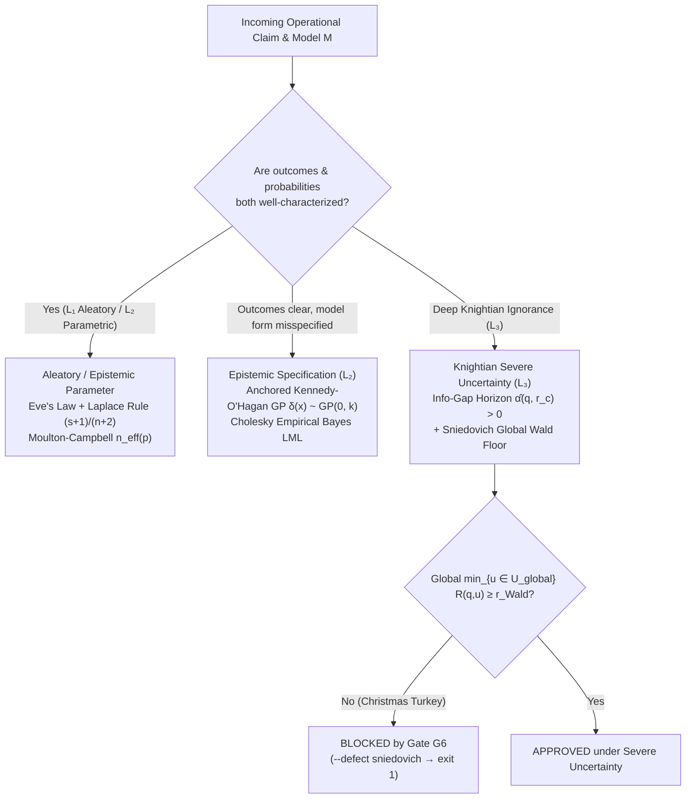

# 2. The Typology of Uncertainty

> **Three tempos.** **Detachment:** set aside the idea that "probability" is a single, self-evident number computed from past data. **Abstraction:** not-knowing comes in qualitatively distinct kinds, and every probability belongs to the layer that produced it. **Return:** the five interpretations typed by layer, the Dutch Book against calibration, natural-frequency trees and decibans, the law of total variance, Kennedy-O'Hagan discrepancy, and Info-Gap with the Sniedovich floor. **Negative proof:** `gates -- --defect sniedovich` (exit `1`).

## The Christmas Turkey and the Three Coins

Bertrand Russell once told the parable of an inductive chicken, later retold by Nassim Nicholas Taleb as **the Christmas Turkey**. Every morning at 9:00 a.m. sharp, the farmer walks into the barn and fills the trough with corn.
- On Day 1, the turkey is cautious.
- By Day 20, the turkey has formed a statistical hypothesis: *"The appearance of the farmer at 9:00 a.m. causes breakfast."*
- By Day 100, the turkey has a hundred consecutive confirmations and zero counterexamples. Using standard textbook confidence intervals, the turkey's estimated probability of being fed tomorrow morning approaches $100\%$, and its standard error has shrunk to almost nothing.

Day 101 is the Wednesday before Thanksgiving (or Christmas Eve). The farmer walks in at 9:00 a.m. carrying an axe instead of corn.

One hundred days of real empirical data made the turkey *more* vulnerable rather than safer because **the event that killed the turkey was never in the turkey's list of hypotheses.** More data only shrink uncertainty *inside* a correctly specified model; when the model's hypothesis space omits the true mechanism of the world, accumulating more data builds false confidence around the wrong answer.

To see why treating all "uncertainty" as a single concept fails, compare four situations:

1. **The Known Fair Coin (Aleatory Uncertainty, $L\_1$):** You are about to toss a physically verified, symmetric coin once. Nobody can predict the single toss, and collecting a billion historical coin tosses will not make the next toss any closer to $100\%$ Heads. The probability stays $50/50$ forever. This is **irreducible physical randomness**.
2. **The Bent Coin of Unknown Bias (Parametric Epistemic Uncertainty, $L\_2$):** Someone hands you a bent coin from a workshop. It has a fixed physical bias $\theta \in (0, 1)$, but you do not know the number $\theta$. After $3$ tosses, you are uncertain about $\theta$; after $10\text{,}000$ tosses, the Law of Large Numbers pins $\theta$ down to within a hundredth of a percent. Here, **more data cure ignorance**.
3. **The Straight Ruler on a Curved Planet (Structural Epistemic Uncertainty, $L\_2$):** An engineer fits a linear friction formula $y = \theta x$ to predict wind drag on an aircraft wing across high-subsonic speeds, where shockwaves actually bend the physics nonlinearly. As the engineer collects more measurements, the least-squares fit forces the single knob $\theta$ to twist into an unphysical number just to compromise between the low-speed and high-speed points. The confidence interval around $\theta$ shrinks toward zero while the formula itself remains **structurally wrong**.
4. **The Turkey's Morning (Knightian Uncertainty, $L\_3$):** A decision-maker faces regimes, strategic reactions, or structural breaks where neither a unique probability distribution nor an exhaustive list of states can be trusted.

---

## 2.1 Foundations: Probability Without Mystery

Before we examine complex models, we must be clear about the elementary building blocks of uncertainty: **probability**, **coherence**, **natural frequencies**, and **Bayes' theorem**.

### Five Meanings Wearing the Same Number

Suppose a meteorologist says: *"There is a 70% probability of rain tomorrow."* Depending on who speaks and how it was computed, that single number $0.70$ can carry five distinct meanings:

| Interpretation | Founders | What "70%" Means | Primary Ontological Layer |
| --- | --- | --- | --- |
| **1. Classical** | Cardano, Laplace | Out of $10$ symmetric, equally possible configurations of the model, $7$ produce rain. | **Model ($L\_2$)** |
| **2. Frequentist** | Venn, von Mises, Fisher | In a long historical sequence of days with identical atmospheric conditions, it rained on $70\%$ of them. | **World ($L\_1$)** |
| **3. Propensity** | Peirce, Popper | The current physical state of the atmosphere has an objective physical disposition of strength $0.70$ to generate rain. | **World ($L\_1$)** |
| **4. Logical / Evidential** | Keynes, Jeffreys, Carnap | Given the formal propositions in our evidence database, the rational degree of logical entailment for rain is $0.70$. | **Model ($L\_2$)** |
| **5. Subjective / Personalist** | Ramsey, de Finetti, Savage | The decision-maker is willing to buy or sell a contract paying USD 1.00 if it rains for a fair price of USD 0.70. | **Agent ($L\_3$)** |

Stochology does not force a philosophical war among these five interpretations. Instead, **it types every probability by the layer from which it came.** Many costly errors in courtrooms, hospitals, and trading desks happen when a number computed as a symmetry of a *Model* ($L\_2$) or a subjective hunch of an *Agent* ($L\_3$) is treated as a verified physical frequency of the *World* ($L\_1$).

### Coherence and the Dutch Book

Degrees of belief must obey the mathematical axioms of probability, namely that probabilities lie between $0$ and $1$, that mutually exclusive events add up ($P(A \cup B) = P(A) + P(B)$), and that totality sums to $1$.

Frank Ramsey (1926) and Bruno de Finetti (1937) gave a concrete operational reason for these rules: **to avoid a Dutch Book**, a combination of bets that guarantees a sure loss no matter what happens in the real world.

Imagine a friend who believes there is a $60\%$ chance it will rain tomorrow and a $50\%$ chance it will not rain. He is willing to buy a ticket that pays USD 1.00 if it rains for USD 0.60, and a second ticket that pays USD 1.00 if it does not rain for USD 0.50. You sell him both tickets and collect $USD 0.60 + USD 0.50 = USD 1.10$ upfront. Tomorrow, either it rains or it does not rain. In either case, exactly one of the two tickets wins, so you pay him back USD 1.00. Your friend has lost USD 0.10 with $100\%$ certainty before looking out the window.

Yet Stochology emphasizes an asymmetry that elementary textbooks often miss: **internal coherence is cheap; external calibration against the World is expensive.** If your friend revises his beliefs to $60\%$ rain and $40\%$ no rain, no bookmaker can Dutch-book him in a single round because $0.60 + 0.40 = 1.00$. He is now internally coherent. But if he lives in a desert where it actually rains on only $5\%$ of days, anyone who knows the World ($L\_1$) will bankrupt him over time. Coherence only polices the Agent ($L\_3$); **calibration** polices the bridge between the Agent and the World.

### Natural Frequencies vs. Percentages: Why Intuition Fails and How Trees Fix It

Consider a classic clinical screening problem investigated by Gerd Gigerenzer and Ulrich Hoffrage (1995):
- In a routine screening population, the prevalence of a condition is $1\%$.
- If a patient has the condition, the diagnostic test is positive $90\%$ of the time (*sensitivity* $= 0.90$).
- If a patient is healthy, the test still triggers a false alarm $9\%$ of the time (*false-positive rate* $= 0.09$, or *specificity* $= 0.91$).

A patient receives a positive test result. What is the probability that she actually has the condition?

When asked in percentages, most physicians and analysts guess "around $80\%$ or $90\%$," confusing the accuracy of the test given the disease, $P(\text{Positive} \mid \text{Disease}) = 0.90$, with the probability of the disease given the test, $P(\text{Disease} \mid \text{Positive})$.

The confusion disappears when we replace abstract percentages with **Gigerenzer Natural Frequencies**, counting whole people in a concrete cohort of $10\text{,}000$ patients:

<figure class="stoch-figure">
  <svg xmlns="http://www.w3.org/2000/svg" width="1080" height="410" viewBox="0 0 1080 410" fill="none" role="img" aria-labelledby="title-fig-00-gigerenzer">
  <title id="title-fig-00-gigerenzer">Gigerenzer Natural-Frequency Tree: 10,000 Patients Screened</title>
  <defs>
  <marker id="g-sky" viewBox="0 0 10 10" refX="8" refY="5" markerWidth="6.5" markerHeight="6.5" orient="auto">
  <path d="M 0 1 L 9 5 L 0 9 z" fill="var(--sky)"/>
  </marker>
  <marker id="g-amber" viewBox="0 0 10 10" refX="8" refY="5" markerWidth="6.5" markerHeight="6.5" orient="auto">
  <path d="M 0 1 L 9 5 L 0 9 z" fill="var(--amber)"/>
  </marker>
  <marker id="g-emerald" viewBox="0 0 10 10" refX="8" refY="5" markerWidth="6.5" markerHeight="6.5" orient="auto">
  <path d="M 0 1 L 9 5 L 0 9 z" fill="var(--emerald)"/>
  </marker>
  
  </defs>
  <rect x="1" y="1" width="1078" height="408" rx="14" fill="var(--canvas)" stroke="var(--border)" stroke-width="1.5"/>
  <rect x="330" y="18" width="420" height="68" rx="10" fill="var(--elevated)" stroke="var(--sky)" stroke-width="2.2"/>
  <text x="540" y="48" text-anchor="middle" fill="var(--ink)" font-size="15.5" font-weight="800">10,000 Patients Screened</text>
  <text x="540" y="70" text-anchor="middle" fill="var(--muted)" class="mono" font-size="11.5">Representative Clinical Cohort (L₁)</text>
  <line x1="450" y1="86" x2="285" y2="124" stroke="var(--amber)" stroke-width="2.2" marker-end="url(#g-amber)"/>
  <line x1="630" y1="86" x2="795" y2="124" stroke="var(--emerald)" stroke-width="2.2" marker-end="url(#g-emerald)"/>
  <rect x="105" y="128" width="340" height="68" rx="10" fill="var(--amber-bg)" stroke="var(--amber)" stroke-width="2"/>
  <text x="275" y="157" text-anchor="middle" fill="var(--ink)" font-size="15" font-weight="800">100 With Disease</text>
  <text x="275" y="179" text-anchor="middle" fill="var(--amber)" class="mono" font-size="11.5" font-weight="700">Prevalence = 1.0%</text>
  <rect x="635" y="128" width="340" height="68" rx="10" fill="var(--emerald-bg)" stroke="var(--emerald)" stroke-width="2"/>
  <text x="805" y="157" text-anchor="middle" fill="var(--ink)" font-size="15" font-weight="800">9,900 Healthy</text>
  <text x="805" y="179" text-anchor="middle" fill="var(--emerald)" class="mono" font-size="11.5" font-weight="700">Complement = 99.0%</text>
  <line x1="215" y1="196" x2="145" y2="232" stroke="var(--amber)" stroke-width="2" marker-end="url(#g-amber)"/>
  <line x1="335" y1="196" x2="405" y2="232" stroke="var(--amber)" stroke-width="2" marker-end="url(#g-amber)"/>
  <line x1="745" y1="196" x2="675" y2="232" stroke="var(--emerald)" stroke-width="2" marker-end="url(#g-emerald)"/>
  <line x1="865" y1="196" x2="935" y2="232" stroke="var(--emerald)" stroke-width="2" marker-end="url(#g-emerald)"/>
  <rect x="20" y="236" width="244" height="72" rx="10" fill="var(--surface)" stroke="var(--amber)" stroke-width="2.2"/>
  <text x="142" y="267" text-anchor="middle" fill="var(--ink)" font-size="14.5" font-weight="800">90 Test (+)</text>
  <text x="142" y="290" text-anchor="middle" fill="var(--amber)" class="mono" font-size="11.5" font-weight="700">True Alarms (Sens 90%)</text>
  <rect x="284" y="236" width="244" height="72" rx="10" fill="var(--elevated)" stroke="var(--border)" stroke-width="1.6"/>
  <text x="406" y="267" text-anchor="middle" fill="var(--ink)" font-size="14.5" font-weight="700">10 Test (-)</text>
  <text x="406" y="290" text-anchor="middle" fill="var(--muted)" class="mono" font-size="11.5">Missed Cases (10%)</text>
  <rect x="552" y="236" width="244" height="72" rx="10" fill="var(--surface)" stroke="var(--rose)" stroke-width="2.2"/>
  <text x="674" y="267" text-anchor="middle" fill="var(--ink)" font-size="14.5" font-weight="800">891 Test (+)</text>
  <text x="674" y="290" text-anchor="middle" fill="var(--rose)" class="mono" font-size="11.5" font-weight="700">False Alarms (FPR 9%)</text>
  <rect x="816" y="236" width="244" height="72" rx="10" fill="var(--elevated)" stroke="var(--border)" stroke-width="1.6"/>
  <text x="938" y="267" text-anchor="middle" fill="var(--ink)" font-size="14.5" font-weight="700">9,009 Test (-)</text>
  <text x="938" y="290" text-anchor="middle" fill="var(--muted)" class="mono" font-size="11.5">Clear (Spec 91%)</text>
  <path d="M 142 308 C 142 338, 250 350, 310 354" stroke="var(--sky)" stroke-width="2.2" marker-end="url(#g-sky)"/>
  <path d="M 674 308 C 674 334, 620 344, 585 348" stroke="var(--sky)" stroke-width="2.2" marker-end="url(#g-sky)"/>
  <rect x="190" y="326" width="700" height="64" rx="10" fill="var(--sky-bg)" stroke="var(--sky)" stroke-width="2"/>
  <text x="540" y="354" text-anchor="middle" fill="var(--ink)" font-size="13.5" font-weight="800">Total Positive Alarms: 90 + 891 = 981 Patients</text>
  <text x="540" y="376" text-anchor="middle" fill="var(--sky)" class="mono" font-size="12" font-weight="700">Posterior P(Disease | +) = 90 / 981 ≈ 9.17% (about 1 in 11)</text>
</svg>
  <figcaption><strong>Figure 0.2 — Gigerenzer Natural-Frequency Tree: 10,000 Patients Screened</strong></figcaption>
</figure>

Two groups of patients received a positive test result:
- $90$ sick patients tested positive;
- $891$ healthy patients also tested positive ($9\%$ of $9\text{,}900$).
- In total, $90 + 891 = 981$ patients hold a positive test slip in their hands.

The fraction of those $981$ positive alarms who actually have the disease is:

$$P(\text{Disease} \mid \text{Positive}) = \frac{90}{90 + 891} = \frac{90}{981} \approx 0.0917 \quad (\text{about } 1 \text{ in } 11)$$

The percentage formula and the natural-frequency tree are mathematically identical, yet the natural-frequency tree makes the **base rate** ($100$ vs. $9\text{,}900$) visually inescapable. That is why Step 8 of the Stochology SIGA Roadmap (`crates/stochology-siga/src/roadmap/`) translates every operational model into an integer natural-frequency tree before presenting it to a human decision-maker.

### Bayes' Rule in Odds and Turing's Decibans

When we want to update beliefs across multiple pieces of evidence, the cleanest formulation of **Bayes' Theorem** is written in **odds** (the ratio of the probability that a hypothesis $H$ is true to the probability that it is false, $\neg H$):

$$\underbrace{\frac{P(H \mid E)}{P(\neg H \mid E)}}\_{\text{Posterior Odds}} = \underbrace{\frac{P(E \mid H)}{P(E \mid \neg H)}}\_{\text{Likelihood Ratio } (\mathrm{LR})} \times \underbrace{\frac{P(H)}{P(\neg H)}}\_{\text{Prior Odds}}$$

In our screening example:
- The **Prior Odds** are $\frac{100}{9900} = \frac{1}{99}$.
- The **Likelihood Ratio** of a positive test is $\mathrm{LR} = \frac{\text{Sensitivity}}{\text{False-Positive Rate}} = \frac{0.90}{0.09} = 10$.
- Multiplying them gives the **Posterior Odds**: $10 \times \frac{1}{99} = \frac{10}{99}$ (which is $10$ sick patients for every $99$ healthy patients, or $\frac{10}{10 + 99} = \frac{10}{109} \approx 0.0917$).

During World War II at Bletchley Park, Alan Turing and I. J. Good took one step further. By taking ten times the base-$10$ logarithm of the likelihood ratio, they defined the **deciban ($\mathrm{dB}$)** as the unit of weight of evidence:

$$W(E) \triangleq 10 \log\_{10}\left(\frac{P(E \mid H)}{P(E \mid \neg H)}\right) \text{ decibans}$$

The deciban is useful for students and auditors because logarithms turn multiplication into addition:
- A likelihood ratio of $10:1$ adds $+10\text{ dB}$ of evidence.
- A likelihood ratio of $100:1$ adds $+20\text{ dB}$ of evidence.
- Starting from prior odds of $1:99$ ($\approx -19.96\text{ dB}$), a $+10\text{ dB}$ positive test brings us to $-9.96\text{ dB}$ (still roughly $1:10$ against).

Turing's scale also exposes the trap of **redundant evidence**. Two positive tests are worth $+10\text{ dB} + 10\text{ dB} = +20\text{ dB}$ *only if the two tests are conditionally independent given the patient's state*. If two diagnostic tests fail for the same physical reason (for instance, dense tissue triggering the same imaging artifact twice), the second test carries far less than $+10\text{ dB}$ of fresh information. Confusing correlated repetitions with independent evidence is the root of **pseudoreplication**, which we formalize via Intra-Class Correlation (Chapter 8) and the Moulton-Campbell design effect ($\Phi\_2$) in Chapter 20.

## 2.2 The Law of Total Variance and the Stirling Matrix

### Separating Aleatory Noise from Epistemic Ignorance

Mathematics gives us an exact accounting identity to separate the randomness of the **World ($L\_1$)** from the parameter ignorance of the **Model ($L\_2$)**. Suppose an outcome $Y$ is governed by an unknown parameter vector $\theta$. By the **Law of Total Variance** (also known as Eve's Law):

$$\mathrm{Var}(Y) = \underbrace{\mathbb{E}\_\theta\bigl[\mathrm{Var}(Y \mid \theta)\bigr]}\_{\text{Aleatory Uncertainty ($L\_1$)}} + \underbrace{\mathrm{Var}\_\theta\bigl(\mathbb{E}[Y \mid \theta]\bigr)}\_{\text{Parametric Epistemic Uncertainty ($L\_2$)}}$$

Examine the two additive pieces on the right-hand side:
- **The first term, $\mathbb{E}\_\theta[\mathrm{Var}(Y \mid \theta)]$, is Aleatory Uncertainty:** Even if an oracle whispered the exact true parameter $\theta$ into your ear, the outcome $Y$ would still fluctuate around $\mathbb{E}[Y \mid \theta]$ with variance $\mathrm{Var}(Y \mid \theta)$. Because this variability belongs to the physical generating process in $L\_1$, **collecting more data never reduces it to zero.** You cannot "research away" aleatory risk; you mitigate it by buying insurance, building safety margins, capping exposure (Chapter 9), or redesigning the physical system.
- **The second term, $\mathrm{Var}\_\theta(\mathbb{E}[Y \mid \theta])$, is Parametric Epistemic Uncertainty:** It measures how much the expected outcome $\mathbb{E}[Y \mid \theta]$ shifts across the plausible values of $\theta$ that your finite sample has not yet ruled out. As sample size $n \to \infty$ in an identifiable model, the posterior distribution of $\theta$ concentrates on a single point, and this second term shrinks to zero.

### The Stirling Matrix: Crossing Outcomes with Probabilities

What happens when even the list of possible outcomes or the functional form of the model is in doubt? Science-policy theorist **Andy Stirling** organized uncertainty into a $2 \times 2$ diagnostic grid according to how well we know (1) the **possible outcomes** and (2) the **probabilities** attached to them:

<figure class="stoch-figure">
  <svg xmlns="http://www.w3.org/2000/svg" width="1160" height="380" viewBox="0 0 1160 380" fill="none" role="img" aria-labelledby="title-fig-02-stirling">
  <title id="title-fig-02-stirling">The 2x2 Stirling Diagnostic Matrix of Uncertainty</title>
  <defs>
  
  </defs>
  <rect x="1" y="1" width="1158" height="378" rx="14" fill="var(--canvas)" stroke="var(--border)" stroke-width="1.5"/>
  <text x="658" y="24" text-anchor="middle" fill="var(--ink)" class="mono" font-size="12.5" font-weight="800" letter-spacing="0.06em">KNOWLEDGE OF PROBABILITIES</text>
  <text x="414" y="48" text-anchor="middle" fill="var(--sky)" font-size="13" font-weight="700">Solid / Agreed Laws</text>
  <text x="904" y="48" text-anchor="middle" fill="var(--violet)" font-size="13" font-weight="700">Fragile / Unknowable Odds</text>
  <text x="88" y="118" text-anchor="middle" fill="var(--ink)" font-size="13" font-weight="800">Outcomes</text>
  <text x="88" y="138" text-anchor="middle" fill="var(--sky)" font-size="12.5" font-weight="700">Well-Defined</text>
  <text x="88" y="156" text-anchor="middle" fill="var(--muted)" font-size="11.5">&amp; Agreed</text>
  <text x="88" y="270" text-anchor="middle" fill="var(--ink)" font-size="13" font-weight="800">Outcomes</text>
  <text x="88" y="290" text-anchor="middle" fill="var(--amber)" font-size="12.5" font-weight="700">Open, Contested</text>
  <text x="88" y="308" text-anchor="middle" fill="var(--muted)" font-size="11.5">or Unlisted</text>
  <rect x="176" y="66" width="476" height="136" rx="12" fill="var(--elevated)" stroke="var(--sky)" stroke-width="2.2"/>
  <text x="200" y="96" fill="var(--sky)" class="mono" font-size="11.5" font-weight="700">QUADRANT 1 · ALEATORY + PARAMETRIC</text>
  <text x="200" y="124" fill="var(--ink)" font-size="17" font-weight="800">1. RISK</text>
  <text x="200" y="152" fill="var(--muted)" font-size="12">Known states and stable governing laws.</text>
  <text x="200" y="176" fill="var(--muted)" font-size="12">Remedy: Kelly caps, Laplace succession, SBC.</text>
  <rect x="668" y="66" width="472" height="136" rx="12" fill="var(--elevated)" stroke="var(--violet)" stroke-width="2.2"/>
  <text x="692" y="96" fill="var(--violet)" class="mono" font-size="11.5" font-weight="700">QUADRANT 2 · EPISTEMIC SPECIFICATION</text>
  <text x="692" y="124" fill="var(--ink)" font-size="17" font-weight="800">2. UNCERTAINTY</text>
  <text x="692" y="152" fill="var(--muted)" font-size="12">Known states, contested odds or model form.</text>
  <text x="692" y="176" fill="var(--muted)" font-size="12">Remedy: Kennedy-O'Hagan GP δ(x) &amp; ICP.</text>
  <rect x="176" y="220" width="476" height="136" rx="12" fill="var(--elevated)" stroke="var(--emerald)" stroke-width="2.2"/>
  <text x="200" y="250" fill="var(--emerald)" class="mono" font-size="11.5" font-weight="700">QUADRANT 3 · VALUATION &amp; SCOPE</text>
  <text x="200" y="278" fill="var(--ink)" font-size="17" font-weight="800">3. AMBIGUITY</text>
  <text x="200" y="306" fill="var(--muted)" font-size="12">Disagreement over harm or who bears error cost.</text>
  <text x="200" y="330" fill="var(--muted)" font-size="12">Remedy: p* = C/(ηL) &amp; Chouldechova audit (Φ₄).</text>
  <rect x="668" y="220" width="472" height="136" rx="12" fill="var(--elevated)" stroke="var(--amber)" stroke-width="2.2"/>
  <text x="692" y="250" fill="var(--amber)" class="mono" font-size="11.5" font-weight="700">QUADRANT 4 · DEEP KNIGHTIAN REGIME</text>
  <text x="692" y="278" fill="var(--ink)" font-size="17" font-weight="800">4. IGNORANCE</text>
  <text x="692" y="306" fill="var(--muted)" font-size="12">Unlisted states &amp; Russell's Christmas Turkey.</text>
  <text x="692" y="330" fill="var(--muted)" font-size="12">Remedy: Info-Gap α̂ + Global Wald Floor + Exit.</text>
</svg>
  <figcaption><strong>Figure 2.1 — Andy Stirling's 2x2 Diagnostic Matrix of Uncertainty</strong></figcaption>
</figure>

In 1921, economist **Frank Knight** drew the classic boundary between measurable **Risk** (Column 1) and unmeasurable **Uncertainty** (Column 2 and Row 2). In the Stochology Protocol (`crates/stochology-core/src/layers/`, `uncertainty.rs`, and `card/`), every Epistemological Card must declare its dominant uncertainty class from four formal types:

| Protocol Type (`uncertainty`) | Primary Layer | Mathematical Mechanism in the Protocol | Operational Remedy |
| --- | --- | --- | --- |
| **`aleatory`** | $L\_1$ (World) | Irreducible conditional variance $\mathbb{E}\_\theta[\mathrm{Var}(Y \mid \theta)]$. | Safety margins, Kelly exposure caps, redundancy, pooling. |
| **`epistemic_parameter`** | $L\_2$ (Model) | Finite-sample dispersion $\mathrm{Var}\_\theta(\mathbb{E}[Y \mid \theta])$ and Laplace's Rule of Succession. |Targeted sampling, Simulation-Based Calibration (SBC), Bayesian updating. |
| **`epistemic_specification`** | $L\_2$ (Model) | **Kennedy-O'Hagan Structural Discrepancy** $\delta(x) \sim \mathcal{GP}(m(x), k(x, x'))$ with boundary anchoring. | Explicit discrepancy modeling, multi-environment ICP, rival model classes. |
| **`knightian`** | $L\_3$ (Agent) | **Info-Gap Decision Theory** ($\hat{\alpha}, \hat{\beta}$, *zero-ing*) + **Sniedovich/Wald Global Maximin Safeguard**. | Robust satisficing, global worst-case floors, automatic numeric exit clauses. |

---

## 2.3 Parametric Epistemic Uncertainty: Laplace's Rule of Succession

Suppose an insurer examines $n = 36$ consecutive months of fire-reinsurance records (measured in the 1986–1988 window of `danish_fire.csv`) and observes $s = 0$ claims exceeding $50\text{ million DKK}$. What is the probability $p$ that a catastrophic claim will strike next month?

A naive frequentist plug-in estimator computes:

$$\hat{p}\_{\text{naive}} = \frac{s}{n} = \frac{0}{36} = 0.00$$

Reporting $\hat{p} = 0$ violates Prohibition 4 (Cromwell's Rule): it confuses *"it did not happen in this 36-month window"* with *"it is physically impossible."* If an underwriter believes $p = 0$, any finite premium looks like free money, encouraging infinite leverage and guaranteeing eventual ruin (which arrived in August 1989 with a $152.4\text{M DKK}$ fire loss, measured in `danish_fire.csv`).

In 1774, **Pierre-Simon Laplace** addressed this small-sample collapse, framing it as the probability that the sun will rise tomorrow given that it has risen $n$ times in a row. Starting from a uniform $\mathrm{Beta}(1, 1)$ prior over the unknown probability $\theta \in [0, 1]$ and observing $s$ successes in $n$ independent Bernoulli trials, the posterior distribution is $\mathrm{Beta}(s + 1, n - s + 1)$, whose expectation is **Laplace's Rule of Succession**:

$$\hat{p}\_{\text{Laplace}} = \frac{s + 1}{n + 2}$$

This formula has three useful properties:
- Before any data are collected ($n = 0, s = 0$), $\hat{p} = \frac{1}{2}$ (maximum entropy over a binary outcome).
- After $n = 36$ clean months with $s = 0$ hits, $\hat{p} = \frac{0 + 1}{36 + 2} = \frac{1}{38} \approx 0.0263$ ($2.63\%$ per month), remaining strictly above zero.
- As sample size grows large ($n \to \infty$), the $+1$ and $+2$ pseudocounts wash out and $\frac{s+1}{n+2} \to \frac{s}{n}$ smoothly.

## 2.4 Dominant Uncertainty Class Across the Six Directed Pairs

Each of the Six Directed Pairs introduced in [Chapter 1](01-layers-six-pairs.md) is governed by a characteristic transition in the Stirling-Knight taxonomy:

| Directed Pair | Dominant Uncertainty Class | Primary Diagnostic & Protocol Primitive |
| --- | --- | --- |
| **1. World Models ($L\_1 \to L\_2$)** | `epistemic_specification` & `MNAR` Selection | Meng's Data Defect Index `DDI`, non-parametric `ManskiBounds` / `lee_trimming_bounds`, and anchored `KennedyOHaganDiscrepancy` $\delta(x)$. |
| **2. Model Worlds ($L\_2 \to L\_1$)** | `aleatory` & `epistemic_parameter` | Seeded null models on `SplitMix64` (`seed = 2026`) with `MonteCarloSplitTreeAudit`, Talts `sbc_rank_chi2`, and multi-seed acceptance (`SynthesisAcceptance` in `stochology_lenses::acceptance`: every claim must pass on $\ge 95\%$ of the 20 development seeds and of the 200 sealed confirmation seeds; the one-sided Clopper-Pearson bound is only reported). |
| **3. Decision Models ($L\_2 \to L\_3$)** | `aleatory` & `epistemic_parameter` | `NonlinearSummary` (Jensen's Gap plus the strictly proper leave-one-out `empirical_crps`, computed by `exact_loo_empirical_crps`), isotonic `CorpPavDecomposition`, and anytime-valid `SaviConfidenceSequence`. |
| **4. Model Decisions ($L\_3 \to L\_2$)** | Stirling Quadrant 3 (**Ambiguity**) | The attempt counter `attempt_counter_k` $K \ge 1$, named `DiscardedAtomRecord` entries, SHA-256 pre-registration of the `EpistemologicalCard`, and its `who_pays_for_error` field audited against `ChouldechovaAudit`. |
| **5. World Decisions ($L\_3 \to L\_1$)** | Strategic / Endogenous Shift | `PerformativeSystem` ($\theta\_{\mathrm{PS}}$ vs. $\theta\_{\mathrm{PO}}$), RRM contraction $\frac{\varepsilon\beta}{\gamma} < 1$, and `GoodhartTaxonomyAudit`. |
| **6. Decision Worlds ($L\_1 \to L\_3$)** | `knightian` (Stirling Quadrant 4 **Ignorance**) | The declared Stirling-Walker class with `InfoGapOption` ($\hat{\alpha}, \hat{\beta}$) and Sniedovich's global Wald Maximin floor, `ExceedanceDesignEffect` $n\_{\mathrm{eff}}(p)$, and `verify_resolution_phi5` ($\Phi\_5$). |

Rows 1, 3, and 5 are the protocol's three implemented bridges. Rows 2, 4, and 6 (the reverse pairs) are a reading frame over existing code, not new bridges; the assignment of an uncertainty class to each pair is the book's own organizing device.

---

## Computational Audit in Rust

The separation between $L\_1$ aleatory variance, $L\_2$ Laplace succession and anchored Kennedy-O'Hagan Gaussian Process discrepancy (`KennedyOHaganDiscrepancy`), and $L\_3$ Info-Gap robustness with Sniedovich's global Wald Maximin floor (`InfoGapOption`) is executed in **Laboratory 2** (`cargo run --release --bin labs -- --uncertainty`, in `crates/stochology-core/src/uncertainty.rs`), with full output blocks analyzed in [Chapter 11](11-world-models-discrepancy-authentic-form.md) and [Chapter 20](20-decision-worlds-regime.md). Use the interactive laboratory below to test how structural GP discrepancy $\delta(x)$ and Info-Gap robustness horizon $\hat{\alpha}(q, r\_c)$ behave as uncertainty grows:

## Exercises

1. **(Concept — Uncertainty Typing)** For each scenario below, name both the **ontological layer** ($L\_1, L\_2, L\_3$) and the **uncertainty class** (`aleatory`, `epistemic_parameter`, `epistemic_specification`, `knightian`):
   - *(a)* Thermal agitation (Johnson-Nyquist noise) inside an already-calibrated resistor.
   - *(b)* Estimating the mean service rate $\mu$ of a newly hired call-center agent after only $15$ calls.
   - *(c)* Using an M/M/1 queueing formula that assumes constant arrival rates $\lambda$ when real customer arrivals surge every Monday morning.
   - *(d)* Designing a power-grid reserve policy when an unmodeled cyber-attack or geomagnetic storm could disable transmission lines outside historical weather records.
2. **(Calculation — Laplace's Rule of Succession)** A clinical trial tests a surgical procedure on $n = 18$ patients and observes $s = 18$ successful recoveries ($0$ complications).
   - *(a)* What is the naive plug-in complication probability, and why does Prohibition 4 ban it?
   - *(b)* What complication probability does Laplace's Rule of Succession assign?

<strong>Analytical &amp; Computational Solutions (Click to Expand)</strong>

1. **Uncertainty Typing:**
   - *(a)* **Layer $L\_1$, `aleatory`:** Irreducible physical thermal noise $\mathbb{E}[\mathrm{Var}(Y \mid \theta)]$.
   - *(b)* **Layer $L\_2$, `epistemic_parameter`:** Finite-sample uncertainty $\mathrm{Var}(\mathbb{E}[Y \mid \theta])$ about $\mu$ that shrinks as $n$ grows.
   - *(c)* **Layer $L\_2$, `epistemic_specification`:** Structural discrepancy $\delta(t)$ between stationary M/M/1 and non-stationary $M\_t/M/c$ arrivals.
   - *(d)* **Layer $L\_3$, `knightian`:** Unlisted or unquantifiable probability regime requiring Info-Gap $\hat{\alpha}$ plus a global Wald maximin floor.
2. **Laplace's Rule of Succession:**
   - *(a)* Naive plug-in complication rate: $\hat{p}\_{\text{naive}} = \frac{0}{18} = 0.00$. Banned by Prohibition 4 (Cromwell's Rule) because $0\%$ probability assigns infinite log-loss if a complication ever occurs and shuts down Bayesian updating.
   - *(b)* Laplace's Rule of Succession: $\hat{p}\_{\text{Laplace}} = \frac{0 + 1}{18 + 2} = \frac{1}{20} = 0.050$ ($5.0\%$).

## Summary

- **Aleatory uncertainty ($L\_1$)** is irreducible noise of the World; **Parametric epistemic uncertainty ($L\_2$)** is finite-sample parameter ignorance; **Structural epistemic uncertainty ($L\_2$)** is model misspecification; **Knightian uncertainty ($L\_3$)** is deep ignorance where probability distributions themselves are untrustworthy.
- **The Law of Total Variance** ($\mathrm{Var}(Y) = \mathbb{E}[\mathrm{Var}(Y\mid\theta)] + \mathrm{Var}(\mathbb{E}[Y\mid\theta])$) separates $L\_1$ aleatory variance from $L\_2$ parametric variance.
- **Laplace's Rule of Succession** ($\hat{p} = \frac{s+1}{n+2}$) prevents small samples from collapsing to dogmatic $0\%$ or $100\%$.
