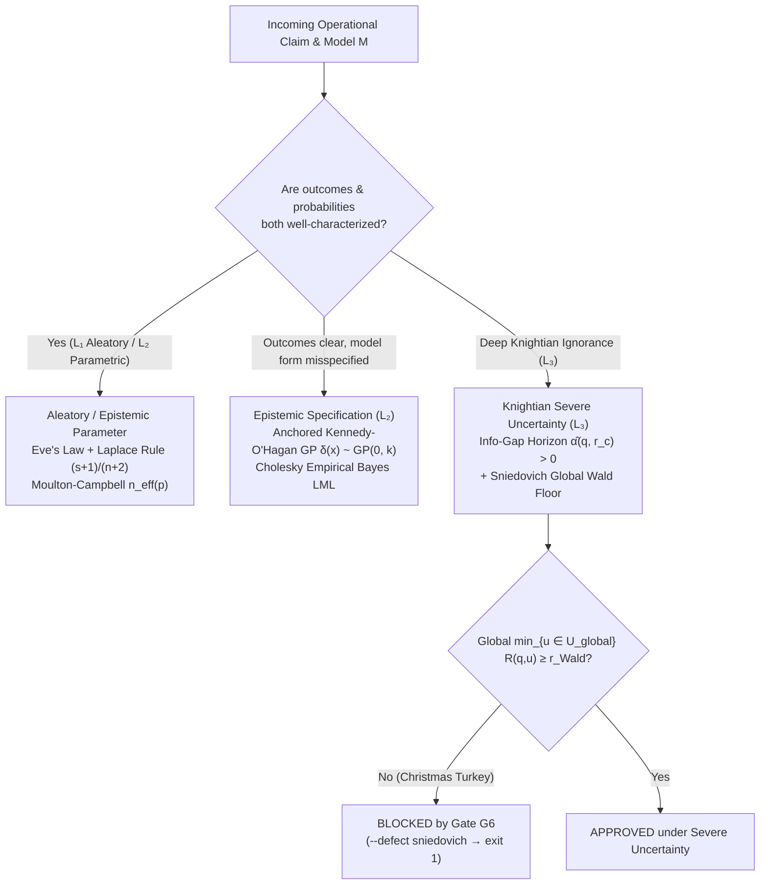

# 4. The Typology of Uncertainty

## The Christmas Turkey and the Three Coins

Bertrand Russell once told the parable of an inductive chicken, later retold by Nassim Nicholas Taleb as **the Christmas Turkey**. Every morning at 9:00 a.m. sharp, the farmer walks into the barn and fills the trough with corn.
- On Day 1, the turkey is cautious.
- By Day 20, the turkey has formed a statistical hypothesis: *"The appearance of the farmer at 9:00 a.m. causes breakfast."*
- By Day 100, the turkey has a hundred consecutive confirmations and zero counterexamples. Using standard textbook confidence intervals, the turkey's estimated probability of being fed tomorrow morning approaches $100\%$, and its standard error has shrunk to almost nothing.

Day 101 is the Wednesday before Thanksgiving (or Christmas Eve). The farmer walks in at 9:00 a.m. carrying an axe instead of corn.

One hundred days of real empirical data made the turkey *more* vulnerable rather than safer because **the event that killed the turkey was never in the turkey's list of hypotheses.** More data only shrink uncertainty *inside* a correctly specified model; when the model's hypothesis space omits the true mechanism of the world, accumulating more data builds false confidence around the wrong answer.

To see why treating all "uncertainty" as a single concept fails, compare four situations:

1. **The Known Fair Coin (Aleatory Uncertainty, $L\_1$):** You are about to toss a physically verified, symmetric coin once. Nobody can predict the single toss, and collecting a billion historical coin tosses will not make the next toss any closer to $100\%$ Heads. The probability stays $50/50$ forever. This is **irreducible physical randomness**.
2. **The Bent Coin of Unknown Bias (Parametric Epistemic Uncertainty, $L\_2$):** Someone hands you a bent coin from a workshop. It has a fixed physical bias $\theta \in (0, 1)$, but you do not know the number $\theta$. After $3$ tosses, you are uncertain about $\theta$; after $10\text{,}000$ tosses, the Law of Large Numbers pins $\theta$ down to within a hundredth of a percent. Here, **more data cure ignorance**.
3. **The Straight Ruler on a Curved Planet (Structural Epistemic Uncertainty, $L\_2$):** An engineer fits a linear friction formula $y = \theta x$ to predict wind drag on an aircraft wing across high-subsonic speeds, where shockwaves actually bend the physics nonlinearly. As the engineer collects more measurements, the least-squares fit forces the single knob $\theta$ to twist into an unphysical number just to compromise between the low-speed and high-speed points. The confidence interval around $\theta$ shrinks toward zero while the formula itself remains **structurally wrong**.
4. **The Turkey's Morning (Knightian Uncertainty, $L\_3$):** A decision-maker faces regimes, strategic reactions, or structural breaks where neither a unique probability distribution nor an exhaustive list of states can be trusted.

---

## 4.1 The Law of Total Variance and the Stirling Matrix

### Separating Aleatory Noise from Epistemic Ignorance

Mathematics gives us an exact accounting identity to separate the randomness of the **World ($L\_1$)** from the parameter ignorance of the **Model ($L\_2$)**. Suppose an outcome $Y$ is governed by an unknown parameter vector $\theta$. By the **Law of Total Variance** (also known as Eve's Law):

$$\mathrm{Var}(Y) = \underbrace{\mathbb{E}\_\theta\bigl[\mathrm{Var}(Y \mid \theta)\bigr]}\_{\text{Aleatory Uncertainty ($L\_1$)}} + \underbrace{\mathrm{Var}\_\theta\bigl(\mathbb{E}[Y \mid \theta]\bigr)}\_{\text{Parametric Epistemic Uncertainty ($L\_2$)}}$$

Examine the two additive pieces on the right-hand side:
- **The first term, $\mathbb{E}\_\theta[\mathrm{Var}(Y \mid \theta)]$, is Aleatory Uncertainty:** Even if an oracle whispered the exact true parameter $\theta$ into your ear, the outcome $Y$ would still fluctuate around $\mathbb{E}[Y \mid \theta]$ with variance $\mathrm{Var}(Y \mid \theta)$. Because this variability belongs to the physical generating process in $L\_1$, **collecting more data never reduces it to zero.** You cannot "research away" aleatory risk; you mitigate it by buying insurance, building safety margins, capping exposure (Chapter 6), or redesigning the physical system.
- **The second term, $\mathrm{Var}\_\theta(\mathbb{E}[Y \mid \theta])$, is Parametric Epistemic Uncertainty:** It measures how much the expected outcome $\mathbb{E}[Y \mid \theta]$ shifts across the plausible values of $\theta$ that your finite sample has not yet ruled out. As sample size $n \to \infty$ in an identifiable model, the posterior distribution of $\theta$ concentrates on a single point, and this second term shrinks to zero.

### The Stirling Matrix: Crossing Outcomes with Probabilities

What happens when even the list of possible outcomes or the functional form of the model is in doubt? Science-policy theorist **Andy Stirling** organized uncertainty into a $2 \times 2$ diagnostic grid according to how well we know (1) the **possible outcomes** and (2) the **probabilities** attached to them:

<figure class="stoch-figure">
  <svg xmlns="http://www.w3.org/2000/svg" width="1160" height="380" viewBox="0 0 1160 380" fill="none" role="img" aria-labelledby="title-fig-02-stirling">
  <title id="title-fig-02-stirling">The 2x2 Stirling Diagnostic Matrix of Uncertainty</title>
  <defs>
  
  </defs>
  <rect x="1" y="1" width="1158" height="378" rx="14" fill="var(--canvas)" stroke="var(--border)" stroke-width="1.5"/>
  <text x="658" y="24" text-anchor="middle" fill="var(--ink)" class="mono" font-size="12.5" font-weight="800" letter-spacing="0.06em">KNOWLEDGE OF PROBABILITIES</text>
  <text x="414" y="48" text-anchor="middle" fill="var(--sky)" font-size="13" font-weight="700">Solid / Agreed Laws</text>
  <text x="904" y="48" text-anchor="middle" fill="var(--violet)" font-size="13" font-weight="700">Fragile / Unknowable Odds</text>
  <text x="88" y="118" text-anchor="middle" fill="var(--ink)" font-size="13" font-weight="800">Outcomes</text>
  <text x="88" y="138" text-anchor="middle" fill="var(--sky)" font-size="12.5" font-weight="700">Well-Defined</text>
  <text x="88" y="156" text-anchor="middle" fill="var(--muted)" font-size="11.5">&amp; Agreed</text>
  <text x="88" y="270" text-anchor="middle" fill="var(--ink)" font-size="13" font-weight="800">Outcomes</text>
  <text x="88" y="290" text-anchor="middle" fill="var(--amber)" font-size="12.5" font-weight="700">Open, Contested</text>
  <text x="88" y="308" text-anchor="middle" fill="var(--muted)" font-size="11.5">or Unlisted</text>
  <rect x="176" y="66" width="476" height="136" rx="12" fill="var(--elevated)" stroke="var(--sky)" stroke-width="2.2"/>
  <text x="200" y="96" fill="var(--sky)" class="mono" font-size="11.5" font-weight="700">QUADRANT 1 · ALEATORY + PARAMETRIC</text>
  <text x="200" y="124" fill="var(--ink)" font-size="17" font-weight="800">1. RISK</text>
  <text x="200" y="152" fill="var(--muted)" font-size="12">Known states and stable governing laws.</text>
  <text x="200" y="176" fill="var(--muted)" font-size="12">Remedy: Kelly caps, Laplace succession, SBC.</text>
  <rect x="668" y="66" width="472" height="136" rx="12" fill="var(--elevated)" stroke="var(--violet)" stroke-width="2.2"/>
  <text x="692" y="96" fill="var(--violet)" class="mono" font-size="11.5" font-weight="700">QUADRANT 2 · EPISTEMIC SPECIFICATION</text>
  <text x="692" y="124" fill="var(--ink)" font-size="17" font-weight="800">2. UNCERTAINTY</text>
  <text x="692" y="152" fill="var(--muted)" font-size="12">Known states, contested odds or model form.</text>
  <text x="692" y="176" fill="var(--muted)" font-size="12">Remedy: Kennedy-O'Hagan GP δ(x) &amp; ICP.</text>
  <rect x="176" y="220" width="476" height="136" rx="12" fill="var(--elevated)" stroke="var(--emerald)" stroke-width="2.2"/>
  <text x="200" y="250" fill="var(--emerald)" class="mono" font-size="11.5" font-weight="700">QUADRANT 3 · VALUATION &amp; SCOPE</text>
  <text x="200" y="278" fill="var(--ink)" font-size="17" font-weight="800">3. AMBIGUITY</text>
  <text x="200" y="306" fill="var(--muted)" font-size="12">Disagreement over harm or who bears error cost.</text>
  <text x="200" y="330" fill="var(--muted)" font-size="12">Remedy: p* = C/(ηL) &amp; Chouldechova audit (Φ₄).</text>
  <rect x="668" y="220" width="472" height="136" rx="12" fill="var(--elevated)" stroke="var(--amber)" stroke-width="2.2"/>
  <text x="692" y="250" fill="var(--amber)" class="mono" font-size="11.5" font-weight="700">QUADRANT 4 · DEEP KNIGHTIAN REGIME</text>
  <text x="692" y="278" fill="var(--ink)" font-size="17" font-weight="800">4. IGNORANCE</text>
  <text x="692" y="306" fill="var(--muted)" font-size="12">Unlisted states &amp; Russell's Christmas Turkey.</text>
  <text x="692" y="330" fill="var(--muted)" font-size="12">Remedy: Info-Gap α̂ + Global Wald Floor + Exit.</text>
</svg>
  <figcaption><strong>Figure 4.1 — Andy Stirling's 2x2 Diagnostic Matrix of Uncertainty</strong></figcaption>
</figure>

In 1921, economist **Frank Knight** drew the classic boundary between measurable **Risk** (Column 1) and unmeasurable **Uncertainty** (Column 2 and Row 2). In the Stochology Protocol (`crates/stochology-core/src/uncertainty.rs` and `card.rs`), every Epistemological Card must declare its dominant uncertainty class from four formal types:

| Protocol Type (`uncertainty`) | Primary Layer | Mathematical Mechanism in the Protocol | Operational Remedy |
| --- | --- | --- | --- |
| **`aleatory`** | $L\_1$ (World) | Irreducible conditional variance $\mathbb{E}\_\theta[\mathrm{Var}(Y \mid \theta)]$. | Safety margins, Kelly exposure caps, redundancy, pooling. |
| **`epistemic_parameter`** | $L\_2$ (Model) | Finite-sample dispersion $\mathrm{Var}\_\theta(\mathbb{E}[Y \mid \theta])$ and Laplace's Rule of Succession. |Targeted sampling, Simulation-Based Calibration (SBC), Bayesian updating. |
| **`epistemic_specification`** | $L\_2$ (Model) | **Kennedy-O'Hagan Structural Discrepancy** $\delta(x) \sim \mathcal{GP}(m(x), k(x, x'))$ with boundary anchoring. | Explicit discrepancy modeling, multi-environment ICP, rival model classes. |
| **`knightian`** | $L\_3$ (Agent) | **Info-Gap Decision Theory** ($\hat{\alpha}, \hat{\beta}$, *zero-ing*) + **Sniedovich/Wald Global Maximin Safeguard**. | Robust satisficing, global worst-case floors, automatic numeric exit clauses. |

---

## 4.2 Parametric Epistemic Uncertainty: Laplace's Rule of Succession

Suppose an insurer examines $n = 36$ consecutive months of fire-reinsurance records (as happened in the 1986–1988 window of `danish_fire.csv`) and observes $s = 0$ claims exceeding $50\text{ million DKK}$. What is the probability $p$ that a catastrophic claim will strike next month?

A naive frequentist plug-in estimator computes:

$$\hat{p}\_{\text{naive}} = \frac{s}{n} = \frac{0}{36} = 0.00$$

Reporting $\hat{p} = 0$ violates Prohibition 4 (Cromwell's Rule): it confuses *"it did not happen in this 36-month window"* with *"it is physically impossible."* If an underwriter believes $p = 0$, any finite premium looks like free money, encouraging infinite leverage and guaranteeing eventual ruin (which arrived in August 1989 with a $152.4\text{M DKK}$ fire loss).

In 1774, **Pierre-Simon Laplace** addressed this small-sample collapse, framing it as the probability that the sun will rise tomorrow given that it has risen $n$ times in a row. Starting from a uniform $\mathrm{Beta}(1, 1)$ prior over the unknown probability $\theta \in [0, 1]$ and observing $s$ successes in $n$ independent Bernoulli trials, the posterior distribution is $\mathrm{Beta}(s + 1, n - s + 1)$, whose expectation is **Laplace's Rule of Succession**:

$$\hat{p}\_{\text{Laplace}} = \frac{s + 1}{n + 2}$$

This formula has three useful properties:
- Before any data are collected ($n = 0, s = 0$), $\hat{p} = \frac{1}{2}$ (maximum entropy over a binary outcome).
- After $n = 36$ clean months with $s = 0$ hits, $\hat{p} = \frac{0 + 1}{36 + 2} = \frac{1}{38} \approx 0.0263$ ($2.63\%$ per month), remaining strictly above zero.
- As sample size grows large ($n \to \infty$), the $+1$ and $+2$ pseudocounts wash out and $\frac{s+1}{n+2} \to \frac{s}{n}$ smoothly.

---

## 4.3 Structural Epistemic Uncertainty: Kennedy-O'Hagan Discrepancy ($\delta(x)$)

### The Trap of Parameter Pseudo-Convergence

Now consider a deeper danger in $L\_2$. Suppose an engineer or economist builds a mechanistic computer simulator $\eta(x, \theta)$ to predict a physical system $y(x)$ across control inputs $x$, where $\theta$ represents a physical constant (for instance, thermal conductivity, aerodynamic drag, or risk aversion).

In reality, **no mathematical model $\eta(x, \theta)$ captures $100\%$ of the real world's physics.** There is always a missing physical term, a **structural discrepancy** $\delta(x)$ separating the true generating process of the World ($L\_1$) from the idealized simulator ($L\_2$).

If we ignore $\delta(x)$ and calibrate the model by minimizing ordinary least squares $\sum\_{i=1}^n \bigl(y\_i - \eta(x\_i, \theta)\bigr)^2$, three failures follow:
1. **Biased Physical Parameters (Pseudo-Convergence):** The optimizer forces the physical knob $\theta$ away from its true physical value $\theta\_{\text{true}}$ toward a distorted value $\hat{\theta}\_{\text{naive}}$ that tries to soak up the missing curve $\delta(x)$ inside the training domain.
2. **False Confidence:** As $n$ grows, the standard error around $\hat{\theta}\_{\text{naive}}$ shrinks as $1/\sqrt{n}$. The analyst becomes $99.9\%$ confident in a wrong parameter.
3. **Extrapolation Collapse:** The moment the decision-maker uses $\eta(x, \hat{\theta}\_{\text{naive}})$ at a new operational point $x\_{\text{extrap}}$ outside the training range, the distorted parameter $\hat{\theta}\_{\text{naive}}$ and the unmodeled discrepancy $\delta(x\_{\text{extrap}})$ stop canceling each other out, producing a large prediction error with tiny nominal error bars.

### Marc Kennedy and Anthony O'Hagan's (2001) Solution

In a 2001 paper in the *Journal of the Royal Statistical Society*, **Marc Kennedy and Anthony O'Hagan** addressed this problem by treating the model's structural flaw as a first-class mathematical object:

$$y(x) = \underbrace{\eta(x, \theta)}\_{\text{Simulator ($L\_2$)}} + \underbrace{\delta(x)}\_{\text{Structural Discrepancy}} + \underbrace{\varepsilon}\_{\text{Aleatory Noise ($L\_1$)}}, \qquad \delta(x) \sim \mathcal{GP}\bigl(m(x),  k(x, x')\bigr)$$

Here $\delta(x) \sim \mathcal{GP}(m(x), k(x, x'))$ denotes a **Gaussian Process ($\mathcal{GP}$)**, a probability distribution over smooth unknown functions. Instead of assuming that the missing physics $\delta(x)$ is a specific polynomial, a $\mathcal{GP}$ specifies only a prior mean function $m(x)$ (typically $0$; `KennedyOHaganDiscrepancy` uses $m \equiv 0$) and a **covariance kernel** $k(x, x')$, such as the squared-exponential kernel:

$$k(x, x') = \sigma\_\delta^2 \exp\left(-\frac{(x - x')^2}{2\ell^2}\right)$$

This kernel encodes two properties:
- If two inputs $x$ and $x'$ are close together ($|x - x'| \ll \ell$), the simulator's structural errors $\delta(x)$ and $\delta(x')$ must be similar (highly correlated).
- If a new query point $x\_{\text{extrap}}$ moves far away from all previously observed training data ($|x\_{\text{extrap}} - x\_i| \gg \ell$), the correlation drops toward zero and the predictive variance automatically inflates back to $\sigma\_\delta^2$, **warning the decision-maker that the model is extrapolating outside its training support.**

### Why Boundary Anchoring Matters

There is one identifiability trap in the raw Kennedy-O'Hagan equation: if $\delta(x)$ can be *any* curve, how can the data tell the difference between changing $\theta$ inside $\eta(x, \theta)$ and changing $\delta(x)$? Without an identifiability constraint, $\theta$ and $\delta(x)$ are confounded (Brynjarsdóttir & O'Hagan, 2014).

In `KennedyOHaganDiscrepancy` (`crates/stochology-core/src/uncertainty.rs`), the protocol enforces **anchor constraints** (known physical boundary regimes, such as low-excitation anchor points $x\_0$ where the idealized law $\eta(x, \theta)$ holds closely and $\delta(x\_0) \approx 0$). Anchoring breaks the collinearity between $\eta(x, \theta)$ and $\delta(x)$:
- The anchor regime pins down the true physical parameter $\theta$ without distortion;
- The Gaussian Process $\delta(x)$ absorbs the nonlinear structural departure away from the anchor;
- Out-of-domain predictions carry widened uncertainty bands.

### Exact Cholesky Factorization and Empirical Bayes Type-II Maximum Likelihood

To select the Gaussian Process hyperparameters (the correlation length-scale $\ell$ and the discrepancy amplitude $\sigma\_\delta$) without hand-tuning, `crates/stochology-core/src/uncertainty.rs` factorizes the covariance matrix $\Sigma = K\_\delta(X, X; \ell, \sigma\_\delta) + \sigma\_n^2 I$ via exact lower-triangular **Cholesky decomposition** $\Sigma = L L^\top$ (`cholesky_decompose`, `cholesky_solve`, `cholesky_log_det`). Given residual vector $r = y - \eta(X, \hat{\theta})$, `KennedyOHaganDiscrepancy::log_marginal_likelihood` evaluates the exact Gaussian Process **Log Marginal Likelihood (Type-II MLE)**:

$$\ln p(y \mid X, \hat{\theta}, \ell, \sigma\_\delta) = \underbrace{-\frac{1}{2} r^\top (K\_\delta + \sigma\_n^2 I)^{-1} r}\_{\text{Data Fit}} \underbrace{- \sum\_{i=1}^n \ln L\_{ii}}\_{\text{Occam's Razor Complexity Penalty } (-\frac{1}{2}\ln|\Sigma|)} - \frac{n}{2}\ln(2\pi)$$

The Cholesky log-determinant term $-\frac{1}{2}\ln|\Sigma| = -\sum\_{i=1}^n \ln L\_{ii}$ acts as an automatic **Bayesian Occam's Razor**, penalizing overly wiggly kernels ($\ell \to 0$) while the quadratic form $-\frac{1}{2}r^\top\Sigma^{-1}r$ penalizes underfitting (`KennedyOHaganDiscrepancy::calibrate_empirical_bayes`).

---

## 4.4 Knightian Uncertainty: Info-Gap Decision Theory and Sniedovich's Safeguard

### Foundations: Decision Criteria When Probabilities Cannot Be Trusted

What should an agent ($L\_3$) do when operating in the right-hand column of the Stirling Matrix, where probability distributions over future states of the world $u \in \mathcal{U}$ do not exist or cannot be trusted?

Classical decision theory offers four rules, illustrated by **David van Dantzig (1956)** after the 1953 North Sea flood prompted the Netherlands to redesign the height of its coastal dikes:

| Classical Criterion | Mathematical Rule (Reward $R(q, u)$) | Epistemological Posture |
| --- | --- | --- |
| **1. Abraham Wald (Maximin)** | $\max\_q \min\_{u \in \mathcal{U}} R(q, u)$ | **Maximum Pessimism:** Judge each decision $q$ by its absolute worst possible outcome across the entire universe of states $\mathcal{U}$. |
| **2. Leonard Savage (Minimax Regret)** | $\min\_q \max\_{u \in \mathcal{U}} \bigl[\max\_{q'} R(q', u) - R(q, u)\bigr]$ | **Regret Avoidance:** Minimize the worst possible hindsight difference between what you did and what you *wish* you had done had you known $u$. |
| **3. Pierre-Simon Laplace (Insufficient Reason)** | $\max\_q \frac{1}{|\mathcal{U}|}\sum\_{u \in \mathcal{U}} R(q, u)$ | **Uniform Ignorance:** Treat all listed states as equally probable. |
| **4. Leonid Hurwicz ($\lambda$-Optimism)** | $\max\_q \bigl[\lambda \max\_u R(q, u) + (1-\lambda)\min\_u R(q, u)\bigr]$ | **Declared Compromise:** Weight the best and worst cases by a declared optimism index $\lambda \in [0, 1]$. |

### Yakov Ben-Haim's Info-Gap Decision Theory

In engineering design and operational resilience, **Yakov Ben-Haim** proposed **Info-Gap Decision Theory** as a way to navigate severe uncertainty when you have a nominal (best-guess) model $\tilde{u}$ that you know may be wrong, and a critical survival requirement $r\_c$ (the minimum reward $R(q, u) \ge r\_c$ the system needs to avoid disaster).

Instead of fixing a single uncertainty set, Info-Gap surrounds the nominal model $\tilde{u}$ with a nested family of uncertainty balls $\mathcal{U}(\alpha, \tilde{u})$ indexed by an **uncertainty horizon $\alpha \ge 0$**:

$$\mathcal{U}(\alpha, \tilde{u}) = \bigl\lbrace   u : \lVert u - \tilde{u} \rVert \le \alpha  \bigr \rbrace$$

When $\alpha = 0$, the ball contains only the nominal guess $\tilde{u}$. As $\alpha$ grows, the ball expands to allow larger and larger departures from $\tilde{u}$. Info-Gap then defines two horizons for each candidate decision $q$:

1. **The Robustness Horizon ($\hat{\alpha}(q, r\_c)$, Immunity to Failure):**
   $$\hat{\alpha}(q, r\_c) = \max\left\lbrace  \alpha \ge 0 : \min\_{u \in \mathcal{U}(\alpha, \tilde{u})} R(q, u) \ge r\_c  \right\rbrace$$
   In plain words: *How wrong can our nominal model $\tilde{u}$ be (how large can $\alpha$ get) before decision $q$ risks violating the survival threshold $r\_c$?* A larger $\hat{\alpha}$ means more robustness.

2. **The Opportuneness Horizon ($\hat{\beta}(q, r\_w)$, Propensity for Windfall):**
   $$\hat{\beta}(q, r\_w) = \min\left\lbrace  \alpha \ge 0 : \max\_{u \in \mathcal{U}(\alpha, \tilde{u})} R(q, u) \ge r\_w  \right\rbrace$$
   In plain words: *What is the smallest departure $\alpha$ from the nominal model needed to make an ambitious windfall reward $r\_w > r\_c$ possible?* A smaller $\hat{\beta}$ means windfall requires less luck.

A central theorem of Info-Gap is the **Zero-ing Property**: if you demand a critical reward $r\_c$ equal to what the nominal model predicts ($r\_c = R(q, \tilde{u})$), your robustness horizon is identically zero ($\hat{\alpha}(q, R(q, \tilde{u})) = 0$). **Optimizing for the nominal model buys zero robustness against model error.** To gain positive robustness ($\hat{\alpha} > 0$), you must step back from nominal optimality and *satisfice*.

### Moshe Sniedovich's Critique ("No-Man's Land") and the Global Wald Safeguard

In a series of mathematical papers (2007–2012), operations researcher **Moshe Sniedovich** identified a structural flaw in unguarded Info-Gap analysis. Because $\hat{\alpha}(q, r\_c)$ expands outward from a single local point $\tilde{u}$ and stops looking the instant a curve crosses $r\_c$, **Info-Gap is blind to what happens at $\alpha > \hat{\alpha}(q, r\_c)$**, a region Sniedovich called **"No-Man's Land."**

Raw Info-Gap can easily recommend a fragile option:
- Suppose **Option A (Fragile Turkey)** performs well near the nominal guess $\tilde{u}$ and stays above $r\_c = 100$ up to $\hat{\alpha}\_A = 1.60$, but at $\alpha = 2.0$ its performance plunges off a cliff to $-450$ (total systemic ruin).
- Suppose **Option B (Robust Engineering)** has a slightly smaller local crossing or a modest trade-off near $\tilde{u}$, or stays above $r\_c$ up to $\hat{\alpha}\_B = 3.50$, and even under the worst conceivable state in the entire physical universe $\mathcal{U}\_{\text{global}}$, its reward never drops below $+45.0$.

If $\tilde{u}$ is severely misspecified (the definition of Knightian uncertainty), reality may easily lie outside $\mathcal{U}(\hat{\alpha}, \tilde{u})$. An algorithm that checks only local robustness around a wrong guess $\tilde{u}$ is performing a **local maximin** around a fiction while ignoring global catastrophe.

To prevent this failure, `InfoGapOption` (`crates/stochology-core/src/uncertainty.rs`) enforces **Sniedovich's Global Maximin Safeguard**:

<figure class="stoch-figure">
  <svg xmlns="http://www.w3.org/2000/svg" width="1100" height="400" viewBox="0 0 1100 400" fill="none" role="img" aria-labelledby="title-fig-02-infogap">
  <title id="title-fig-02-infogap">Info-Gap Robustness Horizon versus Sniedovich's No-Man's Land and the Global Wald Maximin Safeguard</title>
  <defs>
  <marker id="axis-arrow" viewBox="0 0 10 10" refX="8" refY="5" markerWidth="6" markerHeight="6" orient="auto">
  <path d="M 0 1 L 9 5 L 0 9 z" fill="var(--muted)"/>
  </marker>
  
  </defs>
  <rect x="1" y="1" width="1098" height="398" rx="14" fill="var(--canvas)" stroke="var(--border)" stroke-width="1.5"/>
  <rect x="410" y="28" width="650" height="300" rx="10" fill="var(--rose-bg)" opacity="0.58"/>
  <text x="735" y="56" text-anchor="middle" fill="var(--rose)" class="mono" font-size="12.5" font-weight="800" letter-spacing="0.04em">SNIEDOVICH'S "NO-MAN'S LAND" (α &gt; α̂_A = 1.60)</text>
  <text x="735" y="78" text-anchor="middle" fill="var(--muted)" font-size="11.5">Uninspected by local Info-Gap; policed by Global Wald Maximin Floor</text>
  <line x1="110" y1="336" x2="110" y2="20" stroke="var(--muted)" stroke-width="2" marker-end="url(#axis-arrow)"/>
  <line x1="110" y1="236" x2="1068" y2="236" stroke="var(--muted)" stroke-width="2" marker-end="url(#axis-arrow)"/>
  <text x="98" y="34" text-anchor="end" fill="var(--ink)" font-size="12.5" font-weight="700">Reward R(q, u)</text>
  <text x="735" y="378" text-anchor="middle" fill="var(--ink)" font-size="12.5" font-weight="700">Uncertainty Horizon α →</text>
  <line x1="110" y1="156" x2="1060" y2="156" stroke="var(--sky)" stroke-width="1.8" stroke-dasharray="6 4"/>
  <text x="98" y="160" text-anchor="end" fill="var(--sky)" class="mono" font-size="11.5" font-weight="700">r_c = 100</text>
  <line x1="110" y1="196" x2="1060" y2="196" stroke="var(--emerald)" stroke-width="1.8" stroke-dasharray="3 3"/>
  <text x="98" y="200" text-anchor="end" fill="var(--emerald)" class="mono" font-size="11.5" font-weight="700">Wald +45</text>
  <text x="98" y="240" text-anchor="end" fill="var(--muted)" class="mono" font-size="11.5" font-weight="600">0</text>
  <text x="98" y="320" text-anchor="end" fill="var(--rose)" class="mono" font-size="11.5" font-weight="700">-450</text>
  <line x1="410" y1="156" x2="410" y2="336" stroke="var(--rose)" stroke-width="1.5" stroke-dasharray="4 4"/>
  <text x="410" y="356" text-anchor="middle" fill="var(--rose)" class="mono" font-size="11.5" font-weight="700">α̂_A = 1.60</text>
  <line x1="745" y1="156" x2="745" y2="236" stroke="var(--emerald)" stroke-width="1.5" stroke-dasharray="4 4"/>
  <text x="745" y="258" text-anchor="middle" fill="var(--emerald)" class="mono" font-size="11.5" font-weight="700">α̂_B = 3.50</text>
  <path d="M 110 100 C 310 110, 550 136, 745 156 C 845 167, 945 182, 1040 188" fill="none" stroke="var(--emerald)" stroke-width="3.5" stroke-linecap="round"/>
  <circle cx="745" cy="156" r="5.5" fill="var(--surface)" stroke="var(--emerald)" stroke-width="3"/>
  <text x="735" y="122" text-anchor="middle" fill="var(--emerald)" font-size="12.5" font-weight="800">Option B — Robust Satisficing (Global Min ≥ +45.0 · APPROVED)</text>
  <path d="M 110 56 C 235 70, 338 112, 410 156 C 465 194, 520 308, 600 316 L 1030 316" fill="none" stroke="var(--rose)" stroke-width="3.2" stroke-dasharray="8 5" stroke-linecap="round"/>
  <circle cx="410" cy="156" r="5.5" fill="var(--surface)" stroke="var(--rose)" stroke-width="3"/>
  <text x="128" y="50" fill="var(--rose)" font-size="12.5" font-weight="800">Option A — Fragile Nominal Turkey</text>
  <text x="745" y="298" text-anchor="middle" fill="var(--rose)" font-size="12.5" font-weight="800">Catastrophic Collapse to -450 (BLOCKED by Gate G6!)</text>
</svg>
  <figcaption><strong>Figure 4.2 — Info-Gap Robustness Curve vs. Sniedovich's No-Man's Land and the Global Wald Safeguard</strong></figcaption>
</figure>

Every decision under Knightian uncertainty must pass **three simultaneous checks**:
1. **Zero-ing Audit:** $\hat{\alpha}(q, R(q, \tilde{u})) = 0$ is verified algebraically;
2. **Positive Local Robustness:** $\hat{\alpha}(q, r\_c) > 0$ at the declared critical threshold $r\_c$;
3. **Global Wald Maximin Safeguard:** Across the entire physically admissible state space $\mathcal{U}\_{\text{global}}$ (including all states outside $\mathcal{U}(\hat{\alpha}, \tilde{u})$), the global worst-case payoff must stay above the catastrophic ruin floor:
   $$\min\_{u \in \mathcal{U}\_{\text{global}}} R(q, u) \ge r\_{\text{Wald, min}}$$

Any option that violates the global Wald floor in No-Man's Land is automatically rejected (`Gate G6` and `--defect sniedovich`).

### Interactive Laboratory (`/lab`)

Adjust the critical survival requirement $r\_c$, the tail drop in Sniedovich's "No-Man's Land," and the Kennedy-O'Hagan GP boundary anchor weight in the interactive laboratory below:

---

## Computational Audit in Rust

Run Laboratory 2 from your terminal to see both the Kennedy-O'Hagan Gaussian Process calibration and the Info-Gap + Sniedovich safeguard in action:

~~~bash
cargo run --release --bin labs -- --uncertainty
~~~

~~~text
=== LAB 2: KENNEDY-O'HAGAN GP DISCREPANCY AND INFO-GAP + SNIEDOVICH ===
  [Kennedy-O'Hagan GP] theta_true=0.800 | without_GP=0.6454 (bias=0.1546, extrap_err=0.2022) | with_GP=0.7865 (bias=0.0135, extrap_err=0.0324) | EB_Cholesky(ell*=3.60, sigma*=1.00, LML=+27.27)
  [Info-Gap + Sniedovich] fragile_nominal_turkey: alpha_hat=1.60, zero_ing=0.0, Wald=-450.0, approved=false | robust_satisficing_wald: alpha_hat=3.50, beta_hat=2.13, Wald=45.0, approved=true
~~~

Walk through the two laboratory experiments:
1. **In `[Kennedy-O'Hagan GP]`**, the true physical parameter is $\theta\_{\text{true}} = 0.800$, but the physical world includes a nonlinear structural discrepancy $\delta(x)$ absent from the bare model $\eta(x, \theta)$.
   - **Without the GP discrepancy**, ordinary least squares twists the physical parameter down to $\hat{\theta} = 0.6454$ (a parameter bias of $0.1546$) and suffers an out-of-domain extrapolation error of $0.2022$.
   - **With the anchored Kennedy-O'Hagan GP $\delta(x) \sim \mathcal{GP}(0, k)$**, the estimator recovers $\hat{\theta} = 0.7865$ (cutting parameter bias more than $11$-fold to $0.0135$), reduces extrapolation error more than $6$-fold to $0.0324$, and selects Empirical Bayes hyperparameters $(\ell^{\ast} = 3.60,\ \sigma\_\delta^{\ast} = 1.00)$ maximizing the Cholesky log marginal likelihood ($\mathrm{LML} = +27.27$).
2. **In `[Info-Gap + Sniedovich]`**, the `fragile_nominal_turkey` option boasts a positive local robustness horizon $\hat{\alpha} = 1.60$, yet collapses to $\text{Wald} = -450.0$ in No-Man's Land and is blocked (`approved = false`). The `robust_satisficing_wald` option achieves $\hat{\alpha} = 3.50$, opportuneness $\hat{\beta} = 2.13$, and a positive global Wald floor of $+45.0$, earning approval (`approved = true`).

## Exercises

1. **(Concept — Uncertainty Typing)** For each scenario below, name both the **ontological layer** ($L\_1, L\_2, L\_3$) and the **uncertainty class** (`aleatory`, `epistemic_parameter`, `epistemic_specification`, `knightian`):
   - *(a)* Thermal agitation (Johnson-Nyquist noise) inside an already-calibrated resistor.
   - *(b)* Estimating the mean service rate $\mu$ of a newly hired call-center agent after only $15$ calls.
   - *(c)* Using an M/M/1 queueing formula that assumes constant arrival rates $\lambda$ when real customer arrivals surge every Monday morning.
   - *(d)* Designing a power-grid reserve policy when an unmodeled cyber-attack or geomagnetic storm could disable transmission lines outside historical weather records.
2. **(Calculation — Laplace's Rule of Succession)** A clinical trial tests a surgical procedure on $n = 18$ patients and observes $s = 18$ successful recoveries ($0$ complications).
   - *(a)* What is the naive plug-in complication probability, and why does Prohibition 4 ban it?
   - *(b)* What complication probability does Laplace's Rule of Succession assign?
3. **(Concept — Kennedy-O'Hagan)** Explain in your own words why collecting $100\text{,}000$ additional observations *worsens* overconfidence when a mechanistic simulator $\eta(x, \theta)$ is calibrated without a structural discrepancy term $\delta(x)$.
4. **(Laboratory — Sniedovich Negative Proof)** Run `cargo run --release --bin gates -- --defect sniedovich` and verify that deploying an option that violates the global Wald floor in No-Man's Land is blocked with exit code `1`.

<strong>Analytical &amp; Computational Solutions (Click to Expand)</strong>

1. **Uncertainty Typing:**
   - *(a)* **Layer $L\_1$, `aleatory`:** Irreducible physical thermal noise $\mathbb{E}[\mathrm{Var}(Y \mid \theta)]$.
   - *(b)* **Layer $L\_2$, `epistemic_parameter`:** Finite-sample uncertainty $\mathrm{Var}(\mathbb{E}[Y \mid \theta])$ about $\mu$ that shrinks as $n$ grows.
   - *(c)* **Layer $L\_2$, `epistemic_specification`:** Structural discrepancy $\delta(t)$ between stationary M/M/1 and non-stationary $M\_t/M/c$ arrivals.
   - *(d)* **Layer $L\_3$, `knightian`:** Unlisted or unquantifiable probability regime requiring Info-Gap $\hat{\alpha}$ plus a global Wald maximin floor.
2. **Laplace's Rule of Succession:**
   - *(a)* Naive plug-in complication rate: $\hat{p}\_{\text{naive}} = \frac{0}{18} = 0.00$. Banned by Prohibition 4 (Cromwell's Rule) because $0\%$ probability assigns infinite log-loss if a complication ever occurs and shuts down Bayesian updating.
   - *(b)* Laplace's Rule of Succession: $\hat{p}\_{\text{Laplace}} = \frac{0 + 1}{18 + 2} = \frac{1}{20} = 0.050$ ($5.0\%$).
3. **Kennedy-O'Hagan Pseudo-Convergence:** Without $\delta(x)$, ordinary least squares projects the true function $\eta(x, \theta\_{\text{true}}) + \delta(x)$ onto the misspecified parametric family $\eta(x, \theta)$. As $n \to 100\text{,}000$, the parameter standard error shrinks as $O(n^{-1/2}) \to 0$ around the biased pseudo-parameter $\theta^{\ast} \neq \theta\_{\text{true}}$, yielding vanishing nominal error bars around a structurally wrong curve.
4. **Sniedovich Negative Proof:** Running `cargo run --release --bin gates -- --defect sniedovich` triggers `[G6 BLOCKED] Info-Gap option violates Sniedovich Global Wald Safeguard in No-Man's Land` and exits with code `1`.

## Summary

- **Aleatory uncertainty ($L\_1$)** is irreducible noise of the World; **Parametric epistemic uncertainty ($L\_2$)** is finite-sample parameter ignorance; **Structural epistemic uncertainty ($L\_2$)** is model misspecification; **Knightian uncertainty ($L\_3$)** is deep ignorance where probability distributions themselves are untrustworthy.
- **The Law of Total Variance** ($\mathrm{Var}(Y) = \mathbb{E}[\mathrm{Var}(Y\mid\theta)] + \mathrm{Var}(\mathbb{E}[Y\mid\theta])$) separates $L\_1$ aleatory variance from $L\_2$ parametric variance.
- **Laplace's Rule of Succession** ($\hat{p} = \frac{s+1}{n+2}$) prevents small samples from collapsing to dogmatic $0\%$ or $100\%$.
- **Kennedy-O'Hagan Structural Discrepancy** ($y(x) = \eta(x, \theta) + \delta(x) + \varepsilon$ with anchored $\mathcal{GP}$) prevents parameter pseudo-convergence and extrapolation overconfidence.
- **Info-Gap Decision Theory coupled with Sniedovich's Global Maximin Safeguard** measures local robustness ($\hat{\alpha}$) and opportuneness ($\hat{\beta}$) while guaranteeing a global Wald worst-case floor across No-Man's Land.
