# Chapter 6 — Reactive Worlds: Causal Invariance, Performativity, and Goodhart's Law

Once an agent acts on the world, the world does not remain a passive urn of marbles.

**Mediating Filter III** governs the return path from the agent's model and decision back into the physical and social world. Its first constitutive tension (**Tension 5**, implemented in [`crates/stochology/src/performativity.rs`](../crates/stochology/src/performativity.rs)) confronts **passive predictive curve-fitting and performative stability** against **isotonic calibration, causal invariance across environments, performative optimality, and Goodhart's Law** (Goodhart, 1975; Lucas, 1976; Strathern, 1997; Tian & Pearl, 2000; Kennedy & O'Hagan, 2001; MacKenzie, 2006; Hudgens & Halloran, 2008; Peters, Bühlmann & Meinshausen, 2016; Manheim & Garrabrant, 2018; Perdomo et al., 2020; Kleinberg & Raghavan, 2020; Dimitriadis, Gneiting & Jordan, 2021).



---

## 6.1 Isotonic CORP-Murphy Brier Score Decomposition via PAV

Before deploying any probabilistic forecast $p\_1, \dots, p\_n \in (0, 1)$ against binary outcomes $y\_1, \dots, y\_n \in \\{0, 1\\}$, how do we separate **honest calibration** (do events predicted at $70\\%$ happen $70\\%$ of the time?) from **discriminative resolution** (can the model separate high-risk shifts from calm shifts)?

Classical histogram binning is unstable and sensitive to arbitrary bin widths. Timo Dimitriadis, Tilmann Gneiting, and Alexander I. Jordan (2021) solved this via the **CORP** (*Consistent, Optimally Binned, Reproducible*) decomposition ([`CorpPavDecomposition`](../crates/stochology/src/performativity.rs#L19-L97)), which computes the non-decreasing isotonic regression $\hat{\pi}\_1 \le \dots \le \hat{\pi}\_n$ of the sorted outcomes via the **Pool-Adjacent-Violators (PAV)** algorithm ([`pav_isotonic_non_decreasing`](../crates/stochology/src/math.rs#L10-L51)). This yields the exact algebraic identity:

$$\mathrm{BS} = \frac{1}{n}\sum\_{i=1}^n (p\_i - y\_i)^2 = \underbrace{\mathrm{REL}\_{\mathrm{CORP}}}\_{\text{Miscalibration Loss}} - \underbrace{\mathrm{RES}\_{\mathrm{CORP}}}\_{\text{Discriminative Power}} + \underbrace{\mathrm{UNC}\_0}\_{\bar{y}(1-\bar{y})}$$

where $\mathrm{REL}\_{\mathrm{CORP}} = \mathrm{BS}(p) - \mathrm{BS}(\hat{\pi}) \ge 0$ and $\mathrm{RES}\_{\mathrm{CORP}} = \frac{1}{n}\sum\_{i=1}^n (\hat{\pi}\_i - \bar{y})^2 \ge 0$, closing to machine precision (`identity_closure_error < 1e-14`).

---

## 6.2 Invariant Causal Prediction (ICP), Kennedy–O'Hagan Anchored Discrepancy, and Tian–Pearl Counterfactual Bounds

Even a well-calibrated correlation collapses when the agent intervenes (`do(X = x)`), because passive conditioning $\mathbb{P}(Y \mid X = x)$ confounds genuine causal mechanisms with fragile environmental proxies. Stochology pairs three structural instruments in [`performativity.rs`](../crates/stochology/src/performativity.rs):

1. **Invariant Causal Prediction across Environments ([`evaluate_invariant_predictors`](../crates/stochology/src/performativity.rs#L126-L185), Peters, Bühlmann & Meinshausen, 2016):** Given observations from multiple regimes or seasons $e \in \mathcal{E}$, a true causal mechanism maintains an invariant structural slope ($\max\_e \hat{\beta}\_j^{(e)} - \min\_e \hat{\beta}\_j^{(e)} \approx 0$), whereas a spurious proxy exhibits large slope drift across environments.
2. **Kennedy & O'Hagan's (2001) Anchored Gaussian Process Discrepancy ([`AnchoredDiscrepancy`](../crates/stochology/src/performativity.rs#L190-L261)):** Every mathematical model $f\_\theta(x)$ differs from physical reality by a structural discrepancy $\delta(x) \sim \mathcal{GP}(0, k(x, x'))$ with squared-exponential kernel $k(x, x') = s^2 \exp\bigl(-\frac{(x - x')^2}{2\ell^2}\bigr)$. While posterior uncertainty $\sigma\_{\mathrm{post}}(x^\*)$ is small inside the observed training support, it expands back toward the prior structural ceiling $\sqrt{s^2 + \sigma\_{\mathrm{noise}}^2}$ as soon as the decision extrapolates into an unseen regime ($|x^\* - x\_{\mathrm{train}}| \gg \ell$), blocking extrapolation overconfidence.
3. **Jin Tian & Judea Pearl's (2000) Sharp Counterfactual Bounds ([`TianPearlCounterfactualBounds`](../crates/stochology/src/performativity.rs#L267-L327)):** Combining experimental rates $p\_{y\_1} = \mathbb{P}(Y\_{x\_1}=1), p\_{y\_0} = \mathbb{P}(Y\_{x\_0}=1)$ with observational joint probabilities $p\_{xy} = \mathbb{P}(X=x, Y=y)$ bounds the **Probability of Necessity** ($\mathrm{PN}$), **Probability of Sufficiency** ($\mathrm{PS}$), and **Probability of Necessity and Sufficiency** ($\mathrm{PNS}$) without parametric functional-form assumptions.

---

## 6.3 Performative Prediction ($\theta\_{\mathrm{PS}}$ vs. $\theta\_{\mathrm{PO}}$), MacKenzie's Regimes, and Goodhart's Four Variants

When a deployed parameter $\theta$ shifts the world's distribution to $\mathcal{D}(\theta)$ with Wasserstein-1 sensitivity $\varepsilon$ (Perdomo et al., 2020), Repeated Risk Minimization (RRM) contracts to a **Performative Stability** fixed point $\theta\_{\mathrm{PS}}$ only if $\frac{\varepsilon \beta}{\gamma} < 1$. Yet even when RRM converges, $\theta\_{\mathrm{PS}}$ ignores the derivative of the distribution shift itself! The true Stackelberg optimum is **Performative Optimality** $\theta\_{\mathrm{PO}} = \arg\min\_\theta \mathrm{PR}(\theta)$, evaluated in [`PerformativeSystem`](../crates/stochology/src/performativity.rs#L351-L466) alongside:
- Donald MacKenzie's (2006) four performativity regimes ([`MacKenzieRegime`](../crates/stochology/src/performativity.rs#L331-L347)): `GenericNonPerformative`, `EffectivePerformative`, `BarnesianSelfFulfilling`, and `CounterperformativeSelfNegating`;
- Kleinberg & Raghavan's (2020) separation of genuine **causal improvement effort** vs. **cosmetic gaming** (Milli et al.'s **social burden** of gaming);
- Hudgens & Halloran's (2008) **network interference and congestion spillover** $(1 - \gamma\_{\mathrm{cong}}\\,s)$, when treating a saturation fraction $s \in (0, 1]$ crowds out the shared channel;
- Manheim & Garrabrant's (2018) four variants of **Goodhart's Law** ([`GoodhartVariant`](../crates/stochology/src/performativity.rs#L470-L486) & [`GoodhartAudit`](../crates/stochology/src/performativity.rs#L490-L509)): `Regressional`, `Extremal`, `Causal`, and `Adversarial`.

---

## 6.4 Chapter 6 Laboratory: Real Data on NOAA Atlantic Storms (`atlantic_storms.csv`)

Running Chapter 6 (`cargo run --release --bin stochology -- --chapter 6`) evaluates these instruments on the NOAA HURDAT2 Atlantic Tropical Storm dataset (`data/atlantic_storms.csv`, $n = 20{,}778$, Measured):

```text
=== Chapter 6: Reactive Worlds, Performativity & Goodhart (Filter III · Tension 5) ===
  Atlantic Storms CORP-PAV (atlantic_storms.csv, n=20778): BS=0.2691 = REL(0.2114) - RES(0.1310) + UNC(0.1887), closure_err=3.7e-15
  Storms ICP across 3 seasons: physical_pressure_slope_range=0.009 vs proxy_latitude_slope_range=0.076
  Perdomo/MacKenzie (BarnesianSelfFulfilling): theta_PS=1.333 vs theta_PO=1.095 (risk_PO=0.249 < risk_PS=0.263) | KOH std_in=0.050 -> std_out=0.500
  Tian-Pearl PN=[0.75, 1.00], PNS=[0.50, 0.70] | Goodhart collapsed=true
```

- **CORP-PAV Identity Closure on `atlantic_storms.csv` ($n = 20{,}778$, Measured):** The PAV isotonic decomposition yields $\mathrm{BS} = 0.2691 = 0.2114 - 0.1310 + 0.1887$, closing to **$3.7 \times 10^{-15}$**.
- **Physical Mechanism vs. Geographic Proxy Across Historical Eras (`atlantic_storms.csv`, Measured):** Splitting the 20,778 storm tracks into three multi-decade environments (`1975–1994`, `1995–2009`, `2010–2021`), the physical central-pressure deficit $(1013 - P\_{\min})/40$ maintains a rock-solid causal slope (`slope_range = 0.009`), whereas the geographic latitude proxy drifts by **$8.4\times$ more** (`slope_range = 0.076`).
- **Performative Stability vs. Stackelberg Optimality (Analytical):** Under Barnesian self-fulfilling feedback ($\varepsilon = 0.45 > 0$), passive RRM converges to $\theta\_{\mathrm{PS}} = 1.333$ (`risk = 0.263`), whereas Stackelberg performative optimization steers to $\theta\_{\mathrm{PO}} = 1.095$ (`risk = 0.249 < 0.263`).

---

## Exercises

1. **Performative Erosion in `CommunityReserveEnv`:** Inspect lines 433–436 of [`crates/stochology/src/engine.rs`](../crates/stochology/src/engine.rs#L433-L436). How does `NaiveOptimizer`'s high `proxy_incentive_pressure = 0.85` accumulate `performative_erosion` across shifts and accelerate ruin?
2. **Kennedy–O'Hagan Extrapolation Guard:** In `AnchoredDiscrepancy::fit`, vary the length-scale $\ell$ from $0.25$ to $2.0$. At what distance $|x^\* - x\_{\mathrm{train}}|$ does the posterior standard deviation reach $95\\%$ of its unanchored prior ceiling?

