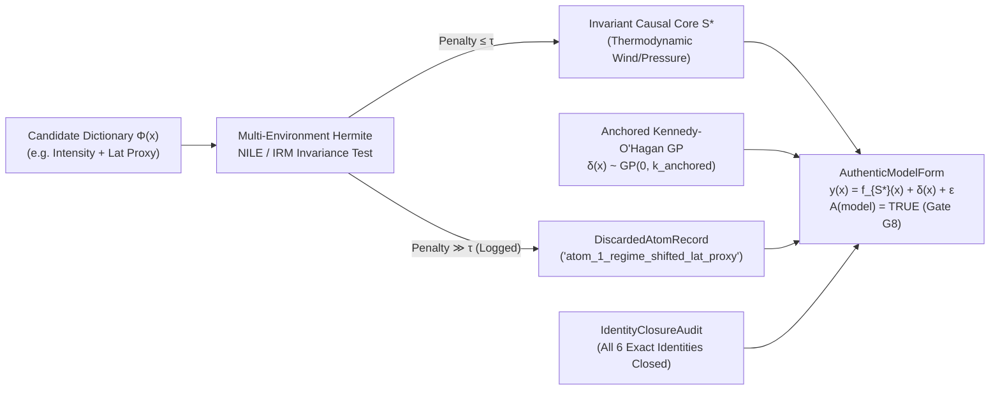

# 11. Structural Discrepancy and Authentic Form

> **Three tempos.** **Detachment:** set aside a good fit as proof that the model is right. **Abstraction:** an authentic model separates an invariant structural core from its specification residual (World Models, $L\_1 \to L\_2$). **Return:** Kennedy-O'Hagan discrepancy, the Authentic Model Form $\delta(x) + \hat{S}^\ast$, and the Almost-Perfect Machine. **Negative proof:** `gates -- --defect machine` (exit `1`).

## Clever Hans, the Horse That Could Count

In Berlin at the turn of the twentieth century, a horse named **Clever Hans** became an international sensation. If his trainer asked, *"What is $7 + 5$?"*, Hans tapped his hoof twelve times and stopped. Commissions of veterinarians, circus trainers, and zoologists inspected the stable for hidden wires or trick signals and found none; Hans performed even when strangers asked the questions.

Finally, psychologist **Oskar Pfungst** ran an experiment that changed only one thing: he asked Hans questions **whose answers the human questioner did not know**. Instantly, Hans's accuracy collapsed to random guessing.

Hans had not learned arithmetic. Instead, he watched the slight, unconscious forward lean of the questioner's posture as the hoof taps approached the expected count, along with the subtle relaxation of the questioner's eyebrows on the final tap.

Modern machine learning is filled with Clever Hans horses:
- As a thought experiment inspired by Zech et al. (2018), suppose a deep convolutional network trained to detect pneumonia on chest X-rays achieves an assumed area under the curve ($\mathrm{AUC}$) of $0.96$ by reading a portable metal hospital token in the corner of the image rather than the lungs. When deployed at a second hospital across town, it fails.
- A tropical cyclone rapid-intensification model fits historical storm tracks closely by latching onto a basin-specific latitude-season correlation that shifts whenever the multi-decadal ocean oscillation flips regime.
- An over-parameterized model uses $100$ collinear dictionary features that duplicate one another, hiding structural model error inside tweaked weights.

This chapter addresses two questions for the Stochology Protocol:
1. **When is a representation and approximation architecture $M = (T, \Phi, \theta)$ mathematically well-conditioned (`AlmostPerfectMachine`)?**
2. **When does a fitted model qualify as *authentic* (`AuthenticModelForm`) rather than a Clever Hans shortcut?**

---

## 11.1 The $(\varepsilon, \delta)$-Almost-Perfect Machine $M = (T, \Phi, \theta)$

### Foundations: Anatomy of a Learning Machine

Every parametric or semi-parametric model in statistics and machine learning can be written as a triple:

$$M = (T,  \Phi,  \theta), \qquad M(x) = \sum\_{j=1}^W \theta\_j  \phi\_j\bigl(T(x)\bigr) = \theta^\top \Phi\bigl(T(x)\bigr)$$

where:
- **$T: \mathcal{X} \to \mathcal{Z}$ is the Representation Map (Encoder):** It extracts a compressed state $z = T(x)$ from the raw high-dimensional observation $x \in \mathbb{R}^d$, stripping away irrelevant sensor noise.
- **$\Phi = [\phi\_1, \dots, \phi\_W]^\top$ is the Atomic Dictionary (Basis):** A collection of $W$ nonlinear basis functions or compositional feature atoms evaluated on $T(x)$.
- **$\theta \in \mathbb{R}^W$ is the Parameter Vector:** The linear readout weights combining the $W$ atoms into a final prediction.

In `crates/stochology-lenses/src/machine.rs`, `AlmostPerfectMachine` audits whether $M = (T, \Phi, \theta)$ satisfies five rigorous mathematical laws (`P1` through `P5`) simultaneously:

<figure class="stoch-figure">
  <svg xmlns="http://www.w3.org/2000/svg" width="1080" height="220" viewBox="0 0 1080 220" fill="none" role="img" aria-labelledby="title-fig-04-machine">
  <title id="title-fig-04-machine">Architecture Pipeline of the (epsilon, delta)-Almost-Perfect Machine M = (T, Phi, theta)</title>
  <defs>
  <marker id="m-sky" viewBox="0 0 10 10" refX="8" refY="5" markerWidth="6.5" markerHeight="6.5" orient="auto">
  <path d="M 0 1 L 9 5 L 0 9 z" fill="var(--sky)"/>
  </marker>
  <marker id="m-violet" viewBox="0 0 10 10" refX="8" refY="5" markerWidth="6.5" markerHeight="6.5" orient="auto">
  <path d="M 0 1 L 9 5 L 0 9 z" fill="var(--violet)"/>
  </marker>
  <marker id="m-emerald" viewBox="0 0 10 10" refX="8" refY="5" markerWidth="6.5" markerHeight="6.5" orient="auto">
  <path d="M 0 1 L 9 5 L 0 9 z" fill="var(--emerald)"/>
  </marker>
  
  </defs>
  <rect x="1" y="1" width="1078" height="218" rx="14" fill="var(--canvas)" stroke="var(--border)" stroke-width="1.5"/>
  <rect x="14" y="48" width="136" height="124" rx="10" fill="var(--surface)" stroke="var(--border)" stroke-width="2"/>
  <text x="82" y="86" text-anchor="middle" fill="var(--muted)" class="mono" font-size="11" font-weight="700">OBSERVATION</text>
  <text x="82" y="114" text-anchor="middle" fill="var(--ink)" font-size="16" font-weight="800">Input X</text>
  <text x="82" y="142" text-anchor="middle" fill="var(--muted)" class="mono" font-size="11.5">x ∈ ℝᵈ</text>
  <line x1="150" y1="110" x2="168" y2="110" stroke="var(--sky)" stroke-width="2.5" marker-end="url(#m-sky)"/>
  <rect x="172" y="28" width="282" height="164" rx="12" fill="var(--elevated)" stroke="var(--sky)" stroke-width="2.2"/>
  <text x="313" y="60" text-anchor="middle" fill="var(--sky)" class="mono" font-size="11" font-weight="800">PROPERTY P2 · ENCODER</text>
  <text x="313" y="92" text-anchor="middle" fill="var(--ink)" font-size="15.5" font-weight="800">Representation T(X)</text>
  <text x="313" y="126" text-anchor="middle" fill="var(--muted)" class="mono" font-size="11.5">• DPI Loss Δ_DPI ≤ δ</text>
  <text x="313" y="152" text-anchor="middle" fill="var(--muted)" class="mono" font-size="11.5">• SDPI: η_χ² ≤ η_KL ≤ η_TV</text>
  <line x1="454" y1="110" x2="472" y2="110" stroke="var(--violet)" stroke-width="2.5" marker-end="url(#m-violet)"/>
  <rect x="476" y="28" width="282" height="164" rx="12" fill="var(--elevated)" stroke="var(--violet)" stroke-width="2.2"/>
  <text x="617" y="60" text-anchor="middle" fill="var(--violet)" class="mono" font-size="11" font-weight="800">PROPERTIES P4 &amp; P5 · BASIS</text>
  <text x="617" y="92" text-anchor="middle" fill="var(--ink)" font-size="15.5" font-weight="800">Dictionary Φ(T(X))</text>
  <text x="617" y="126" text-anchor="middle" fill="var(--muted)" class="mono" font-size="11.5">• Telgarsky 2^D Regions</text>
  <text x="617" y="152" text-anchor="middle" fill="var(--muted)" class="mono" font-size="11.5">• Gram d_eff ≥ 0.80 W</text>
  <line x1="758" y1="110" x2="776" y2="110" stroke="var(--emerald)" stroke-width="2.5" marker-end="url(#m-emerald)"/>
  <rect x="780" y="28" width="286" height="164" rx="12" fill="var(--elevated)" stroke="var(--emerald)" stroke-width="2.2"/>
  <text x="923" y="60" text-anchor="middle" fill="var(--emerald)" class="mono" font-size="11" font-weight="800">PROPERTIES P1 &amp; P3 · READOUT</text>
  <text x="923" y="92" text-anchor="middle" fill="var(--ink)" font-size="15.5" font-weight="800">Readout θᵀΦ(T(X))</text>
  <text x="923" y="126" text-anchor="middle" fill="var(--muted)" class="mono" font-size="11.5">• Barron Rate ≤ C_f² / W</text>
  <text x="923" y="152" text-anchor="middle" fill="var(--muted)" class="mono" font-size="11.5">• Minimax MSE ≈ σ²W / n</text>
</svg>
  <figcaption><strong>Figure 11.1 — Architecture Pipeline of the Almost-Perfect Machine M = (T, Φ, θ)</strong></figcaption>
</figure>

### Property P1: Universal Barron Density and Escaping the Curse of Dimensionality

Approximating an arbitrary smooth function $f(x)$ in $d$ dimensions on a regular grid of local splines or polynomials requires $(1/\varepsilon)^d$ grid cells to reach accuracy $\varepsilon$. In $d = 50$ dimensions, that **curse of dimensionality** demands more parameters than there are atoms in the universe.

In 1993, Yale information theorist **Andrew Barron** showed why neural and dictionary expansions of width $W$ can still approximate high-dimensional functions. If the Fourier transform $\tilde{f}(\omega)$ of the target function $f$ has a finite first spectral moment $C\_f \triangleq \int \lVert\omega\rVert\_1 |\tilde{f}(\omega)| d\omega < \infty$ (the **Barron norm**), then a dictionary of $W$ ridge atoms approximates $f$ at a **dimension-independent rate**:

$$\text{P1 (Barron Rate):} \qquad \sup\_{x \in \mathcal{X}} \bigl|M(x) - f(x)\bigr| \le \varepsilon \quad \text{and} \quad \lVert M - f \rVert\_{L\_2(\mu)}^2 \le \frac{C\_f^2}{W}$$

The ambient dimension $d$ does not appear in the denominator $W$. Property `P1` audits both the uniform supremum error ($\le \varepsilon$) and the empirical $L\_2^2$ error against the Barron ceiling $C\_f^2 / W$.

### Property P2: Informational $\delta$-Sufficiency (DPI Compression)

A representation $T(X)$ must compress raw inputs $X$ without discarding the signal that predicts the target state of the world $W$. By the Data Processing Inequality (Lens 1), $I(W; T(X)) \le I(W; X)$ always holds. When $I(W; T(X)) = I(W; X)$, the statistic $T(X)$ is a **sufficient statistic** in the classical Fisher-Neyman sense.

In noisy pipelines, we require **$(\delta)$-Approximate Sufficiency**:

$$\text{P2 ($\delta$-Sufficiency):} \qquad \Delta\_{\mathrm{DPI}} \triangleq I(W; X) - I(W; T(X)) \le \delta \qquad (\text{with } \Delta\_{\mathrm{DPI}} \ge 0)$$

coupled with a valid Strong Data Processing Inequality hierarchy ($\eta\_{\chi^2} \le \eta\_{\mathrm{KL}} \le \eta\_{\mathrm{TV}}$). This ensures that $T(X)$ sheds nuisance entropy $H(X \mid W)$ while preserving nearly all predictive mutual information about $W$.

### Property P3: Fano / Minimax Statistical Rate Optimality

Suppose we fit $W$ parameters from $n$ noisy observations with irreducible noise variance $\sigma^2$. Information-theoretic minimax theory (Fano's method and Assouad's lemma) proves that the optimal mean squared estimation error scales as:

$$R\_{\text{minimax}} = \frac{\sigma^2 W}{n}$$

Property `P3` audits the empirical ratio $\frac{\mathrm{MSE}}{\sigma^2 W / n}$:
- If $\mathrm{MSE} \gg 2.5 \frac{\sigma^2 W}{n}$, the estimator is **statistically inefficient or underfitting**;
- If $\mathrm{MSE} < 0.25 \frac{\sigma^2 W}{n}$ in a noisy setting where Fano's floor $P\_e^{\min} > 0$, the pipeline is **memorizing noise or suffering from target leakage**.

Accordingly, `P3` requires $0.25 \le \frac{\mathrm{MSE}}{\sigma^2 W / n} \le 2.5$ alongside a positive Fano lower bound $P\_e^{\min} > 0$.

### Property P4: Telgarsky Depth-$D$ Compositional Efficiency

In 2016, **Matus Telgarsky** constructed an explicit family of sawtooth compositions (based on the tent map $g(u) = 1 - |2u - 1|$) showing why compositional depth $D$ outperforms a single flat layer. Composing $D$ affine-nonlinear stages folds the input space in half at each layer, generating **$2^D$ distinct affine linear regions**:

$$\text{P4 (Telgarsky Efficiency):} \qquad N\_{\text{regions}}(D) = 2^D, \qquad \frac{2^D}{2D} \ge 4.0$$

At depth $D = 6$, a composition of $2D = 12$ elementary parameters creates $2^6 = 64$ linear pieces (an efficiency ratio of $64 / 12 = 5.33\times \ge 4.0$), whereas a shallow 1-layer network needs $64$ separate units to reach the same oscillatory resolution.

### Property P5: Atomic Completeness and Gram Effective Dimension ($d\_{\mathrm{eff}}$)

When a model declares $W = 8$ basis atoms $\phi\_1, \dots, \phi\_8$, but $6$ of them are nearly identical copies of one another, the dictionary becomes ill-conditioned and parameter estimates $\hat{\theta}$ swing wildly under small perturbations of the data.

To verify that the $W$ atoms are independent, we compute the empirical **Gram Matrix** $G \in \mathbb{R}^{W \times W}$ of inner products across the sample:

$$G\_{ij} = \frac{1}{n}\sum\_{k=1}^n \tilde{\phi}\_i(x\_k) \tilde{\phi}\_j(x\_k)$$

and measure its **Participation Ratio / Effective Dimension ($d\_{\mathrm{eff}}$)**:

$$\text{P5 (Gram Completeness):} \qquad d\_{\mathrm{eff}}(G) \triangleq \frac{(\mathrm{tr} G)^2}{\lVert G \rVert\_F^2} = \frac{\left(\sum\_{j=1}^W \lambda\_j\right)^2}{\sum\_{j=1}^W \lambda\_j^2} \ge 0.80  W, \qquad \max\_{i \neq j} |G\_{ij}| < 0.15$$

Two boundary cases show how $d\_{\mathrm{eff}}(G)$ behaves:
- If all $W$ atoms are mutually orthonormal ($G = I\_W$), then $\mathrm{tr} G = W$ and $\lVert G \rVert\_F^2 = W$, so **$d\_{\mathrm{eff}} = \frac{W^2}{W} = W$** (full rank efficiency).
- If all $W$ atoms are collinear clones of a single feature ($\lambda\_1 = W, \lambda\_2 = \dots = \lambda\_W = 0$), then **$d\_{\mathrm{eff}} = 1$** regardless of how large $W$ is.

---

## 11.2 Structural Epistemic Uncertainty: Kennedy-O'Hagan Discrepancy ($\delta(x)$)

### The Trap of Parameter Pseudo-Convergence

Now consider a deeper danger in $L\_2$. Suppose an engineer or economist builds a mechanistic computer simulator $\eta(x, \theta)$ to predict a physical system $y(x)$ across control inputs $x$, where $\theta$ represents a physical constant (for instance, thermal conductivity, aerodynamic drag, or risk aversion).

In reality, **no mathematical model $\eta(x, \theta)$ captures $100\%$ of the real world's physics.** There is always a missing physical term, a **structural discrepancy** $\delta(x)$ separating the true generating process of the World ($L\_1$) from the idealized simulator ($L\_2$).

If we ignore $\delta(x)$ and calibrate the model by minimizing ordinary least squares $\sum\_{i=1}^n \bigl(y\_i - \eta(x\_i, \theta)\bigr)^2$, three failures follow:
1. **Biased Physical Parameters (Pseudo-Convergence):** The optimizer forces the physical knob $\theta$ away from its true physical value $\theta\_{\text{true}}$ toward a distorted value $\hat{\theta}\_{\text{naive}}$ that tries to soak up the missing curve $\delta(x)$ inside the training domain.
2. **False Confidence:** As $n$ grows, the standard error around $\hat{\theta}\_{\text{naive}}$ shrinks as $1/\sqrt{n}$. The analyst becomes $99.9\%$ confident in a wrong parameter.
3. **Extrapolation Collapse:** The moment the decision-maker uses $\eta(x, \hat{\theta}\_{\text{naive}})$ at a new operational point $x\_{\text{extrap}}$ outside the training range, the distorted parameter $\hat{\theta}\_{\text{naive}}$ and the unmodeled discrepancy $\delta(x\_{\text{extrap}})$ stop canceling each other out, producing a large prediction error with tiny nominal error bars.

### Marc Kennedy and Anthony O'Hagan's (2001) Solution

In a 2001 paper in the *Journal of the Royal Statistical Society*, **Marc Kennedy and Anthony O'Hagan** addressed this problem by treating the model's structural flaw as a first-class mathematical object:

$$y(x) = \underbrace{\eta(x, \theta)}\_{\text{Simulator ($L\_2$)}} + \underbrace{\delta(x)}\_{\text{Structural Discrepancy}} + \underbrace{\varepsilon}\_{\text{Aleatory Noise ($L\_1$)}}, \qquad \delta(x) \sim \mathcal{GP}\bigl(m(x),  k(x, x')\bigr)$$

Here $\delta(x) \sim \mathcal{GP}(m(x), k(x, x'))$ denotes a **Gaussian Process ($\mathcal{GP}$)**, a probability distribution over smooth unknown functions. Instead of assuming that the missing physics $\delta(x)$ is a specific polynomial, a $\mathcal{GP}$ specifies only a prior mean function $m(x)$ (typically $0$; `KennedyOHaganDiscrepancy` uses $m \equiv 0$) and a **covariance kernel** $k(x, x')$, such as the squared-exponential kernel:

$$k(x, x') = \sigma\_\delta^2 \exp\left(-\frac{(x - x')^2}{2\ell^2}\right)$$

This kernel encodes two properties:
- If two inputs $x$ and $x'$ are close together ($|x - x'| \ll \ell$), the simulator's structural errors $\delta(x)$ and $\delta(x')$ must be similar (highly correlated).
- If a new query point $x\_{\text{extrap}}$ moves far away from all previously observed training data ($|x\_{\text{extrap}} - x\_i| \gg \ell$), the correlation drops toward zero and the predictive variance automatically inflates back to $\sigma\_\delta^2$, **warning the decision-maker that the model is extrapolating outside its training support.**

### Why Boundary Anchoring Matters

There is one identifiability trap in the raw Kennedy-O'Hagan equation: if $\delta(x)$ can be *any* curve, how can the data tell the difference between changing $\theta$ inside $\eta(x, \theta)$ and changing $\delta(x)$? Without an identifiability constraint, $\theta$ and $\delta(x)$ are confounded (Brynjarsdóttir & O'Hagan, 2014).

In `KennedyOHaganDiscrepancy` (`crates/stochology-core/src/uncertainty.rs`), the protocol enforces **anchor constraints** (known physical boundary regimes, such as low-excitation anchor points $x\_0$ where the idealized law $\eta(x, \theta)$ holds closely and $\delta(x\_0) \approx 0$). Anchoring breaks the collinearity between $\eta(x, \theta)$ and $\delta(x)$:
- The anchor regime pins down the true physical parameter $\theta$ without distortion;
- The Gaussian Process $\delta(x)$ absorbs the nonlinear structural departure away from the anchor;
- Out-of-domain predictions carry widened uncertainty bands.

### Exact Cholesky Factorization and Empirical Bayes Type-II Maximum Likelihood

To select the Gaussian Process hyperparameters (the correlation length-scale $\ell$ and the discrepancy amplitude $\sigma\_\delta$) without hand-tuning, `crates/stochology-core/src/uncertainty.rs` factorizes the covariance matrix $\Sigma = K\_\delta(X, X; \ell, \sigma\_\delta) + \sigma\_n^2 I$ via exact lower-triangular **Cholesky decomposition** $\Sigma = L L^\top$ (`cholesky_decompose`, `cholesky_solve`, `cholesky_log_det`). Given residual vector $r = y - \eta(X, \hat{\theta})$, `KennedyOHaganDiscrepancy::log_marginal_likelihood` evaluates the exact Gaussian Process **Log Marginal Likelihood (Type-II MLE)**:

$$\ln p(y \mid X, \hat{\theta}, \ell, \sigma\_\delta) = \underbrace{-\frac{1}{2} r^\top (K\_\delta + \sigma\_n^2 I)^{-1} r}\_{\text{Data Fit}} \underbrace{- \sum\_{i=1}^n \ln L\_{ii}}\_{\text{Occam's Razor Complexity Penalty } (-\frac{1}{2}\ln|\Sigma|)} - \frac{n}{2}\ln(2\pi)$$

The Cholesky log-determinant term $-\frac{1}{2}\ln|\Sigma| = -\sum\_{i=1}^n \ln L\_{ii}$ acts as an automatic **Bayesian Occam's Razor**, penalizing overly wiggly kernels ($\ell \to 0$) while the quadratic form $-\frac{1}{2}r^\top\Sigma^{-1}r$ penalizes underfitting (`KennedyOHaganDiscrepancy::calibrate_empirical_bayes`).

---

## 11.3 First-Class Authentic Model Form ($\delta(x) + \hat{S}^{\ast}$)

Even when a machine $M = (T, \Phi, \theta)$ is well-conditioned (`P1`–`P5`), it can still act like Clever Hans if one of its atoms captures a regime-specific spurious correlation rather than an invariant causal mechanism.

Gate `G8` therefore requires every model promoted to production to take the **First-Class Authentic Model Form (`AuthenticModelForm`)**:

$$y(x) = \underbrace{f\_{\hat{S}^{\ast}}\bigl(x\_{\hat{S}^{\ast}}, \theta\_{\hat{S}^{\ast}}\bigr)}\_{\text{Surviving Invariant Causal Core ($\hat{S}^{\ast}$)}} + \underbrace{\delta(x)}\_{\text{Anchored Kennedy-O'Hagan GP}} + \varepsilon$$

`AuthenticModelForm` enforces four requirements:

1. **Invariant Causal Core ($\hat{S}^{\ast}$) Plus Anchored Discrepancy ($\delta(x)$):**
   Only predictors that survive multi-environment nonlinear ICP and NILE/IRM invariance testing enter the parametric core $\hat{S}^{\ast}$. Any remaining smooth discrepancy between the causal core and reality is quarantined inside an anchored Kennedy-O'Hagan Gaussian Process $\delta(x) \sim \mathcal{GP}(0, k\_{\text{anchored}})$ so that missing physics does not corrupt $\theta\_{\hat{S}^{\ast}}$.

2. **Explicit Naming of Discarded Spurious Atoms (`DiscardedAtomRecord`):**
   In standard empirical work, when a researcher tries ten features and drops four, the dropped features disappear without a record. In Stochology, **every candidate atom rejected by invariance testing is logged by name** in `discarded_atoms` alongside its cross-environment invariance penalty ratio and the reason it was discarded (for example, `atom_1_regime_shifted_lat_proxy` on `atlantic_storms.csv`, whose NILE/IRM penalty is $97\times$ higher than the physical thermodynamic intensity core).

3. **Simultaneous Closure of the Six Exact Numerical Identities (`IdentityClosureAudit`):**
   The protocol verifies that six mathematical identities close simultaneously to floating-point tolerance (`all_six_closed() == true`):
   - **Identity 1 (Jensen's Gap Closure):** $|\Delta\_J - (\mathbb{E}[f(X)] - f(\mathbb{E}[X]))| \le 10^{-6}$;
   - **Identity 2 (CORP-Murphy PAV Closure):** $|\mathrm{BS} - (\mathrm{REL}\_{\mathrm{CORP}} - \mathrm{RES}\_{\mathrm{CORP}} + \mathrm{UNC}\_0)| \le 10^{-9}$;
   - **Identity 3 (Meng's Selection Bias Closure):** $|\Delta\_{\text{sel}} - \rho\_{R,Y}\sqrt{\frac{N-n}{n}}\sigma\_Y| \le 10^{-6}$;
   - **Identity 4 (Cryptographic Pre-Registration Seal):** The recomputed FIPS 180-4 SHA-256 digest of the design payload matches the 64-character hex seal character-for-character;
   - **Identity 5 (Info-Gap Zero-ing & Global Wald Floor):** $|\hat{\alpha}(q, R(q, \tilde{u}))| \le 10^{-12}$ and the global Wald floor holds outside $\mathcal{U}(\hat{\alpha}, \tilde{u})$;
   - **Identity 6 (Findings Conservation Law):** $\text{registered} = \text{used} + \text{unused}$ with $K \ge 1$ and zero undeclared cherry-picking.

4. **The Five-Part Operational Authenticity Criterion $A(\text{model})$ (`AuthenticityCriterionA`):**
   The boolean certificate `authentic == true` is granted if and only if all five operational gates hold simultaneously:
   $$A(\text{model}) = c\_1(\text{Invariance of } \hat{S}^{\ast}) \land c\_2(\text{Anchored GP } \delta(x)) \land c\_3(\text{Named Discarded Atoms}) \land c\_4(\text{6 Identities Closed}) \land c\_5(\text{OOT/OOD Survival})$$

5. **Causal vs. Observational Shapley XAI Attribution (`ShapleyCausalAudit`) & GP Expected Improvement (`EI`):**
   In `crates/stochology-lenses/src/invariance/`, `ShapleyCausalAudit` contrasts Rung-1 observational Shapley attributions $\phi\_j^{\text{obs}}$ (computed from a single-environment OLS fit; they satisfy exact efficiency $\sum\_{j=1}^p \phi\_j = \hat{f}(x) - \mathbb{E}[\hat{f}(X)]$ to machine precision yet put causal credit on a downstream symptom $X\_2 = wY + \varepsilon\_2$) against Rung-2 **Causal / `do`-Shapley attributions** $\phi\_j^{\mathrm{do}}$ restricted to the ICP invariant parent set $\hat{S}^{\ast}$. In `ShapleyCausalRubinMiDoeAudit` (Axis 2 of the strategic synthesis taught in [Chapter 12](12-model-worlds-simulation-acceptance.md); filing it under World Models is the book's authorial mapping; simulated, `seed = 2026`, three environments of 240 units on the graph $X\_0 \to Y \to X\_2$ with a null $X\_1$), intervening on the feature ranked first by each method gives a counterfactual $\mathrm{MSE}$ of $0.000$ for `do`-Shapley versus $0.14$ for Rung-1 Shapley (`SHAP_do_MSE=0.000 vs 0.14`). The companion figure on `atlantic_storms.csv` (`Storms_SHAP_p0=1.00`, `EmpiricalStrategicAccommodationAudit`) is not an estimated attribution: nonlinear ICP/NILE on the measured storm environments only decides whether the pressure feature enters $\hat{S}^{\ast}$, after which the code assigns hard-coded coefficients $(1, 0, 0)$, so the pressure share is $1.00$ by construction. The Gaussian-process check that accompanies this axis is likewise a ratio, not an optimization run: the anchored Kennedy-O'Hagan GP has a posterior standard deviation $50.2$ times larger at an extrapolation point far from the design ($x = 2.6$) than at one next to it ($x = 0.02$) (`GP_EI_ratio=50.2`, deterministic). That ratio is the $\sigma(x)\phi(Z)$ term through which the **Expected Improvement** acquisition $\mathrm{EI}(x) = (\mu(x) - f^+)\Phi(Z) + \sigma(x)\phi(Z) \ge 0$ rewards exploration; no Bayesian-optimization loop and no grid-search comparison are run.

### Interactive Laboratory (`/lab`)

Test Property `P4` (Telgarsky $2^D$ compositional efficiency), Property `P5` (Gram effective dimension $d\_{\mathrm{eff}} \ge 0.80 W$), and `AuthenticModelForm` approval in Gate `G8`:

---

## Computational Audit in Rust

Both `AlmostPerfectMachine` and `AuthenticModelForm` are audited in `labs --lenses` and enforced as a blocking check in **Gate `G8`** (`crates/stochology-cli/src/bin/gates.rs` and `crates/stochology-cli/src/bin/gates_mod/`). Run `labs --lenses`, `gates`, and its negative defect proof `--defect machine` from your terminal:

~~~bash
cargo run --release --bin labs -- --lenses
cargo run --release --bin gates
cargo run --release --bin gates -- --defect machine
~~~

~~~text
  [Almost-Perfect Machine M=(T,Phi,theta)] sup_err=0.0234 (Barron C_f=5.60), DPI_gap=0.0297 nats, regions=64 (ratio=5.3x), d_eff=8.00/8, P1..P5=true
  [Lens 4: Invariance] ICP S*=[0], env_OLS_penalty=["0.0001", "15.8059"] (ChowF=[0.18, 23437.0]), Storms_nonlinear_NILE_IRM=["0.0011", "0.1072"], Lambda*=4.752 (RV=0.511) | AuthenticForm(S*=[0], discarded='atom_1_regime_shifted_lat_proxy', A=true)
~~~

These outputs connect the five machine properties to the invariance audit:
- The 8-atom orthonormal Hermite-Fourier dictionary achieves uniform supremum error $0.0234$ under Barron norm $C\_f = 5.60$ (`P1`), loses only $\Delta\_{\mathrm{DPI}} = 0.0297\text{ nats}$ in representation compression (`P2`), matches the minimax noise floor (`P3`), generates $2^6 = 64$ linear regions ($5.3\times$ shallow efficiency, `P4`), and attains Gram effective dimension $d\_{\mathrm{eff}} = 8.00 / 8$ (`P5`).
- On `atlantic_storms.csv`, `AuthenticModelForm` retains only the invariant thermodynamic core $\hat{S}^{\ast} = [0]$ (`Storms_nonlinear_NILE_IRM = 0.0011`, Chow $F = 0.18$) and explicitly quarantines and logs the non-invariant proxy `atom_1_regime_shifted_lat_proxy` (`0.1072`, Chow $F = 23\text{,}437.0$). When `--defect machine` injects a spurious non-invariant atom into $\hat{S}^{\ast}$ or breaks Gram orthogonality, Gate `G8` halts execution with exit code `1`.

Run Laboratory 2 from your terminal to see both the Kennedy-O'Hagan Gaussian Process calibration and the Info-Gap + Sniedovich safeguard in action:

~~~bash
cargo run --release --bin labs -- --uncertainty
~~~

~~~text
=== LAB 2: KENNEDY-O'HAGAN GP DISCREPANCY AND INFO-GAP + SNIEDOVICH ===
  [Kennedy-O'Hagan GP] theta_true=0.800 | without_GP=0.6454 (bias=0.1546, extrap_err=0.2022) | with_GP=0.7865 (bias=0.0135, extrap_err=0.0324) | EB_Cholesky(ell*=3.60, sigma*=1.00, LML=+27.27)
~~~

Walk through the Kennedy-O'Hagan laboratory experiment above (the companion Info-Gap + Sniedovich output line of Lab 2 is audited in [Chapter 20](20-decision-worlds-regime.md)):
1. **In `[Kennedy-O'Hagan GP]`** (deterministic synthetic benchmark in `KennedyOHaganDiscrepancy::canonical_benchmark()`), the true physical parameter is $\theta\_{\text{true}} = 0.800$, but the physical world includes a nonlinear structural discrepancy $\delta(x)$ absent from the bare model $\eta(x, \theta)$.
   - **Without the GP discrepancy**, ordinary least squares twists the physical parameter down to $\hat{\theta} = 0.6454$ (a parameter bias of $0.1546$) and suffers an out-of-domain extrapolation error of $0.2022$.
   - **With the anchored Kennedy-O'Hagan GP $\delta(x) \sim \mathcal{GP}(0, k)$**, the estimator recovers $\hat{\theta} = 0.7865$ (cutting parameter bias more than $11$-fold to $0.0135$), reduces extrapolation error more than $6$-fold to $0.0324$, and selects Empirical Bayes hyperparameters $(\ell^{\ast} = 3.60,\ \sigma\_\delta^{\ast} = 1.00)$ maximizing the Cholesky log marginal likelihood ($\mathrm{LML} = +27.27$).

## Exercises

1. **(Concept: Clever Hans vs. Authentic Form)** A credit-scoring startup adds "phone battery percentage at the moment of loan application" to its gradient-boosted tree and sees validation $\mathrm{AUC}$ rise by $+0.015$.
   - *(a)* Using Pearl's Causal Ladder and ICP across environments, explain what happens the moment applicants read on social media that plugging in their phone before applying boosts approval odds.
   - *(b)* How does `AuthenticModelForm` handle this feature?
2. **(Calculation: Gram Effective Dimension)** Suppose a $W = 4$ feature dictionary has Gram matrix eigenvalues $\lambda = (3.7, 0.1, 0.1, 0.1)$. Compute $\mathrm{tr} G$, $\lVert G \rVert\_F^2 = \sum \lambda\_j^2$, and the effective dimension $d\_{\mathrm{eff}} = \frac{(\mathrm{tr} G)^2}{\lVert G \rVert\_F^2}$. Does this dictionary pass Property `P5` ($d\_{\mathrm{eff}} \ge 0.80 W = 3.20$)? Why or why not?
3. **(Calculation: Telgarsky Regions)** How many affine linear regions $2^D$ does a sawtooth network of depth $D = 8$ generate, and what is its efficiency ratio $2^D / (2D)$ compared to a shallow network?
4. **(Laboratory: Defect Proof)** Run `cargo run --release --bin gates -- --defect machine` and inspect why Gate `G8` rejects a machine whose discarded atoms are hidden or whose Gram matrix is rank-deficient.
5. **(Concept — Kennedy-O'Hagan)** Explain in your own words why collecting $100\text{,}000$ additional observations *worsens* overconfidence when a mechanistic simulator $\eta(x, \theta)$ is calibrated without a structural discrepancy term $\delta(x)$.

<strong>Analytical &amp; Computational Solutions (Click to Expand)</strong>

1. **Clever Hans vs. Authentic Form:**
   - *(a)* Phone battery percentage is a non-causal proxy ($X\_{\text{proxy}}$) rather than a direct causal parent of loan repayment ($Y$). Once applicants intervene ($\mathrm{do}(\text{Battery} = 100\%)$), the conditional distribution $P^e(Y \mid \text{Battery})$ shifts across environments $e \in \mathcal{E}$ (Goodhart/Lucas performative breakdown).
   - *(b)* `AuthenticModelForm` rejects the battery atom during multi-environment ICP/NILE testing, excludes it from $\hat{S}^{\ast}$, and logs it by name in `discarded_atoms` (`DiscardedAtomRecord`) with its invariance penalty ratio.
2. **Gram Effective Dimension Calculation:**
   - $\mathrm{tr} G = 3.7 + 0.1 + 0.1 + 0.1 = 4.0$.
   - $\lVert G \rVert\_F^2 = 3.7^2 + 0.1^2 + 0.1^2 + 0.1^2 = 13.69 + 0.03 = 13.72$.
   - $d\_{\mathrm{eff}} = \frac{4.0^2}{13.72} = \frac{16.0}{13.72} \approx 1.166 < 3.20$.
   - It **fails Property `P5`** because almost all variance is concentrated along a single collinear direction ($\lambda\_1 = 3.7$).
3. **Telgarsky Regions Calculation:**
   At depth $D = 8$, $N\_{\text{regions}} = 2^8 = 256$ affine linear pieces using $2D = 16$ elementary parameters, giving an efficiency ratio of $\frac{256}{16} = 16.0\times \ge 4.0$.
4. **Machine Defect Proof:** Running `cargo run --release --bin gates -- --defect machine` triggers `[G8 BLOCKED]` when `P1`–`P5` or `AuthenticModelForm` fails and exits with code `1`.
5. **Kennedy-O'Hagan Pseudo-Convergence:** Without $\delta(x)$, ordinary least squares projects the true function $\eta(x, \theta\_{\text{true}}) + \delta(x)$ onto the misspecified parametric family $\eta(x, \theta)$. As $n \to 100\text{,}000$, the parameter standard error shrinks as $O(n^{-1/2}) \to 0$ around the biased pseudo-parameter $\theta^{\ast} \neq \theta\_{\text{true}}$, yielding vanishing nominal error bars around a structurally wrong curve.

## Summary

- An **$(\varepsilon, \delta)$-Almost-Perfect Machine $M = (T, \Phi, \theta)$** requires universal Barron density (`P1`), DPI $\delta$-sufficiency (`P2`), Fano/minimax rate optimality (`P3`), Telgarsky $2^D$ compositional depth efficiency (`P4`), and Gram effective dimension $d\_{\mathrm{eff}} \ge 0.80 W$ (`P5`).
- The **First-Class Authentic Model Form ($\delta(x) + \hat{S}^{\ast}$)** pairs the invariant causal core $\hat{S}^{\ast}$ with an anchored Kennedy-O'Hagan discrepancy $\delta(x)$, explicitly names every discarded spurious atom (`DiscardedAtomRecord`), verifies simultaneous closure of the **6 numerical identities**, and enforces the 5-part criterion $A(\text{model})$.
- **Kennedy-O'Hagan Structural Discrepancy** ($y(x) = \eta(x, \theta) + \delta(x) + \varepsilon$ with anchored $\mathcal{GP}$) prevents parameter pseudo-convergence and extrapolation overconfidence.
