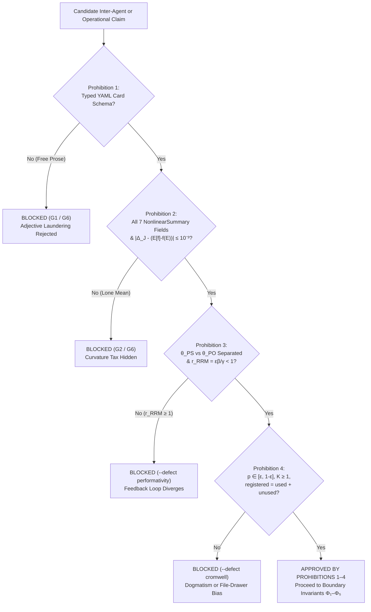

# 15. The Four Prohibitions

## The Paragraph That Hid Three Fatal Flaws

Imagine sitting on an operational risk committee at a retail bank. A consultant hands you a polished slide deck containing the following sentence:

> *"Considering the two-year call-center history, the average arrival rate of $312$ calls per hour, the mean handling time of $6.2$ minutes, and the standard Erlang-C queueing model, the expected service level is $82\%$ of calls answered within $20$ seconds; we therefore recommend maintaining the current staffing of $36$ agents."*

On a first reading, the sentence sounds authoritative, technical, and reassuring. Yet when the bank follows this recommendation, customer waiting times explode and the phone queue collapses on Mondays and Fridays. **Natural-language prose hides unexamined assumptions behind fluent syntax.**

Buried inside that single smooth sentence are three fatal omissions:
1. It applied a nonlinear queueing formula to the *average* arrival rate ($f(\mathbb{E}[X])$) instead of averaging the queueing delay across the fluctuating days ($\mathbb{E}[f(X)]$), hiding a large **Jensen's Gap** ($82\%$ promised versus $57\%$ realized).
2. It treated $27\text{,}716$ five-minute intervals as independent observations instead of clustering by the $164$ calendar days, understating the margin of error by a factor of $\sqrt{28.26} \approx 5.3\times$.
3. It never declared how many alternative staffing formulas the consultant tried before picking the one that looked best on historical data, nor what numeric threshold would force the bank to pull the plug if the model failed in live operation.

In a traditional organization, or in a multi-agent Artificial Intelligence pipeline where Large Language Models converse in free English or Portuguese paragraphs, one agent's smooth prose becomes the next agent's unquestioned premise. Rhetorical confidence substitutes for mathematical proof.

To make hiding impossible, the Stochology Protocol establishes **Four Golden Prohibitions** (`AGENTS.md §I`, audited in `EpistemologicalCard::audit()` and Gate `G6`). No claim, model, or inter-agent message may pass into production if it violates any of the four.

<figure class="stoch-figure">
  <svg xmlns="http://www.w3.org/2000/svg" width="1120" height="280" viewBox="0 0 1120 280" fill="none" role="img" aria-labelledby="title-fig-06-prohibitions">
  <title id="title-fig-06-prohibitions">The Four Golden Prohibitions of the Stochology Protocol</title>
  <defs>
  
  </defs>
  <rect x="1" y="1" width="1118" height="278" rx="14" fill="var(--canvas)" stroke="var(--border)" stroke-width="1.5"/>
  <rect x="18" y="24" width="258" height="232" rx="12" fill="var(--elevated)" stroke="var(--sky)" stroke-width="2.2"/>
  <text x="36" y="54" fill="var(--sky)" class="mono" font-size="11" font-weight="800">PROHIBITION 1 · COMMUNICATION</text>
  <text x="36" y="84" fill="var(--ink)" font-size="15.5" font-weight="800">No Free Prose</text>
  <text x="36" y="106" fill="var(--ink)" font-size="15.5" font-weight="800">Between Agents</text>
  <text x="36" y="140" fill="var(--muted)" font-size="11.5">• Strict YAML Card Schema</text>
  <text x="36" y="164" fill="var(--muted)" font-size="11.5">• EpistemologicalCard::audit()</text>
  <text x="36" y="188" fill="var(--muted)" font-size="11.5">• Defeats adjective laundering</text>
  <text x="36" y="232" fill="var(--sky)" class="mono" font-size="11" font-weight="700">Gate G1 &amp; G6</text>
  <rect x="292" y="24" width="258" height="232" rx="12" fill="var(--elevated)" stroke="var(--violet)" stroke-width="2.2"/>
  <text x="310" y="54" fill="var(--violet)" class="mono" font-size="11" font-weight="800">PROHIBITION 2 · BRIDGE L₂ → L₃</text>
  <text x="310" y="84" fill="var(--ink)" font-size="15.5" font-weight="800">No Lone Mean</text>
  <text x="310" y="106" fill="var(--ink)" font-size="15.5" font-weight="800">Under Curvature</text>
  <text x="310" y="140" fill="var(--muted)" font-size="11.5">• f(E[X]) &amp; E[f(X)]</text>
  <text x="310" y="164" fill="var(--muted)" font-size="11.5">• Jensen's Gap Δ_J ≠ 0</text>
  <text x="310" y="188" fill="var(--muted)" font-size="11.5">• Median, q₀₅, q₉₅ &amp; CRPS</text>
  <text x="310" y="232" fill="var(--violet)" class="mono" font-size="11" font-weight="700">Gate G2 &amp; G6</text>
  <rect x="566" y="24" width="258" height="232" rx="12" fill="var(--elevated)" stroke="var(--emerald)" stroke-width="2.2"/>
  <text x="584" y="54" fill="var(--emerald)" class="mono" font-size="11" font-weight="800">PROHIBITION 3 · BRIDGE L₃ → L₁</text>
  <text x="584" y="84" fill="var(--ink)" font-size="15.5" font-weight="800">No Confusing Fit</text>
  <text x="584" y="106" fill="var(--ink)" font-size="15.5" font-weight="800">with Performativity</text>
  <text x="584" y="140" fill="var(--muted)" font-size="11.5">• Separate θ_PS vs. θ_PO</text>
  <text x="584" y="164" fill="var(--muted)" font-size="11.5">• PerfGD Stackelberg step</text>
  <text x="584" y="188" fill="var(--muted)" font-size="11.5">• RRM contraction εβ/γ &lt; 1</text>
  <text x="584" y="232" fill="var(--emerald)" class="mono" font-size="11" font-weight="700">--defect performativity</text>
  <rect x="840" y="24" width="262" height="232" rx="12" fill="var(--elevated)" stroke="var(--rose)" stroke-width="2.2"/>
  <text x="858" y="54" fill="var(--rose)" class="mono" font-size="11" font-weight="800">PROHIBITION 4 · CALIBRATION</text>
  <text x="858" y="84" fill="var(--ink)" font-size="15.5" font-weight="800">No Dogmatic 0/1</text>
  <text x="858" y="106" fill="var(--ink)" font-size="15.5" font-weight="800">or Hidden Trials</text>
  <text x="858" y="140" fill="var(--muted)" font-size="11.5">• Cromwell p ∈ [ε, 1-ε]</text>
  <text x="858" y="164" fill="var(--muted)" font-size="11.5">• CORP-Murphy PAV OOS</text>
  <text x="858" y="188" fill="var(--muted)" font-size="11.5">• Attempts K ≥ 1 &amp; e-process</text>
  <text x="858" y="232" fill="var(--rose)" class="mono" font-size="11" font-weight="700">--defect cromwell</text>
  </svg>
  <figcaption><strong>Figure 15.1 — The Four Golden Prohibitions Guarding Inter-Agent and Institutional Epistemology</strong></figcaption>
</figure>

---

## 15.1 Prohibition 1 — Ban on Unstructured Free Prose Between Agents (`PROHIBITION_1`)

### Why Prose Fails in Multi-Agent and Institutional Systems

When human teams or autonomous AI agents communicate through free natural language, two well-documented pathologies emerge:
- **Adjective Laundering:** Uncertain guesses in the first stage (*"the data weakly suggest, under strong stationarity assumptions..."*) are summarized by the second stage as established facts (*"based on the verified trend..."*).
- **Sycophancy Cascades:** In multi-agent LLM architectures, downstream agents defer to the confident tone of upstream agents rather than recomputing the variance budget, SHA-256 data hash, or cost-loss threshold.

### The Structural Remedy: Typed Epistemological Cards

Under **Prohibition 1**, all communication between agents or modules transits **exclusively through structured Epistemological Cards** (`EpistemologicalCard` in `crates/stochology-core/src/card.rs`), serialized in strict YAML (`cards/*.yaml`) and validated by `EpistemologicalCard::audit()`.

A fixed schema defeats adjective laundering because **an empty or inconsistent slot cannot hide behind an eloquent verb.** If an agent wants to recommend an action in a YAML card, the parser forces the agent to fill in:
- the exact SHA-256 hash of the dataset (`dataset_sha256`);
- the true independent unit and Moulton-Campbell effective sample size (`effective_sample_size_n_eff`);
- all seven numbers of the nonlinear summary (`f_at_mean`, `mean_of_f`, `jensen_gap`, `median`, `q05`, `q95`, `crps`);
- the four variance-budget shares summing to $1.0$;
- the counter of attempted specifications $K \ge 1$;
- and the numeric exit clause (`exit_clause`).

If any slot is missing, malformed, or algebraically inconsistent with its neighbors, `EpistemologicalCard::audit()` rejects the card before any downstream agent ever reads it.

---

## 15.2 Prohibition 2 — Ban on the Lone Mean (`PROHIBITION_2`)

### Why the Mean Alone Is a Lie Under Curvature, Compounding, or Heavy Tails

In elementary courses, students are taught to summarize a random variable $X$ by its sample mean $\bar{x}$. That habit is harmless only in a linear, thin-tailed, additive Gaussian world. It becomes a dangerous distortion whenever any of three conditions holds:
1. **The payoff or loss function $f(X)$ is nonlinear** (Bridge $L\_2 \to L\_3$, Chapter 2): by Jensen's Inequality, $f(\mathbb{E}[X]) \neq \mathbb{E}[f(X)]$.
2. **The dynamics are multiplicative over time** (Lens 2, Chapter 6): by Itô's variance drain, the ensemble mean growth rate $\mu$ overstates the compounded time-average growth rate $\mu - \frac{1}{2}\sigma^2$.
3. **The upper tail is heavy** (Lens 3, Chapter 6): when the Pareto tail index satisfies $\alpha \le 2$, the population variance is infinite, and the mean is dominated by rare, violent jumps.

### The Seven Mandatory Quantities of `NonlinearSummary`

Under **Prohibition 2**, reporting only $\mathbb{E}[X]$ or $f(\mathbb{E}[X])$ is strictly forbidden. Every Epistemological Card (`epistemological_header.nonlinearity`) and every laboratory summary (`NonlinearSummary` in `crates/stochology-core/src/layers.rs`) must report **all seven numbers together**:

$$\bigl(  f(\mathbb{E}[X]),\quad \mathbb{E}[f(X)],\quad \Delta\_J = \mathbb{E}[f(X)] - f(\mathbb{E}[X]),\quad \text{median},\quad q\_{05},\quad q\_{95},\quad \mathrm{CRPS}  \bigr)$$

Each of these seven numbers answers a distinct operational question:

| Mandatory Field | Symbol | Operational Question It Answers |
| --- | --- | --- |
| `f_at_mean` | $f(\mathbb{E}[X])$ | What would the cost/payoff be if the world froze at its average input every single day? |
| `mean_of_f` | $\mathbb{E}[f(X)]$ | What is the true expected cost/payoff once daily fluctuations pass through the curved function $f$? |
| `jensen_gap` | $\Delta\_J$ | How much extra tax ($\mathbb{E}[f(X)] - f(\mathbb{E}[X])$) is volatility charging us because of curvature? |
| `median` | $q\_{50}$ | What does a *typical* realization look like, uncorrupted by extreme tail spikes? |
| `q05` & `q95` | $q\_{05}, q\_{95}$ | What is the $90\%$ central inter-quantile range spanning calm days to surge days? |
| `crps` | $\mathrm{CRPS}$ | How well does the entire predictive distribution $F(x)$ score out-of-sample against realized outcomes $y$? |

Furthermore, `EpistemologicalCard::audit()` checks the exact algebraic closure $|\Delta\_J - (\mathbb{E}[f(X)] - f(\mathbb{E}[X]))| \le 10^{-3}$ and requires $\Delta\_J \neq 0$ whenever nonlinearity is present.

---

## 15.3 Prohibition 3 — Ban on Confusing Learning with Performativity (`PROHIBITION_3`)

### Why Low Validation Error Does Not Prove Causal or Performative Validity

Suppose a credit-scoring model or an airline ground-delay controller achieves a tiny Brier score on last year's holdout data. Two mechanisms across Rung 2 of Pearl's Ladder and Bridge $L\_3 \to L\_1$ can still break the model when deployed tomorrow:
1. **Confounded Passive Fit vs. Intervention:** A model that predicts well passively ($P(Y \mid X)$) may be riding a spurious proxy or confounder that breaks the moment the agent intervenes ($P(Y \mid \mathrm{do}(X))$).
2. **Performative Feedback ($\mathcal{D}(\theta)$):** When deploying parameter $\theta$ causes customers, borrowers, airlines, or drivers to change their behavior, the data distribution shifts from $\mathcal{D}$ to $\mathcal{D}(\theta)$.

### Mandatory Performative Audit on Bridge $L\_3 \to L\_1$

Under **Prohibition 3**, every model operating on Bridge $L\_3 \to L\_1$ must explicitly separate:
- **Performative Stability ($\theta\_{\mathrm{PS}}$):** the fixed point of myopic Repeated Risk Minimization (retraining passively on the distribution induced by the previous round);
- **Performative Optimality ($\theta\_{\mathrm{PO}}$):** the true Stackelberg equilibrium that anticipates the population's strategic response;
- **Wasserstein-1 Distribution Sensitivity ($\varepsilon$)** and the **Strict RRM Contraction Condition**:
  $$r\_{\mathrm{RRM}} = \frac{\varepsilon \beta}{\gamma} < 1$$

If $r\_{\mathrm{RRM}} \ge 1$, `PerformativeSystem` and `EpistemologicalCard::audit()` reject the card immediately (`--defect performativity`), preventing an automated retraining loop from destabilizing the real-world environment.

---

## 15.4 Prohibition 4 — Ban on Dogmatic Extremes and Omitted Attempts (`PROHIBITION_4`)

Prohibition 4 guards against two of the most common sins in quantitative research: **dogmatic certainty ($0\%$ or $100\%$)** and **unreported cherry-picking ($p$-hacking)**.

### Part A: Cromwell's Rule ($p \in [\varepsilon\_{\text{floor}}, 1 - \varepsilon\_{\text{floor}}]$)

In August 1650, Oliver Cromwell wrote to the General Assembly of the Church of Scotland:

> *"I beseech you, in the bowels of Christ, think it possible that you may be mistaken."*

In the 1980s, Bayesian statistician **Dennis Lindley** named **Cromwell's Rule** after this plea. Look back at Bayes' theorem from the Preface:

$$P(H \mid E) = \frac{P(E \mid H)  P(H)}{P(E \mid H)  P(H) + P(E \mid \neg H)  (1 - P(H))}$$

If an agent sets a prior probability to $P(H) = 0$ (or $P(H) = 1$), no amount of empirical evidence $E$ (not even a billion black swans marching past the window) can move the posterior: multiplying by $P(H) = 0$ keeps $P(H \mid E)$ **frozen at $0$ forever**. Furthermore, under the logarithmic scoring rule $-\ln p$, assigning $p = 0$ to an event that subsequently occurs inflicts an **infinite penalty ($\infty$)**.

Therefore, Prohibition 4 bans probabilities of $0\%$ and $100\%$ across the entire protocol. Every declared probability $p$ must lie strictly inside the **Cromwell Corridor** bounded by a declared base-rate floor $\varepsilon\_{\text{floor}} \in (0, 0.05]$:

$$\varepsilon\_{\text{floor}} \le p \le 1 - \varepsilon\_{\text{floor}}$$

If any card or module attempts to declare $p = 0.0$, $p = 1.0$, or $p$ outside $[\varepsilon\_{\text{floor}}, 1 - \varepsilon\_{\text{floor}}]$, Gate `G6` blocks execution with exit code `1` (`--defect cromwell`).

### Part B: The Garden of Forking Paths, the Attempt Counter $K \ge 1$, and Findings Conservation

Many published "statistically significant ($p < 0.05$)" findings fail to replicate when tested by an independent laboratory (John Ioannidis, 2005).

Suppose a hundred analysts toss a fair coin $20$ times each, or one analyst tests $K = 50$ noisy predictors against a random target on a small validation set. Even when **nothing is happening in the World ($L\_1$)**, if you try $K = 20$ different feature combinations, outlier exclusions, or functional forms (**the Garden of Forking Paths**, as Andrew Gelman and Eric Loken termed it) and report only the single best-looking run while hiding the $19$ failed attempts in a file drawer, the probability of finding a false positive climbs from $5\%$ to $1 - (1 - 0.05)^{20} \approx 64\%$.

In 2022, Nate Breznau and colleagues gave **73 independent research teams** the exact same social-science dataset and the exact same hypothesis; the teams came back with confident estimates ranging from strongly negative to strongly positive, and over $95\%$ of the variance across teams came from undeclared modeling choices along the bridge.

To make the file drawer visible and auditable, **Prohibition 4** enforces three mandatory disclosures in `data_and_audit_contract`:
1. **The Attempt Counter ($K \ge 1$):** Every card must declare `attempt_counter_K`, the total number of model specifications, hyperparameter sweeps, or threshold revisions attempted on the problem.
2. **Multiplicity-Adjusted Sequential Evidence (*e-process* $E\_t$):** The sequential likelihood ratio (*e-process* $E\_t = \prod\_{i=1}^t L\_i$) is penalized by $1/K$ under Ville's inequality (`e_process_multiplicity` $\ge 1.0$).
3. **Exact Findings Conservation (`findings`):** Every card must declare three integers (`registered` for total hypotheses/atoms tested, `used` for those retained in the final model, and `unused` for those discarded) satisfying the exact conservation law:
   $$\text{registered} = \text{used} + \text{unused}, \qquad \text{registered} \ge 1, \qquad \text{used} \ge 1$$
4. **Out-of-Sample Isotonic CORP-Murphy Audit:** Every probabilistic forecast must report its out-of-sample PAV decomposition ($\mathrm{BS} = \mathrm{REL}\_{\mathrm{CORP}} - \mathrm{RES}\_{\mathrm{CORP}} + \mathrm{UNC}\_0$).

### Step-by-Step Foundational Derivation: Cromwell's Log-Score Bound and the Multiplicity Tax

Why must Cromwell's floor $\varepsilon\_{\text{floor}} \in (0, 0.05]$ be enforced *both* in Bayesian updating and in out-of-sample forecast evaluation?
1. **Bounded Worst-Case Surprise Under the Logarithmic Scoring Rule:**
   Under the strictly proper logarithmic score $S\_{\text{log}}(p, y) = -\bigl[y\ln p + (1-y)\ln(1-p)\bigr]$, a single unpredicted tail event ($y = 1$) against a dogmatic forecast $p \to 0^+$ drives the cumulative loss to $+\infty$, destroying the empirical average across all other $n-1$ observations. Clamping $p \in [\varepsilon\_{\text{floor}}, 1 - \varepsilon\_{\text{floor}}]$ via `apply_cromwell_floor(p, eps)` bounds the maximum single-observation log-loss by:
   $$\sup\_{y \in \lbrace 0, 1\rbrace} S\_{\text{log}}\bigl(\mathrm{clamp}(p, \varepsilon\_{\text{floor}}), y\bigr) \le \ln\left(\frac{1}{\varepsilon\_{\text{floor}}}\right)$$
   At $\varepsilon\_{\text{floor}} = 0.005$, the worst-case surprise per observation is bounded at $\ln(200) \approx 5.2983\text{ nats}$ ($\approx 23.01\text{ decibans}$), ensuring finite empirical variance for sequential *e-processes*.
2. **Union-Bound Multiplicity Control for $K$ Forking Paths:**
   Suppose an analyst explores $K \ge 1$ specifications $M\_1, \dots, M\_K$, each generating a test martingale $E\_t^{(k)}$ with $\mathbb{E}\_{H\_0}[E\_t^{(k)}] \le 1$. Even if the $K$ specifications are arbitrarily correlated across the same dataset, Markov's and Ville's inequalities applied to the average $\bar{E}\_t = \frac{1}{K}\sum\_{k=1}^K E\_t^{(k)}$ guarantee:
   $$P\_{H\_0}\left(\sup\_{t \ge 1} \frac{\max\_{1 \le k \le K} E\_t^{(k)}}{K} \ge \frac{1}{\alpha}\right) \le P\_{H\_0}\left(\sup\_{t \ge 1} \bar{E}\_t \ge \frac{1}{\alpha}\right) \le \alpha$$
   Thus, dividing the winning model's evidence $E\_t^{(k^{\ast})}$ by the declared attempt counter $K$ (`e_process_multiplicity = E_t / K`) neutralizes selection bias across the entire Garden of Forking Paths.

---

## Interactive Laboratory (`/lab`)

Explore how cluster correlation, Cromwell bounds, and multi-attempt penalties interact with the protocol's boundary gates:

---

## Computational Audit in Rust

Test the enforcement of the Four Prohibitions directly through the epistemological gates and negative proofs:

~~~bash
cargo run --release --bin gates
cargo run --release --bin gates -- --defect cromwell
cargo run --release --bin gates -- --defect performativity
~~~

When `--defect cromwell` injects a dogmatic probability ($p = 0.0$ or $p = 1.0$) into a card, or when `--defect performativity` injects a divergent RRM loop ($r\_{\mathrm{RRM}} \ge 1$), `gates` catches the violation and exits with code `1`.

## Exercises

1. **(Concept — Prohibition 1)** Read the following prose statement from an engineering memo: *"Our battery degradation neural network achieved an $R^2$ of $0.94$ on historical lab cycles, so we can safely extend the warranty to $10$ years."* List at least four mandatory fields of an `EpistemologicalCard` that are completely missing from this sentence.
2. **(Calculation — Prohibition 2)** Suppose daily server latency penalty is $f(X) = X^3$, where daily traffic load $X$ takes values $1$, $2$, and $6$ with equal probability $1/3$. Compute $\mathbb{E}[X]$, $f(\mathbb{E}[X])$, $\mathbb{E}[f(X)]$, and Jensen's Gap $\Delta\_J$. By what factor does $f(\mathbb{E}[X])$ understate the true average penalty $\mathbb{E}[f(X)]$?
3. **(Calculation — Prohibition 4 & Multiplicity)** If an analyst runs $K = 30$ independent hypothesis tests at significance level $\alpha = 0.05$ on pure noise where the null hypothesis is true in every single test, what is the probability $1 - (1 - 0.05)^{30}$ that at least one test crosses $p < 0.05$ by pure chance? How does declaring $K = 30$ and requiring $E\_t / K \ge 1/\alpha$ protect the decision-maker?
4. **(Concept — Cromwell's Rule)** Why does assigning $P(H) = 0.9999$ behave completely differently under Bayes' theorem from assigning $P(H) = 1.0000$ when a catastrophic counterexample arrives?

<strong>Analytical &amp; Computational Solutions (Click to Expand)</strong>

1. **Prohibition 1 Missing Card Fields:**
   The prose sentence omits: (a) the SHA-256 dataset and pre-registration hashes (`dataset_sha256`, `preregistration_hash`), (b) the true independent unit and Moulton-Campbell $n\_{\mathrm{eff}}(p)$ across battery batches, (c) the 7-number `NonlinearSummary` ($\Delta\_J, q\_{05}, q\_{95}, \mathrm{CRPS}$), (d) the cost-loss threshold $p^{\ast} = \frac{C}{\eta L}$, (e) the attempt counter $K \ge 1$ and discarded specifications, and (f) the numeric exit clause (`exit_clause`).
2. **Prohibition 2 Jensen's Gap Calculation:**
   - $\mathbb{E}[X] = \frac{1 + 2 + 6}{3} = 3.0$, so $f(\mathbb{E}[X]) = 3.0^3 = 27.0$.
   - $\mathbb{E}[f(X)] = \frac{1^3 + 2^3 + 6^3}{3} = \frac{1 + 8 + 216}{3} = \frac{225}{3} = 75.0$.
   - $\Delta\_J = 75.0 - 27.0 = +48.0$. Reporting $f(\mathbb{E}[X]) = 27.0$ understates the true average penalty by a factor of $\frac{75}{27} \approx 2.78\times$.
3. **Prohibition 4 Multiplicity Calculation:**
   - Family-wise false-positive rate: $1 - (0.95)^{30} \approx 1 - 0.2146 = 0.7854$ ($78.54\%$ chance of at least one false discovery on pure noise).
   - Penalizing the sequential *e-process* by $E\_t / K \ge 1/\alpha$ requires $E\_t \ge K/\alpha = 30 / 0.05 = 600$, preserving anytime-valid Type-I error $\le \alpha$ by union bound and Ville's inequality.
4. **Cromwell's Rule:**
   When $P(H) = 1.0000$, $1 - P(H) = 0$, so Bayes' denominator cannot update away from $H$ even after observing an event with tiny likelihood under $H$. When $P(H) = 0.9999$, prior odds are $9\text{,}999 : 1$, so two independent counterexamples with likelihood ratio $10^{-3}$ immediately flip posterior odds to $9.999 \times 10^{-3} : 1$ ($\approx 1\%$ belief in $H$).

## Summary

- **Prohibition 1** bans unstructured free prose between modules/agents, requiring all claims to travel as validated YAML `EpistemologicalCard` structs.
- **Prohibition 2** bans reporting a lone mean under nonlinearity, multiplicative compounding, or heavy tails, requiring the 7-number `NonlinearSummary` ($f(\mathbb{E}[X]), \mathbb{E}[f(X)], \Delta\_J, \text{median}, q\_{05}, q\_{95}, \mathrm{CRPS}$).
- **Prohibition 3** bans equating passive predictive accuracy with causal or performative validity, requiring explicit separation of $\theta\_{\mathrm{PS}}$ vs. $\theta\_{\mathrm{PO}}$ and verification of $r\_{\mathrm{RRM}} = \frac{\varepsilon\beta}{\gamma} < 1$.
- **Prohibition 4** bans dogmatic probabilities ($0\%$ or $100\%$, enforcing Cromwell's Rule $p \in [\varepsilon\_{\text{floor}}, 1 - \varepsilon\_{\text{floor}}]$) and bans hiding failed trials in a file drawer (requiring $K \ge 1$, *e-process* $E\_t$, $\text{registered} = \text{used} + \text{unused}$, and out-of-sample CORP-Murphy decomposition).
