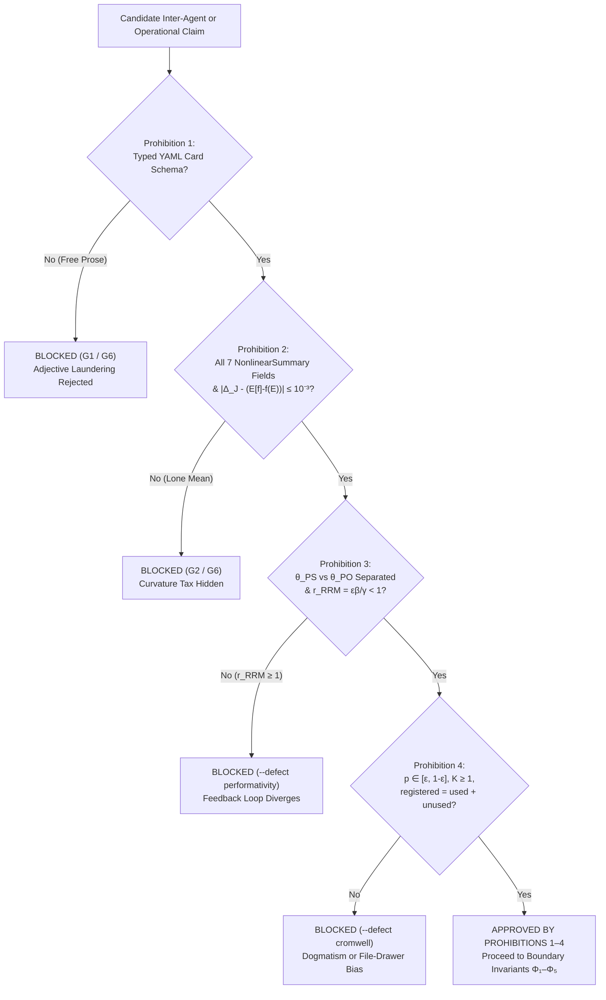
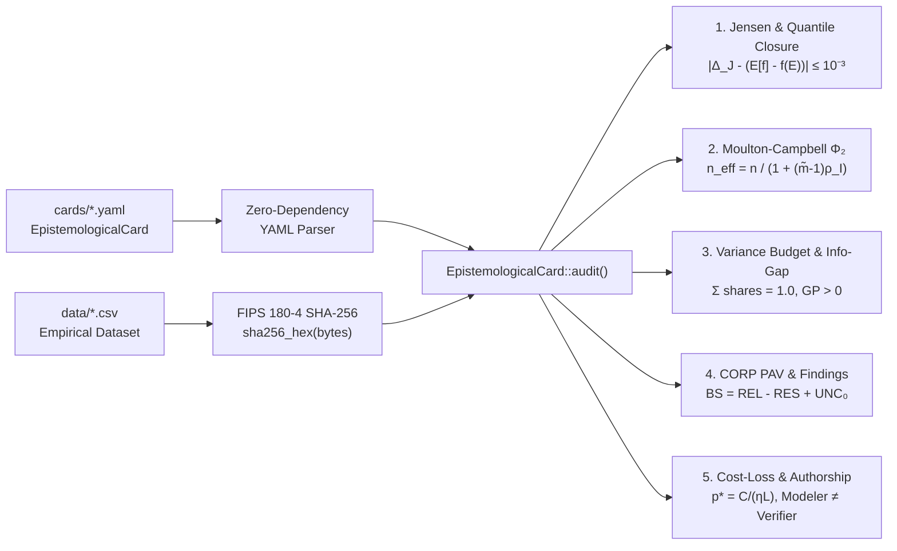

# 17. The Analyst's Choices on Record

## The Paragraph That Hid Three Fatal Flaws

Imagine sitting on an operational risk committee at a retail bank. A consultant hands you a polished slide deck containing the following sentence:

> *"Considering the two-year call-center history, the average arrival rate of $312$ calls per hour, the mean handling time of $6.2$ minutes, and the standard Erlang-C queueing model, the expected service level is $82\%$ of calls answered within $20$ seconds; we therefore recommend maintaining the current staffing of $36$ agents."*

On a first reading, the sentence sounds authoritative, technical, and reassuring. Yet when the bank follows this recommendation, customer waiting times explode and the phone queue collapses on Mondays and Fridays. **Natural-language prose hides unexamined assumptions behind fluent syntax.**

Buried inside that single smooth sentence are three fatal omissions:
1. It applied a nonlinear queueing formula to the *average* arrival rate ($f(\mathbb{E}[X])$) instead of averaging the queueing delay across the fluctuating days ($\mathbb{E}[f(X)]$), hiding a large **Jensen's Gap** ($82\%$ promised versus $57\%$ realized).
2. It treated $27\text{,}716$ five-minute intervals as independent observations instead of clustering by the $164$ calendar days, understating the margin of error by a factor of $\sqrt{28.26} \approx 5.3\times$.
3. It never declared how many alternative staffing formulas the consultant tried before picking the one that looked best on historical data, nor what numeric threshold would force the bank to pull the plug if the model failed in live operation.

In a traditional organization, or in a multi-agent Artificial Intelligence pipeline where Large Language Models converse in free English or Portuguese paragraphs, one agent's smooth prose becomes the next agent's unquestioned premise. Rhetorical confidence substitutes for mathematical proof.

To make hiding impossible, the Stochology Protocol establishes **Four Golden Prohibitions** (`AGENTS.md §I`, audited in `EpistemologicalCard::audit()` and Gate `G6`). No claim, model, or inter-agent message may pass into production if it violates any of the four.

<figure class="stoch-figure">
  <svg xmlns="http://www.w3.org/2000/svg" width="1120" height="280" viewBox="0 0 1120 280" fill="none" role="img" aria-labelledby="title-fig-06-prohibitions">
  <title id="title-fig-06-prohibitions">The Four Golden Prohibitions of the Stochology Protocol</title>
  <defs>
  
  </defs>
  <rect x="1" y="1" width="1118" height="278" rx="14" fill="var(--canvas)" stroke="var(--border)" stroke-width="1.5"/>
  <rect x="18" y="24" width="258" height="232" rx="12" fill="var(--elevated)" stroke="var(--sky)" stroke-width="2.2"/>
  <text x="36" y="54" fill="var(--sky)" class="mono" font-size="11" font-weight="800">PROHIBITION 1 · COMMUNICATION</text>
  <text x="36" y="84" fill="var(--ink)" font-size="15.5" font-weight="800">No Free Prose</text>
  <text x="36" y="106" fill="var(--ink)" font-size="15.5" font-weight="800">Between Agents</text>
  <text x="36" y="140" fill="var(--muted)" font-size="11.5">• Strict YAML Card Schema</text>
  <text x="36" y="164" fill="var(--muted)" font-size="11.5">• EpistemologicalCard::audit()</text>
  <text x="36" y="188" fill="var(--muted)" font-size="11.5">• Defeats adjective laundering</text>
  <text x="36" y="232" fill="var(--sky)" class="mono" font-size="11" font-weight="700">Gate G1 &amp; G6</text>
  <rect x="292" y="24" width="258" height="232" rx="12" fill="var(--elevated)" stroke="var(--violet)" stroke-width="2.2"/>
  <text x="310" y="54" fill="var(--violet)" class="mono" font-size="11" font-weight="800">PROHIBITION 2 · BRIDGE L₂ → L₃</text>
  <text x="310" y="84" fill="var(--ink)" font-size="15.5" font-weight="800">No Lone Mean</text>
  <text x="310" y="106" fill="var(--ink)" font-size="15.5" font-weight="800">Under Curvature</text>
  <text x="310" y="140" fill="var(--muted)" font-size="11.5">• f(E[X]) &amp; E[f(X)]</text>
  <text x="310" y="164" fill="var(--muted)" font-size="11.5">• Jensen's Gap Δ_J ≠ 0</text>
  <text x="310" y="188" fill="var(--muted)" font-size="11.5">• Median, q₀₅, q₉₅ &amp; CRPS</text>
  <text x="310" y="232" fill="var(--violet)" class="mono" font-size="11" font-weight="700">Gate G2 &amp; G6</text>
  <rect x="566" y="24" width="258" height="232" rx="12" fill="var(--elevated)" stroke="var(--emerald)" stroke-width="2.2"/>
  <text x="584" y="54" fill="var(--emerald)" class="mono" font-size="11" font-weight="800">PROHIBITION 3 · BRIDGE L₃ → L₁</text>
  <text x="584" y="84" fill="var(--ink)" font-size="15.5" font-weight="800">No Confusing Fit</text>
  <text x="584" y="106" fill="var(--ink)" font-size="15.5" font-weight="800">with Performativity</text>
  <text x="584" y="140" fill="var(--muted)" font-size="11.5">• Separate θ_PS vs. θ_PO</text>
  <text x="584" y="164" fill="var(--muted)" font-size="11.5">• PerfGD Stackelberg step</text>
  <text x="584" y="188" fill="var(--muted)" font-size="11.5">• RRM contraction εβ/γ &lt; 1</text>
  <text x="584" y="232" fill="var(--emerald)" class="mono" font-size="11" font-weight="700">--defect performativity</text>
  <rect x="840" y="24" width="262" height="232" rx="12" fill="var(--elevated)" stroke="var(--rose)" stroke-width="2.2"/>
  <text x="858" y="54" fill="var(--rose)" class="mono" font-size="11" font-weight="800">PROHIBITION 4 · CALIBRATION</text>
  <text x="858" y="84" fill="var(--ink)" font-size="15.5" font-weight="800">No Dogmatic 0/1</text>
  <text x="858" y="106" fill="var(--ink)" font-size="15.5" font-weight="800">or Hidden Trials</text>
  <text x="858" y="140" fill="var(--muted)" font-size="11.5">• Cromwell p ∈ [ε, 1-ε]</text>
  <text x="858" y="164" fill="var(--muted)" font-size="11.5">• CORP-Murphy PAV OOS</text>
  <text x="858" y="188" fill="var(--muted)" font-size="11.5">• Attempts K ≥ 1 &amp; e-process</text>
  <text x="858" y="232" fill="var(--rose)" class="mono" font-size="11" font-weight="700">--defect cromwell</text>
  </svg>
  <figcaption><strong>Figure 17.1 — The Four Golden Prohibitions Guarding Inter-Agent and Institutional Epistemology</strong></figcaption>
</figure>

---

## 17.1 Prohibition 1 — Ban on Unstructured Free Prose Between Agents (`PROHIBITION_1`)

### Why Prose Fails in Multi-Agent and Institutional Systems

While the software industry celebrates multi-agent pipelines in which Large Language Models converse in fluent English or Portuguese paragraphs, putting autonomous agents to talk in free natural language is an engineering failure. When human teams or autonomous AI agents communicate through unstructured prose, three well-documented pathologies emerge:
- **Adjective Laundering:** Uncertain guesses in the first stage (*"the data weakly suggest, under strong stationarity assumptions..."*) are summarized by the second stage as established facts (*"based on the verified trend..."*).
- **Sycophancy Cascades:** In multi-agent LLM architectures, downstream agents defer to the rhetorical confidence of upstream agents rather than recomputing the variance budget, SHA-256 data hash, or cost-loss threshold.
- **Masking Correlational Shortcuts ("Stochastic Parrots"):** Behind fluent syntax, an upstream agent can rely on a surface token proxy ($P(w_t \mid w_{1:t-1})$, Pearl Rung 1 `1-See`) that looks accurate on passive holdout data. In the simulated toy world of `MarcuseRouvroyStochasticParrotAudit` (Chapter 18, `seed = 2026`; not a measurement on any language model), such a proxy predictor scores $\mathrm{MSE}_{e_0} = 0.012$ yet collapses by three orders of magnitude under a simulated intervention ($\mathrm{MSE}_{\mathrm{do}(X)} = 19.13$, whereas an agent anchored to the invariant causal core $\hat{S}^{\ast} = [0]$ via `run_nonlinear_icp_nile` retains $\mathrm{MSE}_{\mathrm{do}(X)} = 0.012$).

### The Structural Remedy: Typed Epistemological Cards

Under **Prohibition 1**, all communication between agents or modules transits **exclusively through structured Epistemological Cards** (`EpistemologicalCard` in `crates/stochology-core/src/card.rs`), serialized in strict YAML (`cards/*.yaml`) and validated in pure Rust by `EpistemologicalCard::audit()`.

A fixed typed schema counters adjective laundering because **an empty or inconsistent slot for effective sample size, Jensen's Gap ($\Delta_J$), or economic threshold ($p^{\ast} = \frac{C}{\eta L}$) cannot hide behind an eloquent verb.** If an agent wants to recommend an action in a YAML card, the parser forces the agent to fill in:
- the exact SHA-256 hash of the dataset (`dataset_sha256`);
- the true independent unit and Moulton-Campbell effective sample size (`effective_sample_size_n_eff`);
- the seven numbers of the nonlinear summary in the `nonlinearity` string ($f(\mathbb{E}[X])$, $\mathbb{E}[f(X)]$, Jensen gap $\Delta_J$, median, $q_{05}$, $q_{95}$, CRPS);
- the four variance-budget shares summing to $1.0$;
- the counter of attempted specifications $K \ge 1$;
- and the numeric exit clause (`exit_clause`).

If any slot is missing, malformed, or algebraically inconsistent with its neighbors, `EpistemologicalCard::audit()` rejects the card before any downstream agent ever reads it.

---

## Why Airline Pilots Use Checklists Instead of Essays

Before taking off in a modern commercial airliner, the captain and first officer do not sit in the cockpit and write an expressive literary essay about how confident they feel in the weather and the engines. They execute a **structured pre-flight checklist**:
- Fuel quantity and cross-feed valves: *checked against flight plan.*
- Flap setting and stabilizer trim: *verified in green band.*
- Engine failure abort speed ($V\_1$): *computed and called out explicitly.*

Aviation adopted rigid checklists after the 1935 Boeing Model 299 crash because cognitive load, time pressure, and institutional incentives cause even experienced crews to skip uncomfortable checks during free-form narration.

An **Epistemological Card** (`EpistemologicalCard` in `crates/stochology-core/src/card.rs`) is the pre-flight checklist of quantitative science and decision-making. Every technical claim in the Stochology Protocol lives as a self-contained YAML document (`cards/*.yaml`).

When `EpistemologicalCard::audit()` reads a card from disk, it acts as an adversarial mathematical auditor rather than a passive syntax checker: it recomputes Jensen's Gap, recomputes the Moulton-Campbell design effect, checks that the four variance-budget shares sum to $1.0$, verifies the CORP-Murphy PAV identity $\mathrm{BS} = \mathrm{REL}\_{\mathrm{CORP}} - \mathrm{RES}\_{\mathrm{CORP}} + \mathrm{UNC}\_0$, checks the cost-loss threshold $p^{\ast} = \frac{C}{\eta L}$ against the recommended act (`protect` vs. `do_not_protect`), verifies that the modeler and adversarial verifier are distinct agents, and recomputes the SHA-256 cryptographic digest of the underlying CSV dataset on disk.

---

Every Epistemological Card begins with top-level routing metadata (`id`, `layer`, `uncertainty`) followed by **five mandatory sections**:

<figure class="stoch-figure">
  <svg xmlns="http://www.w3.org/2000/svg" width="1100" height="420" viewBox="0 0 1100 420" fill="none" role="img" aria-labelledby="title-fig-08-card">
  <title id="title-fig-08-card">Structural Anatomy of the EpistemologicalCard and its Adversarial Mathematical Audit</title>
  <defs>
  <marker id="c-arrow" viewBox="0 0 10 10" refX="8" refY="5" markerWidth="6.5" markerHeight="6.5" orient="auto">
  <path d="M 0 1 L 9 5 L 0 9 z" fill="var(--sky)"/>
  </marker>
  
  </defs>
  <rect x="1" y="1" width="1098" height="418" rx="14" fill="var(--canvas)" stroke="var(--border)" stroke-width="1.5"/>
  <rect x="20" y="18" width="690" height="384" rx="14" fill="var(--elevated)" stroke="var(--sky)" stroke-width="2.4"/>
  <text x="44" y="48" fill="var(--sky)" class="mono" font-size="12.5" font-weight="800" letter-spacing="0.06em">EPISTEMOLOGICAL CARD · cards/*.yaml</text>
  <text x="44" y="70" fill="var(--muted)" class="mono" font-size="11.5">id: "card-..."  |  layer: L1/L2/L3  |  uncertainty: aleatory/...</text>
  <line x1="20" y1="84" x2="710" y2="84" stroke="var(--border)" stroke-width="1.5"/>
  <rect x="40" y="96" width="650" height="50" rx="8" fill="var(--surface)" stroke="var(--border)" stroke-width="1.4"/>
  <text x="58" y="117" fill="var(--ink)" class="mono" font-size="12.5" font-weight="800">1. decision_maker_question</text>
  <text x="58" y="137" fill="var(--muted)" font-size="11.5">Who decides? Concrete action &amp; Resolution R_data ≥ R_decision (Φ₅)</text>
  <rect x="40" y="156" width="650" height="50" rx="8" fill="var(--surface)" stroke="var(--border)" stroke-width="1.4"/>
  <text x="58" y="177" fill="var(--ink)" class="mono" font-size="12.5" font-weight="800">2. epistemological_header</text>
  <text x="58" y="197" fill="var(--muted)" font-size="11.5">Process, Jensen Δ_J, Moulton-Campbell n_eff (Φ₂), Rubin, Pearl Rung</text>
  <rect x="40" y="216" width="650" height="50" rx="8" fill="var(--surface)" stroke="var(--border)" stroke-width="1.4"/>
  <text x="58" y="237" fill="var(--ink)" class="mono" font-size="12.5" font-weight="800">3. uncertainty_budget_and_authorship</text>
  <text x="58" y="257" fill="var(--muted)" font-size="11.5">4 Variance Shares = 1.0, Info-Gap α̂ + Wald Floor, Cross-Authorship</text>
  <rect x="40" y="276" width="650" height="50" rx="8" fill="var(--surface)" stroke="var(--border)" stroke-width="1.4"/>
  <text x="58" y="297" fill="var(--ink)" class="mono" font-size="12.5" font-weight="800">4. data_and_audit_contract</text>
  <text x="58" y="317" fill="var(--muted)" font-size="11.5">64-Hex SHA-256, seed = 2026 Null (Φ₁), K ≥ 1, e-process, CORP PAV</text>
  <rect x="40" y="336" width="650" height="50" rx="8" fill="var(--surface)" stroke="var(--border)" stroke-width="1.4"/>
  <text x="58" y="357" fill="var(--ink)" class="mono" font-size="12.5" font-weight="800">5. decision_rule_and_scope</text>
  <text x="58" y="377" fill="var(--muted)" font-size="11.5">Cromwell p, p* = C/(ηL), Act, Chouldechova Audit &amp; Exit Clause (Φ₄)</text>
  <line x1="710" y1="121" x2="772" y2="174" stroke="var(--sky)" stroke-width="2" marker-end="url(#c-arrow)"/>
  <line x1="710" y1="181" x2="772" y2="192" stroke="var(--sky)" stroke-width="2" marker-end="url(#c-arrow)"/>
  <line x1="710" y1="241" x2="772" y2="210" stroke="var(--sky)" stroke-width="2" marker-end="url(#c-arrow)"/>
  <line x1="710" y1="301" x2="772" y2="228" stroke="var(--sky)" stroke-width="2" marker-end="url(#c-arrow)"/>
  <line x1="710" y1="361" x2="772" y2="246" stroke="var(--sky)" stroke-width="2" marker-end="url(#c-arrow)"/>
  <rect x="780" y="120" width="296" height="184" rx="12" fill="var(--emerald-bg)" stroke="var(--emerald)" stroke-width="2.4"/>
  <text x="928" y="152" text-anchor="middle" fill="var(--emerald)" class="mono" font-size="11.5" font-weight="800">ADVERSARIAL GATEKEEPER</text>
  <text x="928" y="180" text-anchor="middle" fill="var(--ink)" class="mono" font-size="13.5" font-weight="800">Card::audit()</text>
  <text x="928" y="208" text-anchor="middle" fill="var(--muted)" font-size="11.5">• Recomputes Δ_J &amp; n_eff</text>
  <text x="928" y="230" text-anchor="middle" fill="var(--muted)" font-size="11.5">• Verifies CORP Identity</text>
  <text x="928" y="252" text-anchor="middle" fill="var(--muted)" font-size="11.5">• Checks CSV SHA-256</text>
  <text x="928" y="280" text-anchor="middle" fill="var(--emerald)" class="mono" font-size="11.5" font-weight="800">Gates G1–G5 Enforced</text>
</svg>
  <figcaption><strong>Figure 17.2 — Structural Anatomy of the Epistemological Card and its Adversarial Audit</strong></figcaption>
</figure>

Each section locks specific mathematical invariants in place.

---

## 17.2 Section 1: `decision_maker_question`

~~~yaml
decision_maker_question:
  who_decides: "Director of Retail Banking Operations (North American Call Center)"
  altered_action: "Schedule 18 overflow customer-service agents on high-load business days"
  question: "Does the calibrated daily probability of 5-minute call-arrival queue overload exceed the economic protection threshold p* = 0.080?"
~~~

- **Why it exists (Defeating Type III Error and $\Phi\_5$):** A model that changes no concrete human or algorithmic action has an Expected Value of Perfect Information ($\mathrm{EVPI}$) of zero.
- **What `audit()` enforces:**
  1. `who_decides` and `altered_action` must be non-empty concrete declarations;
  2. `question` must be a genuine interrogative sentence ending with `'?'`;
  3. The temporal/spatial resolution of `question` and `altered_action` is cross-checked against the resolution of the dataset under Invariant $\Phi\_5$.

---

## 17.3 Section 2: `epistemological_header`

This section captures the physical and causal mechanics across Layers $L\_1, L\_2,$ and $L\_3$:

1. **`generating_process`:** Explicit description of the physical data-generating mechanism in $L\_1$ (for instance, inhomogeneous Poisson/negative-binomial customer arrivals or thermodynamic tropical cyclone intensification).
2. **`nonlinearity` (Enforcing Prohibition 2):**
   A single string reporting the seven mandatory numbers of a `NonlinearSummary` (whose Rust fields are `f_at_mean`, `expected_f`, `jensen_gap`, `median_f`, `q05_f`, `q95_f`, `empirical_crps`), in the fixed textual form used by the cards, e.g. card_01:
   - `"f(E[X])=4849.59, E[f(X)]=5819.49, Jensen gap Delta_J=+969.91, median=3600.00, q05=900.00, q95=16900.00, CRPS=2826.59"`.
   - **Audit Check:** Verifies $|\Delta\_J - (\mathbb{E}[f(X)] - f(\mathbb{E}[X]))| \le 10^{-3}$, strict quantile ordering $q\_{05} < \text{median} < q\_{95}$, and $\mathrm{CRPS} > 0$.
3. **`unit_and_margin` (Enforcing Invariant $\Phi\_2$):**
   Reports:
   - `independent_unit` (e.g., `"164 calendar business days"` or `"named Atlantic storm tracks"`),
   - `nominal_sample_size_n` ($n$),
   - `weighted_cluster_mean_m_tilde` ($\tilde{m} = \bar{m}(1 + \mathrm{CV}^2)$),
   - `threshold_exceedance_icc` ($\rho\_I(p)$),
   - `effective_sample_size_n_eff` ($n\_{\mathrm{eff}}(p)$), and `unit_margin_of_error`.
   - **Audit Check:** Recomputes $\frac{n}{1 + (\tilde{m} - 1)\rho\_I(p)}$ from the declared fields and blocks the card if `effective_sample_size_n_eff` deviates from the Moulton-Campbell formula.
4. **`noise_physics` (Enforcing Lens 2 & Prohibition 3):**
   Declares `stochastic_regime` (e.g., sub-exponential vs. Pareto infinite variance), `absorbing_states` (ruin or saturation barriers), and `bridge_L3_L1_performativity` (auditing $\theta\_{\mathrm{PS}}, \theta\_{\mathrm{PO}},$ and $r\_{\mathrm{RRM}} < 1$).
5. **`causal_ladder` (Enforcing Lens 4 & $\Phi\_3$):**
   Declares `pearl_rung` (`"1-See"`, `"2-Act"`, or `"3-Imagine"`), `identification_strategy` (e.g., multi-environment NILE/IRM invariance), and `untestable_assumption` (forcing the author to state openly what could break causal identification).

---

## 17.4 Section 3: `uncertainty_budget_and_authorship`

This section enforces honest accounting of where uncertainty comes from and who authored each part of the card:

1. **`variance_budget` (Decomposition of Total Predictive Uncertainty):**
   Splits predictive variance into four non-negative shares:
   - `inputs` (measurement and covariate noise in $L\_1$),
   - `parameters` (finite-sample estimation variance in $L\_2$),
   - `covariance` (cross-term dependence across clusters/factors),
   - `structural_discrepancy_gp` (the share absorbed by the anchored Kennedy-O'Hagan Gaussian Process $\delta(x)$).
   - **Audit Check:** The four shares must be non-negative, `structural_discrepancy_gp` must be strictly positive ($> 0$, acknowledging that no parametric model is structurally perfect), and their sum must equal unity:
     $$\text{inputs} + \text{parameters} + \text{covariance} + \text{structural\_discrepancy\_gp} = 1.0000$$
2. **`dominant_event` (Cromwell's Rule on Tail Risk):**
   Names the single tail event carrying the largest share of expected loss, together with `probability_p`, `base_rate_floor_epsilon` ($\varepsilon\_{\text{floor}}$), and `cost_share`, verifying $\varepsilon\_{\text{floor}} \le p \le 1 - \varepsilon\_{\text{floor}}$.
3. **`info_gap_robustness` (Knightian Safeguard — Chapter 20):**
   Declares `critical_requirement_rc` ($r\_c$), `robustness_horizon_alpha_hat` ($\hat{\alpha} > 0$), `opportuneness_horizon_beta_hat` ($\hat{\beta} > 0$), and `global_maximin_safeguard` (requiring explicit verification of the global Wald floor outside $\mathcal{U}(\hat{\alpha}, \tilde{u})$).
4. **`field_authorship` (Adversarial Cross-Authorship — Filter 4):**
   Declares the identifiers of three distinct roles:
   - `null_model` (who designed the generative null benchmark),
   - `decision_rule` (who proposed the predictive model and action rule),
   - `adversarial_reviewer` (who audited the bridges and tried to break the card).
   - **Audit Check:** Enforces `decision_rule != adversarial_reviewer` and `null_model != decision_rule` so that no single agent grades their own homework.

---

## 17.5 Section 4: `data_and_audit_contract`

This section binds the YAML card to the physical bytes of the repository and closes the anti-p-hacking contract:

1. **`dataset_path` and `dataset_sha256`:**
   Points to the empirical CSV file in `data/*.csv` and records its 64-character lowercase hexadecimal SHA-256 hash. At runtime, `stochology-cli` computes the FIPS 180-4 SHA-256 digest of the file on disk and cross-checks it against both `dataset_sha256` and `data/SHA256SUMS`.
2. **`missingness_mechanism` and `seed_and_environment`:**
   Must declare `MCAR`, `MAR`, or `MNAR` (with Meng/Manski justification) and must include `seed = 2026` and `SplitMix64`.
3. **`null_model` and `preregistration_hash`:**
   Describes the executable null model and provides the 64-character lowercase hexadecimal SHA-256 pre-registration seal.
4. **`attempt_counter_K` and `e_process_multiplicity` (Prohibition 4):**
   Requires $K \ge 1$ and $E\_t / K \ge 1.0$.
5. **`murphy_corp_decomposition` (Lens 5):**
   Reports `total_score_brier_or_crps` ($\mathrm{BS}$), `miscalibration_REL_MCB` ($\mathrm{REL}\_{\mathrm{CORP}}$), `resolution_RES_DSC` ($\mathrm{RES}\_{\mathrm{CORP}}$), and `base_uncertainty_UNC0` ($\mathrm{UNC}\_0$).
   - **Audit Check:** Verifies the exact PAV identity closure:
     $$\bigl|\mathrm{BS} - (\mathrm{REL}\_{\mathrm{CORP}} - \mathrm{RES}\_{\mathrm{CORP}} + \mathrm{UNC}\_0)\bigr| \le 10^{-4}$$
6. **`findings` (`registered`, `used`, `unused`):**
   - **Audit Check:** Enforces $\text{registered} = \text{used} + \text{unused}$ with $\text{registered} \ge 1$ and $\text{used} \ge 1$.

---

## 17.6 Section 5: `decision_rule_and_scope`

The final section governs Bridge $L\_2 \to L\_3$ and Invariant $\Phi\_4$:

1. **Cost-Loss Parameters and Threshold Verification:**
   Declares `event_probability_p` ($p$), `base_rate_floor_epsilon` ($\varepsilon\_{\text{floor}}$), `protection_cost_C` ($C > 0$), `event_loss_L` ($L > 0$), `mitigation_efficacy_eta` ($\eta \in (0, 1]$), `critical_threshold_p_star` ($p^{\ast}$), and `declared_act` (`"protect"` or `"do_not_protect"`).
   - **Audit Check:** Recomputes $\frac{C}{\eta L}$ and verifies:
     $$\left|p^{\ast} - \frac{C}{\eta L}\right| \le 10^{-4}$$
     and verifies that `declared_act` is `"protect"` **if and only if** $p > p^{\ast}$ (and `"do_not_protect"` if and only if $p \le p^{\ast}$).
2. **`scope_statement`, `who_pays_for_error`, and `exit_clause`:**
   Enforces explicit operational boundaries, Chouldechova error-bearer attribution, and a numeric circuit-breaker exit rule.

---

## 17.7 Cryptographic Pre-Registration Integrity: Pure-Rust FIPS 180-4 SHA-256 (`stochology_core::sha256`)

How does `EpistemologicalCard::audit()` guarantee that neither the CSV dataset nor the pre-registered analysis plan was quietly edited after seeing out-of-sample results, without pulling in external C/OpenSSL dependencies?

In `crates/stochology-core/src/sha256.rs`, the protocol implements the **NIST FIPS 180-4 SHA-256 cryptographic hash function** and **RFC 2104 `HMAC-SHA256`** directly from first principles in pure Rust:
1. **Fractional Cube-Root Round Constants ($K\_{0..63}$) and Square-Root Initial Chaining State ($H^{(0)}\_{0..7}$):**
   The $8$ initial 32-bit words $H^{(0)}\_0 = \text{0x6a09e667}, \dots, H^{(0)}\_7 = \text{0x5be0cd19}$ are the first $32$ bits of the fractional parts of the square roots of the first $8$ primes ($2, 3, 5, 7, 11, 13, 17, 19$), and the $64$ round constants $K\_t$ are the first $32$ bits of the fractional parts of the cube roots of the first $64$ primes. Because these constants derive deterministically from prime roots, they contain zero hidden trapdoors ("nothing-up-my-sleeve numbers").
2. **Merkle-Damgård 512-Bit Block Compression:**
   Every message $M$ of length $\ell$ bits is padded with a `1` bit, zero bits, and a 64-bit big-endian length $\ell$ so the padded length is a multiple of $512$ bits. Each 512-bit block is expanded into $64$ words via:
   $$\sigma\_0(x) = \mathrm{ROTR}^7(x) \oplus \mathrm{ROTR}^{18}(x) \oplus (x \gg 3), \qquad \sigma\_1(x) = \mathrm{ROTR}^{17}(x) \oplus \mathrm{ROTR}^{19}(x) \oplus (x \gg 10)$$
   and compressed across $64$ rounds of bitwise majority $\mathrm{Maj}(a,b,c) = (a\wedge b)\oplus(a\wedge c)\oplus(b\wedge c)$ and choice $\mathrm{Ch}(e,f,g) = (e\wedge f)\oplus(\neg e\wedge g)$.

---

## 17.8 Invariant $\Phi\_3$ — Severe Testing, Error Taxonomy, Missingness, and Pre-Registration

### Deborah Mayo's Severity Principle and the Five Types of Statistical Error

Philosopher of statistics **Deborah Mayo** formulated the core criterion that distinguishes a genuine empirical test from a hollow confirmation ritual:

> **The Severity Principle:** Data $x\_0$ provide genuine evidence for a claim $H$ *only if* $H$ passes a test $T$ that had a very high probability of refuting $H$ if $H$ were false.

If a bridge inspector tests whether a steel cable can support a $40$-ton truck by placing a $2$-kilogram brick on it and announcing *"The cable did not snap! Hypothesis confirmed!"*, the cable passed a test of **zero severity**.

To audit severity across operational dimensions, Stochology expands the textbook Neyman-Pearson error table (`Type I` and `Type II`) to **five distinct statistical failure modes**:

| Error Type | Classic Author | What Goes Wrong | Protocol Defense |
| --- | --- | --- | --- |
| **Type I ($\alpha$)** | Neyman & Pearson | **False Positive:** Claiming an effect exists when the null hypothesis ($H\_0$) is actually true. | Executable Null Model ($\Phi\_1$), Attempt Counter $K$, and anytime-valid *e-process* $E\_t / K \ge 1/\alpha$. |
| **Type II ($\beta$)** | Neyman & Pearson | **False Negative:** Failing to detect a real effect because the sample size or test power is too small. | Moulton-Campbell $n\_{\mathrm{eff}}(p) \ge n\_{\min}$ (Filter 2) and cost-loss threshold $p^{\ast} = \frac{C}{\eta L}$. |
| **Type III** | Kimball (1957), Mosteller | **Wrong Question:** Giving the right mathematical answer to the wrong operational question or wrong ontological layer. | Decision-Maker Question header (`who_decides`, `altered_action`) and $\Phi\_5$ resolution check. |
| **Type S (Sign)** | Gelman & Carlin (2014) | **Wrong Direction:** Claiming with "statistical significance" that an intervention helps when it actually harms. | Anchored Kennedy-O'Hagan GP ($\delta(x)$), Manski bounds, and multi-environment ICP ($\hat{S}^{\ast}$). |
| **Type M (Magnitude)** | Gelman & Carlin (2014) | **Exaggeration Ratio (Winner's Curse):** Conditioning on crossing a noisy significance threshold inflates the estimated effect size by $2\times$ to $10\times$. | Out-of-sample CORP-Murphy PAV decomposition and Single-Opening Temporal Vault (`TemporalVault`). |

To seal $\Phi\_3$ cryptographically alongside the Rubin/Meng/Manski missingness audit on Bridge $L\_1 \to L\_2$ ([Chapter 10](10-world-models-missingness-bounds.md)), every Epistemological Card must also carry:

1. A declared rung on Pearl's Causal Ladder (`1-See`, `2-Act`, or `3-Imagine`) alongside its `identification_strategy` and explicit `untestable_assumption` (remembering Nancy Cartwright's dictum: *"No causes in, no causes out"*);
2. A **64-character lowercase hexadecimal SHA-256 pre-registration digest** (`preregistration_hash`, verified in pure Rust by `stochology_core::sha256` under FIPS 180-4) sealing the pre-analysis design payload before the test vault is opened.

### Filter 4 — Cryptographic Pre-Registration, Cross-Authorship, and Exit Clause

Finally, Filter 4 verifies:
1. A valid 64-character lowercase hexadecimal SHA-256 pre-registration seal;
2. Independent cross-authorship (`modeler_id != verifier_id`);
3. A non-empty, machine-actionable numeric exit clause.

---

## 17.9 Prohibition 4 — Ban on Dogmatic Extremes and Omitted Attempts (`PROHIBITION_4`)

### Part B: The Garden of Forking Paths, the Attempt Counter $K \ge 1$, and Findings Conservation

Many published "statistically significant ($p < 0.05$)" findings fail to replicate when tested by an independent laboratory (John Ioannidis, 2005).

Suppose a hundred analysts toss a fair coin $20$ times each, or one analyst tests $K = 50$ noisy predictors against a random target on a small validation set. Even when **nothing is happening in the World ($L\_1$)**, if you try $K = 20$ different feature combinations, outlier exclusions, or functional forms (**the Garden of Forking Paths**, as Andrew Gelman and Eric Loken termed it) and report only the single best-looking run while hiding the $19$ failed attempts in a file drawer, the probability of finding a false positive climbs from $5\%$ to $1 - (1 - 0.05)^{20} \approx 64\%$.

In 2022, Nate Breznau and colleagues gave **73 independent research teams** the exact same social-science dataset and the exact same hypothesis; the teams came back with confident estimates ranging from strongly negative to strongly positive, and over $95\%$ of the variance across teams came from undeclared modeling choices along the bridge.

To make the file drawer visible and auditable, **Prohibition 4** enforces three mandatory disclosures in `data_and_audit_contract`:
1. **The Attempt Counter ($K \ge 1$):** Every card must declare `attempt_counter_K`, the total number of model specifications, hyperparameter sweeps, or threshold revisions attempted on the problem.
2. **Multiplicity-Adjusted Sequential Evidence (*e-process* $E\_t$):** The sequential likelihood ratio (*e-process* $E\_t = \prod\_{i=1}^t L\_i$) is penalized by $1/K$ under Ville's inequality (`e_process_multiplicity` $\ge 1.0$).
3. **Exact Findings Conservation (`findings`):** Every card must declare three integers (`registered` for total hypotheses/atoms tested, `used` for those retained in the final model, and `unused` for those discarded) satisfying the exact conservation law:
   $$\text{registered} = \text{used} + \text{unused}, \qquad \text{registered} \ge 1, \qquad \text{used} \ge 1$$
4. **Out-of-Sample Isotonic CORP-Murphy Audit:** Every probabilistic forecast must report its out-of-sample PAV decomposition ($\mathrm{BS} = \mathrm{REL}\_{\mathrm{CORP}} - \mathrm{RES}\_{\mathrm{CORP}} + \mathrm{UNC}\_0$).

Why does dividing $E\_t$ by $K$ control false positives across arbitrary model searches (complementing Cromwell's log-score bound in [Chapter 15](15-decision-models-curvature-scoring.md))?

1. **Union-Bound Multiplicity Control for $K$ Forking Paths:**
   Suppose an analyst explores $K \ge 1$ specifications $M\_1, \dots, M\_K$, each generating a test martingale $E\_t^{(k)}$ with $\mathbb{E}\_{H\_0}[E\_t^{(k)}] \le 1$. Even if the $K$ specifications are arbitrarily correlated across the same dataset, Markov's and Ville's inequalities applied to the average $\bar{E}\_t = \frac{1}{K}\sum\_{k=1}^K E\_t^{(k)}$ guarantee:
   $$P\_{H\_0}\left(\sup\_{t \ge 1} \frac{\max\_{1 \le k \le K} E\_t^{(k)}}{K} \ge \frac{1}{\alpha}\right) \le P\_{H\_0}\left(\sup\_{t \ge 1} \bar{E}\_t \ge \frac{1}{\alpha}\right) \le \alpha$$
   Thus, dividing the winning model's evidence $E\_t^{(k^{\ast})}$ by the declared attempt counter $K$ (`e_process_multiplicity = E_t / K`) neutralizes selection bias across the entire Garden of Forking Paths.

---

## 17.10 Comparative Overview of the Four Canonical Cards

Before reading the full YAML listings below, compare how the four cards span all three ontological layers ($L\_1, L\_2, L\_3$), all four uncertainty regimes, and four real empirical domains:

| Card File | Primary Layer & Uncertainty | Real Dataset (`data/*.csv`) | Cost-Loss Threshold $p^{\ast} = \frac{C}{\eta L}$ | Calibrated Forecast $p$ | Declared Action & Why |
| --- | --- | --- | --- | --- | --- |
| **`card_01_atlantic_storms_evacuation.yaml`** | `L2` / `epistemic_specification` | `data/atlantic_storms.csv` ($n = 20\text{,}778$, $n\_{\mathrm{eff}} = 1\text{,}789$) | $\frac{3\text{,}600}{1.0 \times 30\text{,}000} = 0.12000$ | $p = 0.0977$ | **`do_not_protect`** ($p = 0.0977 \le p^{\ast} = 0.12000$): calibrated 85-kt threat is below the evacuation threshold. |
| **`card_02_bank_queue_staffing.yaml`** | `L1` / `aleatory` | `data/bank_calls.csv` ($n = 27\text{,}716$, $n\_{\mathrm{eff}} = 980.70$) | $\frac{2\text{,}400}{1.0 \times 30\text{,}000} = 0.08000$ | $p = 0.09911$ | **`protect`** ($p = 0.09911 > p^{\ast} = 0.08000$): once Jensen's Gap and Moulton-Campbell tail clustering are accounted for, surge risk exceeds $p^{\ast}$. |
| **`card_03_nyc_flights_holding.yaml`** | `L3` / `knightian` | `data/nyc_flights_2013.csv` ($n = 138\text{,}375$, $n\_{\mathrm{eff}} = 1\text{,}364.00$) | $\frac{1\text{,}500}{1.0 \times 25\text{,}000} = 0.06000$ | $p = 0.0981$ | **`protect`** ($p = 0.0981 > p^{\ast} = 0.06000$): under cascade loss $L = 25\text{,}000$, $p^{\ast} = 6\%$ is crossed and Info-Gap + Wald safeguard holds. |
| **`card_04_dpi_civil_defense_triage.yaml`** | `L2` / `epistemic_parameter` | `data/cps_observational.csv` ($n = 15\text{,}992$, $n\_{\mathrm{eff}} = 1\text{,}583.00$) | $\frac{420}{1.0 \times 3\text{,}500} = 0.12000$ | $p = 0.17059$ | **`protect`** ($p = 0.17059 > p^{\ast} = 0.12000$): after Meng `MNAR` adjustment ($\rho\_{R,Y} = +0.1334$), Lee bounds $[872.5, 1\text{,}995.8]$, and Chouldechova audit, mobile-outreach dispatch is optimal. |

<figure class="stoch-figure">
  <svg xmlns="http://www.w3.org/2000/svg" width="1140" height="240" viewBox="0 0 1140 240" fill="none" role="img" aria-labelledby="title-fig-13-cards">
  <title id="title-fig-13-cards">Comparative Cost-Loss Geometry (p vs p*) Across the Four Canonical Epistemological Cards</title>
  <defs>
  
  </defs>
  <rect x="1" y="1" width="1138" height="238" rx="14" fill="var(--canvas)" stroke="var(--border)" stroke-width="1.5"/>
  <rect x="16" y="22" width="264" height="196" rx="12" fill="var(--elevated)" stroke="var(--sky)" stroke-width="2.2"/>
  <text x="30" y="48" fill="var(--sky)" class="mono" font-size="11" font-weight="800">CARD 01 · STORMS (L₂)</text>
  <text x="30" y="72" fill="var(--ink)" font-size="14" font-weight="800">Coastal Evacuation</text>
  <text x="30" y="100" fill="var(--muted)" class="mono" font-size="11">p = 0.0977 ≤ p* = 0.12000</text>
  <text x="30" y="124" fill="var(--muted)" class="mono" font-size="11">n = 20,778 → n_eff = 1,789</text>
  <text x="30" y="148" fill="var(--muted)" class="mono" font-size="11">EVPI = $257,928 · E₃₀ = 547k</text>
  <text x="30" y="190" fill="var(--sky)" class="mono" font-size="11.5" font-weight="800">Act: do_not_protect (OK)</text>
  <rect x="296" y="22" width="264" height="196" rx="12" fill="var(--elevated)" stroke="var(--violet)" stroke-width="2.2"/>
  <text x="310" y="48" fill="var(--violet)" class="mono" font-size="11" font-weight="800">CARD 02 · BANK QUEUES (L₁)</text>
  <text x="310" y="72" fill="var(--ink)" font-size="14" font-weight="800">Overflow Shift Staffing</text>
  <text x="310" y="100" fill="var(--muted)" class="mono" font-size="11">p = 0.09911 &gt; p* = 0.08000</text>
  <text x="310" y="124" fill="var(--muted)" class="mono" font-size="11">n = 27,716 → n_eff = 980.7</text>
  <text x="310" y="148" fill="var(--muted)" class="mono" font-size="11">EVPI = $216,214 · E₃₀ = 3,814.5</text>
  <text x="310" y="190" fill="var(--emerald)" class="mono" font-size="11.5" font-weight="800">Act: protect (Approved)</text>
  <rect x="576" y="22" width="264" height="196" rx="12" fill="var(--elevated)" stroke="var(--emerald)" stroke-width="2.2"/>
  <text x="590" y="48" fill="var(--emerald)" class="mono" font-size="11" font-weight="800">CARD 03 · NYC FLIGHTS (L₃)</text>
  <text x="590" y="72" fill="var(--ink)" font-size="14" font-weight="800">Ground-Holding Buffer</text>
  <text x="590" y="100" fill="var(--muted)" class="mono" font-size="11">p = 0.0981 &gt; p* = 0.06000</text>
  <text x="590" y="124" fill="var(--muted)" class="mono" font-size="11">n = 138,375 → n_eff = 1,364</text>
  <text x="590" y="148" fill="var(--muted)" class="mono" font-size="11">EVPI = $135,285 · Wald OK</text>
  <text x="590" y="190" fill="var(--emerald)" class="mono" font-size="11.5" font-weight="800">Act: protect (Approved)</text>
  <rect x="856" y="22" width="268" height="196" rx="12" fill="var(--elevated)" stroke="var(--amber)" stroke-width="2.2"/>
  <text x="870" y="48" fill="var(--amber)" class="mono" font-size="11" font-weight="800">CARD 04 · DPI TRIAGE (L₂)</text>
  <text x="870" y="72" fill="var(--ink)" font-size="14" font-weight="800">Civil-Defense Outreach</text>
  <text x="870" y="100" fill="var(--muted)" class="mono" font-size="11">p = 0.17059 &gt; p* = 0.12000</text>
  <text x="870" y="124" fill="var(--muted)" class="mono" font-size="11">n = 15,992 → n_eff = 1,583</text>
  <text x="870" y="148" fill="var(--muted)" class="mono" font-size="11">Meng n_eff = 2,843 · Lee OK</text>
  <text x="870" y="190" fill="var(--emerald)" class="mono" font-size="11.5" font-weight="800">Act: protect (Approved)</text>
  </svg>
  <figcaption><strong>Figure 17.3 — Comparative Cost-Loss Decision Geometry Across the Four Canonical Epistemological Cards</strong></figcaption>
</figure>

---

## 17.11 `card_01_atlantic_storms_evacuation.yaml` (Atmospheric Physics & Coastal Evacuation)

This card models 6-hour synoptic rapid-intensification advisories across $n = 20\text{,}778$ NOAA Atlantic tropical cyclone track records (`data/atlantic_storms.csv`). The card records the Moulton-Campbell cluster adjustment across multi-point storm tracks ($\tilde{m} = 41.29 \implies n\_{\mathrm{eff}} = 1\text{,}789$), the isotonic CORP-PAV decomposition ($\mathrm{BS} = 0.03210 = 0.00578 - 0.06183 + 0.08815$), and the rational decision `do_not_protect` whenever $p = 0.0977 \le p^{\ast} = 0.12000$:

~~~yaml
{{#include ../cards/card_01_atlantic_storms_evacuation.yaml}}
~~~

---

## 17.12 `card_02_bank_queue_staffing.yaml` (Queueing Convexity & Shift Staffing)

This card models 5-minute customer call arrivals across $164$ business days (`data/bank_calls.csv`, $n = 27\text{,}716$). It illustrates **Bridge $L\_2 \to L\_3$** (Prohibition 2, with Jensen's Gap $\Delta\_J = +9\text{,}033\text{,}837.19$, $\approx 0.85\%$ of $f(\mathbb{E}[X])$ under the illustrative cost $f(x) = x^2$) and **Invariant $\Phi\_2$** (where $\tilde{m} = 169.0$ and $\rho\_I(0.90) = 0.1623$ inflate variance by $\mathrm{DEFF} = 28.26\times$, reducing $n = 27\text{,}716$ to $n\_{\mathrm{eff}} = 980.70$):

~~~yaml
{{#include ../cards/card_02_bank_queue_staffing.yaml}}
~~~

---

## 17.13 `card_03_nyc_flights_holding.yaml` (Bitemporal Aviation Governance & Performative Holding)

This card governs ground-holding and gate-buffering decisions across $n = 138\text{,}375$ New York flight departures (`data/nyc_flights_2013.csv`). It operates on **Layer $L\_3$** under **Knightian** uncertainty, auditing performative air-traffic feedback ($r\_{\mathrm{RRM}} = 0.30 < 1$), Info-Gap robustness ($\hat{\alpha} = 2.80$) with a verified Global Wald Maximin floor, and bitemporal/drift exit clauses:

~~~yaml
{{#include ../cards/card_03_nyc_flights_holding.yaml}}
~~~

---

## 17.14 `card_04_dpi_civil_defense_triage.yaml` (Digital Public Infrastructure & Civil-Defense Triage)

This card governs daily mobile-outreach and emergency-relief dispatch across $n = 15\text{,}992$ administrative household records (`data/cps_observational.csv` paired with randomized ground-truth `data/nsw_experimental.csv`). It demonstrates **Meng's Identity** ($\rho\_{R,Y} = +0.1334 \implies n\_{\mathrm{eff,Meng}} = 2\text{,}842.70$), **Manski `MNAR` bounds** ($[5\text{,}463.2,\ 13\text{,}835.3]$) and **Lee's (2009) sharp trimming bounds** ($q = 0.031$, $[872.5,\ 1\text{,}995.8]$), Moulton-Campbell census-tract clustering ($\tilde{m} = 95.65, \mathrm{DEFF} = 10.10 \implies n\_{\mathrm{eff}}(0.90) = 1\text{,}583$), cost-loss boundary $p^{\ast} = \frac{420}{1.0 \times 3\text{,}500} = 0.12000$, and **Chouldechova/KMR** fairness (`who_pays_for_error`, $\Phi\_4$):

~~~yaml
{{#include ../cards/card_04_dpi_civil_defense_triage.yaml}}
~~~

---

## Interactive Laboratory (`/lab`)

Test the cross-field algebraic invariants that `EpistemologicalCard::audit()` verifies on every YAML card:

---

## Computational Audit in Rust

In `crates/stochology-core/src/card.rs`, `EpistemologicalCard::from_yaml` parses the YAML card using a zero-dependency parser written in pure Rust, and `EpistemologicalCard::audit()` runs all cross-field algebraic checks. You can see all four canonical cards (`card_01`, `card_02`, `card_03`, `card_04`) audited against their real CSV datasets by running:

~~~bash
cargo run --release --bin labs -- --siga
cargo run --release --bin gates
~~~

## Exercises

1. **(Concept — Prohibition 1)** Read the following prose statement from an engineering memo: *"Our battery degradation neural network achieved an $R^2$ of $0.94$ on historical lab cycles, so we can safely extend the warranty to $10$ years."* List at least four mandatory fields of an `EpistemologicalCard` that are completely missing from this sentence.
2. **(Calculation — Prohibition 4 & Multiplicity)** If an analyst runs $K = 30$ independent hypothesis tests at significance level $\alpha = 0.05$ on pure noise where the null hypothesis is true in every single test, what is the probability $1 - (1 - 0.05)^{30}$ that at least one test crosses $p < 0.05$ by pure chance? How does declaring $K = 30$ and requiring $E\_t / K \ge 1/\alpha$ protect the decision-maker?
3. **(Concept — Severity and Error Types $\Phi\_3$)** An analyst runs a noisy pilot study ($n = 20$) and finds that a new teaching method raises test scores by $+35\%$ ($p = 0.048$). When the ministry of education rolls the method out to $50\text{,}000$ students, the true effect turns out to be $+2\%$. Which of the five error types (`Type I`, `Type II`, `Type III`, `Type S`, `Type M`) did the pilot study commit, and why did conditioning on $p < 0.05$ in a small noisy sample guarantee it?
4. **(Calculation — Auditing a Card by Hand)** Suppose an analyst submits a YAML card with `protection_cost_C: 15000.0`, `event_loss_L: 250000.0`, `mitigation_efficacy_eta: 0.75`, `critical_threshold_p_star: 0.08000`, `event_probability_p: 0.06500`, and `declared_act: "protect"`.
   - *(a)* Verify whether `critical_threshold_p_star` matches $\frac{C}{\eta L}$.
   - *(b)* Will `EpistemologicalCard::audit()` approve or reject `declared_act: "protect"`? Why?
5. **(Calculation — Auditing CORP-Murphy Closure)** A card declares `total_score_brier_or_crps: 0.03210`, `miscalibration_REL_MCB: 0.00578`, `resolution_RES_DSC: 0.06183`, and `base_uncertainty_UNC0: 0.08815` (the exact numbers from `card_01_atlantic_storms_evacuation.yaml`). Check whether $\mathrm{REL}\_{\mathrm{CORP}} - \mathrm{RES}\_{\mathrm{CORP}} + \mathrm{UNC}\_0$ equals $\mathrm{BS}$.
6. **(Concept — Adversarial Cross-Authorship)** Why does `field_authorship` require `null_model`, `decision_rule`, and `adversarial_reviewer` to be distinct agents? What cognitive and institutional bias on Layer $L\_3$ does this rule prevent?

<strong>Analytical &amp; Computational Solutions (Click to Expand)</strong>

1. **Prohibition 1 Missing Card Fields:**
   The prose sentence omits: (a) the SHA-256 dataset and pre-registration hashes (`dataset_sha256`, `preregistration_hash`), (b) the true independent unit and Moulton-Campbell $n\_{\mathrm{eff}}(p)$ across battery batches, (c) the 7-number `NonlinearSummary` ($\Delta\_J, q\_{05}, q\_{95}, \mathrm{CRPS}$), (d) the cost-loss threshold $p^{\ast} = \frac{C}{\eta L}$, (e) the attempt counter $K \ge 1$ and discarded specifications, and (f) the numeric exit clause (`exit_clause`).
2. **Prohibition 4 Multiplicity Calculation:**
   - Family-wise false-positive rate: $1 - (0.95)^{30} \approx 1 - 0.2146 = 0.7854$ ($78.54\%$ chance of at least one false discovery on pure noise).
   - Penalizing the sequential *e-process* by $E\_t / K \ge 1/\alpha$ requires $E\_t \ge K/\alpha = 30 / 0.05 = 600$, preserving anytime-valid Type-I error $\le \alpha$ by union bound and Ville's inequality.
3. **Severity and Error Types ($\Phi\_3$):**
   The pilot study committed a **Type M (Magnitude / Exaggeration) Error** (Gelman & Carlin, 2014). When true power is low and standard error $\mathrm{SE}$ is large (say, $\mathrm{SE} = 16\%$ while true effect is $+2\%$), the only random draws that can cross $|\hat{\beta}| > 1.96\,\mathrm{SE} \approx 31.4\%$ are extreme upward noise fluctuations ($> 15\times$ the true effect).
4. **Auditing a Card by Hand:**
   - *(a)* $\frac{C}{\eta L} = \frac{15\text{,}000}{0.75 \times 250\text{,}000} = \frac{15\text{,}000}{187\text{,}500} = 0.08000 = p^{\ast}$ (matches `critical_threshold_p_star`).
   - *(b)* `EpistemologicalCard::audit()` **rejects** the card because $p = 0.06500 \le p^{\ast} = 0.08000$, which requires `declared_act: "do_not_protect"`, not `"protect"`.
5. **Auditing CORP-Murphy Closure:**
   $$\mathrm{REL}\_{\mathrm{CORP}} - \mathrm{RES}\_{\mathrm{CORP}} + \mathrm{UNC}\_0 = 0.00578 - 0.06183 + 0.08815 = 0.03210 = \mathrm{BS}$$
   The identity closes with zero discrepancy ($0.00000 \le 10^{-4}$).
6. **Adversarial Cross-Authorship:**
   Requiring `null_model != decision_rule` and `decision_rule != adversarial_reviewer` prevents confirmation bias and strategic self-licensing on Layer $L\_3$: the agent who built the decision rule has an incentive to design a weak straw-man null model or overlook bridge defects, whereas an independent adversarial verifier is rewarded for breaking flawed claims.

## Summary

- **Prohibition 1** bans unstructured free prose between modules/agents, requiring all claims to travel as validated YAML `EpistemologicalCard` structs.
- The **Epistemological Card (`EpistemologicalCard`)** is the universal unit of communication in the Stochology Protocol.
- Its five sections (`decision_maker_question`, `epistemological_header`, `uncertainty_budget_and_authorship`, `data_and_audit_contract`, `decision_rule_and_scope`) enforce Prohibitions 1–4 and Invariants $\Phi\_1$–$\Phi\_5$.
- `EpistemologicalCard::audit()` verifies internal algebraic closure across Jensen's Gap, Moulton-Campbell $n\_{\mathrm{eff}}(p)$, variance-budget unity, CORP-Murphy PAV decomposition, findings conservation, SHA-256 integrity, and the cost-loss decision rule $p \gtrless p^{\ast} = \frac{C}{\eta L}$.
- **Epistemic PKM & Provenance Auditing (`EpistemicPkmProvenanceAudit` & `ClaimProvenanceClass` in `crates/stochology-core/src/layers.rs`):** Enforces in executable Rust that every quantitative claim in a knowledge graph or executive synthesis carries a provenance class (`ClaimProvenanceClass::{Measured, Simulated, Assumed, LiteratureInformative, UnanchoredLlmSynthesis}`; the variants carry no payload, and a `Measured` node must additionally be anchored to a verified dataset SHA-256), blocking unanchored "Second Brain" note accumulation when untagged or unverified claims are injected (`MultiCriteriaAhpRegulatoryPkmAudit` in Gate `G8`).
