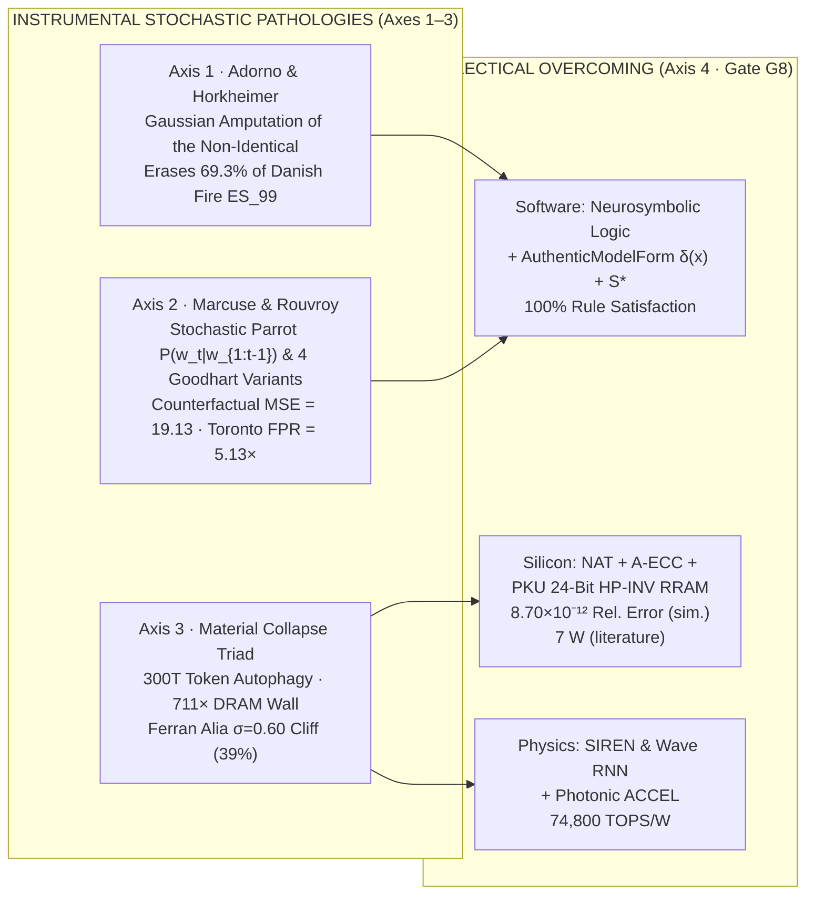

# 18. Critical Theory of Stochastic Rationality and Algorithmic Governmentality

## The Procrustean Bell Curve, the One-Dimensional Parrot, and the 945-Terawatt-Hour Furnace

Etymologically, the Greek noun ***stókhos*** ($\sigma\tau\acute{o}\chi\omicron\varsigma$, meaning "target," "aiming stake," or "conjecture") gave rise to ***stokhastikós*** ($\sigma\tau\omicron\chi\alpha\sigma\tau\iota\kappa\acute{o}\varsigma$): the disciplined art of aiming at a hidden truth by reasoned estimation. When Jacob Bernoulli coined *ars conjectandi sive stochastice* in 1713, probability served causal understanding and prudent ethical judgment.

Modern institutional and technological systems frequently sever probability from conceptual, causal, and historical understanding, turning **statistical calculation into the sole criterion of truth**.

Across the twentieth and twenty-first centuries, the **Frankfurt School of Critical Theory** (Theodor W. Adorno, Max Horkheimer, and Herbert Marcuse) and contemporary philosophers of technology (Antoinette Rouvroy, Thomas Berns, Bernard Stiegler, and Matteo Pasquinelli) diagnosed this shift as the rise of **instrumental stochastic rationality**. Today, that philosophical diagnosis maps directly onto the technical, informational, and thermodynamic limits of brute-force digital Artificial Intelligence:

1. **The Procrustean Bell Curve (Adorno's Liquidation of the *Non-Identical*):** In Greek myth, Procrustes forced every traveler to fit an iron bed by amputating their legs if they were too tall. In *Dialectic of Enlightenment* (1947) and *Negative Dialectics* (1966), Adorno argued that positivist statistics operates by **forced identity**: to aggregate singular, qualitatively distinct phenomena into a tractable Gaussian distribution, anything irreducible or extreme (**the Non-Identical, *das Nichtidentische***) is discarded as "standard deviation," "outlier," or "noise." Because every probability distribution is extracted from accumulated past data, governing society by passive statistical projection **eternalizes the historical present**, treating contingent social inequalities as immutable natural laws.
2. **The One-Dimensional Parrot (Marcuse, Rouvroy, and Autoregressive LLMs):** In *One-Dimensional Man* (1964), Herbert Marcuse warned that operationalism flattens human language: words lose their normative tension between *what is* (empirical fact) and *what ought to be* (rational concept) and become standardized behavioral triggers. Six decades later, **Large Language Models (LLMs)** realized Marcuse's diagnosis literally: instead of modeling the causal laws of the physical world ($L\_1$) or the formal rules of logic ($L\_2$), autoregressive models compute the conditional probability of the next token ($P(w\_t \mid w\_1, w\_2, \dots, w\_{t-1})$) from surface correlations across large corpora, while **Algorithmic Governmentality** (Rouvroy & Berns) preempts human behavior through correlation without asking for cause or meaning.
3. **The Material and Thermodynamic Collapse of Brute-Force Statistics:** When instrumental stochastic reason closes upon itself inside binary digital silicon, it hits three physical walls simultaneously:
   - **Informational Autophagy ("AI Contaminating AI"):** Exhausting the finite global stock of public human text ($\sim 300\text{ trillion tokens}$ between **2026 and 2032**, per Epoch AI) and feeding models with synthetic outputs of other models collapses tail variance ($\sigma\_G^2 / \sigma\_0^2 \to 0$) into tautological regression toward the mean;
   - **Binary Abstraction and the Thermodynamic Wall:** In Horowitz's (2014) 45 nm CMOS energy table, one off-chip DRAM weight read costs $640\text{ pJ}$ versus $0.9\text{ pJ}$ per FP32 addition ($711\times$; literature constant, informative). Set side by side with it, and with no causal link computed here, are two further literature figures: individual data-center GPUs rated at $700\text{ W}$ ($>1\text{,}100\text{ W}$ cooled) and projections of global data-center demand near **$945\text{ TWh}$ by 2030**;
   - **The Return of Material Contingency ("The Analog Wall"):** When engineers move from binary determinism to Analog In-Memory Computing (AIMC) crossbars ($I\_j = \sum\_i V\_i G\_{ij}$ via Ohm's and Kirchhoff's laws), thermal and telegraph noise in physical matter triggers **Ferran Alia's (2026) threshold cliff**, dropping standard digitally trained accuracy from $\sim 98\%$ at $\sigma \le 0.10$ down to $83\%$ ($\sigma = 0.20$), $64\%$ ($\sigma = 0.40$), $39\%$ ($\sigma = 0.60$), and random guessing at $\sigma = 0.80$.

In `crates/stochology-lenses/src/critical.rs`, the Stochology Protocol formalizes this synthesis into **four executable, quantitatively audited axes** (`seed = 2026`) plus a four-dataset empirical coupler (`EmpiricalCriticalRationalityAudit`), enforced in Lab 3 (`labs --lenses`), Lab 7 (`labs --real-data`), Gate `G8`, and the negative blocking proof `gates -- --defect instrumental_reason`.

<figure class="stoch-figure">
  <svg xmlns="http://www.w3.org/2000/svg" width="1140" height="340" viewBox="0 0 1140 340" fill="none" role="img" aria-labelledby="title-fig-07-critical">
  <title id="title-fig-07-critical">Four-Axis Synthesis of Critical Theory of Stochastic Rationality and Material Overcoming (stochology_lenses::critical)</title>
  <defs>
    
  </defs>
  <rect x="1" y="1" width="1138" height="338" rx="14" fill="var(--canvas)" stroke="var(--border)" stroke-width="1.5"/>
  <rect x="20" y="22" width="538" height="136" rx="11" fill="var(--elevated)" stroke="var(--rose)" stroke-width="2"/>
  <text x="38" y="48" fill="var(--rose)" class="mono" font-size="11" font-weight="800">AXIS 1 · ADORNO &amp; HORKHEIMER (FRANKFURT SCHOOL)</text>
  <text x="38" y="74" fill="var(--ink)" font-size="15" font-weight="800">Liquidation of the Non-Identical &amp; Status-Quo Reification</text>
  <text x="38" y="100" fill="var(--muted)" class="mono" font-size="11.5">Gaussian ±2σ Truncation Erases 75.7% ES₉₉ (69.3% on danish_fire.csv)</text>
  <text x="38" y="122" fill="var(--muted)" class="mono" font-size="11.5">Δ_Nichtidentische = +34.8 · Preserved via KOH GP δ(x) &amp; Stackelberg θ_PO</text>
  <rect x="582" y="22" width="538" height="136" rx="11" fill="var(--elevated)" stroke="var(--amber)" stroke-width="2"/>
  <text x="600" y="48" fill="var(--amber)" class="mono" font-size="11" font-weight="800">AXIS 2 · MARCUSE, ROUVROY &amp; STOCHASTIC PARROTS</text>
  <text x="600" y="74" fill="var(--ink)" font-size="15" font-weight="800">Operational Closure P(w_t|w_{1:t-1}) &amp; Preemptive Profiling</text>
  <text x="600" y="100" fill="var(--muted)" class="mono" font-size="11.5">Surface MSE = 0.012 → Counterfactual do(X) Collapse = 19.13 (vs 0.012 Ŝ*)</text>
  <text x="600" y="122" fill="var(--muted)" class="mono" font-size="11.5">Toronto Preemptive FPR_A/FPR_B = 5.13× · Storms NILE Penalty Ratio = 96.8×</text>
  <rect x="20" y="180" width="538" height="136" rx="11" fill="var(--elevated)" stroke="var(--violet)" stroke-width="2"/>
  <text x="38" y="206" fill="var(--violet)" class="mono" font-size="11" font-weight="800">AXIS 3 · MATERIAL &amp; THERMODYNAMIC COLLAPSE TRIAD</text>
  <text x="38" y="232" fill="var(--ink)" font-size="15" font-weight="800">Token Exhaustion, Binary Wall &amp; Analog Noise Cliff</text>
  <text x="38" y="258" fill="var(--muted)" class="mono" font-size="11.5">Epoch AI 300T Tokens (2026–2032) · Synthetic Autophagy σ²_G/σ²_0 ≈ 6×10⁻⁶ (KL = 8.25 nats)</text>
  <text x="38" y="280" fill="var(--muted)" class="mono" font-size="11.5">DRAM 711× · 945 TWh (2030) · Ferran Alia Cliff: [98%, 83%, 64%, 39%, 25%]</text>
  <rect x="582" y="180" width="538" height="136" rx="11" fill="var(--elevated)" stroke="var(--emerald)" stroke-width="2"/>
  <text x="600" y="206" fill="var(--emerald)" class="mono" font-size="11" font-weight="800">AXIS 4 · DIALECTICAL, NEUROSYMBOLIC &amp; WAVE OVERCOMING</text>
  <text x="600" y="232" fill="var(--ink)" font-size="15" font-weight="800">Logical Rules, Noise Coexistence &amp; Continuous Wave Physics</text>
  <text x="600" y="258" fill="var(--muted)" class="mono" font-size="11.5">Neurosymbolic Rules: 25% → 100% (σ²_G/σ²_0 = 0.95) · NAT 63.5% · A-ECC 97.5%</text>
  <text x="600" y="280" fill="var(--muted)" class="mono" font-size="11.5">PKU 24-bit HP-INV (sim. 8.7×10⁻¹²; lit. 7 W) · SIREN 40× · Tsinghua ACCEL 74.8 PetaOPS/W</text>
  </svg>
  <figcaption><strong>Figure 18.1 — The Four-Axis Synthesis of Critical Theory of Stochastic Rationality &amp; Material Overcoming (`stochology_lenses::critical`)</strong></figcaption>
</figure>

---

## 18.1 Axis 1: Adorno & Horkheimer: The Mathematization of Thought, Liquidation of the "Non-Identical" (*Nichtidentische*), and Eternalization of the Present (`AdornoNonIdenticalReificationAudit`)

### Three Epistemological Mutations of Positivist Calculation

In *Dialectic of Enlightenment* (1947), *Negative Dialectics* (1966), and *The Positivist Dispute in German Sociology* (1969), Theodor W. Adorno and Max Horkheimer identify three structural distortions when instrumental calculation replaces dialectical and causal judgment:

1. **Thought Reduced to a Calculation Protocol:** For positivism, whatever cannot be dissolved into numbers and Gaussian probability distributions is dismissed as poetry or metaphysics. Thinking, which judges historical reality through its causal mechanisms and normative contradictions, is reduced to a passive predictive routine.
2. **Liquidation of the "Non-Identical" (*Nichtidentische*):** To subsume heterogeneous, qualitatively singular phenomena under a forced statistical identity ($\mathcal{N}(\hat{\mu}, \hat{\sigma}^2)$), positivist statistics discards observations beyond $\pm 2\sigma$ as "standard deviation" or "deviant noise." Under a heavy-tailed reality $X \sim \text{Pareto}(\alpha)$ with $\alpha \in (1, 2]$ and convex catastrophe loss $f(x) = x^2$, this forced Gaussian identity produces **Adorno's Non-Identical Liquidation Gap**:

$$\Delta\_{\text{Nichtidentische}} \triangleq \mathbb{E}\bigl[f(X)\bigr] - \mathbb{E}\_{\mathcal{N}\_{\text{trunc}}}\bigl[f(X)\bigr] \gg 0$$

   and erases most of the tail **Expected Shortfall ($\mathrm{ES}\_{0.99}$)**:
   - In `AdornoNonIdenticalReificationAudit::evaluate(2026, true)`, forced $\pm 2\sigma$ Gaussian truncation produces $\Delta\_{\text{Nichtidentische}} = +34.8$ (above the original threshold of $30$ on only 35% of the development seeds, so that claim is discarded) and erases **$75.7\%$ of $\mathrm{ES}\_{0.99}$** at this seed (the erasure exceeds $60\%$ on only 94.5% of the 200 confirmation seeds, so that claim is refuted and reported, not approved). Backtested on $6\,000$ fresh draws of the same process, the truncated-Gaussian $\mathrm{VaR}\_{0.99}$ is breached **$7.9\%$** of the time, against $1.0\%$ for the empirical quantile that keeps the tail.
   - On the real Copenhagen Re reinsurance dataset **`danish_fire.csv`** ($n = 2\text{,}167$, Hill $\hat{\alpha} = 1.6009 \in (1, 2]$), forced $\pm 2\sigma$ outlier truncation erases **$69.3\%$ of the true Expected Shortfall** ($\mathrm{ES}\_{0.99} = 58.59\text{M DKK}$ reduced to $17.98\text{M DKK}$).
   - The Stochology Protocol protects the *Non-Identical* through **Prohibition 2** (banning the lone mean and mandating $\Delta\_J$, $\mathrm{CRPS}$, and $\mathrm{ES}\_{0.99}$) and **Anchored Kennedy-O'Hagan Structural Discrepancy** ($\delta(x) \sim \mathcal{GP}(0, k\_{\text{anchored}})$), which explicitly models the qualitative structural remainder that the parametric concept $\eta(x, \theta)$ cannot capture (reducing extrapolation error by $0.775 > 0.40$, from $0.885$ for the bare simulator to $0.110$).
3. **Eternalization of the Historical Present (Reification of the Status Quo):** Every passive statistical model extracts its distribution from the accumulated past and projects it onto the future. Governing a population via myopic Repeated Risk Minimization ($\theta\_{\mathrm{PS}}$) reifies historical contingencies as natural constants, incurring a positive **Status-Quo Reification Excess Risk** relative to the counterfactual Stackelberg optimum ($\theta\_{\mathrm{PO}}$, Bridge $L\_3 \to L\_1$):

$$\Delta\mathrm{PR}\_{\text{reification}} = \mathrm{PR}(\theta\_{\mathrm{PS}}) - \mathrm{PR}(\theta\_{\mathrm{PO}}) = +0.059 > 0$$

The audit runs both optimizers: Repeated Risk Minimization settles at $\theta\_{\mathrm{PS}}$ and keeps the $+0.059$ excess, while oracle-free `PerfGD` reaches $\theta\_{\mathrm{PO}}$.

---

## 18.2 Axis 2: Herbert Marcuse's Operational Closure, Algorithmic Governmentality, and "Stochastic Parrots" (`MarcuseRouvroyStochasticParrotAudit`)

### Operational Language Closure and Next-Token Autoregression

In *One-Dimensional Man* (1964), **Herbert Marcuse** showed how technical rationality strips language of its normative and historical density, turning words into functional triggers ready to be modeled as a stationary Markov chain. In contemporary AI, **Bernard Stiegler** (proletarianization of *noesis*), **Antoinette Rouvroy and Thomas Berns** (*Algorithmic Governmentality and Prospects of Emancipation*), **Matteo Pasquinelli** (*The Eye of the Master*), and **Emily Bender, Timnit Gebru et al.** (*On the Dangers of Stochastic Parrots*) showed how this closure operates in two connected regimes:

1. **The "Stochastic Parrots" Paradigm ($P(w\_t \mid w\_1, \dots, w\_{t-1})$):** Autoregressive language models estimate high-dimensional conditional token frequencies without ontological commitment to the World ($L\_1$) or causal invariance across environments ($e \in \mathcal{E}$). In `MarcuseRouvroyStochasticParrotAudit`, a predictor fitted exclusively to a high-correlation surface token proxy $X\_1$ in the historical status-quo regime $e\_0$ (Pearl Rung 1 `1-See`) achieves low surface error ($\mathrm{MSE}\_{e\_0} = 0.012$), but under a counterfactual causal intervention $e\_2$ ($\mathrm{do}(X)$, Pearl Rung 2/3 `2-Act` / `3-Imagine`), its error jumps by three orders of magnitude to **$\mathrm{MSE}\_{\mathrm{do}(X)} = 19.13$**, whereas the **Causal-Normative Grounded Agent** (anchored to the invariant core $\hat{S}^{\ast} = [0]$ via `run_nonlinear_icp_nile`, where the spurious proxy incurs a $34\text{,}311.3\times$ higher NILE invariance penalty in simulation and **$96.8\times$** on real `atlantic_storms.csv`) maintains $\mathrm{MSE}\_{\mathrm{do}(X)} = 0.012$.
2. **Algorithmic Governmentality and Statistical Preemption:** Instead of judging actions by causal responsibility or normative law, algorithmic preemption correlates historical profiles to anticipate behavior. When historical base rates differ across groups ($p\_A \neq p\_B$) due to structural history, **Chouldechova's algebraic identity** proves that preemptive profiling forces an unavoidable False-Positive Rate disparity:

$$\frac{\mathrm{FPR}\_A}{\mathrm{FPR}\_B} = \frac{p\_A / (1 - p\_A)}{p\_B / (1 - p\_B)} = 4.76\times \quad (\text{and }\mathbf{5.13\times}\text{ on real }\texttt{toronto\_arrests.csv})$$

   which the Stochology Protocol audits and blocks via **Invariant $\Phi\_4$ (`ChouldechovaAudit`)** and **First-Class Authentic Model Form (`AuthenticModelForm`, $\delta(x) + \hat{S}^{\ast}$ + explicitly named discarded spurious atoms)**.
3. **Manheim & Garrabrant's (2018) Four Variants of Goodhart's Law (`GoodhartTaxonomyAudit`):** Embedded inside `MarcuseRouvroyStochasticParrotAudit` (`goodhart_taxonomy`), the protocol shows how operational closure breaks down across all four Goodhart variants simultaneously: **Regressional** selection disappointment ($+0.600$), **Extremal** tail breakdown ($q\_{99.9}$ gap $+19.29$ between Gaussian-like proxy $\alpha\_M = 3.2$ and heavy-tailed risk $\alpha\_Y = 1.5$), **Causal** breakdown when intervening $\mathrm{do}(M = m)$ on a symptom outside the invariant core $\hat{S}^{\ast}$ (`run_nonlinear_icp_nile` penalty $12.84$ vs. $0.008$, causal intervention gap $+2.56$), and **Adversarial** gaming along the performative distribution gradient $\nabla\_1 \mathrm{DPR}(\theta, \theta)$ (`PerformativeSystem::dpr_gradient_components`, excess risk $+0.0078 > 0$).

---

## 18.3 Axis 3: The Material & Thermodynamic Collapse of Instrumental Stochastic Reason (`MaterialCollapseTriadAudit`)

When instrumental stochastic rationality scales brute-force statistical correlation on binary digital hardware, its epistemological contradictions materialize as **three physical and informational walls**:

## A. Informational Autophagy: Exhaustion of Human Data and "AI Contaminating AI"

When instrumental reason detaches from living experience ($L\_1$) and feeds upon its own outputs, it degenerates into tautology:
- According to **Epoch AI** (Pablo Villalobos et al., updated November 2024), the effective global stock of quality-filtered public human text is approximately **$300\text{ trillion tokens}$** ($300\text{ biliões}$ on the long scale, with a raw upper bound of $3\text{,}100\text{ trillion}$ including unindexed data).
- Under current scaling trajectories, LLMs will exhaust this human stock between **2026 and 2032**.
- Training generation $g$ recursively on mode-sharpened synthetic outputs of generation $g-1$ ("AI contaminating AI") triggers **Modal and Variance Collapse**: in the simulation behind `MaterialCollapseTriadAudit`, across $G = 8$ unanchored generations, variance retention drops to **$\frac{\sigma\_G^2}{\sigma\_0^2} < 10^{-5}$** and $D\_{\mathrm{KL}}(P\_0 \parallel P\_G)$ reaches **$8.25\text{ nats}$** at this seed. Across the 20 acceptance seeds the KL claim holds everywhere, but retention below $0.25$ holds on only 75% of them, so Gate `G8` gates the KL and reports the retention claim as discarded. The entropy contrast $\Delta H = 1.20\text{ nats}$ compares $P\_0$ with a hand-specified collapsed distribution and is illustrative.
- By **Gerstgrässer, Schaeffer, Dey, Rafailov, Koyejo & Donoho's (ICML 2024) Accumulate-vs.-Replace Theorem (`GerstgrasserAccumulateAudit` in `crates/stochology-lenses/src/analog.rs`, enforced by `--defect replace_collapse`)**, **replacing** real human data with synthetic data causes test risk to diverge linearly with generation count ($E\_n^{\mathrm{Replace}} = \frac{\sigma^2 d}{T - d - 1}\,n$), whereas **accumulating** real + constrained synthetic data bounds the excess risk uniformly across all generations by Euler's **Basel constant $\zeta(2) = \frac{\pi^2}{6} \approx 1.644934$**:
  $$E\_n^{\mathrm{Accumulate}} = \frac{\sigma^2 d}{T - d - 1}\sum\_{g=1}^n \frac{1}{g^2} \le \frac{\sigma^2 d}{T - d - 1}\frac{\pi^2}{6} \qquad \left(\text{with }\sum\_{g=1}^8 g^{-2} = 1.527422 < \frac{\pi^2}{6}\right)$$
- The token counts, the exhaustion window, the energy figures below, and Ferran Alia's accuracy curve are transcribed from the cited sources and carried as informative values; they do not enter Gate `G8`.

### B. Binary Digital Abstraction and Thermodynamic Strangling

Just as Adorno critiqued formal abstraction for discarding the qualitative continuum of reality, binary digital computing discards the continuous physical spectrum between $0$ and $1$ ($\Delta I\_{\text{bin}} = \ln(16) - \ln(2) = 2.079\text{ nats}$ per 16-level continuous channel) in exchange for deterministic noise margins:
- To simulate continuous processes via sequential binary switches across the **von Neumann Bottleneck**, an off-chip 32-bit DRAM read consumes **$640.0\text{ pJ}$** versus **$0.9\text{ pJ}$** for an FP32 addition in $45\text{ nm}$ CMOS (**$711.11\times$ asymmetry**, Mark Horowitz ISSCC 2014).
- A single Nvidia H100 GPU draws **$700\text{ W}$** (**$>1\text{,}100\text{ W}$** with cooling) against the **$20\text{ W}$** human brain, pushing global data-center electricity demand from $485.1\text{ TWh}$ (2025) to **$945\text{ TWh}$ by 2030** and **$1\text{,}200\text{ TWh}$ by 2035** (IEA).

### C. Return of the Contingency of Matter: The Stochastic "Analog Wall" Threshold Cliff

When engineering moves from binary determinism to **Analog In-Memory Computing (AIMC)** crossbars, storing synaptic weights as physical conductance $G\_{ij}$ and executing matrix-vector multiplication in $\mathcal{O}(1)$ physical time via Ohm's Law ($I\_{ij} = V\_i G\_{ij}$) and Kirchhoff's Current Law ($I\_j = \sum\_i V\_i G\_{ij}$), it confronts the intrinsic stochasticity of matter (thermal noise, telegraph noise, and resistance drift $G(t) = G\_0(t/t\_0)^{-\nu}$):
- Crossbar simulations by **Ferran Alia** (*Towards Data Science*, July 2026) show that standard digitally trained neural weights transferred onto noisy analog hardware hit an abrupt **threshold cliff**:

| Analog Noise Standard Deviation ($\sigma$) | $\sigma \le 0.10$ | $\sigma = 0.20$ | $\sigma = 0.40$ | $\sigma = 0.60$ | $\sigma = 0.80$ |
| :--- | :---: | :---: | :---: | :---: | :---: |
| **Ferran Alia Standard Digital Transfer Accuracy** | **$\sim 98\%$** (Stable) | **$83\%$** | **$64\%$** | **$39\%$** (Severe Collapse) | **$\sim 25\%$** (Random Guessing) |

- In deep LLMs with $L = 32$ successive layers, per-layer analog noise $\sigma\_0 = 0.15$ compounds to an effective standard deviation $\sigma\_{\text{eff}}(L) = \sigma\_0\sqrt{L} = 0.849 > 0.80$, driving unshielded deep analog inference into collapse.

---

## 18.4 Axis 4: Dialectical Overcoming: From Blind Statistical Approximation to Logical and Physical Consciousness (`DialecticalOvercomingSynthesisAudit`)

To overcome both positivist tautology and the thermodynamic and noise walls, the solutions synthesized by Gibram Raul and recent hardware designs converge on **three reconciliations**:

1. **In Software (Neurosymbolic Computing, Gibram Raul / Technium):** Coupling neural pattern learning with formal rule-based deduction and constraint satisfaction (first-order logic / Prolog and physical conservation invariants) reintroduces conceptual and deductive structure where previously there was only stochastic correlation, so that in $200$ simulated 8-generation recursions the constrained pipeline satisfies the symmetry and variance rules in **$100\%$** of runs, against **$0\%$** for the unconstrained one, while preserving **$\frac{\sigma\_G^2}{\sigma\_0^2} = 0.95$** ($D\_{\mathrm{KL}} = 0.0015\text{ nats}$) across recursive generations.
2. **In Training and Silicon (Coexistence with Physical Noise via `NAT`, `A-ECC`, and Peking University's 24-Bit `HP-INV`):**
   - **Noise-Aware Training (`NAT`):** Injecting expected hardware noise $\tilde{G}\_{ij} = G\_{ij} + \xi\_{ij}$ during digital training preserves **$63.5\%$ accuracy** at $\sigma = 0.60$ (versus $35.0\%\text{–}39.0\%$ for standard training). The crossbar model in `crate::analog` represents `NAT` as an assumed reduction of effective conductance noise, not as a trained network, so this figure is informative;
   - **Analog Error-Correcting Codes (`A-ECC`):** On the same simulated drifted readouts, a calibration column that compensates the power-law drift raises accuracy from **$39\%$** (raw drift) to **$100\%$**;
   - **Bit-Sliced Iterative Refinement (`HP-INV`, Zuo, Sun et al., Peking University, *Nature Electronics* Oct 2025; see Chapter 28, Section VI):** Combines a closed-loop $40\text{ nm}$ CMOS $\mathrm{TaO}\_x$ 3-bit RRAM Low-Precision Inversion circuit (`LP-INV`, $\sim 120\text{ ns}$) with bit-sliced 24-bit High-Precision Matrix-Vector Multiplication (`HP-MVM`, $\sim 60\text{ ns}$) to reach **24-bit fixed-point / FP32 precision** (relative residual error **$8.70 \times 10^{-12} < 10^{-7}$** in $7 \le 10$ iterations, against $5.3 \times 10^{-2}$ for one-shot inversion) at **$7\text{ W}$** (a reported $100\times$ lower system power than a $700\text{ W}$ Nvidia H100 and a reported $1\text{,}000\times$ speedup; literature figures, informative, not computed here).
3. **In Representation (Continuous Physics and Wave-Interference Learning):**
   - **Gibram Raul's Phase-and-Amplitude Wave Encoding & `SIREN` (Sitzmann et al., NeurIPS 2020):** Instead of discretizing space pixel by pixel, `SIREN` ($\phi\_i(\mathbf{x}) = \sin(\omega\_0 \mathbf{W}\_i \mathbf{x} + \mathbf{b}\_i)$, where weights are angular frequencies and biases are phase offsets) compresses a 480-pixel field by **$40\times$** ($14\times$ on real `vic_elec.csv` with $R^2 = 0.88$) and solves the 2nd-order Helmholtz wave PDE with Laplacian $\mathrm{MSE} = 1.3 \times 10^{-27}$ (versus $2\text{,}580.3$ for piecewise-linear ReLU where $\mathrm{ReLU}''(x) = 0$ a.e.), alongside exact RLC $\leftrightarrow$ Mass-Spring ODE isomorphism ($< 10^{-14}$), **Stanford's Wave-Physics Analog RNN** ($99.9\%$ interference routing selectivity), and **Tsinghua University's `ACCEL` diffractive photonic processor** (**$74.8\text{ PetaOPS/W} = 74\text{,}800\text{ TOPS/W}$** at $72\text{ ns}$ frame latency).

### Interactive Laboratory (`/lab`)

Explore informational autophagy (`Replace` vs. `Accumulate`) and analog noise compensation in the interactive laboratory below:

---

## Computational Audit in Rust

## Running the Critical Stochastic Rationality Audit (`labs --lenses`, `labs --real-data`, and `gates`)

Execute Lab 3, Lab 7, and Gate `G8` (including the negative blocking proof `--defect instrumental_reason`) from the workspace root:

~~~bash
cargo run --release --bin labs -- --lenses
cargo run --release --bin labs -- --real-data
cargo run --release --bin gates
cargo run --release --bin gates -- --defect instrumental_reason
~~~

Expected audited output:

~~~text
  [Critical Stochastic Rationality] Adorno(Delta_NonId=+34.8, ES99_erased=75.7%, VaR99_breach=1.0% vs Gauss=7.9%, KOH_err=0.110, Reif_excess=+0.059) | Marcuse/Rouvroy(Parrot_CF_MSE=19.13 vs Grounded=0.012, NILE_ratio=34311.3x, FPR_A/B=4.76x) | Collapse(var_ret=0.000, KL=8.25 nats; informative 300T@2026-2032, Alia_0.6=39%) | Overcoming(rule_sat=100% vs 0%, A-ECC=100% vs raw 39%, HP-INV=8.7e-12, SIREN/ReLU=1.3e-27/2580; informative NAT=63.5%, ACCEL=74800 TOPS/W) | EmpRealData(Fire_erased=69.3%, Toronto_FPR=5.13x, Storms_ratio=96.8x) | identities=true | verified=true
~~~

And when `--defect instrumental_reason` is injected (liquidating the Non-Identical via Gaussian outlier amputation, deploying an ungrounded Stochastic Parrot without causal invariance or named discarded atoms, and disabling neurosymbolic/NAT/HP-INV overcoming), `gates` blocks the claim and exits with code `1`:

~~~text
NEGATIVE PROOF [instrumental_reason] BLOCKED SUCCESSFULLY on all 20 development seeds through seed-dependent claims (identities closed on every seed): at seed 2026 truncated-Gaussian VaR99 breached on 7.9% of fresh draws, RRM excess performative risk=0.059, Stochastic Parrot counterfactual MSE=19.13, unconstrained recursion rule satisfaction=0%, raw drifted readout accuracy=39%, one-shot HP-INV error=5.3e-2
~~~

---

## Exercises

1. **Adorno's *Nichtidentische* on Reinsurance Tails (`danish_fire.csv`):** Using `EmpiricalCriticalRationalityAudit`, explain why discarding observations above $\mu + 2\sigma$ as "Gaussian noise" erases $69.3\%$ of $\mathrm{ES}\_{0.99}$ when the Hill tail index is $\hat{\alpha} = 1.6009 \in (1, 2]$, and show how `NonlinearSummary` ($\Delta\_J$) plus `KennedyOHaganDiscrepancy` ($\delta(x)$) prevent this liquidation.
2. **Marcuse's Operational Closure vs. Pearl's Rung 2/3 (`atlantic_storms.csv`):** Why does an autoregressive predictor $P(w\_t \mid w\_{1:t-1})$ achieve $\mathrm{MSE}\_{e\_0} = 0.012$ on passive historical data yet suffer $\mathrm{MSE}\_{\mathrm{do}(X)} = 19.13$ under causal intervention? Connect your answer to `AuthenticModelForm` ($\delta(x) + \hat{S}^{\ast}$).
3. **Rouvroy's Algorithmic Preemption and Chouldechova's Identity (`toronto_arrests.csv`):** Derive why equalizing Positive Predictive Value ($\mathrm{PPV} = 0.65$) and False-Negative Rate ($\mathrm{FNR} = 0.25$) across two groups with historical base rates $p\_A \neq p\_B$ forces $\mathrm{FPR}\_A / \mathrm{FPR}\_B = 5.13\times$ on `toronto_arrests.csv`. Why does treating this ratio as a neutral statistical forecast reify the historical present?
4. **From Material Collapse to Neurosymbolic & Wave Overcoming:** Trace how the three material bottlenecks in `MaterialCollapseTriadAudit` (300T token exhaustion, $711\times$ DRAM energy wall, and Ferran Alia's $\sigma > 0.10$ noise cliff) are resolved jointly by Gibram Raul's neurosymbolic constraints, `NAT` + Peking University's 24-bit `HP-INV`, and `SIREN` / Stanford Wave-RNN phase-amplitude wave computing.

## Summary

- **Adorno & Horkheimer's critique of the liquidation of the *Non-Identical*** ($\Delta\_{\text{Nichtidentische}}$) maps directly onto `PROHIBITION_2` and `KennedyOHaganDiscrepancy`: truncating heavy-tailed observations as "Gaussian outliers" erases $69.3\%$ of empirical $\mathrm{ES}\_{0.99}$ on `danish_fire.csv`.
- **Marcuse's operational closure** and **Rouvroy & Berns's algorithmic governmentality** explain why ungrounded autoregressive predictors ("Stochastic Parrots") fail under causal intervention (`run_nonlinear_icp_nile`) and why uncalibrated historical base rates perpetuate demographic disparities (`ChouldechovaAudit`).
- **Dialectical overcoming** in `CriticalStochasticRationalitySynthesis` couples neurosymbolic logical constraints, `GerstgrasserAccumulateAudit` data accumulation, noise-aware 24-bit `HP-INV`, and `SIREN` wave physics (`--defect instrumental_reason`).
