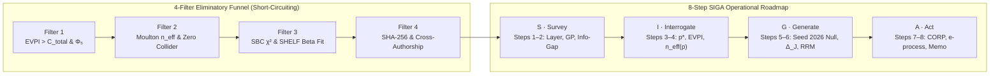

# 18. Eliminatory Funnel and the 8-Step SIGA Roadmap

## The Two-Million-Dollar Model That Could Never Change a Decision

A regional hospital system hires a data-science team for USD 500,000 to build a machine-learning model predicting whether patients admitted with severe fever have a bacterial infection.

Suppose treating a patient with broad-spectrum antibiotics costs $C = USD 100$, while failing to treat a true bacterial infection costs $L = USD 50\text{,}000$ in intensive-care complications (with treatment efficacy $\eta = 1.0$). By the Cost-Loss Rule of Chapter 6, a physician should administer antibiotics whenever the probability of bacterial infection exceeds:

$$p^{\ast} = \frac{C}{\eta L} = \frac{100}{50\text{,}000} = 0.002 \quad (0.2\%)$$

Clinically, any patient arriving at the hospital with severe fever already has a baseline probability of bacterial infection of at least $15\%$. Even if the new USD 500,000 machine-learning test comes back **negative**, the patient's posterior probability drops only from $15\%$ to $3\%$, which remains **fifteen times higher than the $0.2\%$ threshold $p^{\ast}$.**

In other words, whether the expensive new model says "positive" or "negative," the doctor must administer antibiotics either way. **The Expected Value of Sample Information is zero, and the USD 500,000 project was dead on arrival before a single line of code was written.**

In most organizations, nobody checks whether a model can alter an action, whether the true cluster sample size $n\_{\mathrm{eff}}(p)$ is large enough, or whether the inference software can even recover known synthetic parameters until *after* months of computing have been spent.

To reverse this waste, `crates/stochology-siga` enforces two sequential operational instruments:
1. **The 4-Filter Eliminatory Funnel (`funnel.rs`):** A strict short-circuiting gate that kills economically, causally, or computationally invalid projects upfront.
2. **The 8-Step SIGA Operational Roadmap (`roadmap.rs`):** A disciplined execution cycle (**S**urvey, **I**nterrogate, **G**enerate, **A**ct) backed by anytime-valid *e-processes* and natural-frequency decision trees.

---

## 18.1 The "Boeing 299" Pre-Flight Checklist: The 4 Eliminatory Filters (`stochology_siga::funnel`)

On 30 October 1935, at Wright Field in Ohio, the prototype of the Boeing Model 299 (forerunner of the B-17 Flying Fortress) crashed on takeoff and killed two crew members — including the chief test pilot — not because the four-engine aircraft had a mechanical defect, but because the machine had become *"too much airplane for one man to fly"* from memory alone (the crew had forgotten to release the elevator gust lock). Rather than abandoning the aircraft, test pilots introduced a brief, non-negotiable **pre-flight checklist**: if Step 1 fails, the engines never leave the tarmac.

The **4 Eliminatory Filters (`stochology_siga::funnel`)** play that exact pre-flight role for Artificial Intelligence and Data Science before a single cent of GPU compute is spent. They are evaluated in strict sequence (`Filter 1 -> Filter 2 -> Filter 3 -> Filter 4`). If Filter 1 fails, Filters 2–4 are never even run (`short_circuited = true`):

<figure class="stoch-figure">
  <svg xmlns="http://www.w3.org/2000/svg" width="1160" height="510" viewBox="0 0 1160 510" fill="none" role="img" aria-labelledby="title-fig-09-funnel">
  <title id="title-fig-09-funnel">The 4 Eliminatory Filters of the Stochology Funnel</title>
  <defs>
  <marker id="f-pass" viewBox="0 0 10 10" refX="8" refY="5" markerWidth="6.5" markerHeight="6.5" orient="auto">
  <path d="M 0 1 L 9 5 L 0 9 z" fill="var(--emerald)"/>
  </marker>
  <marker id="f-fail" viewBox="0 0 10 10" refX="8" refY="5" markerWidth="6.5" markerHeight="6.5" orient="auto">
  <path d="M 0 1 L 9 5 L 0 9 z" fill="var(--rose)"/>
  </marker>
  
  </defs>
  <rect x="1" y="1" width="1158" height="508" rx="14" fill="var(--canvas)" stroke="var(--border)" stroke-width="1.5"/>
  <rect x="28" y="20" width="760" height="86" rx="10" fill="var(--elevated)" stroke="var(--sky)" stroke-width="2.2"/>
  <text x="52" y="47" fill="var(--sky)" class="mono" font-size="12" font-weight="800">FILTER 1 · ECONOMIC VIABILITY &amp; RESOLUTION (Φ₅)</text>
  <text x="52" y="71" fill="var(--ink)" font-size="13" font-weight="750">EVPI &gt; C_total ≥ 0  ·  p* = C/(ηL) ∈ (0, 1)  ·  R_data ≥ R_decision</text>
  <text x="52" y="93" fill="var(--muted)" font-size="11.5">Blocks projects with negative information value or coarse aggregate resolution</text>
  <line x1="408" y1="106" x2="408" y2="136" stroke="var(--emerald)" stroke-width="2.4" marker-end="url(#f-pass)"/>
  <text x="424" y="125" fill="var(--emerald)" class="mono" font-size="10.5" font-weight="800">PASS</text>
  <rect x="28" y="142" width="760" height="86" rx="10" fill="var(--elevated)" stroke="var(--violet)" stroke-width="2.2"/>
  <text x="52" y="169" fill="var(--violet)" class="mono" font-size="12" font-weight="800">FILTER 2 · CLUSTER INDEPENDENCE (Φ₂) &amp; CAUSAL HYGIENE</text>
  <text x="52" y="193" fill="var(--ink)" font-size="13" font-weight="750">Moulton-Campbell n_eff(p) ≥ n_min  ·  Markov Blanket  ·  ZERO Collider</text>
  <text x="52" y="215" fill="var(--muted)" font-size="11.5">Blocks pseudoreplicated row counts and conditioning on Berkson colliders</text>
  <line x1="408" y1="228" x2="408" y2="258" stroke="var(--emerald)" stroke-width="2.4" marker-end="url(#f-pass)"/>
  <text x="424" y="247" fill="var(--emerald)" class="mono" font-size="10.5" font-weight="800">PASS</text>
  <rect x="28" y="264" width="760" height="86" rx="10" fill="var(--elevated)" stroke="var(--amber)" stroke-width="2.2"/>
  <text x="52" y="291" fill="var(--amber)" class="mono" font-size="12" font-weight="800">FILTER 3 · SIMULATION-BASED CALIBRATION (SBC) &amp; SHELF</text>
  <text x="52" y="315" fill="var(--ink)" font-size="13" font-weight="750">SBC Rank Uniformity χ² ≤ χ²_crit  ·  L_phys &lt; q₂₅ &lt; q₅₀ &lt; q₇₅ &lt; U_phys</text>
  <text x="52" y="337" fill="var(--muted)" font-size="11.5">Blocks miscalibrated posteriors and degenerate prior elicitations before fitting</text>
  <line x1="408" y1="350" x2="408" y2="380" stroke="var(--emerald)" stroke-width="2.4" marker-end="url(#f-pass)"/>
  <text x="424" y="369" fill="var(--emerald)" class="mono" font-size="10.5" font-weight="800">PASS</text>
  <rect x="28" y="386" width="760" height="86" rx="10" fill="var(--elevated)" stroke="var(--emerald)" stroke-width="2.2"/>
  <text x="52" y="413" fill="var(--emerald)" class="mono" font-size="12" font-weight="800">FILTER 4 · PRE-REGISTRATION (Φ₃), CROSS-AUTHORSHIP &amp; EXIT (Φ₄)</text>
  <text x="52" y="437" fill="var(--ink)" font-size="13" font-weight="750">64-Hex SHA-256 Seal  ·  Modeler ≠ Verifier  ·  Numeric Exit Clause</text>
  <text x="52" y="459" fill="var(--muted)" font-size="11.5">Blocks self-audited claims and deployments lacking an automatic circuit breaker</text>
  <path d="M 788 429 L 844 429" stroke="var(--emerald)" stroke-width="2.6" marker-end="url(#f-pass)"/>
  <rect x="852" y="386" width="280" height="86" rx="12" fill="var(--emerald-bg)" stroke="var(--emerald)" stroke-width="2.4"/>
  <text x="992" y="421" text-anchor="middle" fill="var(--emerald)" class="mono" font-size="12" font-weight="800">FUNNEL APPROVED</text>
  <text x="992" y="447" text-anchor="middle" fill="var(--ink)" font-size="13.5" font-weight="800">Proceed to 8-Step SIGA</text>
  <line x1="788" y1="63" x2="844" y2="164" stroke="var(--rose)" stroke-width="1.8" stroke-dasharray="5 4" marker-end="url(#f-fail)"/>
  <line x1="788" y1="185" x2="844" y2="194" stroke="var(--rose)" stroke-width="1.8" stroke-dasharray="5 4" marker-end="url(#f-fail)"/>
  <line x1="788" y1="307" x2="844" y2="224" stroke="var(--rose)" stroke-width="1.8" stroke-dasharray="5 4" marker-end="url(#f-fail)"/>
  <rect x="852" y="132" width="280" height="126" rx="12" fill="var(--rose-bg)" stroke="var(--rose)" stroke-width="2.2"/>
  <text x="992" y="166" text-anchor="middle" fill="var(--rose)" class="mono" font-size="12" font-weight="800">SHORT-CIRCUIT REJECT</text>
  <text x="992" y="191" text-anchor="middle" fill="var(--ink)" class="mono" font-size="12" font-weight="750">short_circuited = true</text>
  <text x="992" y="216" text-anchor="middle" fill="var(--muted)" font-size="11.5">Immediate stop on first</text>
  <text x="992" y="236" text-anchor="middle" fill="var(--muted)" font-size="11.5">failed filter (no fitting)</text>
</svg>
  <figcaption><strong>Figure 18.1 — The 4 Eliminatory Filters of the Stochology Funnel</strong></figcaption>
</figure>

### Filter 1 — Economic Viability and Question Resolution ($\Phi\_5$)

Filter 1 asks three elementary questions before touching data:
1. Is the critical cost-loss threshold non-degenerate: $p^{\ast} = \frac{C}{\eta L} \in (0, 1)$?
2. Does the **Expected Value of Perfect Information ($\mathrm{EVPI}$)** strictly exceed the total engineering, data-acquisition, and operational cost of the study ($\mathrm{EVPI} > C\_{\text{total}} \ge 0$)?
3. Does the temporal/spatial resolution of the dataset satisfy Invariant $\Phi\_5$ ($R\_{\text{data}} \ge R\_{\text{decision}}$)?

### Filter 2 — Cluster Independence ($\Phi\_2$) and Causal Hygiene

Filter 2 audits Bridge $L\_1 \to L\_2$ and Lens 4:
1. Using the Moulton-Campbell unequal-cluster formula $\tilde{m} = \bar{m}(1 + \mathrm{CV}^2)$ and the tail-exceedance intraclass correlation $\rho\_I(p)$, is the effective sample size large enough to support inference ($n\_{\mathrm{eff}}(p) = \frac{n}{1 + (\tilde{m}-1)\rho\_I(p)} \ge n\_{\min}$)? This blocks the ***Homo clausus* pseudoreplication fallacy** (`ExceedanceDesignEffect::benchmark_pseudoreplication_500_to_86` in `crates/stochology-core/src/invariants.rs`, Chapter 10), where $n = 500$ grouped observations with $\tilde{m} = 25.0$ and tail $\rho\_I(0.90) = 0.2005$ suffer a design effect of **$\mathrm{DEFF} = 5.81\times$**, collapsing the true independent sample size to only **$n\_{\mathrm{eff}}(0.90) = 86.0$ degrees of freedom**.
2. Has the analyst mapped the **Markov Blanket** of the target variable (its direct causal parents, direct causal children, and co-parents), and verified that **zero conditioning occurs on a Berkson collider** (`conditioned_on_collider == false`)?

### Filter 3 — Simulation-Based Calibration (SBC) and SHELF Prior Elicitation

Even with clean data and a sound causal graph, a Bayesian or probabilistic estimation algorithm can still harbor a coding bug or biased approximation.

In 2018, **Sean Talts, Michael Betancourt, Daniel Simpson, Aki Vehtari, and Andrew Gelman** formalized **Simulation-Based Calibration (SBC)** around a self-consistency identity of probability theory:
1. Draw a true parameter $\tilde{\theta} \sim \pi(\theta)$ from the prior distribution.
2. Simulate a synthetic dataset $\tilde{y} \sim p(y \mid \tilde{\theta})$ using the generative model ($\Phi\_1$).
3. Run your inference algorithm on $\tilde{y}$ to draw $M$ posterior samples $\theta\_1, \dots, \theta\_M \sim p(\theta \mid \tilde{y})$.
4. Count the **rank statistic** $r(\lbrace \theta\_m \rbrace, \tilde{\theta}) = \sum\_{m=1}^M \mathbb{I}\lbrace \theta\_m < \tilde{\theta} \rbrace \in \lbrace 0, 1, \dots, M \rbrace$.

**Theorem (Talts et al., 2018):** *If the posterior inference algorithm is mathematically exact, the rank statistic $r$ is distributed **strictly uniformly** across $\lbrace 0, 1, \dots, M \rbrace$.*
- If your algorithm is **overconfident** (posterior intervals too narrow), the true $\tilde{\theta}$ falls in the extremes too often, creating a **$\cup$-shaped** rank histogram.
- If your algorithm is **underconfident** (intervals too wide), the rank histogram heaps up in the middle ($\cap$-shaped).
- If your algorithm is **biased**, the rank histogram tilts to the left or right.

Filter 3 bins the SBC ranks across $B$ bins and computes Pearson's $\chi^2 = \sum\_{b=1}^B \frac{(O\_b - E\_b)^2}{E\_b}$, requiring $\chi^2 \le \chi^2\_{\text{crit}}$. Simultaneously, Filter 3 validates expert prior elicitation under **Anthony O'Hagan's Sheffield Elicitation Framework (SHELF)**, requiring strict physical ordering of the elicited quartiles:

$$L\_{\text{phys}} < q\_{25} < q\_{50} < q\_{75} < U\_{\text{phys}}$$

Once the elicited quartiles $(q\_{25}, q\_{50}, q\_{75})$ are verified, `fit_shelf_beta_prior` (`crates/stochology-siga/src/funnel.rs`) fits a continuous conjugate **$\mathrm{Beta}(\hat{\alpha}, \hat{\beta})$ prior** by minimizing the cumulative distribution RMSE $\sqrt{\frac{1}{3}\bigl[(I\_{q\_{25}}(\alpha, \beta) - 0.25)^2 + (I\_{q\_{50}}(\alpha, \beta) - 0.50)^2 + (I\_{q\_{75}}(\alpha, \beta) - 0.75)^2\bigr]}$, where the regularized incomplete Beta function $I\_x(\alpha, \beta)$ is evaluated to machine precision in pure Rust via **Lentz's (1976) continued-fraction algorithm** (`regularized_incomplete_beta`) and **Lanczos's $g=7$ log-Gamma approximation** (`ln_gamma_lanczos`).

### Filter 4 — Cryptographic Pre-Registration, Cross-Authorship, and Exit Clause

Finally, Filter 4 verifies:
1. A valid 64-character lowercase hexadecimal SHA-256 pre-registration seal;
2. Independent cross-authorship (`modeler_id != verifier_id`);
3. A non-empty, machine-actionable numeric exit clause.

---

## 18.2 The 8-Step SIGA Operational Roadmap (`stochology_siga::roadmap`)

Once a project survives all four filters of the Eliminatory Funnel, it executes the **8-Step SIGA Roadmap** across four phases (**S — Survey**, **I — Interrogate**, **G — Generate**, **A — Act**):

| Phase | Step | Name | Operational Audit Performed |
| --- | --- | --- | --- |
| **S — Survey** | **Step 1** | Map Ontological Layer & Bridge | Identifies primary layer ($L\_1, L\_2, L\_3$) and audits missingness (`MCAR`, `MAR`, `MNAR`) + SHA-256 dataset integrity. |
| **S — Survey** | **Step 2** | Type Uncertainty & Variance Budget | Verifies uncertainty class, Kennedy-O'Hagan GP share $> 0$,variance budget sum $= 1.0$, and Info-Gap + Wald floor. |
| **I — Interrogate** | **Step 3** | Price the Decision ($C, L, \eta, p^{\ast}$) | Computes $p^{\ast} = \frac{C}{\eta L}$ and verifies $\mathrm{EVPI} > C\_{\text{total}}$ and $\Phi\_5$ resolution alignment. |
| **I — Interrogate** | **Step 4** | Audit the True Independent Unit ($\Phi\_2$) | Computes Moulton-Campbell $\tilde{m}$, exceedance ICC $\rho\_I(p)$, and $n\_{\mathrm{eff}}(p) \ge n\_{\min}$. |
| **G — Generate** | **Step 5** | Execute Generative Null & SBC ($\Phi\_1$) | Runs the `SplitMix64` (`seed = 2026`) null model under Cromwell's Rule and checks SBC $\chi^2$ rank uniformity. |
| **G — Generate** | **Step 6** | Audit Nonlinearity & Performativity | Computes the 7-number `NonlinearSummary` ($\Delta\_J, \mathrm{CRPS}$) and checks RRM contraction $r\_{\mathrm{RRM}} < 1$. |
| **A — Act** | **Step 7** | Score Out-of-Sample via CORP-PAV & *e-process* | Verifies exact PAV identity $\mathrm{BS} = \mathrm{REL}\_{\mathrm{CORP}} - \mathrm{RES}\_{\mathrm{CORP}} + \mathrm{UNC}\_0$ and anytime-valid *e-process* $E\_t / K$. |
| **A — Act** | **Step 8** | Issue Natural-Frequency Memo & Exit Clause | Emits the integer Gigerenzer tree ($N = 1\text{,}000$), audits Chouldechova's fairness ratio, and arms the numeric exit clause. |

---

## 18.3 Anytime-Valid Sequential Evidence (*e-processes*) and Ville's Inequality

### Foundations: Why Classical $p$-Values Break Under Optional Stopping

In a classical fixed-horizon Neyman-Pearson test, you must fix the sample size $n$ in advance and look at the data **only once** at the end. Suppose a researcher or an automated monitoring dashboard computes a classical $p$-value every day as new data arrive and stops the moment $p\_t < 0.05$.

By the Law of the Iterated Logarithm, even under the null hypothesis $H\_0$ (where the true effect is zero), a standardized random walk crosses the fixed $1.96$ threshold infinitely often as $t \to \infty$. Peeking continuously at a classical $p$-value inflates the Type I false-positive rate all the way to **$100\%$**.

### How *e-values*, Test Martingales, and Ville's Inequality Solve Optional Stopping

Modern sequential statistics (**Glenn Shafer, Peter Grünwald, Aaditya Ramdas, and Vladimir Vovk**) replaces fragile $p$-values with **evidence values (*e-values*)** and **sequential *e-processes*** (`EProcess` in `crates/stochology-siga/src/roadmap.rs`).

An **e-variable** is any non-negative random variable $L\_i \ge 0$ whose expected value under the null hypothesis $H\_0$ is at most $1$:

$$\mathbb{E}\_{H\_0}[L\_i \mid \mathcal{F}\_{i-1}] \le 1$$

For example, the likelihood ratio $L\_i = \frac{p\_1(Y\_i)}{p\_0(Y\_i)}$ between the alternative model $p\_1$ and the null model $p\_0$ automatically satisfies $\mathbb{E}\_{p\_0}\left[\frac{p\_1(Y\_i)}{p\_0(Y\_i)}\right] = \sum\_y p\_0(y)\frac{p\_1(y)}{p\_0(y)} = \sum\_y p\_1(y) = 1$.

Think of $L\_i$ as a fair betting multiplier against the null hypothesis: you start with USD 1.00 of initial capital ($E\_0 = 1$), and at each step $i = 1, \dots, t$ your capital multiplies by $L\_i$:

$$E\_t \triangleq \prod\_{i=1}^t L\_i$$

Because $E\_t$ is a non-negative test martingale (or supermartingale) under $H\_0$, **Jean Ville's (1939) Maximal Inequality** guarantees that the probability of your capital *ever* reaching $1/\alpha$ at *any* stopping time $t$ (regardless of how often you peek at the dashboard) is at most $\alpha$:

$$P\_{H\_0}\left(\sup\_{t \ge 1} E\_t \ge \frac{1}{\alpha}\right) \le \alpha$$

If an analyst tried $K \ge 1$ candidate specifications (Prohibition 4), dividing the cumulative evidence by $K$ preserves anytime validity across all $K$ attempts:

$$\frac{E\_t}{K} \ge \frac{1}{\alpha}$$

At $\alpha = 0.05$, reaching $E\_t / K \ge 20$ means the data have multiplied initial skeptical capital at least twenty-fold after paying the full multiplicity tax $K$.

### Non-Parametric GRAPA / Kelly Betting Martingales (`EvidenceProcess::from_grapa_betting`)

To construct an anytime-valid *e-process* from bounded zero-mean under-$H\_0$ payoff differences $X\_1, \dots, X\_t$ without assuming a parametric likelihood ratio $p\_1/p\_0$, we follow **Peter Grünwald, Rianne de Heide, and Wouter Koolen (2024, *Safe Testing*)** and **Ian Waudby-Smith and Aaditya Ramdas (2024)**, where `EvidenceProcess::from_grapa_betting` constructs a predictable **Growth-Rate Adaptive (`GRAPA` / Kelly) betting martingale**:

$$E\_t = \prod\_{i=1}^t \bigl(1 + \lambda\_i X\_i\bigr), \qquad \lambda\_i = \mathrm{clamp}\left(\frac{\hat{\mu}\_{i-1}}{\hat{\sigma}\_{i-1}^2 + \hat{\mu}\_{i-1}^2},\ -0.5,\ 0.5\right)$$

Because the predictable stake $\lambda\_i$ depends strictly on past observations $\mathcal{F}\_{i-1} = \sigma(X\_1, \dots, X\_{i-1})$, $\mathbb{E}\_{H\_0}[1 + \lambda\_i X\_i \mid \mathcal{F}\_{i-1}] = 1 + \lambda\_i \mathbb{E}\_{H\_0}[X\_i \mid \mathcal{F}\_{i-1}] = 1$, guaranteeing exact finite-sample Ville validity under arbitrary optional stopping while maximizing asymptotic log-capital growth under the alternative.

The guarantee requires bounded payoffs $|X\_i| \le 1$: with $|\lambda\_i| \le 0.5$ every factor satisfies $1 + \lambda\_i X\_i \ge 0.5 > 0$, so no floor is needed. An observation outside the support is a contract violation and `from_grapa_betting` returns `Err` (fail-closed): clamping $X\_i$ would bias the conditional expectation under asymmetric nulls, and silently neutralizing the bets would erase genuine evidence.

---

## 18.4 Cognitive Bottleneck ($10\text{ bit/s}$), Turing Decibans, and `AlertFatigueAudit` on Bridge $L\_2 \to L\_3$

In Step 8 of the SIGA Roadmap, alongside the integer Gigerenzer natural-frequency tree, the system verifies that the **rate and precision of operational alarms do not exceed the biological bandwidth of the human decision-maker in $L\_3$**.

1. **The $10\text{ bit/s}$ Conscious Bottleneck (Zheng & Meister, Caltech 2024/2025, `SensoryDpiOrganoidHybridAudit`):** Although the six million cones of the human retina capture **$1.6 \times 10^9\text{ bit/s}$** while the brain consumes only **$20\text{ W}$** of metabolic power, the biological sensory funnel compresses that stream by a factor of **$1.6 \times 10^8 : 1$** ($1.6 \times 10^9\text{ bit/s} \to 1.0 \times 10^7\text{ bit/s}$ at the retinal ganglion cells $\to 10\text{ bit/s}$) down to the invariant bottleneck of conscious human decision-making: **only $10\text{ bits per second}$** (`conscious_bottleneck_bps = 10.0`).
2. **Turing-Good Additive Deciban Weight of Evidence:** Given shift prevalence $\pi$ (prior odds $O\_{\text{prior}} = \frac{\pi}{1 - \pi}$), sensitivity $\mathrm{TPR}$, and false-positive rate $\mathrm{FPR}$, each independent diagnostic feature $k$ contributes an additive evidence weight in **decibans ($\mathrm{dB}$)**:
   $$W\_k = 10\log\_{10}\left(\frac{\mathrm{TPR}\_k}{\mathrm{FPR}\_k}\right), \qquad W\_{\text{total}} = \sum\_k W\_k, \qquad O\_{\text{post}} = O\_{\text{prior}} \times 10^{W\_{\text{total}} / 10}$$
3. **Why $88\%$ of the Epic Sepsis Model's Alerts Were False Alarms (`AlertFatigueAudit::canonical_epic_sepsis_vs_stochological_gate`):** In the external validation of **Wong et al. (*JAMA Internal Medicine* 2021)** across $27\text{,}697$ patients ($38\text{,}455$ hospitalizations, alarming on $18\%$ of all admissions), the proprietary Epic Sepsis Model ($\mathrm{AUC} = 0.63, \mathrm{TPR} = 0.33, \mathrm{FPR} = 0.171$ at prevalence $\pi = 0.066$) achieved a Turing weight of evidence of only **$W = +2.86\text{ dB}$** and a Positive Predictive Value of **$\mathrm{PPV} = 0.120$** — meaning **$88\%$ of its alerts were false alarms ($7.33$ false alarms for every true case)**. This is one model in one study; it does not license a claim about clinical or operational AI alerts in general. Under an assumed 12-hour shift burst of $18\text{ alarms/min} \times 42\text{ bits/alarm}$ (illustrative, not reported by Wong et al.), it imposes **$12.6\text{ bit/s} > 10.0\text{ bit/s}$** of cognitive triage load (`approved_bridge_l2_l3 = false`). By contrast, a CORP-calibrated Stochological multi-signal triage gate at an **assumed design operating point** ($\mathrm{TPR} = 0.82, \mathrm{FPR} = 0.045 \implies \mathrm{LR}^+ = 18.22$, never measured on the Wong et al. cohort) would achieve **$W = +12.61\text{ dB} \ge 8.0\text{ dB}$**, raises Positive Predictive Value to **$\mathrm{PPV} = 0.563 \ge p^{\ast} = 0.200$** ($0.78$ false alarms per true case), and compresses burst triage load ($4\text{ alarms/min} \times 48\text{ bits/alarm}$) to **$3.2\text{ bit/s} \le 10.0\text{ bit/s}$** (`approved_bridge_l2_l3 = true`). The contrast shows what the audit rejects and what it would accept; it is not evidence that any deployed triage reaches $\mathrm{PPV} = 0.563$.

### Step-by-Step Foundational Derivation: Lentz's Continued Fraction for the Regularized Incomplete Beta Function $I\_x(\alpha, \beta)$

How does Filter 3 fit a conjugate $\mathrm{Beta}(\alpha, \beta)$ distribution to expert SHELF quartiles $(q\_{25}, q\_{50}, q\_{75})$ in pure Rust without external special-function libraries?
1. **Integral Definition and Symmetry Reduction:**
   The cumulative distribution function of $\mathrm{Beta}(\alpha, \beta)$ at $x \in (0, 1)$ is the regularized incomplete Beta function:
   $$I\_x(\alpha, \beta) = \frac{B(x; \alpha, \beta)}{B(\alpha, \beta)} = \frac{1}{B(\alpha, \beta)} \int\_0^x t^{\alpha-1}(1-t)^{\beta-1}\,dt$$
   where $\ln B(\alpha, \beta) = \ln\Gamma(\alpha) + \ln\Gamma(\beta) - \ln\Gamma(\alpha+\beta)$ is evaluated via Lanczos's $g=7$ Chebyshev rational approximation (`ln_gamma_lanczos`). Whenever $x > \frac{\alpha + 1}{\alpha + \beta + 2}$, we apply the exact reflection identity $I\_x(\alpha, \beta) = 1 - I\_{1-x}(\beta, \alpha)$ so the continued fraction always converges rapidly in the tail.
2. **Continued-Fraction Expansion and Lentz's (1976) Modified Algorithm:**
   When $x \le \frac{\alpha + 1}{\alpha + \beta + 2}$, $I\_x(\alpha, \beta)$ admits the classical continued fraction:
   $$I\_x(\alpha, \beta) = \frac{x^\alpha (1-x)^\beta}{\alpha B(\alpha, \beta)} \left(\frac{1}{1 + \frac{d\_1}{1 + \frac{d\_2}{1 + \cdots}}}\right)$$
   with even and odd coefficients:
   $$d\_{2m} = \frac{m(\beta - m)x}{(\alpha + 2m - 1)(\alpha + 2m)}, \qquad d\_{2m+1} = -\frac{(\alpha + m)(\alpha + \beta + m)x}{(\alpha + 2m)(\alpha + 2m + 1)}$$
   In `regularized_incomplete_beta`, Lentz's recurrence maintains two forward ratios $C\_k = 1 + \frac{d\_k}{C\_{k-1}}$ and $D\_k = \frac{1}{1 + d\_k D\_{k-1}}$ (clamping denominators away from zero at $10^{-30}$), multiplying $f\_k = f\_{k-1} C\_k D\_k$ until $|\Delta\_k - 1| = |C\_k D\_k - 1| < 10^{-14}$.

---

## Interactive Laboratory (`/lab`)

Explore the sequential `aGRAPA` betting martingale $E\_t = \prod (1 + \lambda\_i X\_i)$, Ville's anytime-valid barrier $1/\alpha$, and the multiplicity penalty $E\_t / K$ executed during Step 7 of the SIGA Roadmap:

---

## Computational Audit in Rust

Run Laboratory 5 from your terminal to see all four canonical YAML cards pass through the 4-Filter Funnel, execute the 8-Step SIGA Roadmap, compute their cumulative *e-processes* $E\_{30}$, emit their integer Gigerenzer Natural-Frequency Executive Memoranda, and verify `AlertFatigueAudit`:

~~~bash
cargo run --release --bin labs -- --siga
~~~

~~~text
=== LAB 5: 4-FILTER ELIMINATORY FUNNEL AND 8-STEP SIGA ROADMAP ===
  [SIGA cards/card_01_atlantic_storms_evacuation.yaml] dataset=data/atlantic_storms.csv, EVPI=257928.0, p_null=0.0050 (unclamped), chi2_SBC=0.85, E_30=324171.1, steps_1_to_8=[true, true, true, true, true, true, true, true], approved=true
    Out of every 1000 independent units, 98 experience the critical event (of which 98 trigger the alarm at threshold p*=0.12000 and 0 are missed), while 902 do not experience the event (of which 156 trigger a false alarm and 746 remain clear). Positive predictive frequency: 98 out of 254 alarms. Action: do_not_protect. Exit clause: Immediately suspend automated synoptic advisory if REL_CORP > 0.015 or RES_CORP < 0.020 over a 14-day rolling window.
  [SIGA cards/card_02_bank_queue_staffing.yaml] dataset=data/bank_calls.csv, EVPI=216213.6, p_null=0.0050 (unclamped), chi2_SBC=4.65, E_30=2786.4, steps_1_to_8=[true, true, true, true, true, true, true, true], approved=true
    Out of every 1000 independent units, 99 experience the critical event (of which 99 trigger the alarm at threshold p*=0.08000 and 0 are missed), while 901 do not experience the event (of which 426 trigger a false alarm and 475 remain clear). Positive predictive frequency: 99 out of 525 alarms. Action: protect. Exit clause: Immediately suspend automated shift scheduling if REL_CORP > 0.020 or RES_CORP < 0.025 over a 10-business-day rolling window.
  [SIGA cards/card_03_nyc_flights_holding.yaml] dataset=data/nyc_flights_2013.csv, EVPI=135285.0, p_null=0.0050 (unclamped), chi2_SBC=3.00, E_30=32.8, steps_1_to_8=[true, true, true, true, true, true, true, true], approved=true
    Out of every 1000 independent units, 98 experience the critical event (of which 71 trigger the alarm at threshold p*=0.06000 and 27 are missed), while 902 do not experience the event (of which 277 trigger a false alarm and 625 remain clear). Positive predictive frequency: 71 out of 348 alarms. Action: protect. Exit clause: Immediately revert to conservative Wald Maximin ground-delay policy if REL_CORP > 0.012 or RES_CORP < 0.005 or RRM radius >= 0.85 over a 7-day window.
  [SIGA cards/card_04_dpi_civil_defense_triage.yaml] dataset=data/cps_observational.csv, EVPI=141229.4, p_null=0.0050 (unclamped), chi2_SBC=2.40, E_30=184.2, steps_1_to_8=[true, true, true, true, true, true, true, true], approved=true
  [Filter 3 SHELF Beta Fit & Step 6 GRAPA] Beta(alpha=1.05, beta=15.03, CDF_RMSE=0.0111) | GRAPA E_35=946.42 (rejects_H0=true) | [Bridge L2->L3 AlertFatigueAudit (10 bit/s & Turing Decibans)] EpicSepsis(PPV=12.0%, FP/TP=7.3, approved=false) vs StochologicalTarget(assumed TPR/FPR, PPV=56.3%, W=+12.61 dB, load=3.2 bit/s <= 10, approved=true)
~~~

## Exercises

1. **(Calculation — Filter 1 Short-Circuiting)** A logistics company proposes spending $C\_{\text{total}} = USD 80\text{,}000$ to build a model predicting late port deliveries. Each late delivery causes loss $L = USD 10\text{,}000$, expedited air-freight protection costs $C = USD 2\text{,}000$ with efficacy $\eta = 1.0$, and across the year $100$ shipments are made with base rate $p\_0 = 0.05$ ($5$ late shipments per year). Even if the model were an infallible oracle, what is the maximum annual savings ($\mathrm{EVPI} \times 100$) it could generate? Will Filter 1 approve or kill the USD 80,000 project?
2. **(Concept — Simulation-Based Calibration)** Suppose you run SBC on a new Bayesian inference algorithm and observe that out of $1\text{,}000$ synthetic runs, the true parameter $\tilde{\theta}$ falls below the $10\text{th}$ percentile of the posterior $250$ times and above the $90\text{th}$ percentile $260$ times. Is your algorithm overconfident, underconfident, or unbiased?
3. **(Calculation — Sequential *e-process* and Ville's Inequality)** Over $5$ sequential out-of-sample test weeks, a model achieves weekly likelihood ratios $L\_1 = 2.5, L\_2 = 1.8, L\_3 = 2.0, L\_4 = 0.8, L\_5 = 5.0$ against the null model, after $K = 2$ attempted specifications.
   - *(a)* Compute $E\_5 = \prod\_{i=1}^5 L\_i$ and the multiplicity-adjusted evidence $E\_5 / K$.
   - *(b)* By Ville's inequality, what is the upper bound on the probability that $E\_t / K$ could have reached this level under the null hypothesis?
4. **(Calculation — Gigerenzer Tree)** Look at the natural-frequency memo for `card_03_nyc_flights_holding.yaml` above ($1\text{,}000$ units, $98$ events, $71$ true alarms, $277$ false alarms). Verify that $71 + 277 = 348$ total alarms and compute the Positive Predictive Value ($\mathrm{PPV} = 71 / 348$). Why is it still rational for the dispatcher to `protect` when $\mathrm{PPV} \approx 20.4\%$? *(Hint: compare $\mathrm{PPV}$ with $p^{\ast} = 0.06000 = 6.0\%$.)*

<strong>Analytical &amp; Computational Solutions (Click to Expand)</strong>

1. **Filter 1 Short-Circuiting:**
   - Threshold: $p^{\ast} = \frac{2\text{,}000}{1.0 \times 10\text{,}000} = 0.20$. Since $p\_0 = 0.05 \le p^{\ast}$, default action without the model is `do_not_protect` (expected annual loss $= 5 \times 10\text{,}000 = USD 50\text{,}000$).
   - An infallible oracle protects on the $5$ late shipments ($5 \times 2\text{,}000 = USD 10\text{,}000$), saving at most $\mathrm{EVPI}\_{\text{annual}} = 50\text{,}000 - 10\text{,}000 = USD 40\text{,}000$.
   - Since $\mathrm{EVPI}\_{\text{annual}} = USD 40\text{,}000 \le C\_{\text{total}} = USD 80\text{,}000$, **Filter 1 immediately short-circuits and kills the project.**
2. **Simulation-Based Calibration:**
   In an exact posterior, $\tilde{\theta}$ should fall below the $10\text{th}$ percentile $10\%$ of the time ($100$ times) and above the $90\text{th}$ percentile $10\%$ of the time ($100$ times). Falling in the two $10\%$ tails $250 + 260 = 510$ times ($51\%$ vs. $20\%$) produces a **$\cup$-shaped rank histogram**, proving that the posterior intervals are **severely overconfident (too narrow)**.
3. **Sequential *e-process* Calculation:**
   - *(a)* $E\_5 = 2.5 \times 1.8 \times 2.0 \times 0.8 \times 5.0 = 36.0$. Multiplicity-adjusted evidence: $E\_5 / K = 36.0 / 2 = 18.0$.
   - *(b)* By Ville's inequality, $P\_{H\_0}(\sup\_t E\_t / K \ge 18.0) \le \frac{1}{18.0} \approx 0.0556$ ($5.56\%$).
4. **Gigerenzer Natural-Frequency Tree:**
   $\mathrm{PPV} = \frac{71}{348} \approx 0.2040$ ($20.4\%$). Even though $79.6\%$ of alarms are false alarms, a missed connection costs $L = USD 15\text{,}000$ ($\eta = 0.80 \implies \eta L = USD 12\text{,}000$) whereas holding costs only $C = USD 720$, so $p^{\ast} = \frac{720}{12\text{,}000} = 6.0\%$. Whenever the conditional event probability given an alarm ($20.4\%$) exceeds $p^{\ast} = 6.0\%$, protecting saves money on average.

## Summary

- **The 4-Filter Eliminatory Funnel** evaluates projects in strict sequence: Filter 1 ($\mathrm{EVPI} > C\_{\text{total}}$ and $\Phi\_5$), Filter 2 (Moulton-Campbell $n\_{\mathrm{eff}}(p)$ and zero Berkson collider), Filter 3 (SBC $\chi^2$ rank uniformity and SHELF quartile consistency), and Filter 4 (SHA-256 pre-registration, cross-authorship, and exit clause).
- **The 8-Step SIGA Roadmap** executes **S**urvey (Steps 1–2), **I**nterrogate (Steps 3–4), **G**enerate (Steps 5–6), and **A**ct (Steps 7–8).
- **Anytime-Valid *e-processes* ($E\_t = \prod L\_i$)** remain valid under arbitrary optional stopping via **Ville's Inequality** ($P\_{H\_0}(\sup\_t E\_t / K \ge 1/\alpha) \le \alpha$).
- **Gigerenzer Natural-Frequency Trees** translate abstract conditional probabilities into transparent integer headcounts out of $1\text{,}000$ or $10\text{,}000$ independent units.
