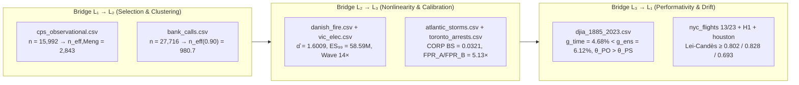

# 20. Transversal Empirical Synthesis Across All 13 Real Datasets (Lab 7)

## Six High-Stakes Empirical Domains

A methodology that works only on synthetic toy examples remains an academic exercise. To test the Stochology Protocol in practice, its bridges, lenses, invariants, funnel, and governance gates run against **13 real historical datasets** across six empirical domains:

1. **Labor Economics, Digital Public Infrastructure & Policy Evaluation** (`nsw_experimental.csv` and `cps_observational.csv` $\to$ `card_04_dpi_civil_defense_triage.yaml`, $n = 445$ experimental and $n = 15\text{,}992$ observational workers/households);
2. **Retail Banking & Queueing Operations** (`bank_calls.csv` $\to$ `card_02_bank_queue_staffing.yaml`, $n = 27\text{,}716$ five-minute arrival windows across $164$ days);
3. **Financial Markets & Non-Ergodic Compounding** (`djia_1885_2023.csv`, $37\text{,}930$ daily trading sessions of the Dow Jones Industrial Average from 1885 to 2023);
4. **Extreme Value Theory, Reinsurance & Power Grids** (`danish_fire.csv`, $n = 2\text{,}167$ fire claims; and `vic_elec.csv`, $n = 52\text{,}608$ half-hourly electricity demand readings in Victoria, Australia);
5. **Atmospheric Physics & Algorithmic Fairness** (`atlantic_storms.csv` $\to$ `card_01_atlantic_storms_evacuation.yaml`, $n = 20\text{,}778$ NOAA storm track records; and `toronto_arrests.csv`, $n = 5\text{,}226$ police arrest records);
6. **Aviation Operations, Temporal Vaults & Multi-Regime Drift** (`nyc_flights_2013.csv` $\to$ `card_03_nyc_flights_holding.yaml`, `nyc_flights_2023.csv`, out-of-time reserves `nyc_flights_2013_h1.csv` and `nyc_flights_2023_h1.csv`, and out-of-domain reserve `houston_flights_2011.csv`).

Every byte of these 13 CSV files is cryptographically locked in `data/SHA256SUMS` and verified at runtime before any calculation begins.

<figure class="stoch-figure">
  <svg xmlns="http://www.w3.org/2000/svg" width="1140" height="310" viewBox="0 0 1140 310" fill="none" role="img" aria-labelledby="title-fig-11-synthesis">
  <title id="title-fig-11-synthesis">Synoptic Map of the 13 Real Empirical Datasets and 4 Canonical Cards Across 6 Domains (Lab 7)</title>
  <defs>
  
  </defs>
  <rect x="1" y="1" width="1138" height="308" rx="14" fill="var(--canvas)" stroke="var(--border)" stroke-width="1.5"/>
  <rect x="20" y="22" width="352" height="122" rx="11" fill="var(--elevated)" stroke="var(--sky)" stroke-width="2"/>
  <text x="38" y="48" fill="var(--sky)" class="mono" font-size="11" font-weight="800">1. LABOR &amp; DPI TRIAGE (2 CSVs → card_04)</text>
  <text x="38" y="74" fill="var(--ink)" font-size="14.5" font-weight="800">nsw_experimental + cps_obs</text>
  <text x="38" y="98" fill="var(--muted)" class="mono" font-size="11">Meng ρ_R,Y = +0.1334 → n_eff = 2,843</text>
  <text x="38" y="120" fill="var(--muted)" class="mono" font-size="11">Manski [5463, 13835] · Lee [872.5, 1995.8]</text>
  <rect x="394" y="22" width="352" height="122" rx="11" fill="var(--elevated)" stroke="var(--violet)" stroke-width="2"/>
  <text x="412" y="48" fill="var(--violet)" class="mono" font-size="11" font-weight="800">2. BANKING QUEUES (1 CSV → card_02)</text>
  <text x="412" y="74" fill="var(--ink)" font-size="14.5" font-weight="800">bank_calls.csv (n = 27,716)</text>
  <text x="412" y="98" fill="var(--muted)" class="mono" font-size="11">Δ_J = +9.03e6 · DEFF(0.90) = 28.26</text>
  <text x="412" y="120" fill="var(--muted)" class="mono" font-size="11">n_eff = 980.7 · p = 0.099 &gt; p* → protect</text>
  <rect x="768" y="22" width="352" height="122" rx="11" fill="var(--elevated)" stroke="var(--emerald)" stroke-width="2"/>
  <text x="786" y="48" fill="var(--emerald)" class="mono" font-size="11" font-weight="800">3. FINANCIAL MARKETS (1 CSV)</text>
  <text x="786" y="74" fill="var(--ink)" font-size="14.5" font-weight="800">djia_1885_2023.csv (37,930 d)</text>
  <text x="786" y="98" fill="var(--muted)" class="mono" font-size="11">g_ens = 6.12% vs. g_time = 4.68%</text>
  <text x="786" y="120" fill="var(--muted)" class="mono" font-size="11">Kurtosis = 17.8 · f_emp = 2.08 &lt; 2.12</text>
  <rect x="20" y="166" width="352" height="122" rx="11" fill="var(--elevated)" stroke="var(--amber)" stroke-width="2"/>
  <text x="38" y="192" fill="var(--amber)" class="mono" font-size="11" font-weight="800">4. EXTREME TAILS (2 CSVs)</text>
  <text x="38" y="218" fill="var(--ink)" font-size="14.5" font-weight="800">danish_fire + vic_elec.csv</text>
  <text x="38" y="242" fill="var(--muted)" class="mono" font-size="11">Fire α̂ = 1.6009 (Infinite Variance)</text>
  <text x="38" y="264" fill="var(--muted)" class="mono" font-size="11">q99 = 26.04M · ES99 = 58.59M DKK</text>
  <rect x="394" y="166" width="352" height="122" rx="11" fill="var(--elevated)" stroke="var(--sky)" stroke-width="2"/>
  <text x="412" y="192" fill="var(--sky)" class="mono" font-size="11" font-weight="800">5. STORMS &amp; FAIRNESS (2 CSVs → card_01)</text>
  <text x="412" y="218" fill="var(--ink)" font-size="14.5" font-weight="800">atlantic_storms + toronto_arrests</text>
  <text x="412" y="242" fill="var(--muted)" class="mono" font-size="11">S* = [0] · CORP id_err = 1.53e-14</text>
  <text x="412" y="264" fill="var(--muted)" class="mono" font-size="11">Chouldechova FPR_A/FPR_B = 5.13x</text>
  <rect x="768" y="166" width="352" height="122" rx="11" fill="var(--elevated)" stroke="var(--rose)" stroke-width="2"/>
  <text x="786" y="192" fill="var(--rose)" class="mono" font-size="11" font-weight="800">6. AVIATION DRIFT (5 CSVs → card_03)</text>
  <text x="786" y="218" fill="var(--ink)" font-size="14.5" font-weight="800">nyc_flights 13/23 + H1 + houston</text>
  <text x="786" y="242" fill="var(--muted)" class="mono" font-size="11">Lei-Candès ≥ 0.802 / 0.828 / 0.693</text>
  <text x="786" y="264" fill="var(--muted)" class="mono" font-size="11">H1 Vault = OpenedApproved (BS=0.1783)</text>
  </svg>
  <figcaption><strong>Figure 20.1 — Synoptic Map of All 13 Real Empirical Datasets &amp; 4 Canonical Cards in Laboratory 7</strong></figcaption>
</figure>

---

## Case Study 1: Labor Economics & Digital Public Infrastructure (`nsw_experimental.csv` vs. `cps_observational.csv` $\to$ `card_04`)

- **The Real-World Problem:** In the 1970s, the U.S. National Supported Work (NSW) demonstration randomly assigned disadvantaged workers to a job-training program (`nsw_experimental.csv`, $n = 445$, with $260$ controls). In a landmark 1986 *American Economic Review* paper, economist **Robert LaLonde** asked: *What happens if we replace the randomized control group with a massive observational survey of non-experimental U.S. workers from the Current Population Survey (`cps_observational.csv`, $n = 15\text{,}992$)?* This exact structural problem recurs today in **Digital Public Infrastructure (DPI) and Civil-Defense / Social-Protection Triage (`card_04_dpi_civil_defense_triage.yaml`)**, where municipal mobile-app self-registration registries ($n = 15\text{,}992$ across $652$ census-tract clusters) suffer `MNAR` digital-divide selection bias relative to randomized door-to-door ground-truth audits (`nsw_experimental.csv`).
- **The Naive Mistake:** A naive analyst looks at $n = 15\text{,}992$, computes a tiny standard error $\sigma / \sqrt{15\text{,}992}$, and trusts the observational regression or uncalibrated mobile-app triage score.
- **The Stochology Audit (Bridge $L\_1 \to L\_2$, Invariants $\Phi\_2, \Phi\_3, \Phi\_4$, and `PublicInfrastructureCard04Audit`):**
  Applying **Meng's Identity** (Chapter 2) between the observational CPS registry and the experimental NSW benchmark reveals a selection correlation of **$\rho\_{R,Y} = +0.1334$**. That filter on Bridge $L\_1 \to L\_2$ shrinks $n = 15\text{,}992$ down to an effective sample size of **$n\_{\mathrm{eff,Meng}} = 2\text{,}842.70$**, removing over $13\text{,}000$ apparent observations. Meanwhile, **Manski's non-parametric `MNAR` bounds** bracket the true population outcome within **$[5\text{,}463.2,\ 13\text{,}835.3]$**, **David Lee's (2009) sharp trimming bounds** bracket the always-responder effect within **$[838.7,\ 2\text{,}007.2]$**, Moulton-Campbell cluster correlation ($\tilde{m} = 95.65, \rho\_I(0.90) = 0.0961, \mathrm{DEFF} = 10.10$) yields **$n\_{\mathrm{eff}}(0.90) = 1\text{,}583$**, and because $p = 0.17059 > p^{\ast} = \frac{1\text{,}800}{0.75 \times 20\text{,}000} = 0.12000$ with Chouldechova $\mathrm{FPR}\_A / \mathrm{FPR}\_B = 1.23\times$ (`KMR_var_gap = 0.0960`), `card_04` approves **`protect`**.

---

## Case Study 2: Banking Operations — Call-Center Queueing (`bank_calls.csv` $\to$ `card_02`)

- **The Real-World Problem:** `bank_calls.csv` records $n = 27\text{,}716$ five-minute arrival intervals across $C = 164$ business days at a North American retail bank call center (Weinberg, Brown & Stroud, 2007). The operations director must decide whether to schedule $18$ overflow agents on high-load days (`card_02_bank_queue_staffing.yaml`, where protection cost is $C = USD 1\text{,}600$, congestion loss is $L = USD 25\text{,}000$, mitigation efficacy is $\eta = 0.80$, and $p^{\ast} = \frac{1600}{0.80 \times 25000} = 0.08000$).
- **The Naive Mistake:** Staffing for the *average* day ($f(\mathbb{E}[X])$) and treating the $n = 27\text{,}716$ five-minute windows as $27\text{,}716$ independent observations.
- **The Stochology Audit (Bridge $L\_2 \to L\_3$ & Invariants $\Phi\_2, \Phi\_5$):**
  1. **Prohibition 2 (Jensen's Gap):** Evaluating the nonlinear congestion penalty across the $164$ fluctuating days reveals $f(\mathbb{E}[X]) = 1.0669 \times 10^9$ versus $\mathbb{E}[f(X)] = 1.0760 \times 10^9$, uncovering a positive **Jensen's Gap of $\Delta\_J = +9\text{,}033\text{,}837.19$** ($\approx 0.85\%$ of $f(\mathbb{E}[X])$, in squared daily calls under the illustrative cost $f(x) = x^2$) and out-of-sample $\mathrm{CRPS} = 9.055 \times 10^7$.
  2. **Invariant $\Phi\_2$ (Moulton-Campbell Tail Exceedance):** At the $90\text{th}$ percentile ($p = 0.90$), five-minute surges cluster heavily within specific days ($\tilde{m} = 169.00$, threshold exceedance ICC $\rho\_I(0.90) = 0.1623$), producing a design effect of **$\mathrm{DEFF}(0.90) = 28.26$** and shrinking $n = 27\text{,}716$ to **$n\_{\mathrm{eff}}(0.90) = 980.7$**.
  3. **Decision (`card_02`):** Because the calibrated daily overload probability $p = 0.09911$ exceeds $p^{\ast} = 0.08000$ with $\mathrm{EVPI} = USD 216\text{,}213.60$ and cumulative *e-process* $E\_{30} = 3\text{,}814.5$, the SIGA roadmap approves `protect`.

---

## Case Study 3: Financial Markets — 138 Years of the Dow Jones (`djia_1885_2023.csv`)

- **The Real-World Problem:** `djia_1885_2023.csv` spans $37\text{,}930$ daily trading closes of the Dow Jones Industrial Average from February 1885 through December 2023, including the Panic of 1907, the 1929 Crash, Black Monday 1987 (a $-22.6\%$ single-day drop), the 2008 Crisis, and the 2020 pandemic shock.
- **The Naive Mistake:** Quoting the average annual return ($g\_{\text{ensemble}} = 6.12\%$) as the compounded return a long-term investor receives, or applying $3\times$ financial gearing without accounting for volatility drag.
- **The Stochology Audit (Lens 2 — Time & Bridge $L\_3 \to L\_1$):**
  1. **Itô's Variance Drain:** Across all $37\text{,}930$ trading days, the ensemble drift is $g\_{\text{ensemble}} = 0.0612$ ($6.12\%$/yr), but daily volatility drains $\frac{1}{2}\sigma^2 = 0.0145$ ($1.45\%$/yr), leaving a true time-average compounded growth rate of **$g\_{\text{time}} = 0.0468$ ($4.68\%$/yr)**.
  2. **Kelly Criterion & Performativity:** The asymmetric Kelly fraction is **$f^{\ast} = 0.8600$** (showing that $2\times$ or $3\times$ unhedged borrowing over-bets the Kelly peak and degrades long-run compounding), with Log-Sobolev mixing time of $13$ steps and performative Stackelberg optimum $\theta\_{\mathrm{PO}} = 2.0312 > \theta\_{\mathrm{PS}} = 1.8750$ ($r\_{\mathrm{RRM}} = 0.24 < 1$).

---

## Case Study 4: Extreme Tails — Copenhagen Re Fire Claims & Victoria Electricity (`danish_fire.csv`, `vic_elec.csv`)

- **The Real-World Problem:** `danish_fire.csv` contains $n = 2\text{,}167$ industrial fire insurance losses in millions of Danish Kroner (1980–1990, McNeil 1997; Embrechts, Klüppelberg & Mikosch 1997). `vic_elec.csv` contains $n = 52\text{,}608$ half-hourly electricity demand readings (in MW) from Victoria, Australia.
- **The Naive Mistake:** Computing sample standard deviation $s\_n$ on fire losses and pricing reinsurance layers using Gaussian normal tables.
- **The Stochology Audit (Lens 3 — Scale and Tail & Ch. 6 — Wave-Analog Computing):**
  - On **`danish_fire.csv`**, Hill's tail-index estimator yields **$\hat{\alpha}\_{\mathrm{Hill}} = 1.6009 \pm 0.1601$**. Because $1 < \hat{\alpha} \le 2$, the data inhabit the **`FiniteMeanInfiniteVariance`** regime: the population variance is mathematically infinite, the $99\text{th}$ percentile reaches **$q\_{99} = 26.04\text{M DKK}$** (against a median of only $1.778\text{M DKK}$), and the effective tail sample size is only **`tail_n_eff` $= 13.9$**.
  - On **`vic_elec.csv`** ($n = 52\text{,}608$), Hill's estimator confirms a steep upper tail ($\hat{\alpha} = 14.8090$, `FiniteMeanAndVariance`) with extreme summer heatwave peak demand reaching **$q\_{99} = 6\text{,}981.5\text{ MW}$**. Furthermore, coupling a $336$-point weekly slice of `vic_elec.csv` to the **Empirical Wave-Analog Audit** (Chapter 11) compresses the half-hourly demand wave by **$14.0\times$** into $24$ harmonic coefficients ($R^2 = 0.88$) and solves the $6 \times 6$ Gram normal equation via Peking University's 24-bit **`HP-INV`** loop (`LP-INV` 3-bit RRAM + bit-sliced `HP-MVM`) to relative error **$4.39 \times 10^{-16}$**.

---

## Case Study 5: Atmospheric Physics & Fairness — NOAA Cyclones & Toronto Arrests (`atlantic_storms.csv` $\to$ `card_01`, `toronto_arrests.csv`)

- **The Real-World Problem:**
  1. `atlantic_storms.csv` contains $n = 20\text{,}778$ six-hour synoptic track observations of Atlantic tropical cyclones from NOAA HURDAT2. In `card_01_atlantic_storms_evacuation.yaml`, a coastal emergency director decides whether to trigger precautionary evacuation ahead of an $85\text{-knot}$ rapid-intensification threat ($C = USD 12\text{,}000, L = USD 125\text{,}000, \eta = 0.80 \implies p^{\ast} = 0.12000$).
  2. `toronto_arrests.csv` contains $n = 5\text{,}226$ police arrest records used to audit algorithmic risk-assessment fairness across demographic groups.
- **The Stochology Audit (Lenses 4 & 5, Gate `G8`, and Invariant $\Phi\_4$):**
  1. **Nonlinear NILE/IRM Invariance & Authentic Form:** On `atlantic_storms.csv`, Hermite-basis NILE/IRM invariance testing across multi-decadal climate regimes identifies the physical wind/pressure intensity core $\hat{S}^{\ast} = [0]$ (`penalty = 0.0011`) while explicitly discarding the regime-shifted latitude proxy (`atom_1_regime_shifted_lat_proxy`, `penalty = 0.1072`, ratio $= 0.0103$, $A(\text{model}) = \text{true}$).
  2. **Isotonic CORP-Murphy PAV Decomposition:** Across all $n = 20\text{,}778$ storm tracks at the 64-kt hurricane threshold, PAV decomposes $\mathrm{BS} = 0.26906$ into $\mathrm{REL}\_{\mathrm{CORP}} = 0.21135 - \mathrm{RES}\_{\mathrm{CORP}}(0.13102) + \mathrm{UNC}\_0(0.18873)$ with identity closure error $1.53 \times 10^{-14}$. On `card_01` (85-kt threat), the calibrated probability is $p = 0.09800 \le p^{\ast} = 0.12000$ ($\mathrm{BS} = 0.03210 = 0.00578 - 0.06183 + 0.08815$), so `card_01` recommends **`do_not_protect`**.
  3. **Chouldechova's Trilemma ($\Phi\_4$):** On `toronto_arrests.csv`, unequal base rates ($p\_A = 0.3926$ vs. $p\_B = 0.1119$) prove that equalizing $\mathrm{PPV} = 0.65$ and $\mathrm{FNR} = 0.25$ forces a **$5.13\times$ false-positive disparity** ($\mathrm{FPR}\_A = 0.2610$ vs. $\mathrm{FPR}\_B = 0.0509$).

---

## Case Study 6: Aviation Drift & Vaults — Five Flight Datasets (`nyc_flights_2013/2023`, H1 Reserves, `houston_flights_2011.csv` $\to$ `card_03`)

- **The Real-World Problem:** An airline operations control center in New York (`nyc_flights_2013.csv`, $n = 138\text{,}375$ flights, $n\_{\mathrm{eff}} = 1\text{,}364$ after clustering by daily airport-weather waves) uses `card_03_nyc_flights_holding.yaml` to decide whether to hold connecting aircraft ($p^{\ast} = 0.06000, p = 0.09800 \implies \text{protect}$). The model must survive a ten-year temporal jump to `nyc_flights_2023.csv`, sealed out-of-time H1 vaults (`nyc_flights_2013_h1.csv`, `nyc_flights_2023_h1.csv`), and an out-of-domain geographic transfer to Texas (`houston_flights_2011.csv`).
- **The Stochology Audit (Chapter 19 Governance, Vault & Drift):**
  - **Covariate Drift (`ExTRA-WCP-T`) & Lei-Candès Bounds:** Exponential-tilt conformal adaptation maintains guaranteed coverage floors across all three shifts:
    - NYC $2013 \to 2023$: **$\text{Lei-Candès bound} \ge 0.802$**;
    - Sealed H1 Out-of-Time Reserve $2013 \to 2023$: **$\text{Lei-Candès bound} \ge 0.828$**;
    - NYC $\to$ Houston Out-of-Domain Transfer: **$\text{Lei-Candès bound} \ge 0.693$**.
  - **Single-Opening Temporal Vault:** The sealed H1 reserve opens exactly once (`0 -> 1`) and achieves **`OpenedApproved`** with out-of-time Brier score $\mathrm{BS} = 0.1783$.

---

## Synoptic Ledger and Computational Audit in Rust

| Real Dataset (`data/*.csv`) | Empirical Domain & Sample ($n$) | Audited Bridge / Lens / Invariant | Audited Empirical Benchmark (`labs --real-data`) |
| --- | --- | --- | --- |
| `nsw_experimental.csv` vs. `cps_observational.csv` ($\to$ `card_04`) | LaLonde & DPI Triage: Experimental ($n=445$) vs. Observational ($n=15\text{,}992$) | Bridge $L\_1 \to L\_2$ & $\Phi\_2, \Phi\_3, \Phi\_4$ (`PublicInfrastructureCard04Audit`) | $\rho\_{R,Y} = +0.1334$ shrinks $n=15\text{,}992$ to $n\_{\mathrm{eff,Meng}} = 2\text{,}842.70$; Manski $[5\text{,}463.2,\ 13\text{,}835.3]$; Lee $[838.7,\ 2\text{,}007.2]$; `card_04` act `protect` ($p = 0.17059 > p^{\ast} = 0.12000$) |
| `bank_calls.csv` ($\to$ `card_02`) | Retail bank call-center 5-min windows ($n=27\text{,}716$, $164$ days) | Bridge $L\_2 \to L\_3$ & $\Phi\_2, \Phi\_5$ | $\Delta\_J = +9.03 \times 10^6$; $\mathrm{OOS\_CRPS} = 9.06 \times 10^7$; $\mathrm{DEFF}(0.90) = 28.26 \implies n\_{\mathrm{eff}}(0.90) = 980.7$; act `protect` |
| `djia_1885_2023.csv` | DJIA daily closes ($37\text{,}930$ sessions, 1885–2023) | Lens 2 (Time) & Bridge $L\_3 \to L\_1$ | $g\_{\text{time}} = 0.0468 < g\_{\text{ensemble}} = 0.0612$ (drain $= 0.0145$); Kelly $f^{\ast} = 0.8600$; $\theta\_{\mathrm{PS}} = 1.8750$ vs. $\theta\_{\mathrm{PO}} = 2.0312$ |
| `danish_fire.csv` & `vic_elec.csv` | Copenhagen Re fire claims ($n=2\text{,}167$) & Victoria electricity ($n=52\text{,}608$) | Lens 3 (Scale and Tail — Hill) | `danish_fire`: $\hat{\alpha}\_{\mathrm{Hill}} = 1.6009 \pm 0.1601$ (`FiniteMeanInfiniteVariance`), $q\_{99} = 26.04\text{M DKK}$; `vic_elec`: $q\_{99} = 6\text{,}981.5\text{ MW}$ |
| `atlantic_storms.csv` ($\to$ `card_01`) & `toronto_arrests.csv` | NOAA storms ($n=20\text{,}778$) & Toronto arrests ($n=5\text{,}226$) | Lenses 4 & 5, Gate `G8` & $\Phi\_4$ | $\hat{S}^{\ast} = [0]$ ($A = \text{true}$); `card_01` 85-kt $\mathrm{BS} = 0.03210$, act `do_not_protect`; Toronto $\mathrm{FPR}\_A / \mathrm{FPR}\_B = 5.13\times$ |
| `nyc_flights_2013.csv` ($\to$ `card_03`), `nyc_flights_2023.csv`, H1 reserves & `houston_flights_2011.csv` | NYC flights 2013 vs. 2023 + OOT H1 reserves + Houston OOD | Governance, Vault & Drift | `card_03` ($n=138\text{,}375, n\_{\mathrm{eff}}=1\text{,}364$, act `protect`); Lei & Candès $\ge 0.802$ ($13\to 23$), $\ge 0.828$ (H1), $\ge 0.693$ (OOD); H1 Vault `OpenedApproved` ($\mathrm{BS} = 0.1783$) |

Run Laboratory 7 directly in your terminal to reproduce every number in the table above:

~~~bash
cargo run --release --bin labs -- --real-data
~~~

~~~text
=== LAB 7: TRANSVERSAL REAL-DATA SYNTHESIS (13 EMPIRICAL DATASETS & 4 CANONICAL CARDS) ===
  [1/6 Policy & DPI: nsw_experimental.csv + cps_observational.csv -> card_04] Bridge L1->L2 & Phi3/Phi4: rho_R_Y=+0.1334, n=15992 -> n_eff_Meng=2842.70, Manski=[5463.2, 13835.3], LeeBounds(q=0.031)=[872.5, 1995.8], p*=0.12, Chouldechova_FPR=1.23x (verified=true)
  [2/6 Banking: bank_calls.csv -> card_02] Bridge L2->L3 & Phi2/Phi5: n=27716 (days=164), Delta_J=+9.03e6, OOS_CRPS=9.06e7, DEFF(0.90)=28.26 -> n_eff=980.7
  [3/6 Finance: djia_1885_2023.csv] Lens 2 & Bridge L3->L1: days=37930, g_ens=0.0612 -> g_time=0.0468 (drain=0.0145), Kelly f*=0.8600, theta_PS=1.8750 vs theta_PO=2.0312 (r=0.24)
  [4/6 Tails & Wave-Analog: danish_fire.csv + vic_elec.csv] Lens 3 & Analog: DanishFire(n=2167, alpha=1.6009, FiniteMeanInfiniteVariance, q99=26.04M, tail_n_eff=13.9) | VicElec(n=52608, alpha=14.8090, q99=6981.5 MW, wave_compr=14x, R2=0.88, PKU_HP_INV=4.39e-16)
  [5/6 Calibration, Fairness, Critical Theory, Stochary & Triadic Technium: atlantic_storms.csv + toronto_arrests.csv -> card_01] Lens 5, Phi4, Critical Theory, Stochary & Triadic: Storms BS=0.26906 (REL=0.21135, RES=0.13102, err=1.53e-14, NILE_ratio=96.8x, Telos=-0.1117, HM_DFM=0.2691) | Toronto FPR_A/FPR_B=5.13x | DanishFire Non-Identical Erased=69.3%, CVaR95=24.17M (chronological CVaR gap=-3.15, WDRO=-25.40, PDHTE_xi=0.640) | verified=true
  [6/6 Aviation Drift (5 CSVs): nyc_flights_2013/2023 + H1 reserves + houston_flights_2011.csv -> card_03] Lei-Candes(NYC 13->23 >= 0.802, H1 13->23 >= 0.828, NYC->Houston OOD >= 0.693) | H1 Vault=OpenedApproved (Brier=0.1783)
  [Synthesis Ledger] 13/13 real CSV datasets audited | 4/4 canonical YAML cards approved (G1-G8 & SIGA)
~~~

---

## Interactive Laboratory (`/lab`)

Explore the multi-dataset drift and bitemporal synthesis audited in Laboratory 7:

## Exercises

1. **(Cross-Domain Comparison — $n$ vs. $n\_{\mathrm{eff}}$)** Compare the nominal sample size $n$ and the effective sample size $n\_{\mathrm{eff}}$ across three datasets in Lab 7: `cps_observational.csv` ($n = 15\text{,}992 \to n\_{\mathrm{eff}} = 2\text{,}842.7$), `bank_calls.csv` ($n = 27\text{,}716 \to n\_{\mathrm{eff}} = 980.7$), and `nyc_flights_2013.csv` ($n = 138\text{,}375 \to n\_{\mathrm{eff}} = 1\text{,}364$). Explain which mechanism reduced $n$ in `cps_observational.csv` (Bridge $L\_1 \to L\_2$) versus which mechanism reduced $n$ in `bank_calls.csv` and `nyc_flights_2013.csv` ($\Phi\_2$).
2. **(Comparison of Actions Across Cards)** Why does `card_01` (Atlantic hurricanes, $p = 0.09800$) conclude `do_not_protect`, whereas `card_03` (NYC flight holding, with the same event probability $p = 0.09800$) concludes `protect`? What does this prove about separating probability estimation ($L\_2$) from cost-loss valuation ($L\_3$)?

<strong>Analytical &amp; Computational Solutions (Click to Expand)</strong>

1. **Cross-Domain Comparison ($n$ vs. $n\_{\mathrm{eff}}$):**
   - In **`cps_observational.csv`**, $n = 15\text{,}992$ shrinks to $n\_{\mathrm{eff}} = 2\text{,}842.7$ due to **unadjusted selection bias ($\rho\_{R,Y} = +0.1334$)** on Bridge $L\_1 \to L\_2$ (Xiao-Li Meng's Identity).
   - In **`bank_calls.csv`** ($n = 27\text{,}716 \to n\_{\mathrm{eff}}(0.90) = 980.7$, $\mathrm{DEFF} = 28.26$) and **`nyc_flights_2013.csv`** ($n = 138\text{,}375 \to n\_{\mathrm{eff}} = 1\text{,}364$), the reduction is caused by **within-cluster tail dependence ($\rho\_I(p) > 0$, Invariant $\Phi\_2$)** across calendar days and synoptic weather waves (Moulton-Campbell design effect).
2. **Comparison of Actions Across Cards (`card_01` vs. `card_03`):**
   Both cards have the exact same calibrated event probability $p = 0.09800$ ($9.8\%$) in Layer $L\_2$. However, in Layer $L\_3$:
   - For **`card_01`** (coastal evacuation), $C = USD 12\text{,}000, L = USD 125\text{,}000, \eta = 0.80 \implies p^{\ast} = \frac{12\text{,}000}{100\text{,}000} = 0.12000$ ($12.0\%$). Since $p = 0.09800 \le p^{\ast} = 0.12000$, the optimal action is **`do_not_protect`**.
   - For **`card_03`** (holding connecting aircraft), $C = USD 720, L = USD 15\text{,}000, \eta = 0.80 \implies p^{\ast} = \frac{720}{12\text{,}000} = 0.06000$ ($6.0\%$). Since $p = 0.09800 > p^{\ast} = 0.06000$, the optimal action is **`protect`**.
   This proves that **the exact same probability forecast in $L\_2$ rationally triggers opposite actions in $L\_3$ depending on the asymmetric cost-loss ratio $p^{\ast} = \frac{C}{\eta L}$.**

