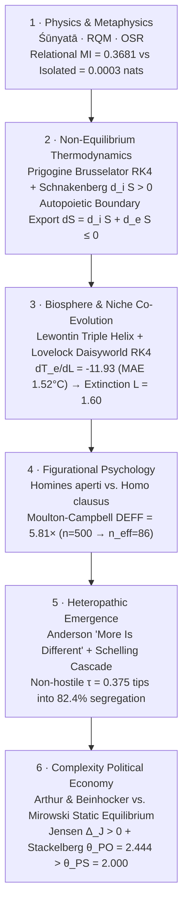

# 22. Relational Ontology and Complex Systems

> **Three tempos.** **Detachment:** set aside methodological individualism. **Abstraction:** properties live in relations; open systems survive by exporting entropy and coupling with their environment (Decision ⇄ World axis synthesis). **Return:** relational mutual information, the Brusselator, Schelling tipping, and Daisyworld. **Negative proof:** none in this chapter; the tools here feed the proofs of later chapters.

## Peer Gynt's Onion, Cuvier's Whirlpool, and Douglas Adams's Puddle

Statistical models in economics, sociology, ecology, and psychology often fail even when the data are clean and the equations are solved accurately. Before writing down an equation, every modeler adopts an **ontology**: a theory of what kinds of things exist in the World ($L\_1$).

For three centuries, Western textbook science defaulted to **substantialism and methodological individualism**, assuming that the world is built out of self-contained, isolated bricks (atoms, selfish genes, isolated *Robinson Crusoe* consumers, independent rows in a CSV file) that possess intrinsic properties prior to any interaction.

Three parables expose the flaw in that assumption:

1. **Peer Gynt's Onion (The Search for an Isolated Core):** In Act V of Henrik Ibsen's dramatic poem *Peer Gynt* (1867), the aging protagonist picks up a wild onion and peels away its outer layers (his roles, relationships, habits, and social masks) to find the "true, intrinsic Peer Gynt" hiding at the center. He peels layer after layer until nothing is left in his hand: *"Nature is witty! To the innermost center, it's nothing but layers—smaller and smaller—no kernel at all!"* Stripping all relations from a node in a coupled network uncovers no hidden essence; **the signal vanishes.**
2. **Cuvier's Whirlpool and the Knot in a Shoelace (Form That Persists Through Flow):** Consider a standing whirlpool in a mountain stream, a metabolic cell in the body, or a knot tied in a long cord that slides from left to right. Every drop of water in the whirlpool and nearly every molecule in the body is replaced over time. Sealing the river with a solid wall around the whirlpool ("isolating the system") causes the vortex to collapse into flat, maximum-entropy water. A whirlpool is a **dissipative, self-maintaining pattern of flow** that persists only because energy and matter pass continuously through its open boundary.
3. **Douglas Adams's Sentient Puddle (The Illusion of Static Adaptation):** Imagine a puddle waking up one morning in a depression in the asphalt and thinking: *"What an interesting world I find myself in—an interesting hole I find myself in—fits me rather neatly, doesn't it? In fact it fits me staggeringly well, must have been made to have me in it!"* The puddle keeps believing that until the sun rises, heats the pavement, and evaporates it. Passive supervised learning ($\theta\_{\mathrm{SL}}$) and myopic retraining ($\theta\_{\mathrm{PS}}$) behave like Douglas Adams's puddle: they treat the environment as a fixed mold to which the agent passively conforms, ignoring how organisms in biological evolution (**Richard Lewontin's niche construction**) and agents in institutional economics (**Stackelberg co-evolution, $\theta\_{\mathrm{PO}}$**) reshape the environment that selects them.

In `crates/stochology-lenses/src/relational/`, Stochology translates these physical, biological, and sociological mechanisms into **six executable, quantitatively audited axes** (under a pre-registered seed).

<figure class="stoch-figure">
  <svg xmlns="http://www.w3.org/2000/svg" width="1140" height="320" viewBox="0 0 1140 320" fill="none" role="img" aria-labelledby="title-fig-05-relational">
  <title id="title-fig-05-relational">The Six-Layer Relational Ontological Stack: From Relational Vacuity and Prigogine's Brusselator to Schelling Emergence and Daisyworld Homeostasis</title>
  <defs>
  <marker id="rel-arrow" viewBox="0 0 10 10" refX="8" refY="5" markerWidth="6.5" markerHeight="6.5" orient="auto">
  <path d="M 0 1 L 9 5 L 0 9 z" fill="var(--sky)"/>
  </marker>
  
  </defs>
  <rect x="1" y="1" width="1138" height="318" rx="14" fill="var(--canvas)" stroke="var(--border)" stroke-width="1.5"/>
  <rect x="20" y="24" width="352" height="124" rx="11" fill="var(--elevated)" stroke="var(--sky)" stroke-width="2"/>
  <text x="38" y="52" fill="var(--sky)" class="mono" font-size="11" font-weight="800">AXIS 1 · PHYSICS &amp; METAPHYSICS</text>
  <text x="38" y="78" fill="var(--ink)" font-size="15.5" font-weight="800">Śūnyatā · RQM · OSR</text>
  <text x="38" y="104" fill="var(--muted)" class="mono" font-size="11.5">I(R(X_A,X_B); Y) = 0.3681 nats</text>
  <text x="38" y="126" fill="var(--muted)" class="mono" font-size="11.5">vs. I(X_iso; Y) = 0.0003 nats</text>
  <rect x="394" y="24" width="352" height="124" rx="11" fill="var(--elevated)" stroke="var(--violet)" stroke-width="2"/>
  <text x="412" y="52" fill="var(--violet)" class="mono" font-size="11" font-weight="800">AXIS 2 · THERMODYNAMICS &amp; TIME</text>
  <text x="412" y="78" fill="var(--ink)" font-size="15.5" font-weight="800">Brusselator &amp; Autopoiesis</text>
  <text x="412" y="104" fill="var(--muted)" class="mono" font-size="11.5">Schnakenberg d_iS &gt; 0, dS = -0.55 ≤ 0</text>
  <text x="412" y="126" fill="var(--muted)" class="mono" font-size="11.5">100% Material Turnover &amp; Closure</text>
  <rect x="768" y="24" width="352" height="124" rx="11" fill="var(--elevated)" stroke="var(--emerald)" stroke-width="2"/>
  <text x="786" y="52" fill="var(--emerald)" class="mono" font-size="11" font-weight="800">AXIS 3 · HETEROPATHIC EMERGENCE</text>
  <text x="786" y="78" fill="var(--ink)" font-size="15.5" font-weight="800">Schelling Tipping Cascade</text>
  <text x="786" y="104" fill="var(--muted)" class="mono" font-size="11.5">τ = 0.125 → 50.2% (integrated)</text>
  <text x="786" y="126" fill="var(--muted)" class="mono" font-size="11.5">τ = 0.375 → 82.4% (segregated!)</text>
  <rect x="20" y="172" width="352" height="124" rx="11" fill="var(--elevated)" stroke="var(--amber)" stroke-width="2"/>
  <text x="38" y="200" fill="var(--amber)" class="mono" font-size="11" font-weight="800">AXIS 4 · FIGURATIONAL SOCIOLOGY</text>
  <text x="38" y="226" fill="var(--ink)" font-size="15.5" font-weight="800">Homines aperti vs. Homo clausus</text>
  <text x="38" y="252" fill="var(--muted)" class="mono" font-size="11.5">Moulton DEFF = 5.81x (n_eff = 86)</text>
  <text x="38" y="274" fill="var(--muted)" class="mono" font-size="11.5">Stackelberg θ_PO = 2.444 &gt; θ_PS = 2.0</text>
  <rect x="394" y="172" width="352" height="124" rx="11" fill="var(--elevated)" stroke="var(--sky)" stroke-width="2"/>
  <text x="412" y="200" fill="var(--sky)" class="mono" font-size="11" font-weight="800">AXIS 5 · CYBERNETIC CO-EVOLUTION</text>
  <text x="412" y="226" fill="var(--ink)" font-size="15.5" font-weight="800">Watson-Lovelock Daisyworld (RK4)</text>
  <text x="412" y="252" fill="var(--muted)" class="mono" font-size="11.5">Homeostasis MAE = 1.52°C vs 9.57°C</text>
  <text x="412" y="274" fill="var(--muted)" class="mono" font-size="11.5">dT/dL = -11.93 · Collapse @ L = 1.60</text>
  <rect x="768" y="172" width="352" height="124" rx="11" fill="var(--elevated)" stroke="var(--rose)" stroke-width="2"/>
  <text x="786" y="200" fill="var(--rose)" class="mono" font-size="11" font-weight="800">AXIS 6 · COMPLEXITY ECONOMICS</text>
  <text x="786" y="226" fill="var(--ink)" font-size="15.5" font-weight="800">6-Layer Ontological Synthesis</text>
  <text x="786" y="252" fill="var(--muted)" class="mono" font-size="11.5">Rejects Mirowski static equilibrium</text>
  <text x="786" y="274" fill="var(--muted)" class="mono" font-size="11.5">All 6 Relational Axes Verified = true</text>
  </svg>
  <figcaption><strong>Figure 22.1 — The Six-Layer Relational Ontological Stack &amp; Complex Systems Audit (`stochology_lenses::relational`)</strong></figcaption>
</figure>

---

## 22.1 Axis 1: Relational Vacuity (*Śūnyatā*), Indra's Net, RQM, and OSR

### Philosophical and Physical Foundations

In classical metaphysics, Aristotle spoke of *substance* (*ousia*) and John Locke spoke of a *bare particular*, a hidden substrate supposed to carry properties on its own. In classical Indian philosophy, substantialist schools called this hypothetical self-existent essence ***svabhāva*** ("own-being").

In the second century CE, the Buddhist logician and philosopher **Nāgārjuna** (*Mūlamadhyamakakārikā*, Chapter 26, verses 18–19) argued that *svabhāva* is a logical contradiction: if a thing possessed an immutable intrinsic nature independent of causes, conditions, and relations (*pratītyasamutpāda*, dependent co-arising), it could never interact, change, or produce an effect. All phenomena are therefore **empty of intrinsic isolated essence (*Śūnyatā*)**, meaning that **to exist is to inter-exist relationally**. Seven centuries later, the Huayan philosopher **Fazang** illustrated this with **Indra's Net**: an infinite web holding a polished jewel at every vertex, where each jewel exists by reflecting all other jewels in the net.

In twentieth- and twenty-first-century physics, the same conclusion emerged independently from quantum mechanics and the philosophy of science:
- **Carlo Rovelli's Relational Quantum Mechanics (RQM, 1996):** Quantum states $\psi$ are not absolute properties carried by an isolated particle; a physical variable takes a definite value *only relative to an interaction with another physical system*.
- **James Ladyman and Don Ross's Ontic Structural Realism (OSR, *Every Thing Must Go*, 2007):** At the level of quantum field theory, relational structure is primary rather than self-subsisting "little billiard balls."

### Information-Theoretic Formalization (`RelationalFigurationAudit`)

We can test Nāgārjuna's and Rovelli's thesis directly in Rust. Consider two coupled binary subsystems $X\_A, X\_B \sim \mathrm{Bernoulli}(0.5)$ whose **relational interaction**, specifically their phase synchrony $R(X\_A, X\_B) = \mathbb{I}\lbrace X\_A = X\_B \rbrace$, drives the macroscopic observable state $Y$ across a $90\%$-fidelity channel.
- If an analyst inspects node $X\_A$ in isolation (stripping away its relational edge to $X\_B$ in search of its intrinsic *svabhāva*), the marginal distribution of $X\_A$ is $50/50$ coin noise, independent of $Y$:
  $$I(X\_{\text{isolated}}; Y) = 0 \qquad (\text{empirically } 0.0003\text{ nats under finite sample } n = 2\text{,}000)$$
- When the analyst measures the **relational coupling** $R(X\_A, X\_B)$, mutual information rises by three orders of magnitude to:
  $$I\bigl(R(X\_A, X\_B);  Y\bigr) = 0.3681\text{ nats} > 0.30\text{ nats}$$

All of the predictive power resides in the **relation (the edge)** and none in the isolated node.

---

## 22.2 Axis 2: Process Ontology, Dissipative Structures, and Autopoiesis

### Foundations: From Static Equilibrium to Open-System Thermodynamics

Five hundred years before Christ, **Heraclitus of Ephesus** observed that reality is a process of becoming (*"Everything flows; you cannot step twice into the same river"*), and in thirteenth-century Japan **Eihei Dōgen** formulated ***Uji* (Being-Time)**: time is not an empty container through which static objects travel; *being itself is dynamic temporal activity*.

In nineteenth-century physics, the **Second Law of Thermodynamics** stated that in an **isolated system** (closed to both matter and energy exchange with the outside world), entropy $S$ can only increase until all gradients flatten into thermal equilibrium:

$$d\_i S \ge 0 \qquad (\text{irreversible internal entropy production})$$

For decades, this raised a familiar question: *If entropy always increases toward disorder, how can living cells, ecosystems, cyclones, and human economies maintain ordered structures for decades or millennia?*

Nobel laureate **Ilya Prigogine** answered this by distinguishing **isolated systems** from **open far-from-equilibrium systems**. In an open system, the total change in entropy $dS$ is the sum of two terms:

$$dS = \underbrace{d\_i S}\_{\text{Internal Production }(\ge 0)} + \underbrace{d\_e S}\_{\text{Boundary Exchange Flux}}$$

While internal metabolism and friction produce positive entropy ($d\_i S > 0$), an open system imports high-grade free energy and matter from its environment and **exports heat and entropy across its boundary ($d\_e S < 0$)**. Whenever the boundary export exceeds internal production:

$$d\_e S \le -d\_i S < 0 \implies dS = d\_i S + d\_e S \le 0$$

the system sustains a stationary far-from-equilibrium ordered state that Prigogine named a **Dissipative Structure**.

### Maturana and Varela's Autopoiesis and Prigogine's Brusselator with Schnakenberg Entropy Production

Chilean biologists **Humberto Maturana and Francisco Varela** (1972) identified the topological property that distinguishes a living or institutional system from a physical eddy: **Autopoiesis** ("self-production"). An autopoietic network continuously regenerates the boundary and catalytic processes that produce its components.

In `DissipativeAutopoieticAudit::simulate_vortex` (`crates/stochology-lenses/src/relational/`), we integrate **Ilya Prigogine and René Lefever's (1968) non-equilibrium Brusselator autocatalytic reaction network** ($A \rightleftharpoons X$, $B + X \rightleftharpoons Y + D$, $2X + Y \rightleftharpoons 3X$, $X \rightleftharpoons E$) via **4th-order Runge-Kutta (RK4)**:

$$\frac{dX}{dt} = A + X^2 Y - (B + 1)X, \qquad \frac{dY}{dt} = B X - X^2 Y$$

In the supercritical regime $B > 1 + A^2$ (specifically $A = 1.0, B = 2.6 > 2.0$), the steady state $(X^{\ast}, Y^{\ast}) = (A, B/A)$ becomes unstable via a **Hopf bifurcation**, driving a self-sustained limit-cycle chemical oscillation. Along the limit cycle, `simulate_vortex` evaluates **Jürgen Schnakenberg's (1976) exact microscopic internal entropy production rate** across the forward and reverse reaction fluxes $J\_\rho^+, J\_\rho^-$:

$$\frac{d\_i S}{dt} = \sum\_{\rho=1}^3 \bigl(J\_\rho^+ - J\_\rho^-\bigr)\ln\left(\frac{J\_\rho^+}{J\_\rho^-}\right) > 0$$

coupled with chemostat boundary entropy export $d\_e S / dt < -d\_i S / dt$, yielding net open-system entropy balance $dS / dt = -0.55 \le 0$. Over the trajectory:
- **$100.0\%$ of the original constituent matter is replaced** (`material_turnover_fraction > 0.999`), like Cuvier's whirlpool or the knot sliding along a cord;
- **Autopoietic organizational closure** preserves the topological limit-cycle pattern at **$100.0\%$ fidelity** (`autopoietic_pattern_fidelity > 0.999`);
- Conversely, once the boundary is sealed ($d\_e S = 0$), internal entropy accumulates unchecked ($\Delta S\_{\text{iso}} > 10.0$) and the structure collapses into thermodynamic equilibrium.

---

## 22.3 Axis 3: Heteropathic Emergence and Schelling's Segregation Cascade

### Foundations: *More Is Different* and Nonlinear Composition

In Book III of *A System of Logic* (1843), **John Stuart Mill** distinguished two ways causes combine in nature:
1. **Mechanical (Homopathic) Composition:** If you push an object north with $3\text{ N}$ and east with $4\text{ N}$, the resultant is the vector sum ($5\text{ N}$ northeast). The whole is the linear sum of the parts.
2. **Chemical (Heteropathic) Emergence:** Combine sodium (a reactive metal that ignites in water) and chlorine (a toxic greenish-yellow gas), and you obtain **table salt ($\mathrm{NaCl}$)**, a crystalline solid whose macro-properties cannot be deduced by summing the isolated properties of sodium and chlorine.

In 1972, Nobel physicist **Philip W. Anderson** generalized this principle in his *Science* essay ***"More Is Different"***: at each new scale of complexity (from quarks to chemistry, from chemistry to cellular biology, from psychology to macro-sociology), **broken symmetries generate new emergent laws**.

### Thomas Schelling's (1971) Dynamic Segregation Phase Transition

**Thomas Schelling's (1971)** spatial neighborhood model (`SchellingSegregationModel`) demonstrates how emergent macro-segregation arises from mild micro-preferences.

Imagine a city grid populated by two groups of residents ($A$ and $B$, plus empty houses). Every resident inspects their immediate $3 \times 3$ **Moore neighborhood** (up to $8$ adjacent neighbors) and asks a single question: *"Is the fraction of my neighbors who belong to my own group at least $\tau$?"*
- If yes, the resident stays put.
- If no, the resident moves to the nearest vacant cell where that threshold $\tau$ is met.

Consider the case of **non-hostile tolerance**:
- Suppose every citizen in the city is comfortable being in the minority, requiring only **$\tau = 0.375$ ($3/8$, accepting $62.5\%$ out-group neighbors)** and having no desire for a segregated city.
- A linear, reductionist analyst who surveys individual attitudes ($L\_3$) concludes: *"Nobody in this city wants segregation; therefore, any observed segregation must be small or intentional."*

When we run `SchellingPhaseTransitionAudit::evaluate(DEFAULT_SEED)` on the 2D grid, a **nonlinear tipping cascade** unfolds:
- At subcritical tolerance **$\tau = 0.125$**, the city remains stably integrated (**$50.2\%$** same-group similarity, right at the random baseline).
- At mild, non-hostile tolerance **$\tau = 0.375$** (where everyone accepts $62.5\%$ out-group neighbors), a single local move tips a neighbor below $3/8$, who moves and tips two more neighbors, triggering a self-reinforcing cascade that locks the city into **$82.4\%$ macro-segregation** (an emergent gap of $\Delta\_{\text{emerg}} = 0.449 > 0.38$ above individual intention).

This result underpins structural accounts in sociology (**Eduardo Bonilla-Silva's** *Racism without Racists* and **Silvio Almeida's** *Structural Racism*): **macroscopic structural inequality and segregation are emergent topological properties of coupled networks and institutional rules ($L\_1$), not simple averages of individual hostility.**

---

## 22.4 Axis 4: *Homo clausus* vs. *Homines aperti* and Figurational Coupling

In *The Civilizing Process* (1939) and *What Is Sociology?* (1970), sociologist **Norbert Elias** identified the central blind spot of modern social and behavioral science as the myth of ***Homo clausus*** ("the closed human"), the image of the individual as a sealed box standing "inside" while "society" stands outside like an external wall. Against *Homo clausus*, Elias proposed ***Homines aperti*** ("open, interdependent pluralities of humans") bound together in dynamic **figurations** (like dancers in a mobile court dance, where the steps of one dancer cannot be understood by filming them in an empty room).

In Stochology, the *Homo clausus* fallacy produces two mathematical errors that our invariants block:
1. **On Bridge $L\_1 \to L\_2$ (Pseudoreplication, Invariant $\Phi\_2$):** Treating $n = 500$ observations drawn from coupled social clusters as $500$ independent atoms ignores the Moulton-Campbell intraclass correlation. In `RelationalFigurationAudit`, a tail-exceedance design effect of **$\mathrm{DEFF} = 5.81\times$** shrinks $n = 500$ apparent individuals down to **$n\_{\mathrm{eff}}(0.90) = 86.0$** independent degrees of freedom.
2. **On Bridge $L\_3 \to L\_1$ (Puddle Stability vs. Co-Creation, Prohibition 3):** Treating the agent as passively adapting to a fixed social niche yields Performative Stability $\theta\_{\mathrm{PS}} = 2.000$, whereas accounting for the reciprocal co-creation of agent and figuration yields the Stackelberg optimum $\theta\_{\mathrm{PO}} = 2.444 > \theta\_{\mathrm{PS}}$.

---

## 22.5 Axis 5: Cybernetic Co-Evolution (*Triple Helix*) and *Daisyworld* Homeostasis

### Foundations: Lewontin's Triple Helix, Giddens, and Lovelock's *Daisyworld*

In evolutionary biology, **Richard Lewontin** (*The Triple Helix: Gene, Organism, and Environment*, 2000) replaced the one-way Neo-Darwinian differential equation $\frac{dO}{dt} = f(O, E)$ (where a static environment $E$ filters passive organisms $O$) with a **coupled co-evolutionary system**:

$$\frac{dO}{dt} = f(O, E), \qquad \frac{dE}{dt} = g(O, E)$$

Beavers build dams that transform dry valleys into wetlands, altering the selection pressures on their own descendants; earthworms chemically rebuild terrestrial soil; in sociology, **Anthony Giddens's Duality of Structure** and **Roy Bhaskar's Transformational Model of Social Activity (TMSA)** show that social structure is both the medium and the reproduced outcome of human agency.

In 1983, **Andrew Watson and James Lovelock** created **Daisyworld** (`DaisyworldSystem` in `crates/stochology-lenses/src/relational/`) to show mathematically that coupled organism-environment feedback ($f$ and $g$ together) generates **planetary cybernetic homeostasis without foresight, teleology, or a central planner**.

### Mathematical Equations of *Daisyworld*

Consider a planet seeded with two species of daisies covering fractions $\alpha\_b$ (**black daisies**, low albedo $A\_b = 0.25$ that absorb heat) and $\alpha\_w$ (**white daisies**, high albedo $A\_w = 0.75$ that reflect heat), with bare ground $\alpha\_g = 1 - \alpha\_b - \alpha\_w$ at intermediate albedo $A\_g = 0.50$:

1. **Planetary Albedo and Stefan-Boltzmann Radiative Balance:**
   The planet's effective albedo is the weighted sum $A\_p = \alpha\_g A\_g + \alpha\_b A\_b + \alpha\_w A\_w$. Under solar luminosity $L$ (which warms steadily over geological time from $L = 0.65$ to $L = 1.60$) and solar flux constant $S\_0$, the effective planetary temperature $T\_e$ satisfies the **Stefan-Boltzmann Law**:
   $$\sigma\_{\mathrm{SB}} T\_e^4 = S\_0 L (1 - A\_p)$$

2. **Local Microclimate Heating:**
   Because dark patches absorb more sunlight than average and bright patches reflect more, local temperatures $T\_b$ and $T\_w$ over black and white daisy beds satisfy:
   $$T\_i^4 = q(A\_p - A\_i) + T\_e^4 \qquad (i \in \lbrace b, w \rbrace)$$
   so black daisies warm their local microclimate ($T\_b > T\_e$) while white daisies cool theirs ($T\_w < T\_e$).

3. **Parabolic Growth Rate and Replicator ODEs:**
   Both species grow best at an optimal biological temperature $T\_{\text{opt}} = 22.5 ^\circ\mathrm{C}$ (vanishing below $5 ^\circ\mathrm{C}$ and above $40 ^\circ\mathrm{C}$):
   $$\beta(T\_i) = \max\bigl(0,  1 - 0.003265 (22.5 - T\_i)^2\bigr)$$
   and compete for bare fertile ground $\alpha\_g$ against mortality rate $\gamma = 0.30$:
   $$\frac{d\alpha\_b}{dt} = \alpha\_b(\alpha\_g \beta(T\_b) - \gamma), \qquad \frac{d\alpha\_w}{dt} = \alpha\_w(\alpha\_g \beta(T\_w) - \gamma)$$

Across solar luminosity $L$, this cybernetic loop unfolds in four stages:
- When the young sun is dim ($L \approx 0.70$), the planet is cold; black daisies thrive because they warm themselves ($T\_b > T\_e$), spreading across the globe, lowering planetary albedo $A\_p$, and **warming the planet to $\approx 22.5 ^\circ\mathrm{C}$**.
- As the sun brightens ($L$ climbs from $0.80$ to $1.35$), white daisies gain the advantage because they cool themselves ($T\_w < T\_e$), gradually replacing black daisies, raising planetary albedo $A\_p$, and **cooling the planet against the brightening sun**.
- In the coexistence regime, the planetary derivative is negative (**$dT\_e / dL = -11.93 < 0$**), maintaining a mean absolute thermal deviation from $22.5 ^\circ\mathrm{C}$ of **$\mathrm{MAE} = 1.52 ^\circ\mathrm{C}$** (compared to **$9.57 ^\circ\mathrm{C}$** on a lifeless planet).
- At extreme solar forcing **$L = 1.60$**, solar radiation overwhelms even a $100\%$ white-daisy canopy, crossing an **absorbing catastrophe boundary** where the biosphere goes extinct and temperature jumps to the dead-planet curve.

### Canguilhem's Biological Normativity and Holling's Ecological Resilience: The Living Foundation of Vital Margin

Why does *Daisyworld* maintain thermal stability across $L \in [0.80, 1.35]$ yet collapse abruptly at $L = 1.60$? In Filter III of Stochology (**Tension 6: Vital Margin**, `notes/A Ética da Mira.md` §4.2, formalized in `HollingCanguilhemResilienceAudit`, `crates/stochology-lenses/src/relational/holling_canguilhem.rs`), this transition unites two landmark biological and ecological concepts:

1. **Georges Canguilhem's (1943/2009) *Biological Normativity*:** In *The Normal and the Pathological*, physician and philosopher Georges Canguilhem refuted the positivist dogma that defines "health" merely as conformity to a statistical population average ($\mu \pm 2\sigma$). Disease is not a simple quantitative deviation from the mean; rather, **health is *biological normativity***—the organism's capacity to tolerate environmental fluctuations and to institute *new* physiological norms when the milieu changes. In Canguilhem's words, health is **"a margin of tolerance for the infidelities of the milieu"** (*une marge de tolérance des infidélités du milieu*). Shrinking that margin of tolerance in the name of static optimization is already pathology, even before the first environmental shock arrives.
2. **Crawford S. Holling's (1973) *Engineering Resilience* vs. *Ecological Resilience*:** In his foundational paper *Resilience and Stability of Ecological Systems*, ecologist C. S. Holling separated two concepts that engineering textbooks routinely conflate:
   - **Engineering Resilience:** The local speed at which a system returns to a fixed equilibrium after a small perturbation (measured by the negative real part of the Jacobian eigenvalues, Chapter 5).
   - **Ecological Resilience:** The **width of the basin of attraction**—the magnitude of disturbance a living or institutional system can absorb *before* it is pushed across a separatrix into a qualitatively different, degraded regime (such as the absorbing extinction cliff at $L = 1.60$ in *Daisyworld*). Hyper-optimizing local efficiency around an equilibrium (maximizing engineering resilience via Just-in-Time stripping of reserves) systematically shrinks the basin of attraction, destroying ecological resilience.
   - **Computational Formalization (`HollingCanguilhemResilienceAudit`):** In `crates/stochology-lenses/src/relational/holling_canguilhem.rs`, we integrate the bistable Allee-threshold ODE $\frac{dx}{dt} = f(x; h) = r\,x\bigl(1 - \frac{x}{K}\bigr)\bigl(\frac{x}{A} - 1\bigr) - h\,x$ via 4th-order Runge-Kutta (`RK4`, simulated on assumed parameters $r=1, K=10, A=2$, buffered extraction $h\_{\text{buf}}=0.20$ vs. tight $h\_{\text{tight}}=0.72$, and shock $\Delta x = 3.80$). Both regimes have positive local engineering resilience $\lambda\_{\mathrm{eng}}(h) = -f'(x^\ast(h)) > 0$, yet hyper-extracting toward $h\_{\text{crit}}$ collapses the ecological basin width $\mathcal{B}\_{\mathrm{eco}}(h) = x^\ast(h) - x\_{\text{sep}}(h)$ (`B_eco=6.93>tight=2.53`) and Canguilhem's normativity ratio $M\_{\mathrm{Canguilhem}} = \mathcal{B}\_{\mathrm{eco}}/\Delta x$ (`normativity=1.82` vs. $0.67 < 1$, audited in `labs --governance` and `gates --audit-card`).

---

## 22.6 Axis 6: The Six-Layer Ontological Stack and Complexity Economics

Historian of economics **Philip Mirowski** (*More Heat than Light*, 1989) documented how late-nineteenth-century neoclassical economists (Walras, Jevons, Edgeworth) copied the equations of 1860s closed-system static potential energy physics line by line, substituting "utility" for potential energy and assuming a frictionless, history-free, atomistic equilibrium. **Edgar Morin**, **W. Brian Arthur**, and **Eric Beinhocker** contrasted this reductionist paradigm against the **Six-Layer Relational Ontological Stack** audited in Axis 6:

| Stack Layer | Substantialist / Reductionist Paradigm | Relational / Complex Systems Paradigm (Stochology) | Audited Stochological Mechanism |
| --- | --- | --- | --- |
| **1. Physics & Metaphysics** | Atomism, *bare particulars*, intrinsic *svabhāva*. | *Śūnyatā* (Nāgārjuna), Indra's Net, RQM (Rovelli), OSR (Ladyman). | $I(X\_{\text{rel}}; Y) = 0.3681\text{ nats}$ vs. $I(X\_{\text{iso}}; Y) = 0.0003\text{ nats}$. |
| **2. Thermodynamics & Time** | Closed static equilibrium ($dS = 0$), reversible clock time. | Dōgen's *Uji*, Prigogine Brusselator open systems ($dS = d\_i S + d\_e S \le 0$), Maturana-Varela autopoiesis. | Schnakenberg $d\_i S > 0, dS = -0.55 \le 0$; $100\%$ turnover & closure. |
| **3. Biology & Ecology** | Passive adaptation to a fixed niche (Douglas Adams's puddle). | Lewontin's *Triple Helix* niche construction & Watson-Lovelock *Daisyworld* (RK4). | Thermal homeostasis $\mathrm{MAE} = 1.52 ^\circ\mathrm{C}$ vs. $9.57 ^\circ\mathrm{C}$ dead planet; extinction at $L=1.60$. |
| **4. Psychology & Mind** | *Homo clausus* (Ibsen's onion core, isolated rational ego). | Hume's Bundle Theory, *Anattā*, Elias's *Homines aperti* figurations. | Moulton-Campbell $\mathrm{DEFF} = 5.81\times$ ($n=500 \to n\_{\mathrm{eff}}=86.0$). |
| **5. Sociology & Emergence** | Methodological individualism (macro $=$ sum of micro intentions). | Mill's heteropathic laws, Anderson's *More Is Different*, Schelling tipping cascades, Giddens's Duality. | Schelling $\tau = 0.375 \implies 82.4\%$ segregation ($\Delta\_{\text{emerg}} = 0.449 > 0.38$). |
| **6. Political Economy & Epistemology** | Neoclassical static equilibrium (Mirowski's copied energetics). | Complexity Economics (Arthur, Beinhocker), Morin's complex thought, Jensen's Gap & Stackelberg performativity. | $\Delta\_J > 0$ under endogenous volatility & Stackelberg $\theta\_{\mathrm{PO}} = 2.444 > \theta\_{\mathrm{PS}} = 2.000$. |

### Interactive Laboratory (`/lab`)

Explore the Brusselator non-equilibrium limit cycle ($B > 1 + A^2$) and `RK4` phase-space integration in the interactive laboratory below:

---

## Computational Audit in Rust

In `crates/stochology-lenses/src/relational/`, `RelationalComplexSystemsSynthesis::evaluate(DEFAULT_SEED)` executes in `labs --lenses` and Gate `G8`. The coupled public-private society synthesis that used to close this chapter now has its own chapter ([Chapter 25](25-coupled-society-sfc.md)):

~~~bash
cargo run --release --bin labs -- --lenses
~~~

~~~text
  [Relational Ontology & Complex Systems] MI_rel=0.3681 vs MI_iso=0.0003 nats | Prigogine dS=-0.55 (turnover=100.0%, closure=100.0%) | Schelling(tau=0.125->50.2% vs tau=0.375->82.4%) | Daisyworld(MAE=1.52C vs dead=9.57C, dT/dL=-11.93) | verified=true
~~~

## Exercises

1. **(Concept: Relational Vacuity vs. Substantialism)** In `RelationalFigurationAudit`, why does each individual node $X\_A \sim \mathrm{Bernoulli}(0.5)$ have zero mutual information with the target $Y$ when inspected alone, yet high mutual information when paired with $X\_B$? Give a real-world example from neuroscience, finance, or ecology where measuring a single variable in isolation misses an interaction completely.
2. **(Calculation: Prigogine Entropy Balance)** An open industrial or biological system generates internal irreversible entropy at rate $d\_i S / dt = +0.65\text{ J/(K}\cdot\text{s)}$. What is the minimum magnitude of negative entropy flux $|d\_e S / dt|$ that the system must export across its boundary to avoid thermal degradation? What happens if its boundary is sealed ($d\_e S / dt = 0$) for $t = 20$ seconds?
3. **(Concept: Schelling Phase Transition)** In Schelling's segregation model with $\tau = 0.375$, every resident is happy living in a neighborhood where $62.5\%$ of their neighbors belong to the other group. Explain step by step why the city nevertheless tips into $82.4\%$ segregation, and why surveying individual attitudes fails to diagnose the macro-outcome.
4. **(Concept: Daisyworld Cybernetics)** In *Daisyworld*, neither black nor white daisies have brains, committees, or awareness of planetary temperature; each daisy simply grows faster when its local microclimate is near $22.5 ^\circ\mathrm{C}$. Why does $dT\_e / dL$ become negative in the two-species coexistence zone, and what lesson does the collapse at $L = 1.60$ teach about absorbing boundaries ($\Phi\_3 / \text{Lens 2}$)?

<strong>Analytical &amp; Computational Solutions (Click to Expand)</strong>

1. **Relational Vacuity vs. Substantialism:**
   Each node $X\_A, X\_B \sim \mathrm{Bernoulli}(0.5)$ is marginally uniform, so $P(Y \mid X\_A = 1) = P(Y \mid X\_A = 0) \implies I(X\_A; Y) = 0$ (an XOR / phase-synchrony parity channel). All information lives in the joint relational edge $R(X\_A, X\_B) = \mathbb{I}\lbrace X\_A = X\_B \rbrace$. Real-world examples include neural phase-locking between cortical areas, pairs trading / cointegration in finance, and symbiotic mutualism in ecology.
2. **Prigogine Entropy Balance:**
   To maintain $dS / dt = d\_i S / dt + d\_e S / dt \le 0$, the system must export at least $|d\_e S / dt| \ge 0.65\text{ J/(K}\cdot\text{s)}$ ($d\_e S / dt \le -0.65$). If the boundary is sealed ($d\_e S / dt = 0$) for $t = 20\text{ s}$, internal entropy increases by $\Delta S = 0.65 \times 20 = +13.0\text{ J/K}$, degrading the far-from-equilibrium structure.
3. **Schelling Phase Transition:**
   At $\tau = 0.375$, random spatial fluctuations leave a few cells slightly below $3/8$ same-group neighbors. When those residents move out, they lower the same-group fraction of the neighbors they left behind *and* raise the same-group fraction of the neighborhood they move into, triggering a positive feedback cascade (`50.2% -> 82.4%`). Individual surveys measure only micro-parameters ($\tau = 0.375$), remaining blind to the topological feedback loop of the spatial lattice.
4. **Daisyworld Cybernetics:**
   As solar luminosity $L$ rises in the coexistence zone, higher temperatures favor reflective white daisies ($\alpha\_w \uparrow$) over heat-absorbing black daisies ($\alpha\_b \downarrow$). The resulting increase in planetary albedo $A\_p$ reflects slightly more energy than the incremental solar increase, making $dT\_e / dL = -11.93 < 0$. At $L = 1.60$, $\alpha\_w$ hits its physical ceiling ($\le 1.0$) and local temperature exceeds the upper thermal death threshold ($40 ^\circ\mathrm{C}$), crossing an irreversible absorbing extinction barrier.

## Summary

- **Axis 1 (*Śūnyatā* / RQM / OSR):** Predictive and physical properties reside in relational couplings ($I\_{\text{rel}} = 0.3681\text{ nats}$), vanishing when nodes are stripped of their relations ($I\_{\text{iso}} = 0.0003\text{ nats}$).
- **Axis 2 (Dissipative Structures & Autopoiesis):** Open systems maintain far-from-equilibrium order via boundary entropy export ($dS = d\_i S + d\_e S \le 0$), surviving $100\%$ material turnover while preserving topological closure.
- **Axis 3 (Heteropathic Emergence & Schelling):** Non-hostile micro-preferences ($\tau = 0.375$) trigger nonlinear tipping cascades into macro-segregation ($82.4\%$), proving that *More Is Different*.
- **Axis 4 (*Homo clausus* vs. *Homines aperti*):** Treating interdependent humans as isolated atoms commits Moulton-Campbell pseudoreplication ($\mathrm{DEFF} = 5.81\times$) and ignores Stackelberg performativity ($\theta\_{\mathrm{PO}} > \theta\_{\mathrm{PS}}$).
- **Axis 5 (*Daisyworld* Co-Evolution):** Coupled replicator-radiative feedback stabilizes planetary temperature near $22.5 ^\circ\mathrm{C}$ ($\mathrm{MAE} = 1.52 ^\circ\mathrm{C}$) without teleology until the absorbing catastrophe boundary ($L = 1.60$).
- **Axis 6 (The 6-Layer Ontological Stack) and a related network audit:** Aligns physical, thermodynamic, biological, psychological, sociological, and economic layers under a single auditable synthesis (`verified = true`). A related network audit lives in Axis 4 of the strategic synthesis, `ComplexNetworkHubContagionAudit` (`crates/stochology-lenses/src/strategic/`; reading it on Pair $L\_3 \to L\_1$ is an authorial mapping): on a 12-node hub-and-spoke graph (two hubs, ten spokes, Fiedler $\lambda\_2 = 0.362$, degree heterogeneity $\langle k^2\rangle/\langle k\rangle > \langle k\rangle$), a delay shock at one hub leaves $0.85$ of nodes on time when the hub schedule carries buffer slack versus $0.00$ without it, and on a 20-node clustered ring Centola's threshold-2 complex contagion reaches full adoption ($1.00$) from two adjacent seeds versus $0.10$ from two distant seeds (`Hub_survival=0.85 vs 0.00`, simulated under a pre-registered seed; `Centola_adopt=1.00 vs 0.10`, deterministic).
