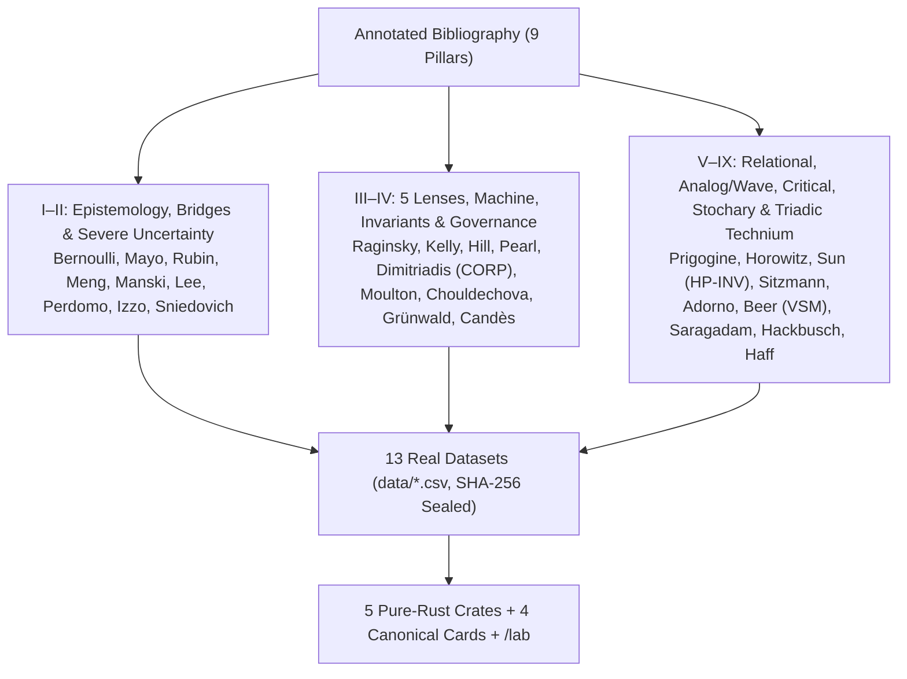

# 24. Empirical Data Sources and Annotated Bibliography

## 24.1 Provenance and Cryptographic Integrity of the 13 Empirical Datasets

All 13 CSV files in `data/*.csv` were retrieved from public scientific repositories, including the Rdatasets archive (`github.com/vincentarelbundock/Rdatasets`, commit `1dcc2bf5f955cc1224a3e1307256e1fe86b68dae`), CRAN packages (`fitdistrplus`, `nycflights13`, `nycflights23`), NOAA HURDAT2, AEMO Victoria, and Open Data Toronto.

Their exact 64-character SHA-256 digests are recorded in [`data/SHA256SUMS`](../data/SHA256SUMS) and verified at runtime by `stochology-cli` before any laboratory or gate executes:

| Dataset File (`data/*.csv`) | Upstream Scientific Source | Sample Size ($n$) | Primary Protocol Audits |
| --- | --- | --- | --- |
| **`nsw_experimental.csv`** | LaLonde (1986) / Dehejia & Wahba (1999), `causaldata::nsw_mixtape` | $n = 445$ ($185$ treated, $260$ randomized controls) | Bridge $L\_1 \to L\_2$ randomized benchmark for Meng's Identity and Manski bounds (`Lab 1`, `Lab 7`). |
| **`cps_observational.csv`** | LaLonde (1986), Current Population Survey comparison group (`causaldata::cps_mixtape`) | $n = 15\text{,}992$ observational workers | Bridge $L\_1 \to L\_2$ selection correlation $\rho\_{R,Y} = +0.1334 \implies n\_{\mathrm{eff}} = 2\text{,}842.70$ and `card_04` DPI Triage (`Lab 1`, `Lab 5`, `Lab 7`). |
| **`bank_calls.csv`** | Weinberg, Brown & Stroud (2007), North American retail bank (`fpp3::bank_calls`) | $n = 27\text{,}716$ 5-min windows across $164$ days | Bridge $L\_2 \to L\_3$ Jensen's Gap $\Delta\_J$, $\mathrm{CRPS}$, $\Phi\_2$ Moulton-Campbell $\mathrm{DEFF}(0.90) = 28.26$, and `card_02` (`Lab 1`, `Lab 4`, `Lab 5`, `Lab 7`). |
| **`djia_1885_2023.csv`** | S&P Dow Jones Indices historical daily series (`stevedata::DJIA`, 1885–2023) | $n = 37\text{,}930$ daily trading sessions | Lens 2 (Time): Itô variance drain ($g\_{\text{time}} = 0.0468 < g\_{\text{ensemble}} = 0.0612$), Kelly fraction $f^{\ast} = 0.8600$, and performativity (`Lab 3`, `Lab 7`). |
| **`danish_fire.csv`** | Copenhagen Reinsurance fire losses 1980–1990 (`fitdistrplus::danishuni`, McNeil 1997) | $n = 2\text{,}167$ claims (in millions of DKK) | Lens 3 (Tail): Hill estimator $\hat{\alpha} = 1.6009 \pm 0.1601$ (`FiniteMeanInfiniteVariance`), $q\_{99} = 26.04\text{M DKK}$ (`Lab 3`, `Lab 7`). |
| **`vic_elec.csv`** | Australian Energy Market Operator (AEMO) half-hourly electricity demand in Victoria (`fpp3::vic_elec`) | $n = 52\text{,}608$ half-hourly records | Lens 3 (Tail) & Ch. 6 (Analog/Wave): Upper-tail heatwave demand spikes ($q\_{99} = 6\text{,}981.5\text{ MW}$) and Empirical Wave-Interference Compression ($14\times$) + PKU `HP-INV` solver (`Lab 3`, `Lab 7`, `G8`). |
| **`atlantic_storms.csv`** | NOAA National Hurricane Center HURDAT2 Atlantic tropical cyclone tracks (`dplyr::storms`) | $n = 20\text{,}778$ 6-hr synoptic track records | Lenses 4 & 5, Gate `G8`, and `card_01`: Nonlinear Hermite NILE/IRM invariance ($\hat{S}^{\ast} = [0]$), `AuthenticModelForm`, and CORP-PAV decomposition (`Lab 3`, `Lab 5`, `Lab 7`). |
| **`toronto_arrests.csv`** | Open Data Toronto / Fox & Weisberg (`carData::Arrests`) police arrest records | $n = 5\text{,}226$ arrest records | Invariant $\Phi\_4$: Chouldechova's algebraic fairness audit ($\mathrm{FPR}\_A / \mathrm{FPR}\_B = 5.13\times$, `Lab 4`, `Lab 7`). |
| **`nyc_flights_2013.csv`** | Bureau of Transportation Statistics (BTS) NYC departures (`nycflights13`) | $n = 138\text{,}375$ flights | `card_03`, Bitemporal Governance, Covariate Drift source distribution, and Label Shift baseline (`Lab 5`, `Lab 6`, `Lab 7`). |
| **`nyc_flights_2023.csv`** | Bureau of Transportation Statistics (BTS) NYC departures (`nycflights23`) | $n = 132\text{,}649$ flights | Covariate Drift (`ExTRA-WCP-T`, Lei & Candès bound $\ge 0.802$) and 4 Label Shift estimators (`Lab 6`, `Lab 7`). |
| **`nyc_flights_2013_h1.csv`** | Sealed H1 out-of-time reserve (2013 first-half schedule slice) | Out-of-time reserve | Temporal Vault & H1 `ExTRA-WCP-T` source reserve (`Lab 7`). |
| **`nyc_flights_2023_h1.csv`** | Sealed H1 out-of-time reserve (2023 first-half schedule slice) | Out-of-time reserve | Single-Opening Temporal Vault (`OpenedApproved`, $\mathrm{BS} = 0.1783$) and H1 Lei & Candès bound $\ge 0.828$ (`Lab 7`). |
| **`houston_flights_2011.csv`** | BTS Houston (IAH/HOU) departures (`hflights`) | Out-of-domain reserve | Geographic out-of-domain transfer audit (NYC $\to$ Houston Lei & Candès bound $\ge 0.693$, `Lab 7`). |

---

## 24.2 Annotated Bibliography by Thematic Pillar

### I. Epistemology, Induction, and Severe Testing
- **Bernoulli, Jacob (1713).** *Ars Conjectandi*. Basel: Thurnisiorum. — Introduces *ars conjectandi sive stochastice*, the art of aiming conjectures under uncertainty.
- **Peirce, Charles Sanders (1878).** "Deduction, Induction, and Hypothesis." *Popular Science Monthly*, 13, 470–482. — Separates truth-preserving deduction from ampliative induction and abduction.
- **Popper, Karl (1959).** *The Logic of Scientific Discovery*. London: Hutchinson. — Formulates falsificationism and propensity probability.
- **Lakatos, Imre (1970).** "Falsification and the Methodology of Scientific Research Programmes." In *Criticism and the Growth of Knowledge*, Cambridge University Press. — Distinguishes progressive problemshifts (predicting novel testable facts) from degenerative patches.
- **Mayo, Deborah G. (2018).** *Statistical Inference as Severe Testing: How to Get Beyond the Statistics Wars*. Cambridge University Press. — Establishes the Severity Principle ($\Phi\_3$).
- **Simmons, Joseph P., Leif D. Nelson & Uri Simonsohn (2011).** "False-Positive Psychology: Undisclosed Flexibility in Data Collection and Analysis Allows Presenting Anything as Significant." *Psychological Science*, 22(11), 1359–1366.
- **Breznau, Nate et al. (2022).** "Observing Many Researchers Using the Same Data and Hypothesis Reveals a Hidden Universe of Uncertainty." *Proceedings of the National Academy of Sciences (PNAS)*, 119(44), e2203150119.

### II. Bridge Mechanics, Missingness, Performativity, and Severe Uncertainty
- **Rubin, Donald B. (1976).** "Inference and Missing Data." *Biometrika*, 63(3), 581–592. — Formalizes `MCAR`, `MAR`, and `MNAR`.
- **Meng, Xiao-Li (2018).** "Statistical Paradises and Paradoxes in Big Data (I): Law of Large Populations, Big Data Paradox, and the 2016 US Presidential Election." *Annals of Applied Statistics*, 12(2), 685–726. — Derives Meng's Identity ($\bar{Y}\_n - \bar{Y}\_N = \rho\_{R,Y}\sqrt{\frac{N-n}{n}}\sigma\_Y$).
- **Manski, Charles F. (1990).** "Nonparametric Bounds on Treatment Effects." *American Economic Review*, 80(2), 319–323. — Establishes worst-case identification bounds under `MNAR`.
- **Lee, David S. (2009).** "Training, Wages, and Sample Selection: Estimating Sharp Bounds on Treatment Effects." *Review of Economic Studies*, 76(3), 1071–1102. — Derives sharp quantile-trimming bounds under monotonic differential attrition (`ManskiBounds::lee_trimming_bounds`).
- **Perdomo, Juan C., Tijana Zrnic, Celestine Mendler-Dünner & Moritz Hardt (2020).** "Performative Prediction." *Proceedings of the 37th International Conference on Machine Learning (ICML)*, PMLR 119:7599–7609. — Formalizes Performative Risk, Performative Stability ($\theta\_{\mathrm{PS}}$), Performative Optimality ($\theta\_{\mathrm{PO}}$), and RRM contraction.
- **Izzo, Zachary, Lexing Ying & James Zou (2021).** "How to Learn when Data Reacts to Your Model: Performative Gradient Descent." *Proceedings of the 38th International Conference on Machine Learning (ICML)*, PMLR 139:4631–4640. — Introduces `PerfGD` converging to the Stackelberg optimum $\theta\_{\mathrm{PO}}$.
- **Manheim, David & Scott Garrabrant (2018).** "Categorizing Variants of Goodhart's Law." *arXiv:1803.04585*. — Formalizes the 4 variants of Goodhart's Law (`Regressional`, `Extremal`, `Causal`, `Adversarial` in `GoodhartTaxonomyAudit`).
- **Steele, Guy L. Jr., Doug Lea & Christine H. Flood (2014).** "Fast Splittable Pseudorandom Number Generators." *Proceedings of OOPSLA 2014*, pp. 453–472; & **Steele, Guy L. Jr. & Sebastiano Vigna (2021).** "LXM: Better Splittable Pseudorandom Number Generators (and Almost as Fast)." *Proceedings of OOPSLA 2021*, Article 148. — Establishes lock-free `.split(stream_id)` substream derivation for fork-join Monte Carlo trees (`SplitMix64::split`).
- **Wong, Andrew et al. (2021).** "External Validation of a Widely Implemented Proprietary Sepsis Prediction Model in Hospitalized Patients." *JAMA Internal Medicine*, 181(8), 1065–1070. — Documents the external validation failure of the Epic Sepsis Model ($\mathrm{AUC}=0.63, \mathrm{PPV}=0.12$), motivating `AlertFatigueAudit`.
- **Kennedy, Marc C. & Anthony O'Hagan (2001).** "Bayesian Calibration of Computer Models." *Journal of the Royal Statistical Society: Series B*, 63(3), 425–464. — Introduces Gaussian Process structural discrepancy $\delta(x) \sim \mathcal{GP}(m(x), k(x, x'))$.
- **Brynjarsdóttir, Jenný & Anthony O'Hagan (2014).** "Learning About Physical Parameters: The Importance of Model Discrepancy." *Inverse Problems*, 30(11), 114007. — Demonstrates boundary-anchored GP kernels for physical parameter identifiability.
- **Ben-Haim, Yakov (2006).** *Info-Gap Decision Theory: Decisions Under Severe Uncertainty* (2nd ed.). Academic Press.
- **Sniedovich, Moshe (2012).** "Black Swans, New Nostradamuses, Voodoo Decision Theories, and the Science of Decision Making in the Face of Severe Uncertainty." *International Transactions in Operational Research*, 19(1–2), 253–281. — Proves the local nature of Info-Gap and the necessity of Wald's global Maximin safeguard across "No-Man's Land."

### III. The Five Transversal Lenses and the Almost-Perfect Machine
- **Blahut, Richard E. (1972).** "Computation of Channel Capacity and Rate-Distortion Functions." *IEEE Transactions on Information Theory*, 18(4), 460–473; & **Arimoto, Suguru (1972).** "An Algorithm for Computing the Capacity of Arbitrary Discrete Memoryless Channels." *IEEE Transactions on Information Theory*, 18(1), 14–20.
- **Raginsky, Maxim (2016).** "Strong Data Processing Inequalities and $\Phi$-Sobolev Inequalities for Discrete Channels." *IEEE Transactions on Information Theory*, 62(6), 3355–3389.
- **Peters, Ole (2019).** "The Ergodicity Problem in Economics." *Nature Physics*, 15(12), 1216–1221.
- **Kelly, John L. Jr. (1956).** "A New Interpretation of Information Rate." *Bell System Technical Journal*, 35(4), 917–926.
- **Hill, Bruce M. (1975).** "A Simple General Approach to Inference About the Tail of a Distribution." *Annals of Statistics*, 3(5), 1163–1174.
- **Dekkers, Arnold L. M., John H. J. Einmahl & Laurens de Haan (1989).** "A Moment Estimator for the Index of an Extreme-Value Distribution." *Annals of Statistics*, 17(4), 1833–1855.
- **Pickands, James (1975).** "Statistical Inference Using Extreme Order Statistics." *Annals of Statistics*, 3(1), 119–131; & **Balkema, A. A. & Laurens de Haan (1974).** "Residual Life Time at Great Age." *Annals of Probability*, 2(5), 792–804.
- **Embrechts, Paul, Claudia Klüppelberg & Thomas Mikosch (1997).** *Modelling Extremal Events for Insurance and Finance*. Berlin: Springer.
- **Pearl, Judea (2009).** *Causality: Models, Reasoning, and Inference* (2nd ed.). Cambridge University Press.
- **Peters, Jonas, Peter Bühlmann & Nicolai Meinshausen (2016).** "Causal Inference by Using Invariant Prediction: Identification and Confidence Intervals." *Journal of the Royal Statistical Society: Series B*, 78(5), 947–1012.
- **Chow, Gregory C. (1960).** "Tests of Equality Between Sets of Coefficients in Two Linear Regressions." *Econometrica*, 28(3), 591–605.
- **Cinelli, Carlos & Chad Hazlett (2020).** "Making Sense of Sensitivity: Extending Omitted Variable Bias." *Journal of the Royal Statistical Society: Series B*, 82(1), 39–67.
- **Richardson, David S. (2000).** "Skill and Relative Economic Value of the ECMWF Ensemble Prediction System." *Quarterly Journal of the Royal Meteorological Society*, 126(563), 649–667.
- **Dimitriadis, Timo, Tilmann Gneiting & Alexander I. Jordan (2021).** "Stable Reliability Diagrams for Probabilistic Classifiers." *Proceedings of the National Academy of Sciences (PNAS)*, 118(8), e2016191118. — Establishes the isotonic **CORP-Murphy** decomposition via Pool-Adjacent-Violators (PAV).
- **Barron, Andrew R. (1993).** "Universal Approximation Bounds for Superpositions of a Sigmoidal Function." *IEEE Transactions on Information Theory*, 39(3), 930–945.
- **Telgarsky, Matus (2016).** "Benefits of Depth in Neural Networks." *Proceedings of the 29th Conference on Learning Theory (COLT)*, PMLR 49:1517–1539.

### IV. Cluster Invariants, Fairness, Funnel, and Drift Governance
- **Hurlbert, Stuart H. (1984).** "Pseudoreplication and the Design of Ecological Field Experiments." *Ecological Monographs*, 54(2), 187–211.
- **Moulton, Brent R. (1986).** "Random Group Effects and the Precision of Regression Estimates." *Journal of Econometrics*, 32(3), 385–397.
- **Chouldechova, Alexandra (2017).** "Fair Prediction with Disparate Impact: A Study of Bias in Recidivism Prediction Instruments." *Big Data*, 5(2), 153–163.
- **Kleinberg, Jon, Sendhil Mullainathan & Manish Raghavan (2017).** "Inherent Trade-Offs in the Fair Determination of Risk Scores." *Proceedings of the 8th Innovations in Theoretical Computer Science Conference (ITCS)*, LIPIcs 67:43:1–43:23.
- **Gigerenzer, Gerd & Ulrich Hoffrage (1995).** "How to Improve Bayesian Reasoning Without Instruction: Frequency Formats." *Psychological Review*, 102(4), 684–704.
- **Talts, Sean, Michael Betancourt, Daniel Simpson, Aki Vehtari & Andrew Gelman (2018).** "Validating Bayesian Inference Algorithms with Simulation-Based Calibration." *arXiv:1804.06788*.
- **Grünwald, Peter, Rianne de Heide & Wouter M. Koolen (2024).** "Safe Testing." *Journal of the Royal Statistical Society: Series B*, 86(5), 1091–1128; & **Waudby-Smith, Ian & Aaditya Ramdas (2024).** "Estimating Means of Bounded Random Variables by Betting." *JRSS: Series B*, 86(1), 1–27.
- **Lei, Lihua & Emmanuel J. Candès (2021).** "Conformal Inference of Counterfactuals and Individual Treatment Effects." *Journal of the Royal Statistical Society: Series B*, 83(5), 911–938.
- **Gibbs, Isaac & Emmanuel Candès (2021).** "Adaptive Conformal Inference Under Distribution Shift." *Advances in Neural Information Processing Systems (NeurIPS)*, 34, 1660–1672.
- **Lipton, Zachary C., Yu-Xiang Wang & Alexander Smola (2018).** "Detecting and Correcting for Label Shift with Black Box Predictors." *Proceedings of ICML*, PMLR 80:3122–3130.

### V. Relational Ontology, Emergence, and Complex Systems
- **Nāgārjuna (c. 150 CE / trans. Jay L. Garfield, 1995).** *The Fundamental Wisdom of the Middle Way: Nāgārjuna's Mūlamadhyamakakārikā*. Oxford University Press.
- **Rovelli, Carlo (1996).** "Relational Quantum Mechanics." *International Journal of Theoretical Physics*, 35(8), 1637–1678.
- **Ladyman, James & Don Ross (2007).** *Every Thing Must Go: Metaphysics Naturalized*. Oxford University Press.
- **Prigogine, Ilya & René Lefever (1968).** "Symmetry Breaking Instabilities in Dissipative Systems. II." *Journal of Chemical Physics*, 48(4), 1695–1700.
- **Schnakenberg, Jürgen (1976).** "Network Theory of Microscopic and Macroscopic Behavior of Master Equation Systems." *Reviews of Modern Physics*, 48(4), 571–585.
- **Prigogine, Ilya & Isabelle Stengers (1984).** *Order Out of Chaos: Man's New Dialogue with Nature*. Bantam Books.
- **Maturana, Humberto R. & Francisco J. Varela (1980).** *Autopoiesis and Cognition: The Realization of the Living*. D. Reidel.
- **Anderson, Philip W. (1972).** "More Is Different." *Science*, 177(4047), 393–396.
- **Schelling, Thomas C. (1971).** "Dynamic Models of Segregation." *Journal of Mathematical Sociology*, 1(2), 143–186.
- **Elias, Norbert (1939 / 2000).** *The Civilizing Process: Sociogenetic and Psychogenetic Investigations*. Blackwell.
- **Lewontin, Richard C. (2000).** *The Triple Helix: Gene, Organism, and Environment*. Harvard University Press.
- **Watson, Andrew J. & James E. Lovelock (1983).** "Biological Homeostasis of the Global Environment: The Parable of Daisyworld." *Tellus B*, 35(4), 284–289.
- **Mirowski, Philip (1989).** *More Heat than Light: Economics as Social Physics, Physics as Nature's Economics*. Cambridge University Press.

### VI. Physical, Analog, and Wave-Interference Computing
- **Horowitz, Mark (2014).** "1.1 Computing's Energy Problem (and What We Can Do About It)." *2014 IEEE International Solid-State Circuits Conference Digest of Technical Papers (ISSCC)*, pp. 10–14. — Quantifies the 45nm CMOS energy hierarchy ($640\text{ pJ}$ off-chip DRAM read vs. $0.9\text{ pJ}$ FP32 add $= 711.11\times$; $6400\times$ vs. $0.1\text{ pJ}$ Int32 add).
- **Shumailov, Ilia, Zakhar Shumaylov, Yiren Zhao, Nicolas Papernot, Ross Anderson & Yarin Gal (2024).** "AI Models Collapse When Trained on Recursively Generated Data." *Nature*, 631, 755–759. — Proves generational variance collapse and tail loss under recursive synthetic training.
- **Villalobos, Pablo et al. (2024).** "Will We Run Out of Data? Limits of LLM Scaling Based on Human-Generated Data." *Proceedings of the 41st International Conference on Machine Learning (ICML)* / Epoch AI.
- **Hasani, Ramin, Mathias Lechner, Alexander Amini, Daniela Rus & Radu Grosu (2021).** "Liquid Time-Constant Networks." *Proceedings of the AAAI Conference on Artificial Intelligence*, 35(9), 7657–7666.
- **Sitzmann, Vincent, Julien N. P. Martel, Alexander W. Bergman, David B. Lindell & Gordon Wetzstein (2020).** "Implicit Neural Representations with Periodic Activation Functions (`SIREN`)." *Advances in Neural Information Processing Systems (NeurIPS)*, 33, 7462–7473. — Establishes $\sin(\omega\_0 Wx + b)$ networks with closed-form infinitely differentiable wave derivatives ($\nabla^2 u + k^2 u = s(x)$).
- **Hughes, Tyler W., Ian A. D. Williamson, Momchil Minkov & Shanhui Fan (2019).** "Wave Physics as an Analog Recurrent Neural Network." *Science Advances*, 5(12), eaay6946. — Demonstrates direct correspondence between the damped nonlinear wave PDE ($\partial\_t^2 u + \gamma \partial\_t u = c^2(x,u)\partial\_x^2 u + f$) and a Recurrent Neural Network.
- **Xu, Zhihao, Tiankuang Zhou, Muzhou Ma, ChenChen Deng, Qionghai Dai & Lu Fang (2023).** "Large-Scale Photonic Chiplet Taichi / ACCEL All-Analog Photoelectronic Chip for High-Speed Vision." *Nature*, 623, 48–55 (*ACCEL*, 2023) & *Science*, 384(6692), 202–209 (*Taichi*, 2024).
- **Zuo, Peng, Zhong Sun et al. (2025).** "High-Precision Analog Computing via Closed-Loop Low-Precision RRAM Inversion and Bit-Sliced Iterative Refinement (`HP-INV`)." *Nature Electronics*, October 2025. — Demonstrates 24-bit FP32-equivalent accuracy ($< 10^{-7}$ relative error) on physical 3-bit RRAM chips via closed-loop `LP-INV` preconditioning and bit-sliced `HP-MVM`.
- **Zheng, Jieyu & Markus Meister (2024).** "The Unbearable Slowness of Being: Why Do We Live at 10 Bits/s?" *Neuron*, 113(2), 192–204. — Quantifies the $1.6\text{ Gb/s} \to 10\text{ bit/s}$ ($1.6 \times 10^8 : 1$) human sensory information-compression funnel.
- **Smirnova, Lena, Brian S. Caffo, David H. Gracias et al. (2023).** "Organoid Intelligence (OI): The New Frontier in Biocomputing and Intelligence-in-a-Dish." *Frontiers in Science*, 1, 1017235.
- **Raul, Gibram (2026).** *Computação Analógica, Aprendizado por Interferência de Ondas e Ancoragem Neuro-Simbólica na Superação da Barreira de von Neumann.*

### VII. Stochary-Conjectural Synthesis, Supply-Chain Physics, and Cybernetic Governance (VSM & PATE)
- **Aristotle (c. 340 BCE).** *Nicomachean Ethics* (1104a) & *Rhetoric* (1360b); **Cicero (45 BCE).** *De Finibus Bonorum et Malorum* (3.22); & **Alexander of Aphrodisias (c. 200 CE).** *Quaestiones* (2.16). — Classical sources for the *technai stochastikai* and the distinction between internal *telos* (*facere omnia quae possit ut conliniet*) and exogenous *skopos*.
- **Meadows, Donella H. (1999).** *Leverage Points: Places to Intervene in a System*. The Sustainability Institute. — Establishes stabilizing buffers and system structure/paradigms as primary leverage points.
- **Dierickx, Ingemar & Karel Cool (1989).** "Asset Stock Accumulation and Sustainability of Competitive Advantage." *Management Science*, 35(12), 1504–1511. — Formalizes the 5 laws of non-tradeable asset stock accumulation (time compression diseconomies, asset mass efficiency, interconnectedness, erosion, and causal ambiguity).
- **Powell, Warren B. (2022).** *Reinforcement Learning and Stochastic Optimization: A Unified Framework for Sequential Decisions*. Wiley. — Establishes the 4 universal policy meta-classes (`PFA`, `CFA`, `VFA`, `DLA`).
- **Friston, Karl et al. (2015).** "Active Inference and Epistemic Value." *Cognitive Neuroscience*, 6(4), 187–214; & **Parr, Thomas, Giovanni Pezzulo & Karl J. Friston (2022).** *Active Inference: The Free Energy Principle in Mind, Brain, and Behavior*. MIT Press. — Formalizes Expected Free Energy $G(\pi)$ unifying epistemic foraging and pragmatic control across a Markov Blanket.
- **Little, John D. C. (1961).** "A Proof for the Queuing Formula: $L = \lambda W$." *Operations Research*, 9(3), 383–387; **Kingman, J. F. C. (1961).** "The Single Server Queue in Heavy Traffic." *Mathematical Proceedings of the Cambridge Philosophical Society*, 57(4), 902–904; & **Hopp, Wallace J. & Mark L. Spearman (2011).** *Factory Physics* (3rd ed.). Waveland Press. — Derives the VUT utilization cliff and the triad of inventory, capacity, and time buffers.
- **Sterman, John D. (1989).** "Modeling Managerial Behavior: Misperceptions of Feedback in a Dynamic Decision Making Experiment." *Management Science*, 35(3), 321–339; & **Lee, Hau L., V. Padmanabhan & Seungjin Whang (1997).** "Information Distortion in a Supply Chain: The Bullwhip Effect." *Management Science*, 43(4), 546–558. — Proves how supply-line ($SL\_t$) underweighting and structural forecast/batching mechanisms amplify variance upstream.
- **Scarf, Herbert (1960).** "The Optimality of $(S, s)$ Policies in the Dynamic Inventory Problem." In *Mathematical Methods in the Social Sciences*, Stanford University Press; **Clark, Andrew J. & Herbert Scarf (1960).** "Optimal Policies for a Multi-Echelon Inventory Problem." *Management Science*, 6(4), 475–490; & **Graves, Stephen C. & Sean P. Willems (2000).** "Optimizing Strategic Safety Stock Placement in Supply Chains." *Manufacturing & Service Operations Management*, 2(1), 68–83. — Establishes $K$-convexity, echelon stock decomposition, and Guaranteed-Service Model (`GSM`) strategic decoupling points.
- **Eppen, Gary D. (1979).** "Effects of Centralization on Expected Costs in a Multi-Location Newsboy Problem." *Management Science*, 25(5), 498–501; & **Allon, Gad & Jan A. Van Mieghem (2010).** "Global Dual Sourcing: Tailored Base-Surge Allocation to Near- and Offshore Production." *Management Science*, 56(1), 110–124. — Formalizes the Square-Root Law of risk pooling (and its breakdown under correlated tails) and frequency-domain Tailored Base-Surge (`TBS`) dual sourcing.
- **Simchi-Levi, David, William Schmidt & Yehua Wei (2014).** "From Superstorms to Factory Fires: Managing Unpredictable Supply-Chain Disruptions." *Harvard Business Review*, 92(1–2), 96–101; **Simchi-Levi, David et al. (2015).** *Interfaces*, 45(5), 375–390; & **Ivanov, Dmitry (2020/2022).** "Viable Supply Chain Model: Integrating Agility, Resilience and Sustainability Perspectives." *Annals of Operations Research*, 319, 1411–1431. — Introduces $\mathrm{TTS}$, $\mathrm{TTR}$, $\mathrm{REI}$, the structural *Ripple Effect*, and the *Viable Supply Chain (`VSC`)*.
- **Rockafellar, R. Tyrrell & Stanislav Uryasev (2000).** "Optimization of Conditional Value-at-Risk." *Journal of Risk*, 2(3), 21–41; & **Mohajerin Esfahani, Peyman & Daniel Kuhn (2018).** "Data-Driven Distributionally Robust Optimization Using the Wasserstein Metric: Performance Guarantees and Tractable Reformulations." *Mathematical Programming*, 171(1–2), 115–166. — Establishes convex $\beta$-CVaR and Wasserstein DRO (`WDRO`) certificates against the Optimizer's Curse.
- **Ashby, W. Ross (1956).** *An Introduction to Cybernetics*. Chapman & Hall; **Conant, Roger C. & W. Ross Ashby (1970).** "Every Good Regulator of a System Must Be a Model of That System." *International Journal of Systems Science*, 1(2), 89–97; & **Beer, Stafford (1972/1981).** *Brain of the Firm* (2nd ed.). Wiley. — Establishes the Law of Requisite Variety, the Good Regulator Theorem, and the Viable System Model (`VSM` S1–S5, `S3*`, and Algedonic Channel).
- **Kahneman, Daniel, Olivier Sibony & Cass R. Sunstein (2021).** *Noise: A Flaw in Human Judgment*. Little, Brown Spark. — Decomposes judgment noise into level, pattern, and occasion noise and establishes decision hygiene protocols.

### VIII. Empirical Dataset Primary Sources
- **LaLonde, Robert J. (1986).** "Evaluating the Econometric Evaluations of Training Programs with Experimental Data." *American Economic Review*, 76(4), 604–620.
- **Dehejia, Rajeev H. & Sadek Wahba (1999).** "Causal Effects in Nonexperimental Studies: Reevaluating the Evaluation of Training Programs." *Journal of the American Statistical Association*, 94(448), 1053–1062.
- **Weinberg, Jonathan, Lawrence D. Brown & Jonathan R. Stroud (2007).** "Bayesian Forecasting of an Inhomogeneous Poisson Process With Applications to Call Center Data." *Journal of the American Statistical Association*, 102(480), 1185–1198.
- **McNeil, Alexander J. (1997).** "Estimating the Tails of Loss Severity Distributions Using Extreme Value Theory." *ASTIN Bulletin*, 27(1), 117–137.

### IX. Critical Theory, Triadic Synthesis ($\mathbb{C} \times \text{Fractals} \times \mathbb{T}^d$), and Technosphere Ontology
- **Horkheimer, Max & Theodor W. Adorno (1944 / 1947).** *Dialectic of Enlightenment* (*Dialektik der Aufklärung*); & **Adorno, Theodor W. (1966).** *Negative Dialectics* (*Negative Dialektik*). Frankfurt am Main: Suhrkamp. — Critiques positivist identity thinking and the liquidation of the *Non-Identical* ($\Delta\_{\text{Nichtidentische}}$).
- **Marcuse, Herbert (1964).** *One-Dimensional Man*. Beacon Press; & **Rouvroy, Antoinette & Thomas Berns (2013).** "Gouvernementalité algorithmique et perspectives d'émancipation." *Réseaux*, 177(1), 163–196. — Analyzes operational closure and preemptive algorithmic governmentality.
- **Saragadam, Vishwanath, Daniel LeJeune, Jasper Tan, Guha Balakrishnan, Ashok Veeraraghavan & Richard G. Baraniuk (2023).** "`WIRE`: Wavelet Implicit Neural Representations." *Proceedings of IEEE/CVF CVPR 2023*, pp. 18507–18516. — Introduces continuous complex Gabor wavelet activations $\psi(z) = e^{i\omega\_0 z} e^{-|s\_0 z|^2}$ on the Helmholtz PDE.
- **Hackbusch, Wolfgang (2015).** *Hierarchical Matrices: Algorithms and Analysis*. Berlin: Springer. — Establishes $\eta$-admissible tree-structured low-rank approximations ($\mathcal{H}$-Matrices).
- **Montroll, Elliott W. & George H. Weiss (1965).** "Random Walks on Lattices. II." *Journal of Mathematical Physics*, 6(2), 167–181; & **Roth, Ron M. (2020).** "Analog Error-Correcting Codes." *IEEE Transactions on Information Theory*, 66(7), 4075–4088. — Formalizes heavy-tailed continuous-time random walks (`CTRW`) and analog $m$-height error-correcting codes.
- **Mandelbrot, Benoit B., Adlai Fisher & Laurent Calvet (1997).** "A Multifractal Model of Asset Returns (`MMAR`)." Cowles Foundation Discussion Paper No. 1164; & **Gerstgrasser, Matthias et al. (2024).** "Is Model Collapse Inevitable? Breaking the Curse of Recursion by Accumulating Real and Synthetic Data." *Proceedings of ICML 2024*. — Formalizes multifractal cascades and the $\pi^2/6$ Basel bound for data accumulation.
- **Garg, Saurabh, Yifan Wu, Sivaraman Balakrishnan & Zachary C. Lipton (2020).** "A Unified View of Label Shift Estimation." *Advances in NeurIPS*, 33, 3290–3300. — Analyzes Maximum Likelihood Label Shift with Bias-Corrected Temperature Scaling (`MLLS+BCTS`).
- **Feudel, Ulrike, Sergey Kuznetsov & Arkady Pikovsky (2006).** *Strange Nonchaotic Attractors: Dynamics Between Order and Chaos*. World Scientific; & **Perea, Jose A. (2018).** "Topological Time Series Analysis." *Notices of the AMS*, 66(5), 686–694. — Establishes quasiperiodically forced Strange Nonchaotic Attractors (`SNA`, $\lambda < 0, \mu > 0$) and persistent cohomology circular coordinates $H^1(X; \mathbb{Z}) \cong [X, S^1]$.
- **Kelly, Kevin (2010).** *What Technology Wants*. Viking Press; **Arthur, W. Brian (2009).** *The Nature of Technology: What It Is and How It Evolves*. Free Press; & **Haff, Peter K. (2014).** "Humans and Technology in the Anthropocene: Six Rules." *The Anthropocene Review*, 1(2), 126–136. — Formalizes the *Technium*, combinatorial autopoiesis, and the Six Rules of the Technosphere across Strata I–III.

---

## Interactive Laboratory (`/lab`)

Launch the full interactive sandbox across all modules and empirical datasets at **[`/lab`](./lab/index.html?seed=2026)**:

