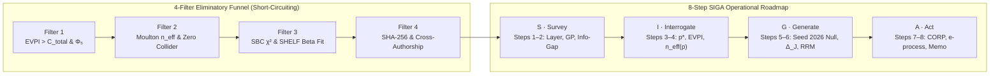

# 26. Eliminatory Funnel and the 8-Step SIGA Roadmap

> **Three tempos.** **Detachment:** set aside fitting first and asking whether the question was worth answering later. **Abstraction:** bad questions should be pruned before compute is spent; the funnel is the practicum that runs across every Movement. **Return:** the 4 Eliminatory Filters and the 8-step SIGA Roadmap. **Negative proof:** none in this chapter; the tools here feed the proofs of later chapters.

## Pruning Bad Questions Before Spending Compute

In a conventional machine-learning organization, teams spend weeks training deep neural networks or running hyperparameter sweeps before asking whether the decision threshold $p^{\ast} = \frac{C}{\eta L}$ lies inside $(0, 1)$, whether the cluster-adjusted sample size $n\_{\mathrm{eff}}(p)$ can detect a meaningful effect, or whether the inference engine is calibrated on synthetic data. The **CAPIBA Protocol** reverses that order: every candidate project must first pass a short-circuiting **4-Filter Eliminatory Funnel** (`stochology_siga::funnel`) and then execute the **8-Step SIGA Operational Roadmap** (`stochology_siga::roadmap`).

## 26.1 The "Boeing 299" Pre-Flight Checklist: The 4 Eliminatory Filters (`stochology_siga::funnel`)

On 30 October 1935, at Wright Field in Ohio, the prototype of the Boeing Model 299 (forerunner of the B-17 Flying Fortress) crashed on takeoff and killed two crew members — including the chief test pilot — not because the four-engine aircraft had a mechanical defect, but because the machine had become *"too much airplane for one man to fly"* from memory alone (the crew had forgotten to release the elevator gust lock). Rather than abandoning the aircraft, test pilots introduced a brief, non-negotiable **pre-flight checklist**: if Step 1 fails, the engines never leave the tarmac.

The **4 Eliminatory Filters (`stochology_siga::funnel`)** play that exact pre-flight role for Artificial Intelligence and Data Science before a single cent of GPU compute is spent. They are evaluated in strict sequence (`Filter 1 -> Filter 2 -> Filter 3 -> Filter 4`). If Filter 1 fails, Filters 2–4 are never even run (`short_circuited = true`):

<figure class="stoch-figure">
  <svg xmlns="http://www.w3.org/2000/svg" width="1160" height="510" viewBox="0 0 1160 510" fill="none" role="img" aria-labelledby="title-fig-09-funnel">
  <title id="title-fig-09-funnel">The 4 Eliminatory Filters of the Stochology Funnel</title>
  <defs>
  <marker id="f-pass" viewBox="0 0 10 10" refX="8" refY="5" markerWidth="6.5" markerHeight="6.5" orient="auto">
  <path d="M 0 1 L 9 5 L 0 9 z" fill="var(--emerald)"/>
  </marker>
  <marker id="f-fail" viewBox="0 0 10 10" refX="8" refY="5" markerWidth="6.5" markerHeight="6.5" orient="auto">
  <path d="M 0 1 L 9 5 L 0 9 z" fill="var(--rose)"/>
  </marker>
  
  </defs>
  <rect x="1" y="1" width="1158" height="508" rx="14" fill="var(--canvas)" stroke="var(--border)" stroke-width="1.5"/>
  <rect x="28" y="20" width="760" height="86" rx="10" fill="var(--elevated)" stroke="var(--sky)" stroke-width="2.2"/>
  <text x="52" y="47" fill="var(--sky)" class="mono" font-size="12" font-weight="800">FILTER 1 · ECONOMIC VIABILITY &amp; RESOLUTION (Φ₅)</text>
  <text x="52" y="71" fill="var(--ink)" font-size="13" font-weight="750">EVPI &gt; C_total ≥ 0  ·  p* = C/(ηL) ∈ (0, 1)  ·  R_data ≥ R_decision</text>
  <text x="52" y="93" fill="var(--muted)" font-size="11.5">Blocks projects with negative information value or coarse aggregate resolution</text>
  <line x1="408" y1="106" x2="408" y2="136" stroke="var(--emerald)" stroke-width="2.4" marker-end="url(#f-pass)"/>
  <text x="424" y="125" fill="var(--emerald)" class="mono" font-size="10.5" font-weight="800">PASS</text>
  <rect x="28" y="142" width="760" height="86" rx="10" fill="var(--elevated)" stroke="var(--violet)" stroke-width="2.2"/>
  <text x="52" y="169" fill="var(--violet)" class="mono" font-size="12" font-weight="800">FILTER 2 · CLUSTER INDEPENDENCE (Φ₂) &amp; CAUSAL HYGIENE</text>
  <text x="52" y="193" fill="var(--ink)" font-size="13" font-weight="750">Moulton-Campbell n_eff(p) ≥ n_min  ·  Markov Blanket  ·  ZERO Collider</text>
  <text x="52" y="215" fill="var(--muted)" font-size="11.5">Blocks pseudoreplicated row counts and conditioning on Berkson colliders</text>
  <line x1="408" y1="228" x2="408" y2="258" stroke="var(--emerald)" stroke-width="2.4" marker-end="url(#f-pass)"/>
  <text x="424" y="247" fill="var(--emerald)" class="mono" font-size="10.5" font-weight="800">PASS</text>
  <rect x="28" y="264" width="760" height="86" rx="10" fill="var(--elevated)" stroke="var(--amber)" stroke-width="2.2"/>
  <text x="52" y="291" fill="var(--amber)" class="mono" font-size="12" font-weight="800">FILTER 3 · SIMULATION-BASED CALIBRATION (SBC) &amp; SHELF</text>
  <text x="52" y="315" fill="var(--ink)" font-size="13" font-weight="750">SBC Rank Uniformity χ² ≤ χ²_crit  ·  L_phys &lt; q₂₅ &lt; q₅₀ &lt; q₇₅ &lt; U_phys</text>
  <text x="52" y="337" fill="var(--muted)" font-size="11.5">Blocks miscalibrated posteriors and degenerate prior elicitations before fitting</text>
  <line x1="408" y1="350" x2="408" y2="380" stroke="var(--emerald)" stroke-width="2.4" marker-end="url(#f-pass)"/>
  <text x="424" y="369" fill="var(--emerald)" class="mono" font-size="10.5" font-weight="800">PASS</text>
  <rect x="28" y="386" width="760" height="86" rx="10" fill="var(--elevated)" stroke="var(--emerald)" stroke-width="2.2"/>
  <text x="52" y="413" fill="var(--emerald)" class="mono" font-size="12" font-weight="800">FILTER 4 · PRE-REGISTRATION (Φ₃), CROSS-AUTHORSHIP &amp; EXIT (Φ₄)</text>
  <text x="52" y="437" fill="var(--ink)" font-size="13" font-weight="750">64-Hex SHA-256 Seal  ·  Modeler ≠ Verifier  ·  Numeric Exit Clause</text>
  <text x="52" y="459" fill="var(--muted)" font-size="11.5">Blocks self-audited claims and deployments lacking an automatic circuit breaker</text>
  <path d="M 788 429 L 844 429" stroke="var(--emerald)" stroke-width="2.6" marker-end="url(#f-pass)"/>
  <rect x="852" y="386" width="280" height="86" rx="12" fill="var(--emerald-bg)" stroke="var(--emerald)" stroke-width="2.4"/>
  <text x="992" y="421" text-anchor="middle" fill="var(--emerald)" class="mono" font-size="12" font-weight="800">FUNNEL APPROVED</text>
  <text x="992" y="447" text-anchor="middle" fill="var(--ink)" font-size="13.5" font-weight="800">Proceed to 8-Step SIGA</text>
  <line x1="788" y1="63" x2="844" y2="164" stroke="var(--rose)" stroke-width="1.8" stroke-dasharray="5 4" marker-end="url(#f-fail)"/>
  <line x1="788" y1="185" x2="844" y2="194" stroke="var(--rose)" stroke-width="1.8" stroke-dasharray="5 4" marker-end="url(#f-fail)"/>
  <line x1="788" y1="307" x2="844" y2="224" stroke="var(--rose)" stroke-width="1.8" stroke-dasharray="5 4" marker-end="url(#f-fail)"/>
  <rect x="852" y="132" width="280" height="126" rx="12" fill="var(--rose-bg)" stroke="var(--rose)" stroke-width="2.2"/>
  <text x="992" y="166" text-anchor="middle" fill="var(--rose)" class="mono" font-size="12" font-weight="800">SHORT-CIRCUIT REJECT</text>
  <text x="992" y="191" text-anchor="middle" fill="var(--ink)" class="mono" font-size="12" font-weight="750">short_circuited = true</text>
  <text x="992" y="216" text-anchor="middle" fill="var(--muted)" font-size="11.5">Immediate stop on first</text>
  <text x="992" y="236" text-anchor="middle" fill="var(--muted)" font-size="11.5">failed filter (no fitting)</text>
</svg>
  <figcaption><strong>Figure 24.1 — The 4 Eliminatory Filters of the Stochology Funnel</strong></figcaption>
</figure>

Each of the four sequential gates in `evaluate_four_filter_funnel` (`crates/stochology-siga/src/funnel/`) enforces the mathematical primitives developed in Parts II–V:
- **Filter 1 (Economic Viability, $\mathrm{EVPI} > C\_{\text{total}}$, and $\Phi\_5$ Resolution):** Verifies that $p^{\ast} = \frac{C}{\eta L} \in (0, 1)$, that the Expected Value of Perfect Information exceeds total modeling cost, and that data resolution matches decision resolution ([Chapter 16](16-decision-models-thresholds-evidence.md)).
- **Filter 2 (Moulton-Campbell $n\_{\mathrm{eff}}(p)$ and Causal Blanket Hygiene):** Verifies the declared $n\_{\mathrm{eff}}(p) \ge n\_{\min}$, a mapped Markov Blanket, and zero conditioning on Berkson colliders. The prospective sizing helpers exported beside it (`prospective_clustered_mde`, `prospective_ppi_gold_sample_size`, `ppi_effective_sample_size_multiplier`) are not called by Filter 2; they are exercised by unit tests and, for `prospective_clustered_mde`, by the strategic synthesis ([Chapter 4](04-markov-chains-causal-graphs.md) & [Chapter 20](20-decision-worlds-regime.md)).
- **Filter 3 (Simulation-Based Calibration $\chi^2$ and SHELF Conjugate Beta Prior):** Verifies Talts et al. (2018) rank uniformity (`sbc_rank_chi2`) and fits a conjugate Beta prior (`fit_shelf_beta_prior`) via Lentz's incomplete Beta continued fraction (`regularized_incomplete_beta`, [Chapter 12](12-model-worlds-simulation-acceptance.md)).
- **Filter 4 (SHA-256 Pre-Registration, Independent Cross-Authorship, and Numeric Exit Clause):** Verifies the FIPS 180-4 SHA-256 pre-registration digest, `null_model != decision_rule != adversarial_reviewer`, and a machine-actionable numeric exit clause ([Chapter 17](17-model-decisions-card-preregistration.md)).

---

## 26.2 The 8-Step SIGA Operational Roadmap (`stochology_siga::roadmap`)

Once a project survives all four filters of the Eliminatory Funnel, it executes the **8-Step SIGA Roadmap** across four phases (**S — Survey**, **I — Interrogate**, **G — Generate**, **A — Act**):

| Phase | Step | Name | Operational Audit Performed |
| --- | --- | --- | --- |
| **S — Survey** | **Step 1** | Map Ontological Layer & Bridge | Identifies primary layer ($L\_1, L\_2, L\_3$) and audits missingness (`MCAR`, `MAR`, `MNAR`) + SHA-256 dataset integrity. |
| **S — Survey** | **Step 2** | Type Uncertainty & Variance Budget | Verifies uncertainty class, Kennedy-O'Hagan GP share $> 0$,variance budget sum $= 1.0$, and Info-Gap + Wald floor. |
| **I — Interrogate** | **Step 3** | Price the Decision ($C, L, \eta, p^{\ast}$) | Computes $p^{\ast} = \frac{C}{\eta L}$ and verifies $\mathrm{EVPI} > C\_{\text{total}}$ and $\Phi\_5$ resolution alignment. |
| **I — Interrogate** | **Step 4** | Audit the True Independent Unit ($\Phi\_2$) | Computes Moulton-Campbell $\tilde{m}$, exceedance ICC $\rho\_I(p)$, and $n\_{\mathrm{eff}}(p) \ge n\_{\min}$. |
| **G — Generate** | **Step 5** | Execute Generative Null & SBC ($\Phi\_1$) | Runs the `SplitMix64` (`seed = 2026`) null model under Cromwell's Rule and checks SBC $\chi^2$ rank uniformity. |
| **G — Generate** | **Step 6** | Audit Nonlinearity & Performativity | Computes the 7-number `NonlinearSummary` ($\Delta\_J, \mathrm{CRPS}$) and checks RRM contraction $r\_{\mathrm{RRM}} < 1$. |
| **A — Act** | **Step 7** | Score Out-of-Sample via CORP-PAV & *e-process* | Verifies exact PAV identity $\mathrm{BS} = \mathrm{REL}\_{\mathrm{CORP}} - \mathrm{RES}\_{\mathrm{CORP}} + \mathrm{UNC}\_0$ and anytime-valid *e-process* $E\_t / K$. |
| **A — Act** | **Step 8** | Issue Natural-Frequency Memo & Exit Clause | Emits the integer Gigerenzer tree ($N = 1\text{,}000$), audits Chouldechova's fairness ratio, and arms the numeric exit clause. |

## 26.3 Moulding the Protocol for a New Application: Protocol Profiles (`examples/clay/`)

A checklist protects a crew only if it was written for their aircraft. The Funnel and the Roadmap above ran with **canonical numbers**: seed 2026, $1/\alpha \ge 20$, a decision volume of 100 units against a modeling cost of 500, $n\_{\min} = 50$, $\chi^2\_{\text{crit}} = 9.49$, a null $p < 0.05$, 200 permutations, and an English $\Phi\_5$ vocabulary (`shift`, `annual`, `average`). These numbers are defaults, not laws. The CAPIBA Protocol separates a **kernel** from **clay** ([Appendix D](appendix-protocol.md), §1.6):
- The **kernel** is the principles (the four Prohibitions and $\Phi\_1$–$\Phi\_5$) and the mechanisms that make them auditable. These include a seed declared before fitting, a manifest-sealed dataset, the SHA-256 pre-registration, $K \ge 1$, Cromwell's interval, the CORP-Murphy identity, cross-authorship, and a numeric exit clause. The order of the 4 Filters and the 8 Steps is also kernel.
- The **clay** is the thresholds, tolerances, vocabularies, data location, and replication counts with which each principle is checked.

An application shapes the clay in an optional sixth section of its card, `protocol_profile`, and the auditor enforces it with `EpistemologicalCard::audit_with`. To mould the protocol for a new application:

1. Write the five card sections as usual ([Chapter 17](17-model-decisions-card-preregistration.md)).
2. Add `protocol_profile` with a `name`, a `rationale`, and **only the fields that depart from the defaults**. Omitted fields inherit the canonical value; unknown fields are rejected, so a typo never falls back silently.
3. Place the dataset under `dataset_root` and seal its SHA-256 in `dataset_manifest`. Then map its columns (`cluster`, `forecast`, `outcome`, `value`, and a `square`, `exp`, or `hinge` loss) so that `ColumnMappedCsvStrategy` can read it without new Rust code.
4. Waive only instruments listed in `WAIVABLE_INSTRUMENTS`, each under its admissibility condition and with a written reason. The principle the instrument serves stays binding.
5. Seal the profile: for any non-canonical profile, `ProtocolProfile::preregistration_hash_for` hashes its fingerprint into `preregistration_hash`. Changing a number after seeing the data breaks the seal.
6. Run `gates -- --audit-card <card.yaml>`.

**Worked example (thought experiment; simulated data, seed 31).** A nursing coordination asks, in Portuguese, whether to call a float nurse to a ward for the coming 12-hour night shift. The dataset is simulated: 2,410 ward-nights over 48 wards, generated by `regenerate_clay_example` in `crates/stochology-cli/tests/clay_profile.rs`. It supports no claim about any real hospital. The card's profile reads (all values *assumed*):

~~~yaml
protocol_profile:
  name: "night_shift_ward_overflow"
  seed: 31
  e_process_min_inverse_alpha: 40.0
  resolution:
    fine_unit_terms: "plantão, plantões, turno, hora"
    coarse_horizon_terms: "anual, mensal, trimestral"
    coarse_aggregation_terms: "média, total, soma, único"
  dataset_root: "examples/clay/"
  dataset_manifest: "examples/clay/SHA256SUMS"
  severe_test:
    permutation_replications: 500
  waivers:
    PHI4_CHOULDECHOVA: "The action is allocated per ward-night by forecast risk; ..."
~~~

~~~bash
cargo run --release --bin gates -- --audit-card examples/clay/card_clay_night_shift_overflow.yaml
~~~

~~~text
=== PORTABLE EPISTEMOLOGICAL CARD AUDIT (`gates --audit-card`) ===
  [0] Protocol Profile 'night_shift_ward_overflow' (Assumed: pre-registered application parameters) — Shift-level nursing decision asked in Portuguese; stricter anytime-valid evidence (1/alpha = 40); dataset kept outside data/ under its own manifest
      seed=31, 1/alpha>=40.0, tol(p*)=0.001, tol(Murphy)=0.0001, min cost share=0.50, dataset root='examples/clay/', manifest='examples/clay/SHA256SUMS', Phi5 vocabulary=application
      severe test: permutations=500, SBC=200x(0..=49), Ville blocks=30, null p<0.05, Funnel volume=100, cost=500, n_eff>=50, SBC chi2<=9.49
      waiver PHI4_CHOULDECHOVA (principle PHI4 stays binding): The action is allocated per ward-night by forecast risk; no protective action is split across patient groups with distinct base rates — suppressed 1 finding(s)
  [1] 4-Filter Funnel: approved=true, EVPI=92265.6, n_eff(q90)=206, SBC chi2=2.35
  [2] 8-Step SIGA Roadmap: steps=[true, true, true, true, true, true, true, true], p_null=0.0020, E_t/K=319.30, REL_CORP=0.0026, RES_CORP=0.0447
=== CARD 'night_shift_ward_overflow_float_nurse' APPROVED END-TO-END (EXIT CODE 0) ===
~~~

Read the simulated output against the kernel:
- **What moved.** The seed (31), the evidence bar ($E\_{30} = 319.3 \ge 40$ instead of $\ge 20$), the null resolution (500 permutations, so $p\_{\text{null}} = 1/501 \approx 0.0020$), the location of the data, and the language in which $\Phi\_5$ recognises a coarse aggregate.
- **What did not move.** The 8 Steps ran in order. $n\_{\mathrm{eff}}(0.90) = 206$ comes from the same Moulton-Campbell correction as every canonical card ($\tilde{m} = 54.99$, $\rho\_I = 0.1979$), and CORP-Murphy still closes ($\mathrm{REL} = 0.0026 < \mathrm{RES} = 0.0447$).
- **The waiver is visible.** It names the principle that stays binding and the one finding it suppressed. $\Phi\_4$ itself was not waived: the card still states its non-applicability boundary and a numeric exit clause.
- **The same card fails under the canonical profile**, on `PHI1_SEED`, `PHI3_DATASET_PROVENANCE`, `PHI3_PREREGISTRATION_HASH`, and `PHI4_CHOULDECHOVA`. The integration tests in `clay_profile.rs` also prove three negatives:
  - a profile that waives `PHI1_SEED` is blocked as `PROFILE_KERNEL_WAIVER`;
  - a waiver without a reason is blocked as `PROFILE_WAIVER_REASON`;
  - "Fixar a média anual … para todos os plantões" is blocked by $\Phi\_5$ under the Portuguese vocabulary but invisible to the English one.

The clay still has hard edges. The seed and $\Phi\_5$ vocabulary inside the sealed sources, the English keyword instruments (Pearl ladder, missingness bounds, scope statement), and the `G8` multi-seed acceptance of the syntheses change only through a re-seal under human review.

---

## Computational Audit in Rust

Run Laboratory 5 from your terminal to see all four canonical YAML cards pass through the 4-Filter Funnel, execute the 8-Step SIGA Roadmap, compute their cumulative *e-processes* $E\_{30}$, emit their integer Gigerenzer Natural-Frequency Executive Memoranda, and verify `AlertFatigueAudit`:

~~~bash
cargo run --release --bin labs -- --siga
~~~

~~~text
=== LAB 5: 4-FILTER ELIMINATORY FUNNEL AND 8-STEP SIGA ROADMAP ===
  [SIGA cards/card_01_atlantic_storms_evacuation.yaml] dataset=data/atlantic_storms.csv, EVPI=257928.0, p_null=0.0050 (unclamped), chi2_SBC=0.85, E_30=546503.8, steps_1_to_8=[true, true, true, true, true, true, true, true], approved=true
    Out of every 1000 independent units, 98 experience the critical event (of which 98 trigger the alarm at threshold p*=0.12000 and 0 are missed), while 902 do not experience the event (of which 156 trigger a false alarm and 746 remain clear). Positive predictive frequency: 98 out of 254 alarms. Action: do_not_protect. Exit clause: Immediately suspend automated synoptic advisory if REL_CORP > 0.015 or RES_CORP < 0.020 over a 14-day rolling window.
  [SIGA cards/card_02_bank_queue_staffing.yaml] dataset=data/bank_calls.csv, EVPI=216213.6, p_null=0.0050 (unclamped), chi2_SBC=4.65, E_30=3814.5, steps_1_to_8=[true, true, true, true, true, true, true, true], approved=true
    Out of every 1000 independent units, 99 experience the critical event (of which 99 trigger the alarm at threshold p*=0.08000 and 0 are missed), while 901 do not experience the event (of which 426 trigger a false alarm and 475 remain clear). Positive predictive frequency: 99 out of 525 alarms. Action: protect. Exit clause: Immediately suspend automated shift scheduling if REL_CORP > 0.020 or RES_CORP < 0.025 over a 10-business-day rolling window.
  [SIGA cards/card_03_nyc_flights_holding.yaml] dataset=data/nyc_flights_2013.csv, EVPI=135285.0, p_null=0.0050 (unclamped), chi2_SBC=3.00, E_30=32.6, steps_1_to_8=[true, true, true, true, true, true, true, true], approved=true
    Out of every 1000 independent units, 98 experience the critical event (of which 71 trigger the alarm at threshold p*=0.06000 and 27 are missed), while 902 do not experience the event (of which 277 trigger a false alarm and 625 remain clear). Positive predictive frequency: 71 out of 348 alarms. Action: protect. Exit clause: Immediately revert to conservative Wald Maximin ground-delay policy if REL_CORP > 0.012 or RES_CORP < 0.005 or RRM radius >= 0.85 over a 7-day window.
  [SIGA cards/card_04_dpi_civil_defense_triage.yaml] dataset=data/cps_observational.csv, EVPI=34835.2, p_null=0.0050 (unclamped), chi2_SBC=0.85, E_30=128.8, steps_1_to_8=[true, true, true, true, true, true, true, true], approved=true
    Out of every 1000 independent units, 171 experience the critical event (of which 116 trigger the alarm at threshold p*=0.12000 and 55 are missed), while 829 do not experience the event (of which 188 trigger a false alarm and 641 remain clear). Positive predictive frequency: 116 out of 304 alarms. Action: protect. Exit clause: Trigger PCCP automatic rollback and VSM Algedonic Channel freeze if REL_CORP > 0.015, RES_CORP < 0.015, PLAT enters Red zone (r_s < 0.70 or D_KS > 0.12), or shift alarm load exceeds 10 bit/s over a 7-day window.
~~~

You can also audit any individual canonical or external YAML Epistemological Card end-to-end (including its 4-Filter Funnel, 8-Step SIGA Roadmap, Gigerenzer Natural-Frequency Memo, and EU AI Act / LGPD operational proxy checklist — printed as "Statutory Compliance" but computed on partly assumed and hard-coded inputs, so it is not a statutory compliance certificate; see [Chapter 21](21-decision-worlds-governance.md)) via `--audit-card`:

~~~bash
cargo run --release --bin gates -- --audit-card cards/card_01_atlantic_storms_evacuation.yaml
~~~

Use the interactive Gigerenzer Natural-Frequency and Turing Deciban laboratory below to explore how Step 8 of the SIGA Roadmap translates calibrated probabilities and likelihood ratios into operational frequencies:

## Exercises

1. **(Calculation — Gigerenzer Tree)** Look at the natural-frequency memo for `card_03_nyc_flights_holding.yaml` above ($1\text{,}000$ units, $98$ events, $71$ true alarms, $277$ false alarms). Verify that $71 + 277 = 348$ total alarms and compute the Positive Predictive Value ($\mathrm{PPV} = 71 / 348$). Why is it still rational for the dispatcher to `protect` when $\mathrm{PPV} \approx 20.4\%$? *(Hint: compare $\mathrm{PPV}$ with $p^{\ast} = 0.06000 = 6.0\%$.)*

<strong>Analytical &amp; Computational Solutions (Click to Expand)</strong>

1. **Gigerenzer Natural-Frequency Tree:**
   $\mathrm{PPV} = \frac{71}{348} \approx 0.2040$ ($20.4\%$). Even though $79.6\%$ of alarms are false alarms, a missed connection costs $L = 25\text{,}000$ (with $\eta = 1.0$) whereas holding costs only $C = 1\text{,}500$ (the card's declared values), so $p^{\ast} = \frac{1\text{,}500}{25\text{,}000} = 6.0\%$. Whenever the conditional event probability given an alarm ($20.4\%$) exceeds $p^{\ast} = 6.0\%$, protecting saves money on average.

2. **(Reasoning — Sealing the Clay)** In the shaped example of §26.3, the simulated $E\_{30} = 319.3$ clears the profile's bar $1/\alpha \ge 40$ by a wide margin. Suppose that a weaker dataset had produced $E\_{30} = 30$, and the analyst lowered `e_process_min_inverse_alpha` back to $20$ after seeing it. Which gate blocks the card, and why is that the right outcome?

<strong>Analytical &amp; Computational Solutions (Click to Expand)</strong>

2. **Sealing the Clay:**
   `PHI3_PREREGISTRATION_HASH`. A non-canonical profile's fingerprint is hashed into `preregistration_hash`, so editing any profile number after the data are seen changes the expected seal and the card no longer matches it (`recalibrating_the_profile_breaks_the_preregistration_seal` in `clay_profile.rs`). The clay is shaped **before** the data are opened; reshaping it afterwards is a new attempt, and it has to increment $K$ and be declared.

## Summary

- **The 4-Filter Eliminatory Funnel** evaluates projects in strict sequence: Filter 1 ($\mathrm{EVPI} > C\_{\text{total}}$ and $\Phi\_5$), Filter 2 (Moulton-Campbell $n\_{\mathrm{eff}}(p) \ge n\_{\min}$, a mapped Markov Blanket, and zero Berkson collider; the `PPI` gold-set sizing helpers are unit-tested utilities, and `SimpsonCausalParadoxAudit` and `LongContextDpiDilutionAudit` run only in block `[5]` of `gates --audit-card`, not inside Filter 2), Filter 3 (SBC $\chi^2$ rank uniformity and SHELF quartile consistency), and Filter 4 (SHA-256 pre-registration, cross-authorship, and exit clause).
- **The 8-Step SIGA Roadmap** executes **S**urvey (Steps 1–2), **I**nterrogate (Steps 3–4), **G**enerate (Steps 5–6), and **A**ct (Steps 7–8), reinforced by prospective *Pre-Mortem*, Tian-Pearl counterfactual root-cause bounds ($\mathrm{PNS} \in [\max(0, P(Y\_1=1)-P(Y\_0=1)), \min(P(Y\_1=1), P(Y\_0=0))]$ vs. naive linear "5 Whys"), and frictionless `SOP` homologation ($\le 10\text{ bit/s}$ in `PreMortemCounterfactualRootCauseAudit`).
- **Protocol Profiles** separate the kernel from the clay. The kernel is the principles, their mechanisms, and the order of the Filters and Steps. The clay is the numbers and vocabulary each application pre-registers in `protocol_profile`. A profile never waives a principle, and every waiver is reported.
- **Gigerenzer Natural-Frequency Trees** translate abstract conditional probabilities into transparent integer headcounts out of $1\text{,}000$ or $10\text{,}000$ independent units.
