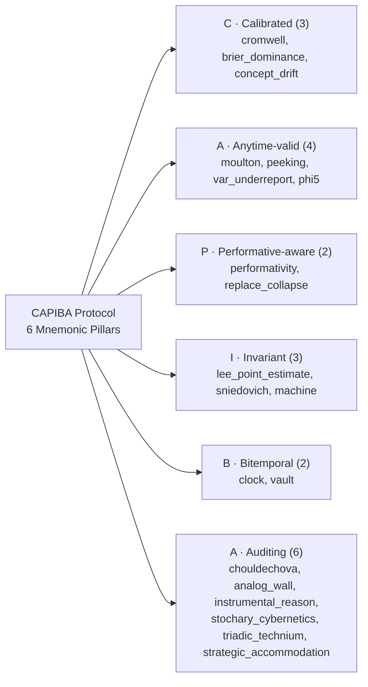

# 27. Verification and Algorithmic Gates (`G1`–`G8` and 20 Negative Proofs)

## 27.1 The Philosophy of Positive and Negative Verification

In ordinary software engineering, a test suite checks that valid inputs produce the expected output (*positive testing*). In an **auditable epistemological machine**, positive testing alone is never enough.

Suppose a gate is supposed to reject dogmatic $0\%$ probabilities or Moulton-Campbell pseudoreplication, but a programmer accidentally wrote `if true { return Ok(()); }` inside the validator. Every positive test would still pass. Proving that a gate has genuine refutation power (Deborah Mayo's Severity Principle, Chapters 8 and 17) requires us to **deliberately inject each forbidden methodological pathology into the system and verify that the binary halts and exits with non-zero status code `1`**.

A single command at the root of the repository runs the complete positive and negative verification suite:

~~~bash
scripts/verify.sh
~~~

---

## 27.2 The Six Verification Stages of `scripts/verify.sh`

1. **Formatting Check (`cargo fmt --all --check`):** Enforces canonical Rust formatting across all 5 crates.
2. **Zero-Warning Static Analysis (`cargo clippy --workspace --all-targets -- -D warnings`):** Rejects any compiler or Clippy lint warning anywhere in library, binary, or test targets.
3. **Unit and Integration Tests (`cargo test --workspace`):** Executes all unit tests across `stochology-core`, `stochology-lenses`, `stochology-siga`, `stochology-governance`, and the end-to-end integration suite in `crates/stochology-cli/tests/protocol_integration.rs`.
4. **The Seven Methodological and Empirical Laboratories (`labs`):**
   - `cargo run --release --bin labs -- --all`
   - `cargo run --release --bin labs -- --layers` (Lab 1: Meng, Manski, Jensen, Performativity)
   - `cargo run --release --bin labs -- --uncertainty` (Lab 2: Kennedy-O'Hagan GP, Info-Gap + Sniedovich)
   - `cargo run --release --bin labs -- --lenses` (Lab 3: The 5 Lenses, Machine $M=(T,\Phi,\theta)$, 6-Axis Relational Ontology, 5-Axis Analog & Wave Computing, 4-Axis Critical Stochastic Rationality, 4-Axis Stochary-Conjectural & Cybernetic Synthesis, and 6-Axis Strategic AI Six-Pair Accommodation)
   - `cargo run --release --bin labs -- --invariants` (Lab 4: $\Phi\_1$–$\Phi\_5$, Moulton-Campbell, Exceedance, Chouldechova)
   - `cargo run --release --bin labs -- --siga` (Lab 5: 4-Filter Funnel, 8-Step SIGA on the 4 YAML Cards, and `AlertFatigueAudit`)
   - `cargo run --release --bin labs -- --governance` (Lab 6: Bitemporal Clock, Canary, Vault, 4 Drift Regimes, and `PCCP`/`PLAT`/`EvaluatedCompetence`)
   - `cargo run --release --bin labs -- --real-data` (Lab 7: Transversal Synthesis across all 13 CSVs & 4 YAML Cards)
5. **The Eight Epistemological Gates (`gates`, exit code `0`) and Twenty Negative Proofs (`--defect`, exit code `1`).**
6. **Repository Tag Hygiene (`git tag --list`):** Verifies that no git tags pollute the tree.

---

## 27.3 The Eight Epistemological Gates (`G1` to `G8`)

<figure class="stoch-figure">
  <svg xmlns="http://www.w3.org/2000/svg" width="1140" height="260" viewBox="0 0 1140 260" fill="none" role="img" aria-labelledby="title-fig-14-gates">
  <title id="title-fig-14-gates">The Eight Epistemological Gates (G1 to G8) and Twenty Negative Defect Proofs</title>
  <defs>
  
  </defs>
  <rect x="1" y="1" width="1138" height="258" rx="14" fill="var(--canvas)" stroke="var(--border)" stroke-width="1.5"/>
  <rect x="18" y="20" width="262" height="100" rx="10" fill="var(--elevated)" stroke="var(--sky)" stroke-width="2"/>
  <text x="34" y="46" fill="var(--sky)" class="mono" font-size="11.5" font-weight="800">G1 · SIMULABILITY (Φ₁)</text>
  <text x="34" y="70" fill="var(--ink)" font-size="13.5" font-weight="750">seed=2026 &amp; 13 CSV SHA-256</text>
  <text x="34" y="94" fill="var(--muted)" class="mono" font-size="11">SplitMix64 + Null Model H₀</text>
  <rect x="298" y="20" width="262" height="100" rx="10" fill="var(--elevated)" stroke="var(--violet)" stroke-width="2"/>
  <text x="314" y="46" fill="var(--violet)" class="mono" font-size="11.5" font-weight="800">G2 · INDEPENDENT UNIT (Φ₂)</text>
  <text x="314" y="70" fill="var(--ink)" font-size="13.5" font-weight="750">Moulton m̃ &amp; Exceedance n_eff</text>
  <text x="314" y="94" fill="var(--rose)" class="mono" font-size="11">--defect moulton → exit 1</text>
  <rect x="578" y="20" width="262" height="100" rx="10" fill="var(--elevated)" stroke="var(--emerald)" stroke-width="2"/>
  <text x="594" y="46" fill="var(--emerald)" class="mono" font-size="11.5" font-weight="800">G3 · SEVERE TEST &amp; SEAL (Φ₃)</text>
  <text x="594" y="70" fill="var(--ink)" font-size="13.5" font-weight="750">Rubin · Meng · Manski · Lee</text>
  <text x="594" y="94" fill="var(--rose)" class="mono" font-size="11">--defect lee_point_estimate</text>
  <rect x="858" y="20" width="264" height="100" rx="10" fill="var(--elevated)" stroke="var(--amber)" stroke-width="2"/>
  <text x="874" y="46" fill="var(--amber)" class="mono" font-size="11.5" font-weight="800">G4 · FAIRNESS &amp; EXIT (Φ₄)</text>
  <text x="874" y="70" fill="var(--ink)" font-size="13.5" font-weight="750">p* = C/(ηL) · Chouldechova</text>
  <text x="874" y="94" fill="var(--rose)" class="mono" font-size="11">--defect chouldechova → exit 1</text>
  <rect x="18" y="138" width="262" height="100" rx="10" fill="var(--elevated)" stroke="var(--rose)" stroke-width="2"/>
  <text x="34" y="164" fill="var(--rose)" class="mono" font-size="11.5" font-weight="800">G5 · RESOLUTION (Φ₅)</text>
  <text x="34" y="188" fill="var(--ink)" font-size="13.5" font-weight="750">R_data ≥ R_decision Match</text>
  <text x="34" y="212" fill="var(--rose)" class="mono" font-size="11">--defect phi5 → exit 1</text>
  <rect x="298" y="138" width="262" height="100" rx="10" fill="var(--elevated)" stroke="var(--sky)" stroke-width="2"/>
  <text x="314" y="164" fill="var(--sky)" class="mono" font-size="11.5" font-weight="800">G6 · PROHIBITIONS 1–4 &amp; WALD</text>
  <text x="314" y="188" fill="var(--ink)" font-size="13.5" font-weight="750">Cromwell · RRM · Wald · SAVI</text>
  <text x="314" y="212" fill="var(--rose)" class="mono" font-size="10">cromwell/perf/snied/peek/brier/</text>
  <text x="314" y="228" fill="var(--rose)" class="mono" font-size="10">var_underreport</text>
  <rect x="578" y="138" width="262" height="100" rx="10" fill="var(--elevated)" stroke="var(--violet)" stroke-width="2"/>
  <text x="594" y="164" fill="var(--violet)" class="mono" font-size="11.5" font-weight="800">G7 · CLOCK, VAULT &amp; DRIFT</text>
  <text x="594" y="188" fill="var(--ink)" font-size="13.5" font-weight="750">Canary · Vault · PCCP · Breaker</text>
  <text x="594" y="212" fill="var(--rose)" class="mono" font-size="10">clock/vault/concept_drift</text>
  <rect x="858" y="138" width="264" height="100" rx="10" fill="var(--elevated)" stroke="var(--emerald)" stroke-width="2"/>
  <text x="874" y="164" fill="var(--emerald)" class="mono" font-size="11.5" font-weight="800">G8 · MACHINE, ANALOG &amp; TRIAD</text>
  <text x="874" y="188" fill="var(--ink)" font-size="13.5" font-weight="750">P1–P5 · Wave · Critical · Triad</text>
  <text x="874" y="212" fill="var(--rose)" class="mono" font-size="10">machine/analog/reason/stoch/triad/</text>
  <text x="874" y="228" fill="var(--rose)" class="mono" font-size="10">replace_collapse/strategic</text>
  </svg>
  <figcaption><strong>Figure 27.1 — The Eight Epistemological Gates (G1–G8) and Twenty Negative Defect Proofs (3 + 4 + 2 + 3 + 2 + 6 = 20)</strong></figcaption>
</figure>

When you run `cargo run --release --bin gates`, the binary executes eight sequential gates:

| Gate | Name | What It Audits at Runtime |
| --- | --- | --- |
| **`G1`** | **Simulability & Cryptographic Integrity ($\Phi\_1$)** | Verifies `seed = 2026` (`SplitMix64` + lock-free `.split(stream_id)` `MonteCarloSplitTreeAudit`), executable null models, and FIPS 180-4 SHA-256 digests of all 13 CSV datasets against `data/SHA256SUMS` and `cards/*.yaml`. |
| **`G2`** | **Independent Unit & Exceedance Design Effect ($\Phi\_2$)** | Verifies Moulton-Campbell unequal-cluster $\tilde{m} = \bar{m}(1 + \mathrm{CV}^2)$, tail-exceedance ICC $\rho\_I(p)$, and $n\_{\mathrm{eff}}(p)$ across all 4 canonical cards and empirical benchmarks. |
| **`G3`** | **Severe Testing, Missingness & Pre-Registration ($\Phi\_3$)** | Verifies Rubin missingness (`MCAR`, `MAR`, `MNAR`), Meng's Identity, Manski bounds, Pearl's Ladder rung, and 64-hex SHA-256 pre-registration seals. |
| **`G4`** | **Scope, Fairness & Exit Clause ($\Phi\_4$)** | Verifies cost-loss threshold $p^{\ast} = \frac{C}{\eta L}$, action consistency (`protect` iff $p > p^{\ast}$), Chouldechova's algebraic fairness identity, and numeric exit clauses. |
| **`G5`** | **Question Resolution Alignment ($\Phi\_5$)** | Verifies $R\_{\text{data}} \ge R\_{\text{decision}}$ so coarse annual/monthly aggregates never answer daily, shift, or 6-hour operational questions. |
| **`G6`** | **Prohibitions 1–4, Performativity, Info-Gap & Lenses** | Verifies Cromwell's Rule ($p \in [\varepsilon\_{\text{floor}}, 1-\varepsilon\_{\text{floor}}]$), 7-number `NonlinearSummary`, Stackelberg $\theta\_{\mathrm{PO}}$ vs. $\theta\_{\mathrm{PS}}$ ($r\_{\mathrm{RRM}} < 1$), 4 Variants of Goodhart's Law (`GoodhartTaxonomyAudit`), `AlertFatigueAudit` ($10\text{ bit/s}$ + Turing decibans), Info-Gap + Sniedovich Wald floor, SDPI/DPI hierarchy, and exact PAV CORP-Murphy closure. |
| **`G7`** | **Bitemporal Governance, Vault & Drift Breaker** | Verifies Bitemporal Clock ($t\_{\text{disp}} \le \tau$), Synthetic Canary ($I(\text{Canary}; Y) = 0$), Single-Opening Temporal Vault (`0 -> 1`), `ExTRA-WCP-T` Lei & Candès bounds, 4 Label Shift estimators, the Murphy-CORP Circuit Breaker, and `PredeterminedChangeControlPlan` (`PCCP`) + `ProfitLossAttributionTest` (`PLAT`) + `EvaluatedCompetenceCriterion`, fed by a real GRAPA *e-process* on the H1 vault model's calibration residuals: approved under the executable null $Y\_i \sim \mathrm{Bernoulli}(p\_i)$, rolled back on the real 2023 outcomes ($\sup\_t E\_t \approx 4.9 \times 10^4$). |
| **`G8`** | **Almost-Perfect Machine, Authentic Form, Relational, Analog/Wave, Critical Rationality, Stochary Cybernetics, Triadic Technium & Strategic AI Six-Pair Accommodation** | Verifies $(\varepsilon, \delta)$-Almost-Perfect Machine $M=(T,\Phi,\theta)$ (`P1`–`P5`), First-Class Authentic Model Form ($\delta(x)+\hat{S}^{\ast}$, named discarded atoms, 6 closed identities, $A(\text{model}) = \text{true}$), Fair-Coin Benchmark, the 6-Axis Relational & Complex Systems Synthesis, the 5-Axis Physical, Analog, and Wave-Interference Computing Synthesis (including `BlockAMC` and `ABNAT / HaLoRA`), the 4-Axis Critical Theory of Stochastic Rationality (including `GoodhartTaxonomyAudit`), the 4-Axis Stochary-Conjectural, Supply-Chain Physics & Cybernetic Synthesis (`StocharyConjecturalCyberneticSynthesis`, `SupplyChainPhysicsAudit`, `StocharyStressTestNotebook`, and 5-CSV `EmpiricalStocharyCyberneticAudit`), the 6-Bridge Triadic ($\mathbb{C} \times \text{Fractals} \times \mathbb{T}^d$) & Technium/Technosphere Synthesis (`ComplexFractalToroidalTechniumSynthesis` and `EmpiricalTriadicTechniumAudit`), and the 6-Axis Strategic AI Six-Pair Accommodation Synthesis (`StrategicAiAccommodationSynthesis` and 6-CSV `EmpiricalStrategicAccommodationAudit`). |

**Multi-seed acceptance in `G8`.** A claim verified at `seed = 2026` alone can be seed luck. For the four simulated syntheses (`CriticalStochasticRationalitySynthesis`, `StocharyConjecturalCyberneticSynthesis`, `ComplexFractalToroidalTechniumSynthesis`, `StrategicAiAccommodationSynthesis`), `G8` re-evaluates every named claim on two seed sets (`stochology_lenses::acceptance`). The development seeds `2026..=2045` were used to decide which claims to keep, discard, or re-specify, so passing them shows little on its own. The confirmation seeds `9_000_000..=9_000_199` were evaluated once, after the claim set was frozen, and never used for a decision. A claim is approved only if it passes on at least `MIN_CLAIM_PASS_RATE = 0.95` of both sets; claims marked `.det.` do not depend on the seed and must pass on every seed, and `G8` checks that their outcome really is constant. Identities must close on every seed. Claims that fall short are moved to `discarded_claims`, still computed, and printed by `gates` with their pass rates; at present they are, from development, the liquidation gap above 30, synthetic variance retention below 0.25, conformal coverage at least 0.88, raw judge noise above 0.20, the `MLLS+BCTS` KL below $10^{-3}$, and `strategic.a2.parametric_mar_mi_covers_true_mean_under_mnar` (`0.0%`; despite the sealed name, the code computes a complete-case $\pm 1.96\,\mathrm{SE}$ interval on the sample truncated at $Y > 5.5$); and, refuted on the one-shot confirmation, ES99 erasure above 0.60 (94.5%), the stocks WDRO certificate (89.0%), the `TBS` saving above 8% (93.5%), and the fixed $< 0.06$ single-run PPI-rectified LLM-as-a-Judge absolute error bound at $n\_{\text{gold}} = 160$ (88.0%). The seed sets, the pass rate, every gated and discarded claim name, the SHA-256 of the 19 source files that define the claims (the module closure of the four syntheses, checked by a unit test), and the confirmation pass rates are sealed in `data/preregistration/acceptance_registry.txt` (SHA-256 in `data/SHA256SUMS`, with the attempt counter $K$ in its comments); `G8` regenerates the registry from the code and blocks if either the hash or the content diverges, so changing a threshold anywhere in those files breaks the seal. Checks that hold by construction (phase completeness of $\{\sin, \cos\}$, the `mixGamma` transition floor, the `LTC` fused-solver bound, declared taxonomies, the Algedonic gate rule, the `PATE` table) are identities, not claims.

**Operating characteristic of the confirmation rule.** With 200 confirmation seeds and a 190-of-200 floor, a claim whose true pass rate is $p$ is approved with probability $P(X \ge 190 \mid n = 200, p)$ (`binomial_accept_probability`):

| True pass rate $p$ | 0.90 | 0.93 | 0.95 | 0.97 | 0.99 |
| --- | :---: | :---: | :---: | :---: | :---: |
| Probability of approval | 0.008 | 0.166 | 0.583 | 0.960 | >0.999 |

So a claim that holds 97% of the time is still refuted about 4% of the time, and one that holds 93% of the time slips through about 17% of the time. `G8` prints, for each synthesis, the lowest one-sided 95% Clopper-Pearson bound on a gated claim's confirmation pass rate (`clopper_pearson_lower`) so this uncertainty stays visible. `scripts/verify.sh` also runs `sha256sum -c` on `data/SHA256SUMS`, requires the dataset hashes to equal those at `HEAD`, and prints a notice when the acceptance registry has been re-sealed since `HEAD`.

---

## 27.4 The Twenty Negative Defect Proofs (`--defect`)

Each command below injects a targeted methodological defect and **must exit with code `1`**:

| Command (`cargo run --release --bin gates -- ...`) | Injected Pathology | Blocking Gate & Mechanism |
| --- | --- | --- |
| `--defect cromwell` | Sets a forecast probability to dogmatic $0\%$ or $100\%$ outside $[\varepsilon\_{\text{floor}}, 1 - \varepsilon\_{\text{floor}}]$. | **Gate `G6` (Prohibition 4):** Rejects violation of Cromwell's Rule. |
| `--defect phi5` | Attempts to answer a 5-minute shift-staffing decision using coarse monthly aggregate data ($R\_{\text{data}} < R\_{\text{decision}}$). | **Gate `G5` (Invariant $\Phi\_5$):** Rejects temporal resolution mismatch. |
| `--defect moulton` | Claims nominal sample size $n$ as effective sample size $n\_{\mathrm{eff}}(p)$, ignoring Moulton-Campbell cluster inflation ($\mathrm{DEFF} > 1$). | **Gate `G2` (Invariant $\Phi\_2$):** Rejects pseudoreplicated margin of error. |
| `--defect performativity` | Deploys a performative retraining loop with contraction ratio $r\_{\mathrm{RRM}} = \frac{\varepsilon\beta}{\gamma} \ge 1$ or conflates $\theta\_{\mathrm{PS}}$ with $\theta\_{\mathrm{PO}}$. | **Gate `G6` (Prohibition 3):** Rejects divergent performative feedback. |
| `--defect sniedovich` | Selects a fragile "Christmas Turkey" option with positive local $\hat{\alpha}$ that collapses below the global Wald Maximin floor in "No-Man's Land." | **Gate `G6` (Chapter 20):** Rejects Info-Gap No-Man's Land collapse. |
| `--defect clock` | Disables the bitemporal filter ($t\_{\text{disp}} \le \tau$), allowing future records to leak into features and spiking canary mutual information $I(\text{Canary}; Y) > 0$. | **Gate `G7` (Chapter 21):** Trips the Bitemporal Canary Intrusion Alarm. |
| `--defect vault` | Attempts to call `open_once()` a second time (`opened_count: 1 -> 2`) on an already-opened `TemporalVault`. | **Gate `G7` (Chapter 21):** Blocks vault reopening (`VaultError::IllegalReopeningAttempt`). |
| `--defect concept_drift` | Injects a structural breakdown where resolution collapses ($\Delta\mathrm{RES}\_{\mathrm{CORP}} < -\tau\_{\mathrm{RES}}$) while attempting to continue automated predictions. | **Gate `G7` (Chapter 21):** Trips the Murphy-CORP Concept Drift Circuit Breaker. |
| `--defect chouldechova` | Claims simultaneous equality of $\mathrm{FPR}, \mathrm{PPV},$ and $\mathrm{FNR}$ across groups with unequal base rates ($p\_A \neq p\_B$). | **Gate `G4` (Invariant $\Phi\_4$):** Rejects algebraic violation of Chouldechova's identity. |
| `--defect machine` | Injects a non-invariant spurious proxy into $\hat{S}^{\ast}$, hides a discarded atom, or breaks Gram effective dimension $d\_{\mathrm{eff}} < 0.80 W$. | **Gate `G8` (Chapter 11):** Rejects inauthentic model form ($A(\text{model}) = \text{false}$). |
| `--defect analog_wall` | Deploys standard digital weights onto a noisy analog RRAM/PCM crossbar ($\sigma = 0.60$) without Noise-Aware Training (NAT), Analog ECC, or PKU `HP-INV` iterative refinement. | **Gate `G8` (Chapter 13):** Rejects the uncompensated Analog Wall threshold cliff (current output: accuracy at $\sigma = 0.60$ collapsed to $37.7\%$, one-step `LP-INV` relative error $0.0530 > 10^{-7}$, synthetic variance retention $0.00$). |
| `--defect instrumental_reason` | Liquidates Adorno's *Non-Identical* via Gaussian outlier amputation (truncated-Gaussian $\mathrm{VaR}\_{0.99}$), extrapolates with the bare simulator, keeps Repeated Risk Minimization, deploys an ungrounded Marcuse/Rouvroy "Stochastic Parrot" without causal invariance ($\hat{S}^{\ast}$), and disables constrained recursion, A-ECC compensation, and `HP-INV` refinement. | **Gate `G8` (Chapter 18):** The positivist synthesis fails on all 20 acceptance seeds while every identity closes on all of them; at `seed = 2026` the $\mathrm{VaR}\_{0.99}$ is breached on $7.9\%$ of fresh draws, RRM keeps a $0.059$ excess risk, the parrot's $\mathrm{MSE}\_{\mathrm{do}(X)} = 19.13$, rule satisfaction is $0\%$, raw-drift accuracy $39\%$, and one-shot `HP-INV` error $5.3 \times 10^{-2}$. The ReLU Laplacian ($\mathrm{ReLU}'' = 0$) and the unnamed discarded atoms are by construction and are not counted. |
| `--defect stochary_cybernetics` | Runs Just-in-Time panic ordering (Bullwhip $= 8.38\times$), exposes full capital to Peters's non-ergodic $+50\%/-40\%$ coin (simulated growth $-5.09\%$), deploys an always-act agent, the Rung-1 slope, and the untransported effect, runs the queue at $u = 0.985$ (simulated wait $30.6\text{ h}$), keeps a 4-day buffer without surge ($40.4\%$ outage fill) and $\mathrm{TTS} < \mathrm{TTR}$ ($0.43$), and uses a persistence regulator model, raw single-judge estimates, and a factor-omitting risk model. | **Gate `G8` (Chapter 23):** The naive synthesis fails on all 20 acceptance seeds while every identity closes on all of them (`StocharyConjecturalCyberneticSynthesis::evaluate_with_mode(seed, false)`). By-construction contrasts (the declared canonical tree, the ungated S1 channel, the outcome-only `PATE` review, and myopic baselines compared with themselves) are reported but not counted. |
| `--defect peeking` | Evaluates fixed-$n$ $z$-intervals or clamped pseudomartingales under continuous optional stopping without SAVI (`aGRAPA` / Hedged `PrPl`). | **Gate `G6` (Prohibition 4):** Rejects optional-stopping Type-I error inflation (`SaviConfidenceSequence`). |
| `--defect brier_dominance` | Selects a forecaster solely by aggregate Brier Score when the Murphy Diagram (`MurphyDiagram`, `CorpRocMurphyTriptych`) shows uniform non-dominance across operational cost-loss thresholds $\theta \in (0, 1)$. | **Gate `G6` (Lens 5):** Rejects Brier ranking without Murphy Diagram uniform dominance. |
| `--defect var_underreport` | Underreports $99\%$ Value-at-Risk ($\mathrm{VaR}\_{0.99}$) by $20\%$ under heavy-tailed losses. | **Gate `G6` (Chapter 8):** Trips the model-free `GREE` e-backtest martingale (`VarEsEBacktest`, $M\_t \ge 20$). |
| `--defect lee_point_estimate` | Reports a positive naive point estimate under `MNAR` selection without reporting fractional Lee trimming bounds (`lee_trimming_bounds`) and tipping point $\Delta^\ast$ (`lee_tipping_point_delta`) that span zero. | **Gate `G3` (Invariant $\Phi\_3$):** Rejects point-only `MNAR` inference (`PHI3_MISSINGNESS_MECHANISM`). |
| `--defect replace_collapse` | Recursively trains across generations by pure synthetic replacement ($E\_n^{\mathrm{Replace}} \propto n$) instead of data accumulation ($E\_n^{\mathrm{Accum}} \le c\pi^2/6$). | **Gate `G8` (Chapter 13):** Simulates both pipelines by recursive OLS refitting (2,000 replicates, `seed = 2026`), requires the simulation to close on both Gerstgrasser closed forms, and rejects the declared `SyntheticDataPolicy::Replace` because its *simulated* risk exceeds the Basel ceiling (`GerstgrasserAccumulateAudit`); with a single generation Replace passes, so the block comes from the dynamics, not the label. |
| `--defect triadic_technium` | Deploys the naive method on every triadic bridge: a real `tanh` dictionary on the $k = 12$ Helmholtz PDE, one-shot `BlockAMC` without refinement, low-rank compression of an inadmissible block, uncompensated PCM drift, Fickian $c^{1/2}$ scaling of a subdiffusive `CTRW`, plain least squares under impulsive errors, OLS under Pareto noise, a rational Weyl step, random Fourier features under contamination, classify-and-count under label shift, and Repeated Risk Minimization. | **Gate `G8` (Chapter 14):** The naive synthesis fails on all 20 acceptance seeds while every identity closes on all of them; each axis fails at `seed = 2026` through at least one computed claim (`ComplexFractalToroidalTechniumSynthesis::evaluate_with_mode(seed, false)`). By-construction contrasts (single-phase sine, unmixed gammas, explicit Euler, the missing refusal gate) are reported but not counted. |
| `--defect strategic_accommodation` | Deploys the naive method on all 6 axes of the strategic synthesis: diameter-limited connectivity and a homogeneous correlated voter ensemble (Axis 1); Rung-1 observational `SHAP`, single-mean imputation, and naive i.i.d. clustered power sizing (Axis 2); an uncalibrated LLM-as-a-Judge and clipped `INT4` quantization (Axis 3); an unbuffered hub schedule (Axis 4); the rank-reversed `AHP` portfolio (Axis 5); and Gaussian $L\_2$ Kalman filtering with certainty-equivalent MPC (Axis 6). Current output at `seed = 2026`: connectivity acc $= 0.51$, homogeneous voter Brier $= 0.268$, Rung-1 `SHAP` do-MSE $= 0.14$, imputation variance retention $= 0.62$, clustered power $= 0.17$, judge error $= 0.199$, `INT4` $\mathrm{ES}\_{0.99}$ retention $= 0.17$, hub survival $= 0.00$, `AHP` portfolio value $= 11.80$ (a constructed contrast), $L\_2$ Kalman RMSE $= 1.47$, MPC survival $= 0.59$. | **Gate `G8` (axes taught in Chapters 10, 11, 12, 15, 16, 17, 19, 20, 21 and 22):** The naive synthesis fails on all 20 development seeds through seed-dependent claims while every identity closes on every seed (`StrategicAiAccommodationSynthesis::evaluate_with_mode(seed, false)`). |

---

## 27.5 Interactive Verification Gate Explorer (`/lab`)

Simulate how sequential peeking, multiplicity $K$, and uncalibrated thresholds trigger the protocol's negative defect proofs:

## Computational Audit in Rust

Run the positive gate suite (`gates`, exit code `0`), the single-card portable auditor (`gates -- --audit-card`), any of the 20 negative defect proofs (`gates -- --defect <name>`, exit code `1`), or the complete end-to-end verification pipeline (`scripts/verify.sh`):

~~~bash
cargo run --release --bin gates
cargo run --release --bin gates -- --audit-card cards/card_01_atlantic_storms_evacuation.yaml
cargo run --release --bin gates -- --defect strategic_accommodation
./scripts/verify.sh
~~~

## Exercises

1. **Pillar-to-Defect Bijection (`C-A-P-I-B-A`):** Verify that the 20 negative defect proofs partition cleanly across the six mnemonic pillars of the CAPIBA Protocol (`3 + 4 + 2 + 3 + 2 + 6 = 20`). Why must every positive gate have a corresponding negative defect proof that exits with code `1`?
2. **Multi-Seed Acceptance Registry (`acceptance_registry.txt` & $K = 5$):** Run `cargo run --release --bin gates -- --print-acceptance-registry` and inspect how `check_acceptance` verifies the SHA-256 digests of the 19 claim-defining source files alongside the development (`2026..=2045`) and confirmation (`9_000_000..=9_000_199`) pass rates. Why are claims that fall below $95\%$ confirmation pass rate recorded in `discarded_claims` rather than silently deleted?

## Summary

- **Eight Epistemological Gates (`G1`–`G8`)** enforce the Four Prohibitions, Five Boundary Invariants ($\Phi\_1$–$\Phi\_5$), and multi-seed synthesis acceptance (`data/preregistration/acceptance_registry.txt` sealed in `data/SHA256SUMS`), exiting with code `0` only when every check closes.
- **Twenty Negative Defect Proofs (`--defect <name>`)** inject specific methodological failures across all six `C-A-P-I-B-A` pillars and verify that `gates` blocks each violation with exit code `1`.
- **Portable Card Auditing (`gates -- --audit-card <card.yaml>`)** and **`scripts/verify.sh`** provide a single-command audit of code formatting, compiler/Clippy hygiene, unit and snapshot-parity tests, all 7 laboratories, all 8 gates, all 20 negative proofs, and textbook synchronization.
