# Inquiry, Framing, and Antidogmatic Openness

<figure class="stoch-figure stoch-logo-figure">
  <svg xmlns="http://www.w3.org/2000/svg" width="660" height="132" viewBox="0 0 660 132" fill="none" role="img" aria-label="Stochology CH43 · S_EPI — Inquiry, Framing, And Multiverse">
  <defs>
    <linearGradient id="ch43-ring" x1="2" y1="78" x2="386" y2="78" gradientUnits="userSpaceOnUse">
      <stop offset="0%" stop-color="var(--logo-green, #10b981)"/>
      <stop offset="38%" stop-color="var(--logo-blue, #2563eb)"/>
      <stop offset="68%" stop-color="var(--logo-gold, #f59e0b)"/>
      <stop offset="100%" stop-color="var(--logo-crimson, #e11d48)"/>
    </linearGradient>
    <radialGradient id="ch43-glow" cx="50%" cy="50%" r="50%">
      <stop offset="0%" stop-color="#38bdf8" stop-opacity="0.25"/>
      <stop offset="50%" stop-color="#2563eb" stop-opacity="0.14"/>
      <stop offset="82%" stop-color="#fbbf24" stop-opacity="0.08"/>
      <stop offset="100%" stop-color="#090e1a" stop-opacity="0"/>
    </radialGradient>
    <linearGradient id="ch43-triad-stroke" x1="18" y1="24" x2="110" y2="104" gradientUnits="userSpaceOnUse">
      <stop offset="0%" stop-color="var(--logo-blue, #2563eb)" stop-opacity="0.85"/>
      <stop offset="50%" stop-color="var(--logo-gold, #f59e0b)" stop-opacity="0.90"/>
      <stop offset="100%" stop-color="var(--logo-crimson, #e11d48)" stop-opacity="0.85"/>
    </linearGradient>
    <linearGradient id="ch43-fill" x1="22" y1="30" x2="106" y2="98" gradientUnits="userSpaceOnUse">
      <stop offset="0%" stop-color="var(--logo-green, #10b981)" stop-opacity="0.26"/>
      <stop offset="48%" stop-color="var(--logo-blue, #2563eb)" stop-opacity="0.28"/>
      <stop offset="100%" stop-color="var(--logo-crimson, #e11d48)" stop-opacity="0.26"/>
    </linearGradient>
    <linearGradient id="ch43-ink-curve" x1="20" y1="66" x2="108" y2="66" gradientUnits="userSpaceOnUse">
      <stop offset="0%" stop-color="var(--logo-ink, #0f172a)"/>
      <stop offset="50%" stop-color="var(--logo-sub, #1d4ed8)"/>
      <stop offset="100%" stop-color="var(--logo-ink, #0f172a)"/>
    </linearGradient>
    <radialGradient id="ch43-pupil" cx="45%" cy="42%" r="58%">
      <stop offset="0%" stop-color="#020617"/>
      <stop offset="68%" stop-color="#0f172a"/>
      <stop offset="100%" stop-color="#451a03"/>
    </radialGradient>
    <linearGradient id="ch43-gold-mira" x1="54" y1="48" x2="84" y2="82" gradientUnits="userSpaceOnUse">
      <stop offset="0%" stop-color="#fef08a"/>
      <stop offset="45%" stop-color="#fbbf24"/>
      <stop offset="100%" stop-color="#d97706"/>
    </linearGradient>
    <radialGradient id="ch43-gold-core" cx="38%" cy="35%" r="65%">
      <stop offset="0%" stop-color="#ffffff"/>
      <stop offset="35%" stop-color="#fde047"/>
      <stop offset="100%" stop-color="#d97706"/>
    </radialGradient>
    <radialGradient id="ch43-node-well" cx="38%" cy="35%" r="65%">
      <stop offset="0%" stop-color="var(--logo-well-hi, var(--elevated-bg, #ffffff))"/>
      <stop offset="100%" stop-color="var(--logo-node-bg, #e2e8f0)"/>
    </radialGradient>
    <linearGradient id="ch43-ring-epi" x1="0%" y1="0%" x2="100%" y2="100%">
      <stop offset="0%" stop-color="#7dd3fc"/>
      <stop offset="50%" stop-color="#2563eb"/>
      <stop offset="100%" stop-color="#1e3a8a"/>
    </linearGradient>
    <radialGradient id="ch43-core-epi" cx="35%" cy="35%" r="65%">
      <stop offset="0%" stop-color="#bae6fd"/>
      <stop offset="45%" stop-color="#3b82f6"/>
      <stop offset="100%" stop-color="#1d4ed8"/>
    </radialGradient>
    <linearGradient id="ch43-ring-vital" x1="0%" y1="0%" x2="100%" y2="100%">
      <stop offset="0%" stop-color="#6ee7b7"/>
      <stop offset="50%" stop-color="#10b981"/>
      <stop offset="100%" stop-color="#065f46"/>
    </linearGradient>
    <radialGradient id="ch43-core-vital" cx="35%" cy="35%" r="65%">
      <stop offset="0%" stop-color="#a7f3d0"/>
      <stop offset="45%" stop-color="#10b981"/>
      <stop offset="100%" stop-color="#047857"/>
    </radialGradient>
    <linearGradient id="ch43-ring-gov" x1="0%" y1="0%" x2="100%" y2="100%">
      <stop offset="0%" stop-color="#fda4af"/>
      <stop offset="50%" stop-color="#e11d48"/>
      <stop offset="100%" stop-color="#881337"/>
    </linearGradient>
    <radialGradient id="ch43-core-gov" cx="35%" cy="35%" r="65%">
      <stop offset="0%" stop-color="#fecdd3"/>
      <stop offset="45%" stop-color="#f43f5e"/>
      <stop offset="100%" stop-color="#be123c"/>
    </radialGradient>
  </defs>
  <g>
    <circle cx="64" cy="66" r="48" fill="url(#ch43-glow)"/>
    <circle cx="64" cy="66" r="42" stroke="var(--logo-ticks, #64748b)" stroke-width="1.2" stroke-dasharray="3 3" stroke-opacity="0.45"/>
    <line x1="38" y1="28" x2="38" y2="102" stroke="var(--logo-green, #10b981)" stroke-width="2.6" stroke-linecap="round"/>
    <line x1="88" y1="28" x2="88" y2="102" stroke="var(--logo-crimson, #e11d48)" stroke-width="2.6" stroke-linecap="round"/>
    <path d="M 38 66 L 88 46" stroke="var(--logo-blue, #2563eb)" stroke-width="2.2"/>
    <path d="M 38 66 L 88 66" stroke="var(--logo-blue, #2563eb)" stroke-width="2.6"/>
    <path d="M 38 66 L 88 86" stroke="var(--logo-blue, #2563eb)" stroke-width="2.2"/>
    <circle cx="88.00" cy="66.00" r="6.72" fill="url(#ch43-node-well)" stroke="url(#ch43-ring-gov)" stroke-width="2.48"/>
    <circle cx="88.00" cy="66.00" r="2.88" fill="url(#ch43-core-gov)"/>
    <g>
      <circle cx="38.00" cy="66.00" r="6.96" fill="var(--logo-node-bg, #e2e8f0)"/>
      <circle cx="38.00" cy="66.00" r="6.02" fill="url(#ch43-pupil)" stroke="url(#ch43-gold-mira)" stroke-width="2.26"/>
      <line x1="28.98" y1="66.00" x2="34.05" y2="66.00" stroke="url(#ch43-gold-mira)" stroke-width="2.26" stroke-linecap="round"/>
      <line x1="41.95" y1="66.00" x2="47.02" y2="66.00" stroke="url(#ch43-gold-mira)" stroke-width="2.26" stroke-linecap="round"/>
      <line x1="38.00" y1="56.98" x2="38.00" y2="62.05" stroke="url(#ch43-gold-mira)" stroke-width="2.26" stroke-linecap="round"/>
      <line x1="38.00" y1="69.95" x2="38.00" y2="75.02" stroke="url(#ch43-gold-mira)" stroke-width="2.26" stroke-linecap="round"/>
      <circle cx="38.00" cy="66.00" r="2.07" fill="url(#ch43-gold-core)"/>
    </g>
  </g>
  <g transform="translate(148, 0)">
    <text x="2" y="27" fill="var(--logo-sub, #1d4ed8)" font-family="ui-monospace, 'Cascadia Code', monospace" font-size="10.5" font-weight="700" letter-spacing="1.2">PART IV · THE FRAMEWORK</text>
    <text x="498" y="27" text-anchor="end" fill="var(--logo-meta, #475569)" font-family="ui-monospace, 'Cascadia Code', monospace" font-size="10.5" font-weight="700" letter-spacing="1.0">CH43 · S_EPI</text>
    <text x="0" y="59" fill="var(--logo-ink, #0f172a)" font-family="system-ui, -apple-system, 'Segoe UI', Roboto, sans-serif" font-size="20.2" font-weight="800" letter-spacing="1.15">INQUIRY, FRAMING, AND MULTIVERSE</text>
    <line x1="2" y1="78" x2="384" y2="78" stroke="url(#ch43-ring)" stroke-width="1.6" stroke-opacity="0.82"/>
    <circle cx="400" cy="78" r="6.2" stroke="var(--logo-gold, #f59e0b)" stroke-width="1.5" stroke-dasharray="2.2 1.6"/>
    <circle cx="400" cy="78" r="4.0" fill="var(--logo-node-bg, #e2e8f0)" stroke="var(--logo-blue, #2563eb)" stroke-width="2.2"/>
    <circle cx="400" cy="78" r="1.8" fill="var(--logo-gold, #f59e0b)"/>
    <circle cx="415" cy="78" r="3.8" fill="var(--logo-node-bg, #e2e8f0)" stroke="var(--logo-blue, #2563eb)" stroke-width="2.0"/>
    <circle cx="415" cy="78" r="1.6" fill="var(--logo-blue, #2563eb)"/>
    <circle cx="430" cy="78" r="3.8" fill="var(--logo-node-bg, #e2e8f0)" stroke="var(--logo-blue, #2563eb)" stroke-width="2.0"/>
    <circle cx="430" cy="78" r="1.6" fill="var(--logo-blue, #2563eb)"/>
    <circle cx="445" cy="78" r="2.0" fill="var(--logo-ticks, #64748b)" fill-opacity="0.42"/>
    <circle cx="460" cy="78" r="2.0" fill="var(--logo-ticks, #64748b)" fill-opacity="0.42"/>
    <circle cx="475" cy="78" r="2.0" fill="var(--logo-ticks, #64748b)" fill-opacity="0.42"/>
    <circle cx="490" cy="78" r="2.0" fill="var(--logo-ticks, #64748b)" fill-opacity="0.42"/>
    <text x="2" y="104" fill="var(--logo-meta, #475569)" font-family="ui-monospace, 'Cascadia Code', monospace" font-size="10.8" font-weight="600" letter-spacing="0.65">CROMWELL CLAMP · PAUKER–KASSIRER GAP · SIMON FRAMING AND E-BH DISCOVERY</text>
  </g>
  </svg>
</figure>

## By the end of this chapter you can

1. Say why a dogmatic zero or one cannot be moved by evidence, and how the interior floor repairs it.
2. Derive the cost–loss threshold from a cost, an efficacy and a loss, and explain why two standpoints holding the same probability reach opposite decisions.
3. Tell a severe test from a powered one, and recognise a multiverse report that hides the specification which failed.

The first breakdown of the naive optimiser occurs before a single parameter is estimated: it treats the analyst's framing as neutral, permits dogmatic extreme probabilities ($p = 0$ or $p = 1$), mistakes an underpowered study for evidence of safety, and hides the analytical choices (Gelman and Loken's garden of forking paths) that preceded the reported specification.

Mediating Filter I · Axis 1 ($S\_{\mathrm{epi}}$: Epistemic Margin) carries the axis from the open world to the institutional archive, and Chapters 43, 44 and 45 take one part of that transition each. Its operator is Canonical Operator I, the epistemic margin state. The tension it opens on is Tension 1: situated cognitive interest and framing power against antidogmatic openness and full attempt memory.

---

## 2.1 Cromwell's Rule and Peirce's First Rule of Reason

In 1650, Oliver Cromwell pleaded with the General Assembly of the Church of Scotland: *"I beseech you, in the bowels of Christ, think it possible you may be mistaken."* In Bayesian probability, Dennis Lindley (1985) formalized this plea as **Cromwell's Rule**, while Charles Sanders Peirce (1899) formulated its philosophical counterpart as the **First Rule of Reason**: *Do not block the way of inquiry.*

If a prior or forecast assigns $p = 0$ or $p = 1$ to an empirically possible event, Bayes's theorem yields:

$$\mathbb{P}(H \mid E) = \frac{\mathbb{P}(E \mid H)\mkern3mu\mathbb{P}(H)}{\mathbb{P}(E \mid H)\mkern3mu\mathbb{P}(H) + \mathbb{P}(E \mid \neg H)\mkern3mu\bigl(1 - \mathbb{P}(H)\bigr)} \in \lbrace 0, 1\rbrace$$

No finite likelihood ratio (no matter how overwhelming the field evidence) can ever move a dogmatic $0$ or $1$. The rule the operator enforces is therefore an explicit interior floor $p \in [\varepsilon\_{\mathrm{floor}}, 1 - \varepsilon\_{\mathrm{floor}}]$ with $\varepsilon\_{\mathrm{floor}} > 0$: the floor is not a statement about the world but a statement about the analyst, and its size is the smallest probability the institution is prepared to defend as non-zero before it has looked. Without it, a forecast of certainty is a forecast that no observation can discipline, and the archive that disagrees with it can only be read as corrupt.

---

## 2.2 Strong Objectivity, Inductive Risk, and Cost–Loss Framing

Following Richard Rudner (1953), Heather Douglas (2000), and Sandra Harding (1991), setting an action or acceptance threshold under uncertainty is never value-free: it weighs the cost of protective action $C > 0$ against the mitigated loss $\eta L > 0$ of an unbuffered catastrophe. Consider the canonical $2\times 2$ decision payoff matrix under state of nature $\theta \in \{\text{Hazard } H, \text{Safe } \neg H\}$:

| Action | Hazard Present ($H$, prob $\pi\_0$) | Safe State ($\neg H$, prob $1 - \pi\_0$) | Expected Cost / Loss |
| :--- | :--- | :--- | :--- |
| **Protective Action ($A$)** | $C + (1 - \eta)L$ | $C$ | $C + \pi\_0(1 - \eta)L$ |
| **Inaction / Wait ($W$)** | $L$ | $0$ | $\pi\_0 L$ |

Equating the expected loss of action and inaction yields the indifference threshold $p^\ast$:
$$C + \pi\_0(1 - \eta)L = \pi\_0 L \implies C = \pi\_0 \eta L \implies p^\ast = \frac{C}{\eta L} \in (0, 1)$$
Action is rational whenever prior hazard belief satisfies $\pi\_0 > p^\ast$. Under the economic cost–loss rule the operator computes:
$$p^\ast = \frac{C}{\eta L} \in (0, 1), \qquad \mathrm{EVPI}(\pi\_0) = \min\bigl(C,\mkern3mu \pi\_0 \eta L\bigr) - \pi\_0 \min\bigl(C,\mkern3mu \eta L\bigr) \ge 0$$

Institutions and affected communities disagree even when they agree on the probability $\pi\_0$ of a hazard, because the threshold is a ratio and the two standpoints put different quantities in the denominator. The **institutional budget** measures $L\_{\mathrm{inst}}$ strictly as bureaucratic liability — a settlement, a fine, a replacement cost — and so reaches a high action threshold. The **vulnerable community** bears the irreversible human and livelihood loss $L\_{\mathrm{affected}} \gg L\_{\mathrm{inst}}$ at the same protective cost $C$, and so reaches a threshold lower by exactly the ratio of the two stakes:
$$\frac{p^\ast\_{\mathrm{affected}}}{p^\ast\_{\mathrm{inst}}} = \frac{L\_{\mathrm{inst}}}{L\_{\mathrm{affected}}}$$
Where the shared prior lies strictly between the two thresholds, the institution calls waiting scientific prudence and the community calls it reckless abandonment. Neither is dishonest about the probability, and no sharper measurement of it settles the disagreement. This is Pauker and Kassirer's (1980) threshold logic read politically.

Harding's *strong objectivity* requires the epistemic margin to be computed from both standpoints and the **framing gap**, the distance between the two thresholds, to be published. Disguising institutional cost-saving as scientific conservatism is the failure it forbids. A report that names one standpoint and calls it the standpoint has replaced a measurement with a budget.

---

## 2.3 Agnotology vs. Severe Power and Kimball's Type III Error

Robert Proctor (2008) coined **agnotology** for the strategic production of ignorance. One of its most common statistical instruments is the **deliberately underpowered study**: running a small sample $n$ with low statistical power $1 - \beta(\delta\_{\min})$ against a substantively dangerous harm $\delta\_{\min} > 0$, and then proclaiming "no statistically significant effect ($p > \alpha$)" as proof that the system is safe.

For a one-sided level-$\alpha$ test of the zero-effect null $H\_0: \delta \le 0$ against $\delta > 0$ using an unbiased Gaussian estimator $\hat{\delta} \sim \mathcal{N}(\delta, \sigma^2/n\_{\mathrm{eff}})$ and standardized statistic $T(\mathbf{X}) = \hat{\delta}\sqrt{n\_{\mathrm{eff}}}/\sigma$ (rejecting when $T(\mathbf{X}) > z\_{1-\alpha}$), the statistical power to detect a minimum substantively relevant harm $\delta\_{\min} > 0$ at standard deviation $\sigma > 0$ and effective sample size $n\_{\mathrm{eff}}$ is:
$$\mathrm{Power}(\delta\_{\min}) = \mathbb{P}\_{\delta = \delta\_{\min}}\bigl(T(\mathbf{X}) > z\_{1-\alpha}\bigr) = 1 - \Phi\mkern-3mu\left(z\_{1-\alpha} - \frac{\delta\_{\min}\sqrt{n\_{\mathrm{eff}}}}{\sigma}\right)$$

By Deborah Mayo's (2018) **Severity Principle**, a hypothesis or claim $H$ passes a severe test with data $\mathbf{x}\_0$ only if:

1. $\mathbf{x}\_0$ accords with $H$; and
2. with very high probability, the test procedure would have produced a less favorable result if $H$ were false.

Formally, when the zero-null test fails to reject ($T(\mathbf{x}\_0) \le z\_{1-\alpha}$), the post-data severity with which $\mathbf{x}\_0$ warrants the non-harm claim $H: \delta \le \delta\_{\min}$ against $\neg H: \delta > \delta\_{\min}$ is evaluated at the boundary discrepancy $\delta = \delta\_{\min}$:
$$\mathrm{SEV}\bigl(\delta \le \delta\_{\min};\mkern3mu \mathbf{x}\_0\bigr) = \inf\_{\delta > \delta\_{\min}} \mathbb{P}\_\delta\bigl(T(\mathbf{X}) > T(\mathbf{x}\_0)\bigr) = \mathbb{P}\_{\delta = \delta\_{\min}}\bigl(T(\mathbf{X}) > T(\mathbf{x}\_0)\bigr) = 1 - \Phi\mkern-3mu\left(T(\mathbf{x}\_0) - \frac{\delta\_{\min}\sqrt{n\_{\mathrm{eff}}}}{\sigma}\right)$$
A non-rejection of $H\_0: \delta \le 0$ warrants the claim "true harm does not exceed $\delta\_{\min}$" only if $\mathrm{SEV}(\delta \le \delta\_{\min};\mkern3mu \mathbf{x}\_0)$ clears the bar the inquiry declared in advance. At the non-rejection ceiling $T(\mathbf{x}\_0) = z\_{1-\alpha}$, severity equals $\mathbb{P}\_{\delta = \delta\_{\min}}(T(\mathbf{X}) > z\_{1-\alpha}) = \mathrm{Power}(\delta\_{\min}) = 1 - \beta(\delta\_{\min})$ (and even at $T(\mathbf{x}\_0) = 0$ it reaches only $\Phi(\delta\_{\min}\sqrt{n\_{\mathrm{eff}}}/\sigma) \to 1/2$ as $n\_{\mathrm{eff}} \to 0$), rendering an underpowered non-rejection unseverely tested and epistemically baseless.

At the same time, A. W. Kimball (1957), Ian Mitroff & Francisco Sagasti (1973), and Mitroff & Featheringham (1974) identified **Type III Error**: solving the wrong problem precisely, achieving a positive narrow proxy gain $+G\_{\mathrm{narrow}}$ while inflicting a larger unmeasured systemic damage $-D\_{\mathrm{unmeasured}} < -G\_{\mathrm{narrow}}$.

Joining Type III framing analysis with **Herbert Simon's (1947/1997 [1979])** theory of bounded rationality and **Jürgen Habermas's (1984 [1981/2012])** theory of communicative action exposes the organizational root of framing distortion: because human information throughput is bounded at roughly ten bits per second (Zheng & Meister 2025), creating a compression bottleneck at the organizational interface, every manager acts on the **decision premises** of subordinates — *"every manager is a cognitive influencer by obligation, but becomes a cognitive manipulator by choice"*.

To audit this institutional manipulation, Stochology formalizes the **Simon Premise Rigging Index** ($\mathrm{PRI}$). Let $w\_{\mathrm{disp}} \in [0, w\_{\mathrm{true}}]$ be the epistemic identification width disclosed by the framing against the reference width $w\_{\mathrm{true}} > 0$ (such as the partial-identification width $U\_t - L\_t$ across admissible specifications), and let $D\_{\mathrm{disp}} \in [0, D\_{\mathrm{true}}]$ be the disclosed collateral spillover damage against the reference spillover harm $D\_{\mathrm{true}} > 0$. Setting the concealed fractions $c\_{\mathrm{epi}} = 1 - w\_{\mathrm{disp}}/w\_{\mathrm{true}}$ and $c\_{\mathrm{spill}} = 1 - D\_{\mathrm{disp}}/D\_{\mathrm{true}}$ (with $c\_{\mathrm{spill}} = 0$ if $D\_{\mathrm{true}} = 0$), the primary index is:
$$\mathrm{PRI} = \max\bigl(c\_{\mathrm{epi}},\mkern3mu c\_{\mathrm{spill}}\bigr) = \max\left(1 - \frac{w\_{\mathrm{disp}}}{w\_{\mathrm{true}}},\mkern5mu 1 - \frac{D\_{\mathrm{disp}}}{D\_{\mathrm{true}}}\right) \in [0, 1].$$
When a discrete set of $m \ge 2$ admissible decision premises $\mathcal{P} = \{p\_1, \dots, p\_m\}$ is assigned weight distribution $\boldsymbol{\omega} = (\omega\_1, \dots, \omega\_m)$, a secondary concentration diagnostic $C\_{\mathrm{prem}}(\mathcal{P})$ compares its Shannon entropy $H(\mathcal{P}) = -\sum\_{i=1}^m \omega\_i \log\_2 \omega\_i$ (with $0\log\_2 0 = 0$) against the uniform ceiling $H\_{\max} = \log\_2 m$:
$$C\_{\mathrm{prem}}(\mathcal{P}) = 1 - \frac{H(\mathcal{P})}{H\_{\max}} = 1 - \frac{-\sum\_{i=1}^m \omega\_i \log\_2 \omega\_i}{\log\_2 m} \in [0, 1].$$
Unlike $\mathrm{PRI}$, this secondary metric $C\_{\mathrm{prem}}(\mathcal{P})$ **is not invariant under re-partitioning** of the hypothesis or premise space: splitting a single premise of weight $\omega\_1$ into two equally weighted sub-premises replaces $-\omega\_1 \log\_2 \omega\_1$ with $-\omega\_1 \log\_2 \omega\_1 + \omega\_1$ in $H(\mathcal{P})$ while shifting $H\_{\max}$ from $\log\_2 m$ to $\log\_2(m + 1)$, so the value moves with the analyst's taxonomy rather than with concealed epistemic width or spillover harm.

**Legitimate cognitive influence** shares partial-identification bounds $[L\_t, U\_t]$ and collateral spillover costs openly, keeping $\mathrm{PRI}$ beneath the declared threshold and preserving operational variety. Conversely, **cognitive manipulation** conceals epistemic width or spillover harm, drives $\mathrm{PRI}$ above the declared threshold, and traps frontline operators inside a **decision labyrinth pre-rigged at the top**, violating **Immanuel Kant's (1996 [1785/2007])** principle against instrumentalizing another agent's rational judgment.

The framing defect has a constitutional twin. Hayek argued that the knowledge relevant to a decision is never held in a single mind but exists dispersed among the actors who happen to be on the spot, so the central problem is not how to gather it all but how to use knowledge that nobody possesses in its entirety (Hayek 1945). Against the Premise Rigging Index the argument cuts both ways: an inquiry whose premise set one actor fixes has already decided which dispersed knowledge counts, and no increase in the volume of the archive recovers a premise the frame never admitted. Hayek's later constitutional turn states the same limit in institutional form, as a rule that constrains what a legislature may decide; it does not bind what an analyst may measure (Hayek 1973).

---

## 2.4 Multiplicity ($e\text{-BH}$) and the Specification Curve (Multiverse)

When an analyst explores $K \ge 1$ plausible data-cleaning rules, covariate sets, or functional forms (Gelman & Loken's *garden of forking paths*), reporting only the single specification that crossed a significance threshold is a classic cherry-picking distortion. Two defenses answer it, and they work on different halves of the problem.

1. **The $e\text{-BH}$ Procedure (Wang & Ramdas, 2022):** Given $K$ e-values $E\_{(1)} \ge E\_{(2)} \ge \dots \ge E\_{(K)}$ (where $\mathbb{E}\_{H\_0}[E\_k] \le 1$), the $e\text{-BH}$ rule controls the False Discovery Rate at level $\alpha$ under **arbitrary dependence** across the $K$ specifications by finding the largest $k^\ast$ such that:

   $$\frac{k^\ast \mkern3mu E\_{(k^\ast)}}{K} \ge \frac{1}{\alpha}$$

2. **Simonsohn, Simmons & Nelson's (2020) Specification Curve / Steegen et al.'s (2016) Multiverse Analysis:** Instead of hiding the $K - 1$ alternative models, the operator records the full vector of $K$ effect estimates and e-values, reporting the min–max envelope $[L\_t, U\_t]$ across all $K$ specifications, the **consistency ratio**, and the average e-value $\bar{E} = \frac{1}{K}\sum\_{k=1}^K E\_k$.

---

## 2.5 The Instruments of the First Filter

The first of the four instruments is Cromwell's floor, and it is not a smoothing device: it is the formal statement that an institutional belief must remain falsifiable by an observation. Lindley's formalization and Peirce's rule of reason agree about the mechanism and differ about the vocabulary, and the chapter needs both, because the floor is simultaneously a probability statement and a norm of inquiry.

The second and third instruments are the cost–loss threshold and the severity criterion, and they answer different questions about the same test. The threshold, in Pauker and Kassirer's diagnostic form, tells the institution when to act given a stake; severity, in Mayo's sense, tells the institution what its non-rejection was worth. An inquiry can be severe and pointed at the wrong question, which is Kimball's Type III error. It can also be pointed at the right question with no power to detect the harm it was asked about, and that is agnotology's preferred instrument. Neither defect is repaired by the other's instrument.

The anti-dogmatic gate has an older operational form: the analyst tabulates every plausible hypothesis against the same evidence and scores the disconfirming weight before naming a favourite (Heuer 1999).

The fourth instrument is multiplicity. Wang and Ramdas's $e$-BH procedure controls the false discovery rate under arbitrary dependence across specifications, which is the dependence a forking-paths analysis produces, and Simonsohn, Simmons and Nelson's specification curve with Steegen and colleagues' multiverse analysis makes the set of specifications the object of the report, not the winner of a search. The pair is what turns "we found an effect" into "here is the envelope of effects the archive permits, and here is the specification that fell outside it".

---

### Power and relevance are different guards

Severe power at its ceiling and a net loss can coexist. The design answered the question it was given with maximum severity, and the question was the wrong one. Openness does not repair that; only the framing guard does, and the two guards sit on different sides of the data: severity asks whether the test could have failed, framing asks whether the test was worth running.

The multiverse makes the second guard operational. A consistency ratio that reads almost whole, with an envelope narrow enough to look decisive, can still hide the one specification that failed the criterion, and the specification that a consistency headline would hide inside the majority is the one a reader needs. A multiverse with one hundred percent consistency and a wide interval is not a licence to decide: it is stable ignorance, and stability is a property of the specification set, not of the world.

### When investigation costs more than the question is worth

The anti-dogmatic opening fails when the cost of investigating exceeds the value of the question. The procedure is to declare the cost of inquiry and to close the line when the expected value of the information falls below it, instead of keeping the line open as a matter of principle: an investigation that cannot change a decision is a cost with no decision attached.

### The cost of the framing guard

The framing guard has a cost that the openness guard does not, and it is worth naming. Checking whether the question is the one the decision needs requires someone to state the decision, which means the analysis cannot be delegated to whoever holds the data; severity can be delegated to a statistician, framing cannot. That asymmetry explains why organisations invest in the first and skip the second: the first has a specialist, a standard and a deliverable, and the second has only a meeting that has to happen before the analysis starts, when nobody yet knows what the analysis will show. A guard with no specialist survives on the authority of whoever convenes the meeting, and that authority is what the framing decision needs.

## 2.6 Where the two thresholds coincide, and the action the matrix cannot price

### Two threshold families at their limits

The cost-loss threshold is $p^\ast = C/(\eta L)$ and its two ends are the cheap-action end and the large-stake end: as $C \to 0$ the threshold goes to $0$ and any hazard at all justifies acting, and as $L \to \infty$ at fixed $C$ it goes to $0$ again, so an unbounded stake makes the action free. In between, the whole political disagreement of §2.2 lives: the same prior is above one standpoint's threshold and below the other's, and the gap between them is the framing gap the report is obliged to publish.

The second family is the diagnostic one, and it meets the first. Pauker and Kassirer's threshold is $p^\ast = C\_{\mathrm{FP}}/(C\_{\mathrm{FP}} + L\_{\mathrm{FN}})$, the indifference probability at which the expected cost of a false positive $(1 - p^\ast)C\_{\mathrm{FP}}$ equals the expected loss of a false negative $p^\ast L\_{\mathrm{FN}}$, and it coincides with the cost–loss threshold $C/(\eta L)$ whenever $C/C\_{\mathrm{FP}} = \eta L/(C\_{\mathrm{FP}} + L\_{\mathrm{FN}})$ (in particular, when $C = C\_{\mathrm{FP}}$ and $\eta L = C\_{\mathrm{FP}} + L\_{\mathrm{FN}}$, equivalently $C/(\eta L - C) = C\_{\mathrm{FP}}/L\_{\mathrm{FN}}$). The coincidence is an identity and not a coincidence: the same number can be produced by two different theories and the number itself never says which one produced it. The limits of the second family are equally sharp: $C\_{\mathrm{FP}} \to 0$ gives $p^\ast \to 0$ and every warning acts, while $L\_{\mathrm{FN}} \to 0$ gives $p^\ast \to 1$ and no warning ever does.

### The severity the archive can actually certify

Severity has an edge, and a clustered archive puts it in a place the nominal sample size does not advertise. Rows recorded inside arrival days are not independent rows: the intra-cluster correlation inflates the variance by the Kish–Moulton design effect $\mathrm{DEFF} = 1 + (\bar{m} - 1)\rho\_{\mathrm{intra}}$, the effective sample size falls to $n/\mathrm{DEFF}$, and the power to detect a shift of a given relative size falls with it. The consequence is not a smaller number; it is a different verdict about what a non-rejection means.

The argument is one line long and it is the severity argument: an archive can certify a shift large enough that the design would have detected it, and cannot certify a shift below that scale. A non-rejection at the smaller scale is therefore not evidence of safety; it is evidence that the design could not have found the harm it did not find. Kish (1965) supplies the variance, Moulton (1986) the cluster-size correction, and Mayo (2018) the reading of the verdict; nothing in the chain requires a particular archive, which is why the chapter states it as a rule about designs.

### The programme that acted on the right threshold

The cost-loss matrix on this page has three entries, and the recommendation it issues assumes there is no fourth. Put the affected-standpoint numbers to work symbolically: at a prior above $C/(\eta L)$ the action is rational, since $\pi\_0 \eta L > C$. Now let the action make its own harm at a rate $\lambda$ per unit of exposure. Action beats inaction only while $\lambda < \pi\_0\eta L - C$, so a protective programme whose own per-unit harm exceeds that margin is worse than waiting by the matrix's own arithmetic, and the matrix never mentions the term. The 1976 national swine-influenza immunisation campaign in the United States is the dated instance of that term crossing the bar: launched on a hazard estimate of this shape and suspended in December 1976 once the vaccine's own harm entered the ledger (Neustadt & Fineberg 1983). The form applied, and the recommendation it issued — protect, because the affected standpoint holds the low threshold — was wrong for a reason internal to the form.

### When the specification set is not enumerable

The thesis of this chapter is that severe testing plus a published multiverse keeps framing honest. The condition that invalidates it is enumerability: the specification curve is a bound only when the set of specifications is closed and known to the analyst at the moment of the report. Where choices are made downstream by other teams, or where specifications only become available after publication, the envelope $[L\_t, U\_t]$ is a lower bound on the true width, the consistency ratio is a property of the subset that was found, and the reported interval inherits the very selection it was built to expose. The procedure when the condition fails: declare the enumeration rule and a closure date before the curve is computed; report the envelope explicitly as a lower bound, with the allowance for unfound specifications stated beside it; and where no rule can be declared at all, withdraw the multiverse interval and report the single pre-registered specification with its severity, since a narrow claim with a stated design is auditable and a wide claim whose width nobody can reconstruct is not.

## Bridge

What leaves this chapter is a severity criterion and a warning. The criterion is that a claim survives
only if it would have failed had it been false, which is a property of the test and not of the result.
The warning is that an open frame is not the same thing as an unbounded search: a multiverse large enough
to contain every answer also contains the answer the analyst wanted.

[Underdetermination and Partial Identification](44-underdetermination-partial-identification.md) turns the
warning into arithmetic. Once the frame is admitted to be one of many, the estimand is no longer a point
and the honest object is a set: the two-arm Manski interval reports the set the design supports, and the
$e$-process reports how much evidence has accumulated against a hypothesis without pretending the evidence
is a posterior. The margin handed forward is the width of that set. The debt is that a set can be wide
enough to license nothing, and [Chapter 44](44-underdetermination-partial-identification.md) has to say which decisions survive a width and which do not.
