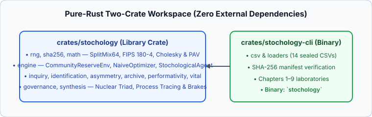

# Appendix B — Architecture, Crates, and Verification

Stochology is implemented in **pure Rust (`std` only, zero external crates)** across two workspace crates: [`crates/stochology`](../crates/stochology/src/lib.rs) (the mathematical and institutional library) and [`crates/stochology-cli`](../crates/stochology-cli/src/lib.rs) (the dataset loader, SHA-256 manifest verifier, and Chapter 1–9 laboratory runner).



---

## B.1 1-to-1 Mapping Between Book Chapters, Treatise Sections, and Rust Modules

| Chapter | Treatise Section (`notes/The Ethics of Aim.md`) | Library Module (`crates/stochology/src/`) | Primary Exported Types & Functions |
| :---: | :--- | :--- | :--- |
| **00** | §I–§II (Genealogy, Nuclear Triad, 3 Collapse Propositions) | [`lib.rs`](../crates/stochology/src/lib.rs) | Crate-level overview and re-exports |
| **01** | §II.2 (Sequential Mediation Loop) | [`rng.rs`](../crates/stochology/src/rng.rs), [`sha256.rs`](../crates/stochology/src/sha256.rs), [`engine.rs`](../crates/stochology/src/engine.rs) | `SplitMix64`, `sha256_hex`, `CommunityReserveEnv`, `AgentPolicy`, `NaiveOptimizer`, `StochologicalAgent` |
| **02** | §III.1 (Filter I · Tension 1) | [`inquiry.rs`](../crates/stochology/src/inquiry.rs) | `cromwell_clamp`, `CostLossFraming`, `SeverePowerAnalysis`, `TypeThreeFramingAudit`, `e_bh_discoveries`, `SpecificationCurve` |
| **03** | §III.2 (Filter I · Tension 2) | [`identification.rs`](../crates/stochology/src/identification.rs) | `EvidenceProcess`, `lakatos_shift_ratio`, `ManskiBounds`, `LeeAttritionBounds`, `PetersonSurvivalBounds` |
| **04** | §IV.1 (Filter II · Tension 3) | [`asymmetry.rs`](../crates/stochology/src/asymmetry.rs) | `DialecticalPenumbra`, `OrdinalScaleAudit`, `NonlinearSummary`, `HillTailEstimate`, `TailMomentRegime` |
| **05** | §IV.2 (Filter II · Tension 4) | [`archive.rs`](../crates/stochology/src/archive.rs) | `KeynesEvidentialWeight`, `MengBigDataDefect`, `ClusterDesignEffect`, `KishWeightAudit`, `CaptureRecaptureAudit`, `BitemporalRecord`, `VintageRevisionAudit` |
| **06** | §V.1 (Filter III · Tension 5) | [`performativity.rs`](../crates/stochology/src/performativity.rs) | `CorpPavDecomposition`, `evaluate_invariant_predictors`, `AnchoredDiscrepancy`, `TianPearlCounterfactualBounds`, `PerformativeSystem`, `GoodhartAudit` |
| **07** | §V.2 (Filter III · Tension 6) | [`vital.rs`](../crates/stochology/src/vital.rs) | `EpistemicKellyAllocation`, `CanguilhemHollingBasin`, `VitalSlackBuffer`, `WaldSurvivorshipAudit`, `InfoGapMaximinSafeguard` |
| **08** | §VI (Ethical Mediation · Tension 7) | [`governance.rs`](../crates/stochology/src/governance.rs) | `SosaJudgmentGrade`, `TelicEvaluation`, `DiscursiveCommittee`, `AlgedonicChannel`, `ContractAndLiabilityAudit`, `ChouldechovaTrilemma`, `CognitiveAlertFilter`, `TemporalVault` |
| **09** | §VII–§VIII (5 Families, Process Tracing, Reflexivity) | [`synthesis.rs`](../crates/stochology/src/synthesis.rs) | `CollapseProposition`, `TriadicIntegrity`, `DiagnosticClue`, `ProcessTracingTestKind`, `ProcessTracingInference`, `ReflexiveBrakeAudit` |

---

## B.2 Running the Verification Pipeline (`scripts/verify.sh`)

The workspace verification script [`scripts/verify.sh`](../scripts/verify.sh) executes four checks in sequence:

1. **`cargo fmt --all -- --check`:** Verifies standard Rust formatting across both crates.
2. **`cargo clippy --all-targets -- -D warnings`:** Enforces zero compiler or Clippy warnings.
3. **`cargo test`:** Runs all 25 unit tests in `crates/stochology` (testing FIPS 180-4 SHA-256 vectors, PAV isotonic regression, Cholesky SPD solver, `CommunityReserveEnv` survival vs. ruin, and every tension module) plus the end-to-end integration test in `crates/stochology-cli`.
4. **`cargo run --release --bin stochology`:** Cryptographically verifies all 14 real-world CSV datasets against [`data/SHA256SUMS`](../data/SHA256SUMS) and executes Chapters 1 through 9:

```text
[OK] Cryptographic manifest data/SHA256SUMS verified (14 sealed datasets).
=== Chapter 1: The Sequential Loop (CommunityReserveEnv, seed=2026, T=24) ===
  NaivePointOptimizer      -> coverage=0.0%, mean_harm=105.80, terminal_reserve=0.00, ruin_step=Some(3)
  StochologicalAgent(Full) -> coverage=100.0%, mean_harm=2.23, terminal_reserve=66.50, ruin_step=None, triad=IntactTriad
=== Chapter 2: Inquiry, Framing & Antidogmatic Openness (Filter I · Tension 1) ===
  Cromwell floor=0.0001 | Framing p*_inst=0.50 vs p*_affected=0.05 (gap=0.45, EVPI_affected=80.0)
  Agnotology vs Severe Power (delta=0.30): n=18 power=0.283 vs n=140 power=0.956 | Type III net=-16.0
  Multiverse (K=6): robust consistency=100% (avg_E=35.0) vs cherry-picked consistency=16.7% (e-BH discoveries=0)
=== Chapter 3: Underdetermination & Partial Identification (Filter I · Tension 2) ===
  LaLonde (nsw_experimental.csv vs cps_observational.csv): experimental_ATE=$1794 vs naive_CPS_diff=$-8498
  Manski bounds=[$5339, $10907] (width=$5568) | Lee attrition bounds=[$321, $2235]
  Peterson survival bounds=[0.55, 0.80] vs naive=0.73 | e-process E_t=8.53 (Lakatos prog=8.53 vs deg=0.66)
=== Chapter 4: Asymmetry, Scale Invariance & Heavy Tails (Filter II · Tension 3) ===
  Danish Fire (danish_fire.csv, n=2167): mean=3.39, median=1.78, q95=9.97, Jensen_gap=72.34, Hill_alpha=1.446 (FiniteMeanInfiniteVariance)
  NYC Flights (nyc_flights_2013/2023.csv): delay Jensen_gap=2536.0 min^2, penumbra_mass(10..20m)=8.2%, ordinal_err=0.0e0
=== Chapter 5: From World to Archive & Big Data Paradox (Filter II · Tension 4) ===
  Meng Big Data (n=2.3M / N=10M, rho=-0.05): n_eff=119.5 | CPS clusters (n=15992): DEFF=13.00, n_eff=1230.2, Keynes_V=0.330
  Bank Calls (bank_calls.csv): DEFF=22.48, n_eff=1233.0 | Kish floor n_eff=12.3 | Chao uncounted n00=450
  Real-Time Vintages (rtdsm_routput_vintages.csv, Q=241): mean_revision=1.47 pp, max_revision=8.02 pp, sign_flips=6.6%
=== Chapter 6: Reactive Worlds, Performativity & Goodhart (Filter III · Tension 5) ===
  Atlantic Storms CORP-PAV (atlantic_storms.csv, n=20778): BS=0.2691 = REL(0.2114) - RES(0.1310) + UNC(0.1887), closure_err=3.7e-15
  Storms ICP across 3 seasons: physical_pressure_slope_range=0.009 vs proxy_latitude_slope_range=0.076
  Perdomo/MacKenzie (BarnesianSelfFulfilling): theta_PS=1.333 vs theta_PO=1.095 (risk_PO=0.249 < risk_PS=0.263) | KOH std_in=0.050 -> std_out=0.500
  Tian-Pearl PN=[0.75, 1.00], PNS=[0.50, 0.70] | Goodhart collapsed=true
=== Chapter 7: Irreversible Time, Non-Ergodicity & Vital Margin (Filter III · Tension 6) ===
  DJIA (djia_1885_2023.csv, n=37930): ensemble_mu=0.000243, time_growth_g=0.000186, Kelly_f*=2.12
  Victoria Grid (vic_elec.csv, n=52608): mean=4665 MW, q95=6106 MW | Kingman wait: rho=0.78 -> 3.55x vs rho=0.97 -> 32.33x
  Canguilhem-Holling basin: fresh=6.40 -> worn(McEwen)=2.96 | Scheffer CSD rho1: 0.578 -> 0.791
  Wald 1943 lethality: wing=7.2% vs engine=84.0% | Sniedovich No-Man's-Land mirage=true
=== Chapter 8: Moral Luck, Apt Agency & Institutional Design (Tension 7) ===
  Toronto Arrests Chouldechova (toronto_arrests.csv): p_A=0.393, p_B=0.112 -> FPR_A/FPR_B disparity=5.13x
  List-Pettit Discursive Dilemma: premise_maj=true vs constitutional_veto=false | Fricker algedonic delay: 5 -> 11 shifts (TTS=8)
  Sosa/Baron-Hershey grade=AdroitExAnteUnluckyOutcome (bias_removed=0.45) | Holmstrom structural_liability=83.3% vs frontline=6.2%
  Zheng-Meister & Gigerenzer Alerts (N=1000): noisy FDR=93.9% vs filtered PPV=52.7% (16 true alerts, 15 false alarms)
=== Chapter 9: Methodological Families, Process Tracing & Reflexive Brakes ===
  Process Tracing (Family 5): prior=0.25 -> post=0.925 (+15.7 dB), Keynes_V: 0.20 -> 0.56, hoop_refutable=true
  Three Reflexive Goodhart Brakes: sharp_RES=0.250 vs lazy_RES=0.000 | optimal_welfare=2.55 > hoarding=-11.97 | fast_path=1.5 <= TTS=4.0
  Three Collapse Propositions Verified: P1=Proposition1BlindUndersizing, P2=Proposition2ImpotentLucidity, P3=Proposition3CynicalCapture -> Full=IntactTriad
=== ALL 9 STOCHOLOGICAL CHAPTER LABORATORIES & INVARIANTS VERIFIED (EXIT CODE 0) ===
```

