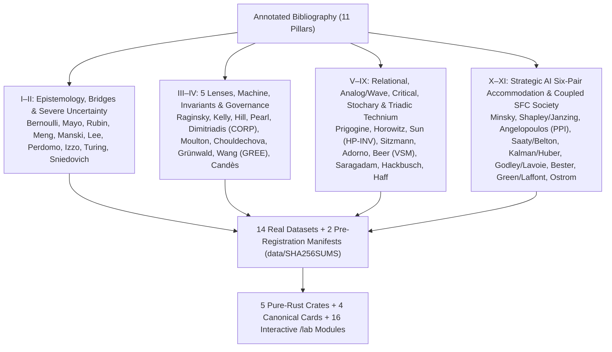

# Appendix C — Empirical Data Sources, Annotated Bibliography, and Honest Epistemic Ledger

## C.1 Provenance and Cryptographic Integrity of the 14 Empirical Datasets and the Sealed Pre-Registration Manifests

All **14 empirical CSV files** in `data/*.csv` were retrieved from public scientific repositories, including the Rdatasets archive (`github.com/vincentarelbundock/Rdatasets`, commit `1dcc2bf5f955cc1224a3e1307256e1fe86b68dae`), CRAN packages (`fitdistrplus`, `nycflights13`, `nycflights23`, `hflights`), NOAA HURDAT2, AEMO Victoria, Open Data Toronto, and the Federal Reserve Bank of Philadelphia (real-time vintages, converted from the publisher's workbook). Alongside those 14 datasets, [`data/SHA256SUMS`](../data/SHA256SUMS) seals two pre-registration manifests — [`data/preregistration/acceptance_registry.txt`](../data/preregistration/acceptance_registry.txt) (`3c3405ae9f38...`, at attempt counter $K = 6$) and [`data/preregistration/coupled_society_preregistration.yaml`](../data/preregistration/coupled_society_preregistration.yaml) (`c6e5e78abbe9...`, $K = 6$) — which lock the SHA-256 hashes of the **64 claim-defining Rust source files**, the **20 development seeds** (`2026..=2045`), and the **200 confirmation seeds** (`9_000_000..=9_000_199` for `critical`, `stocks`, `triad`, and `strategic`, plus the virgin block `9_000_200..=9_000_399` for `society`).

Every digest in `data/SHA256SUMS` is verified at runtime by `stochology-cli` and `scripts/verify.sh` before any laboratory or gate is approved:

| Sealed File (`data/`) | Upstream Scientific Source | Sample Size ($n$) & SHA-256 Prefix | Primary Protocol Audits & Couplers |
| --- | --- | --- | --- |
| **`nsw_experimental.csv`** | LaLonde (1986) / Dehejia & Wahba (1999), National Supported Work randomized trial (`causaldata::nsw_mixtape`) | $n = 445$ ($185$ treated, $260$ controls) · `72efd333a4b9...` | Bridge $L\_1 \to L\_2$ experimental benchmark for Meng's Identity, Manski `MNAR` bounds, Lee (2009) trimming bounds, and `EmpiricalStrategicAccommodationAudit` (`Lab 1`, `Lab 4`, `Lab 5`, `Lab 7`, `G8`). |
| **`cps_observational.csv`** | LaLonde (1986), Current Population Survey non-experimental comparison group (`causaldata::cps_mixtape`) | $n = 15\text{,}992$ observational workers · `e357e728bfef...` | Bridge $L\_1 \to L\_2$ selection correlation $\rho\_{R,Y} = +0.1334 \implies n\_{\mathrm{eff,Meng}} = 2\text{,}842.70$, `card_04` (`PublicInfrastructureCard04Audit`), `EmpiricalStrategicAccommodationAudit`, and `EmpiricalCoupledSocietyAudit` (`Lab 1`, `Lab 5`, `Lab 7`, `G3/G4`, `G8`). |
| **`bank_calls.csv`** | Weinberg, Brown & Stroud (2007), North American retail bank arrival windows (`fpp3::bank_calls`) | $n = 27\text{,}716$ 5-min windows across $164$ days · `6e430180c3fa...` | Bridge $L\_2 \to L\_3$ Jensen's Gap $\Delta\_J = +9.03 \times 10^6$ ($\approx 0.85\%$ of $f(\mathbb{E}[X])$), $\mathrm{CRPS}$, $\Phi\_2$ Moulton-Campbell $\mathrm{DEFF}(0.90) = 28.26 \implies n\_{\mathrm{eff}}(0.90) = 980.7$, `card_02`, and `EmpiricalStocharyCyberneticAudit` / `EmpiricalTriadicTechniumAudit` / `EmpiricalStrategicAccommodationAudit` / `EmpiricalCoupledSocietyAudit` (`Lab 1`, `Lab 4`, `Lab 5`, `Lab 7`, `G8`). |
| **`djia_1885_2023.csv`** | S&P Dow Jones Indices historical daily closes (`stevedata::DJIA`, 1885–2023) | $n = 37\text{,}930$ daily trading sessions · `3b9c0eea57eb...` | Lens 2 (Time) & Bridge $L\_3 \to L\_1$: Itô variance drain ($g\_{\text{time}} = 0.0468 < g\_{\text{ensemble}} = 0.0612$), empirical Kelly fraction $f^{\ast}\_{\mathrm{emp}} = 2.08 < f\_{\mathrm{Merton}} = 2.12$, Stackelberg $\theta\_{\mathrm{PO}}$ (`PerfGD`), `EmpiricalStocharyCyberneticAudit`, and `EmpiricalTriadicTechniumAudit` (`Lab 1`, `Lab 3`, `Lab 7`, `G8`). |
| **`danish_fire.csv`** | Copenhagen Reinsurance fire losses 1980–1990 (`fitdistrplus::danishuni`, McNeil 1997) | $n = 2\text{,}167$ claims (in millions of DKK) · `82373e6e9828...` | Lens 3 (Tail): Hill $\hat{\alpha} = 1.6009 \pm 0.1601$ (`FiniteMeanInfiniteVariance`), DEdH $\hat{\xi} = 0.538$, GPD-POT $\hat{\xi} = 0.483$, $q\_{99} = 26.04\text{M DKK}$, $\mathrm{ES}\_{0.99} = 58.59\text{M DKK}$, and all 5 multi-dataset couplers in `G8` (`Lab 3`, `Lab 7`, `G8`). |
| **`vic_elec.csv`** | Australian Energy Market Operator (AEMO) half-hourly electricity demand in Victoria (`fpp3::vic_elec`) | $n = 52\text{,}608$ half-hourly records · `21727117d26c...` | Lens 3 (Tail) & Ch. 13/21: Heatwave spikes ($q\_{99} = 6\text{,}981.5\text{ MW}$), `SIREN` wave-interference compression ($14\times$, $R^2 = 0.88$), PKU 24-bit `HP-INV` (`4.39e-16`), and Huber-Kalman vs. $L\_2$ Kalman tracking ($138.9\text{ MW}$ vs. $619.3\text{ MW}$ in `EmpiricalStrategicAccommodationAudit`, on the first 400 half-hourly values with a simulated $+4\text{,}500\text{ MW}$ glitch every 20 slots — measured series + simulated glitches; `Lab 3`, `Lab 7`, `G8`). |
| **`atlantic_storms.csv`** | NOAA National Hurricane Center HURDAT2 Atlantic tropical cyclone tracks (`dplyr::storms`) | $n = 20\text{,}778$ 6-hr synoptic track records · `f7c58accf747...` | Lenses 4 & 5, Gate `G6/G8`, and `card_01`: Nonlinear Hermite NILE/IRM invariance ($\hat{S}^{\ast} = [0]$, penalties `["0.0011", "0.1072"]`), `AuthenticModelForm`, an ICP-gated `SHAP` share of $1.00$ on $X\_0$ (`Storms_SHAP_p0=1.00`; fixed by ICP's acceptance of $X\_0$ and hard-coded linear coefficients, not an estimated attribution), and CORP-PAV / Murphy triptych (`Lab 3`, `Lab 5`, `Lab 7`, `G6`, `G8`). |
| **`toronto_arrests.csv`** | Open Data Toronto / Fox & Weisberg (`carData::Arrests`) police arrest records | $n = 5\text{,}226$ arrest records · `c6982b28e80b...` | Invariant $\Phi\_4$: Chouldechova's algebraic fairness trilemma ($\mathrm{FPR}\_A / \mathrm{FPR}\_B = 5.13\times$), KMR calibration gap ($0.0960$), and `EmpiricalCriticalRationalityAudit` (`Lab 4`, `Lab 7`, `G8`). |
| **`nyc_flights_2013.csv`** | Bureau of Transportation Statistics (BTS) NYC departures (`nycflights13`) | $n = 138\text{,}375$ flights · `651ae28c4b9a...` | `card_03` ($n\_{\mathrm{eff}}(0.90) = 1\text{,}364$), Bitemporal Clock + Canary, Covariate Drift source distribution, and 4 Label Shift estimators (`Lab 5`, `Lab 6`, `Lab 7`, `G7`). |
| **`nyc_flights_2023.csv`** | Bureau of Transportation Statistics (BTS) NYC departures (`nycflights23`) | $n = 132\text{,}649$ flights · `0c6562bd0ad8...` | Covariate Drift target (`ExTRA-WCP-T`, Lei & Candès bound $\ge 0.802$), Gibbs-Candès Online `ACI` ($89.1\%$ coverage), and 4 Label Shift estimators (`Lab 6`, `Lab 7`, `G7`). |
| **`nyc_flights_2013_h1.csv`** | BTS NYC 2013 first-half out-of-time schedule reserve | $n = 195\text{,}583$ rows · `7b119575c938...` | Out-of-time source reserve for `TemporalVault` calibration and H1 `ExTRA-WCP-T` drift transfer (`Lab 7`, `G7`). |
| **`nyc_flights_2023_h1.csv`** | BTS NYC 2023 first-half out-of-time schedule reserve | $n = 258\text{,}613$ rows · `950bc37d305a...` | Single-Opening `TemporalVault` (`OpenedApproved`, $\mathrm{BS} = 0.1783$), H1 Lei & Candès bound $\ge 0.828$, and `G7` GRAPA *e-process* rollback audit (`Lab 7`, `G7`). |
| **`houston_flights_2011.csv`** | BTS Houston (IAH/HOU) departures (`hflights`) | $n = 224\text{,}591$ rows · `42770fa6ad07...` | Out-of-domain geographic transfer audit (NYC $\to$ Houston Lei & Candès bound $\ge 0.693$, `Lab 7`). |
| **`rtdsm_routput_vintages.csv`** | Federal Reserve Bank of Philadelphia, Real-Time Data Set for Macroeconomists, `ROUTPUT` (real GNP/GDP) quarterly vintages (Croushore & Stark 2001), converted from `routputqvqd.xlsx` to long form | $n = 47\text{,}405$ vintage–quarter values ($244$ vintages, 1965Q4–2026Q3) · `e0703a4b3cb3...` | Pillar B (`RealTimeVintageAudit`, Ch. 21): $158$ real-time decisions 1985Q1–2024Q4, mean revision first → latest $+0.32$ pp, `--defect vintage_leak` |
| **`preregistration/acceptance_registry.txt`** | Stochology multi-seed pre-registration manifest ($\Phi\_3$, Prohibition 4) | $154$ lines ($K = 6$, $64$ source hashes, $74$ gated + $11$ discarded synthetic claims) · `3c3405ae9f38...` | Gate `G8` multi-seed acceptance across $20$ development seeds (`2026..=2045`) and $200$ confirmation seeds (`9_000_000..=9_000_199` and `9_000_200..=9_000_399`). |
| **`preregistration/coupled_society_preregistration.yaml`** | Pre-registration contract for `CoupledPublicPrivateSocietySynthesis` ($\Phi\_3$, $K = 6$) | YAML specification (`preregistration_hash = 82e6cf8431de...`) · `c6e5e78abbe9...` | Pre-registered `SfcFlowMatrix`, `H1a`, `H1b`, `H2`, and `EmpiricalCoupledSocietyAudit` evaluated on virgin confirmation block `9_000_200..=9_000_399` (`Lab 3`, `G8`). |

---

## C.2 Annotated Bibliography Across All 11 Thematic Pillars

### I. Epistemology, Induction, and Severe Testing
- **Barbosa, Lourenço da Fonseca — "Capiba" (1904–1997).** Cultural patron of the **CAPIBA Protocol** (*Calibrated, Anytime-valid, Performative-aware, Invariant, Bitemporal Auditing Protocol*, dedicated in `00-preface.md`).
- **Bernoulli, Jacob (1713).** *Ars Conjectandi*. Basel: Thurnisiorum. — Introduces *ars conjectandi sive stochastice*, the art of aiming conjectures under uncertainty.
- **Peirce, Charles Sanders (1878).** "Deduction, Induction, and Hypothesis." *Popular Science Monthly*, 13, 470–482. — Separates truth-preserving deduction from ampliative induction and abduction.
- **Popper, Karl (1959).** *The Logic of Scientific Discovery*. London: Hutchinson. — Formulates falsificationism and propensity probability.
- **Lakatos, Imre (1970).** "Falsification and the Methodology of Scientific Research Programmes." In *Criticism and the Growth of Knowledge*, Cambridge University Press. — Distinguishes progressive problemshifts (predicting novel testable facts) from degenerative patches.
- **Mayo, Deborah G. (2018).** *Statistical Inference as Severe Testing: How to Get Beyond the Statistics Wars*. Cambridge University Press. — Establishes the Severity Principle ($\Phi\_3$).
- **Simmons, Joseph P., Leif D. Nelson & Uri Simonsohn (2011).** "False-Positive Psychology: Undisclosed Flexibility in Data Collection and Analysis Allows Presenting Anything as Significant." *Psychological Science*, 22(11), 1359–1366.
- **Breznau, Nate et al. (2022).** "Observing Many Researchers Using the Same Data and Hypothesis Reveals a Hidden Universe of Uncertainty." *Proceedings of the National Academy of Sciences (PNAS)*, 119(44), e2203150119.

### II. Bridge Mechanics, Missingness, Performativity, and Severe Uncertainty
- **Rubin, Donald B. (1976).** "Inference and Missing Data." *Biometrika*, 63(3), 581–592; & **Rubin, Donald B. (1987).** *Multiple Imputation for Nonresponse in Surveys*. Wiley. — Formalizes `MCAR`, `MAR`, and `MNAR` and the total variance identity $T\_m = \bar{U}\_m + (1 + m^{-1})B\_m$ (`RubinMultipleImputationAudit`).
- **Meng, Xiao-Li (2018).** "Statistical Paradises and Paradoxes in Big Data (I): Law of Large Populations, Big Data Paradox, and the 2016 US Presidential Election." *Annals of Applied Statistics*, 12(2), 685–726. — Derives Meng's Identity ($\bar{Y}\_n - \bar{Y}\_N = \rho\_{R,Y}\sqrt{\frac{N-n}{n}}\sigma\_Y$).
- **Manski, Charles F. (1990).** "Nonparametric Bounds on Treatment Effects." *American Economic Review*, 80(2), 319–323. — Establishes worst-case identification bounds under `MNAR`.
- **Lee, David S. (2009).** "Training, Wages, and Sample Selection: Estimating Sharp Bounds on Treatment Effects." *Review of Economic Studies*, 76(3), 1071–1102. — Derives sharp quantile-trimming bounds under monotonic differential attrition (`ManskiBounds::lee_trimming_bounds`).
- **Perdomo, Juan C., Tijana Zrnic, Celestine Mendler-Dünner & Moritz Hardt (2020).** "Performative Prediction." *Proceedings of the 37th International Conference on Machine Learning (ICML)*, PMLR 119:7599–7609. — Formalizes Performative Risk, Performative Stability ($\theta\_{\mathrm{PS}}$), Performative Optimality ($\theta\_{\mathrm{PO}}$), and RRM contraction.
- **Izzo, Zachary, Lexing Ying & James Zou (2021).** "How to Learn when Data Reacts to Your Model: Performative Gradient Descent." *Proceedings of the 38th International Conference on Machine Learning (ICML)*, PMLR 139:4631–4640. — Introduces `PerfGD` converging to the Stackelberg optimum $\theta\_{\mathrm{PO}}$.
- **Manheim, David & Scott Garrabrant (2018).** "Categorizing Variants of Goodhart's Law." *arXiv:1803.04585*. — Formalizes the 4 variants of Goodhart's Law (`Regressional`, `Extremal`, `Causal`, `Adversarial` in `GoodhartTaxonomyAudit`).
- **Steele, Guy L. Jr., Doug Lea & Christine H. Flood (2014).** "Fast Splittable Pseudorandom Number Generators." *Proceedings of OOPSLA 2014*, pp. 453–472; & **Steele, Guy L. Jr. & Sebastiano Vigna (2021).** "LXM: Better Splittable Pseudorandom Number Generators (and Almost as Fast)." *Proceedings of OOPSLA 2021*, Article 148. — Establishes lock-free `.split(stream_id)` substream derivation for fork-join Monte Carlo trees (`SplitMix64::split`).
- **Turing, Alan M. (1941 / 1942) & Good, Irving John (1950 / 1979).** *Probability and the Weighing of Evidence* (London: Charles Griffin, 1950) & "Studies in the History of Probability and Statistics. XXXVII: A. M. Turing's Statistical Work in World War II." *Biometrika*, 66(2), 393–396. — Introduces the additive **deciban** weight of evidence $W(H:E) = 10\log\_{10}\frac{P(E\mid H)}{P(E\mid \neg H)}$ used in `AlertFatigueAudit` and `MultimodalCorrelatedFusionAudit`.
- **Wong, Andrew et al. (2021).** "External Validation of a Widely Implemented Proprietary Sepsis Prediction Model in Hospitalized Patients." *JAMA Internal Medicine*, 181(8), 1065–1070. — Documents the external validation failure of the Epic Sepsis Model ($\mathrm{AUC}=0.63, \mathrm{PPV}=0.12$, $88\%$ of the Epic Sepsis Model's alerts false), motivating `AlertFatigueAudit`.
- **Kennedy, Marc C. & Anthony O'Hagan (2001).** "Bayesian Calibration of Computer Models." *Journal of the Royal Statistical Society: Series B*, 63(3), 425–464. — Introduces Gaussian Process structural discrepancy $\delta(x) \sim \mathcal{GP}(m(x), k(x, x'))$.
- **Brynjarsdóttir, Jenný & Anthony O'Hagan (2014).** "Learning About Physical Parameters: The Importance of Model Discrepancy." *Inverse Problems*, 30(11), 114007. — Demonstrates boundary-anchored GP kernels for physical parameter identifiability.
- **Ben-Haim, Yakov (2006).** *Info-Gap Decision Theory: Decisions Under Severe Uncertainty* (2nd ed.). Academic Press.
- **Sniedovich, Moshe (2012).** "Black Swans, New Nostradamuses, Voodoo Decision Theories, and the Science of Decision Making in the Face of Severe Uncertainty." *International Transactions in Operational Research*, 19(1–2), 253–281. — Proves the local nature of Info-Gap and the necessity of Wald's global Maximin safeguard across "No-Man's Land."
- **Hardt, Moritz, Meena Jagadeesan & Celestine Mendler-Dünner (2022).** "Performative Power." *Advances in Neural Information Processing Systems 35* (NeurIPS 2022). — Defines performative power as how far a firm's algorithmic action can move the population it acts on, and argues for measuring it by experiment; `PerformativePowerAudit` follows that idea, while its lower bound rests on the $\varepsilon$-sensitivity of Perdomo et al. (2020) (Ch. 19, informative).

### III. The Five Transversal Lenses and the Almost-Perfect Machine
- **Blahut, Richard E. (1972).** "Computation of Channel Capacity and Rate-Distortion Functions." *IEEE Transactions on Information Theory*, 18(4), 460–473; & **Arimoto, Suguru (1972).** "An Algorithm for Computing the Capacity of Arbitrary Discrete Memoryless Channels." *IEEE Transactions on Information Theory*, 18(1), 14–20.
- **Raginsky, Maxim (2016).** "Strong Data Processing Inequalities and $\Phi$-Sobolev Inequalities for Discrete Channels." *IEEE Transactions on Information Theory*, 62(6), 3355–3389.
- **Peters, Ole (2019).** "The Ergodicity Problem in Economics." *Nature Physics*, 15(12), 1216–1221.
- **Kelly, John L. Jr. (1956).** "A New Interpretation of Information Rate." *Bell System Technical Journal*, 35(4), 917–926.
- **Hill, Bruce M. (1975).** "A Simple General Approach to Inference About the Tail of a Distribution." *Annals of Statistics*, 3(5), 1163–1174.
- **Dekkers, Arnold L. M., John H. J. Einmahl & Laurens de Haan (1989).** "A Moment Estimator for the Index of an Extreme-Value Distribution." *Annals of Statistics*, 17(4), 1833–1855.
- **Pickands, James (1975).** "Statistical Inference Using Extreme Order Statistics." *Annals of Statistics*, 3(1), 119–131; & **Balkema, A. A. & Laurens de Haan (1974).** "Residual Life Time at Great Age." *Annals of Probability*, 2(5), 792–804.
- **Embrechts, Paul, Claudia Klüppelberg & Thomas Mikosch (1997).** *Modelling Extremal Events for Insurance and Finance*. Berlin: Springer.
- **Pearl, Judea (2009).** *Causality: Models, Reasoning, and Inference* (2nd ed.). Cambridge University Press; **Tian, Jin & Judea Pearl (2000).** "Probabilities of Causation: Bounds and Identification." *Annals of Mathematics and Artificial Intelligence*, 28(1–4), 287–313; & **Charig, C. R., D. R. Webb, S. R. Payne & J. E. Wickham (1986).** "Comparison of Treatment of Renal Calculi by Open Surgery, Percutaneous Nephrolithotomy, and Extracorporeal Shockwave Lithotripsy." *British Medical Journal (BMJ)*, 292(6524), 879–882. — Establishes `do`-calculus, the kidney-stone Simpson's Paradox benchmark (`SimpsonCausalParadoxAudit`), and sharp bounds on $\mathrm{PNS}$ (`PreMortemCounterfactualRootCauseAudit`).
- **Peters, Jonas, Peter Bühlmann & Nicolai Meinshausen (2016).** "Causal Inference by Using Invariant Prediction: Identification and Confidence Intervals." *Journal of the Royal Statistical Society: Series B*, 78(5), 947–1012.
- **Chow, Gregory C. (1960).** "Tests of Equality Between Sets of Coefficients in Two Linear Regressions." *Econometrica*, 28(3), 591–605.
- **Cinelli, Carlos & Chad Hazlett (2020).** "Making Sense of Sensitivity: Extending Omitted Variable Bias." *Journal of the Royal Statistical Society: Series B*, 82(1), 39–67.
- **Richardson, David S. (2000).** "Skill and Relative Economic Value of the ECMWF Ensemble Prediction System." *Quarterly Journal of the Royal Meteorological Society*, 126(563), 649–667.
- **Dimitriadis, Timo, Tilmann Gneiting & Alexander I. Jordan (2021).** "Stable Reliability Diagrams for Probabilistic Classifiers." *Proceedings of the National Academy of Sciences (PNAS)*, 118(8), e2016191118; & **Ehm, Werner, Tilmann Gneiting, Alexander Jordan & Fabian Krüger (2016).** "Of Quantiles and Expectiles: Consistent Scoring Functions, Choquet Representations and Forecast Rankings." *JRSS: Series B*, 78(3), 505–562. — Establishes the isotonic **CORP-Murphy** decomposition via Pool-Adjacent-Violators (PAV) and the extremal Murphy diagram (`CorpPavDecomposition`, `MurphyDiagram`, `CorpRocMurphyTriptych`).
- **Barron, Andrew R. (1993).** "Universal Approximation Bounds for Superpositions of a Sigmoidal Function." *IEEE Transactions on Information Theory*, 39(3), 930–945.
- **Telgarsky, Matus (2016).** "Benefits of Depth in Neural Networks." *Proceedings of the 29th Conference on Learning Theory (COLT)*, PMLR 49:1517–1539.
- **Arnold, Sebastian, Eva-Maria Walz, Johanna Ziegel & Tilmann Gneiting (2024).** "Decompositions of the Mean Continuous Ranked Probability Score." *Electronic Journal of Statistics*, 18(2), 4992–5044. — Decomposes the mean CRPS into miscalibration, discrimination, and uncertainty; `CorpCrpsDecomposition` implements the threshold-wise CORP variant (Ch. 15, informative).
- **Rothenhäusler, Dominik, Nicolai Meinshausen, Peter Bühlmann & Jonas Peters (2021).** "Anchor Regression: Heterogeneous Data Meet Causality." *Journal of the Royal Statistical Society Series B*, 83(2), 215–246. — Interpolates between OLS and instrumental variables to protect against shifts along exogenous anchors; anchor stability diagnoses confounding (`AnchorRegressionAudit`, Ch. 9, informative).

### IV. Cluster Invariants, Fairness, Funnel, Anytime-Valid Martingales, and Drift Governance
- **Hurlbert, Stuart H. (1984).** "Pseudoreplication and the Design of Ecological Field Experiments." *Ecological Monographs*, 54(2), 187–211.
- **Moulton, Brent R. (1986).** "Random Group Effects and the Precision of Regression Estimates." *Journal of Econometrics*, 32(3), 385–397.
- **Chouldechova, Alexandra (2017).** "Fair Prediction with Disparate Impact: A Study of Bias in Recidivism Prediction Instruments." *Big Data*, 5(2), 153–163.
- **Kleinberg, Jon, Sendhil Mullainathan & Manish Raghavan (2017).** "Inherent Trade-Offs in the Fair Determination of Risk Scores." *Proceedings of the 8th Innovations in Theoretical Computer Science Conference (ITCS)*, LIPIcs 67:43:1–43:23.
- **Gigerenzer, Gerd & Ulrich Hoffrage (1995).** "How to Improve Bayesian Reasoning Without Instruction: Frequency Formats." *Psychological Review*, 102(4), 684–704.
- **Talts, Sean, Michael Betancourt, Daniel Simpson, Aki Vehtari & Andrew Gelman (2018).** "Validating Bayesian Inference Algorithms with Simulation-Based Calibration." *arXiv:1804.06788*; & **Oakley, Jeremy E. & Anthony O'Hagan (2019).** *SHELF: The Sheffield Elicitation Framework* (v4). University of Sheffield (`fit_shelf_beta_prior`).
- **Grünwald, Peter, Rianne de Heide & Wouter M. Koolen (2024).** "Safe Testing." *Journal of the Royal Statistical Society: Series B*, 86(5), 1091–1128; & **Waudby-Smith, Ian & Aaditya Ramdas (2024).** "Estimating Means of Bounded Random Variables by Betting." *JRSS: Series B*, 86(1), 1–27 (`EvidenceProcess::from_grapa_betting`, `EvidenceProcess::gro_betting`, `SaviConfidenceSequence`).
- **Wang, Ruodu, Qinyu Wang & Johanna F. Ziegel (2025).** "E-Backtesting." *Management Science*. — Establishes Generalized RERO E-backtesting (`GREE`) for model-free Value-at-Risk and Expected Shortfall e-processes (`VarEsEBacktest`).
- **Lei, Lihua & Emmanuel J. Candès (2021).** "Conformal Inference of Counterfactuals and Individual Treatment Effects." *Journal of the Royal Statistical Society: Series B*, 83(5), 911–938.
- **Gibbs, Isaac & Emmanuel Candès (2021).** "Adaptive Conformal Inference Under Distribution Shift." *Advances in Neural Information Processing Systems (NeurIPS)*, 34, 1660–1672.
- **Lipton, Zachary C., Yu-Xiang Wang & Alexander Smola (2018).** "Detecting and Correcting for Label Shift with Black Box Predictors." *Proceedings of ICML*, PMLR 80:3122–3130; & **Saerens, Marco, Patrice Latinne & Christine Decaestecker (2002).** "Adjusting the Outputs of a Classifier to New a Priori Probabilities: A Simple Procedure." *Neural Computation*, 14(1), 21–41 (`BBSE`, `MLLS/SLD`, `DFM`, `OTTER`).
- **Basel Committee on Banking Supervision (2019).** *Minimum Capital Requirements for Market Risk (FRTB — MAR33: Profit and Loss Attribution Test)*. Bank for International Settlements (`ProfitLossAttributionTest` & `PredeterminedChangeControlPlan`).
- **Wang, Ruodu & Aaditya Ramdas (2022).** "False Discovery Rate Control with E-Values." *Journal of the Royal Statistical Society Series B*, 84(3), 822–852. — The e-BH procedure: FDR control at $\alpha$ under arbitrary dependence among e-values (`EBhMultiplicityAudit`, Ch. 8, informative).
- **Benjamini, Yoav & Daniel Yekutieli (2001).** "The Control of the False Discovery Rate in Multiple Testing under Dependency." *The Annals of Statistics*, 29(4), 1165–1188. — The harmonic correction BH needs under arbitrary dependence, reported next to e-BH (informative).
- **Hébert-Johnson, Úrsula, Michael P. Kim, Omer Reingold & Guy N. Rothblum (2018).** "Multicalibration: Calibration for the (Computationally-Identifiable) Masses." *Proceedings of the 35th International Conference on Machine Learning*, PMLR 80, 1939–1948. — Calibration inside every identifiable subgroup (`MulticalibrationAudit`, Ch. 20, informative).
- **Croushore, Dean (2011).** "Frontiers of Real-Time Data Analysis." *Journal of Economic Literature*, 49(1), 72–100. — Why forecasts must be evaluated on the data vintages available at the time (`RealTimeVintageAudit`, Ch. 21, informative).

### V. Relational Ontology, Emergence, and Complex Systems
- **Nāgārjuna (c. 150 CE / trans. Jay L. Garfield, 1995).** *The Fundamental Wisdom of the Middle Way: Nāgārjuna's Mūlamadhyamakakārikā*. Oxford University Press.
- **Rovelli, Carlo (1996).** "Relational Quantum Mechanics." *International Journal of Theoretical Physics*, 35(8), 1637–1678.
- **Ladyman, James & Don Ross (2007).** *Every Thing Must Go: Metaphysics Naturalized*. Oxford University Press.
- **Prigogine, Ilya & René Lefever (1968).** "Symmetry Breaking Instabilities in Dissipative Systems. II." *Journal of Chemical Physics*, 48(4), 1695–1700.
- **Schnakenberg, Jürgen (1976).** "Network Theory of Microscopic and Macroscopic Behavior of Master Equation Systems." *Reviews of Modern Physics*, 48(4), 571–585.
- **Prigogine, Ilya & Isabelle Stengers (1984).** *Order Out of Chaos: Man's New Dialogue with Nature*. Bantam Books.
- **Maturana, Humberto R. & Francisco J. Varela (1980).** *Autopoiesis and Cognition: The Realization of the Living*. D. Reidel.
- **Anderson, Philip W. (1972).** "More Is Different." *Science*, 177(4047), 393–396.
- **Schelling, Thomas C. (1971).** "Dynamic Models of Segregation." *Journal of Mathematical Sociology*, 1(2), 143–186.
- **Elias, Norbert (1939 / 2000).** *The Civilizing Process: Sociogenetic and Psychogenetic Investigations*. Blackwell.
- **Lewontin, Richard C. (2000).** *The Triple Helix: Gene, Organism, and Environment*. Harvard University Press.
- **Watson, Andrew J. & James E. Lovelock (1983).** "Biological Homeostasis of the Global Environment: The Parable of Daisyworld." *Tellus B*, 35(4), 284–289.
- **Mirowski, Philip (1989).** *More Heat than Light: Economics as Social Physics, Physics as Nature's Economics*. Cambridge University Press.

### VI. Physical, Analog, and Wave-Interference Computing
- **Horowitz, Mark (2014).** "1.1 Computing's Energy Problem (and What We Can Do About It)." *2014 IEEE International Solid-State Circuits Conference Digest of Technical Papers (ISSCC)*, pp. 10–14. — Informative literature constant: quantifies the 45nm CMOS energy hierarchy ($640\text{ pJ}$ off-chip DRAM read vs. $0.9\text{ pJ}$ FP32 add $= 711.11\times$; $6400\times$ vs. $0.1\text{ pJ}$ Int32 add).
- **Shumailov, Ilia, Zakhar Shumaylov, Yiren Zhao, Nicolas Papernot, Ross Anderson & Yarin Gal (2024).** "AI Models Collapse When Trained on Recursively Generated Data." *Nature*, 631, 755–759. — Proves generational variance collapse and tail loss under recursive synthetic training (`SyntheticDataPolicy::Replace`).
- **Villalobos, Pablo et al. (2024).** "Will We Run Out of Data? Limits of LLM Scaling Based on Human-Generated Data." *Proceedings of the 41st International Conference on Machine Learning (ICML)* / Epoch AI. — Informative literature projection ($300\text{T}$ human public text stock).
- **Hasani, Ramin, Mathias Lechner, Alexander Amini, Daniela Rus & Radu Grosu (2021).** "Liquid Time-Constant Networks." *Proceedings of the AAAI Conference on Artificial Intelligence*, 35(9), 7657–7666.
- **Sitzmann, Vincent, Julien N. P. Martel, Alexander W. Bergman, David B. Lindell & Gordon Wetzstein (2020).** "Implicit Neural Representations with Periodic Activation Functions (`SIREN`)." *Advances in Neural Information Processing Systems (NeurIPS)*, 33, 7462–7473. — Establishes $\sin(\omega\_0 Wx + b)$ networks with closed-form infinitely differentiable wave derivatives ($\nabla^2 u + k^2 u = s(x)$).
- **Hughes, Tyler W., Ian A. D. Williamson, Momchil Minkov & Shanhui Fan (2019).** "Wave Physics as an Analog Recurrent Neural Network." *Science Advances*, 5(12), eaay6946. — Demonstrates direct correspondence between the damped nonlinear wave PDE ($\partial\_t^2 u + \gamma \partial\_t u = c^2(x,u)\partial\_x^2 u + f$) and a Recurrent Neural Network, plus adjoint wave-field gradients.
- **Xu, Zhihao, Tiankuang Zhou, Muzhou Ma, ChenChen Deng, Qionghai Dai & Lu Fang (2023/2024).** "Large-Scale Photonic Chiplet Taichi / ACCEL All-Analog Photoelectronic Chip for High-Speed Vision." *Nature*, 623, 48–55 (*ACCEL*, 2023) & *Science*, 384(6692), 202–209 (*Taichi*, 2024). — Informative literature figures.
- **Zuo, P., Z. Sun et al. (Peking University, 2025).** "High-Precision Analog Computing via Closed-Loop Low-Precision RRAM Inversion and Bit-Sliced Iterative Refinement (`HP-INV`)." *Nature Electronics*, October 2025. — Demonstrates 24-bit FP32-equivalent accuracy ($< 10^{-7}$ relative error) on physical 3-bit RRAM chips via closed-loop `LP-INV` preconditioning and bit-sliced `HP-MVM`. Source of the figures cited in Chapters 13 and 18: operation at $7\text{ W}$ versus a $700\text{ W}$ Nvidia H100 (a reported $100\times$ lower system power) and a reported $1\text{,}000\times$ speedup — literature figures, informative, not computed by this repository (the repository's own `HP-INV` simulation reports only the relative residual $8.70 \times 10^{-12}$).
- **Alia, Ferran et al. (2024/2025).** Noise-Aware Training (`NAT`) and the physical analog conductance noise threshold cliff in resistive crossbar arrays. — Informative literature curve transcribed in `analog/` and `critical/`.
- **Zheng, Jieyu & Markus Meister (2024).** "The Unbearable Slowness of Being: Why Do We Live at 10 Bits/s?" *Neuron*, 113(2), 192–204. — Quantifies the $1.6\text{ Gb/s} \to 10\text{ bit/s}$ ($1.6 \times 10^8 : 1$) human sensory information-compression funnel.
- **Smirnova, Lena, Brian S. Caffo, David H. Gracias et al. (2023).** "Organoid Intelligence (OI): The New Frontier in Biocomputing and Intelligence-in-a-Dish." *Frontiers in Science*, 1, 1017235.
- **Raul, Gibram (2026).** *Computação Analógica, Aprendizado por Interferência de Ondas e Ancoragem Neuro-Simbólica na Superação da Barreira de von Neumann.*

### VII. Stochary-Conjectural Synthesis, Supply-Chain Physics, and Cybernetic Governance (VSM & PATE)
- **Aristotle (c. 340 BCE).** *Nicomachean Ethics* (1104a) & *Rhetoric* (1360b); **Cicero (45 BCE).** *De Finibus Bonorum et Malorum* (3.22); & **Alexander of Aphrodisias (c. 200 CE).** *Quaestiones* (2.16). — Classical sources for the *technai stochastikai* and the distinction between internal *telos* (*facere omnia quae possit ut conliniet*) and exogenous *skopos*.
- **Taleb, Nassim Nicholas & Raphael Douady (2013).** "Mathematical Definition, Mapping, and Detection of (Anti)Fragility." *Quantitative Finance*, 13(11), 1677–1689. — Formalizes Tail Vega convexity $H(x,\Delta) = \frac{1}{2}[f(x+\Delta)+f(x-\Delta)] - f(x)$.
- **Meadows, Donella H. (1999).** *Leverage Points: Places to Intervene in a System*. The Sustainability Institute. — Establishes stabilizing buffers and system structure/paradigms as primary leverage points.
- **Dierickx, Ingemar & Karel Cool (1989).** "Asset Stock Accumulation and Sustainability of Competitive Advantage." *Management Science*, 35(12), 1504–1511. — Formalizes the 5 laws of non-tradeable asset stock accumulation (time compression diseconomies, asset mass efficiency, interconnectedness, erosion, and causal ambiguity).
- **Powell, Warren B. (2022).** *Reinforcement Learning and Stochastic Optimization: A Unified Framework for Sequential Decisions*. Wiley. — Establishes the 4 universal policy meta-classes (`PFA`, `CFA`, `VFA`, `DLA`).
- **Friston, Karl et al. (2015).** "Active Inference and Epistemic Value." *Cognitive Neuroscience*, 6(4), 187–214; & **Parr, Thomas, Giovanni Pezzulo & Karl J. Friston (2022).** *Active Inference: The Free Energy Principle in Mind, Brain, and Behavior*. MIT Press. — Formalizes Variational Free Energy (computed in `stocks/`) and Expected Free Energy $G(\pi)$ (cited as informative literature while `stocks/` computes a simulated preposterior value-of-information check).
- **Little, John D. C. (1961).** "A Proof for the Queuing Formula: $L = \lambda W$." *Operations Research*, 9(3), 383–387; **Kingman, J. F. C. (1961).** "The Single Server Queue in Heavy Traffic." *Mathematical Proceedings of the Cambridge Philosophical Society*, 57(4), 902–904; & **Hopp, Wallace J. & Mark L. Spearman (2011).** *Factory Physics* (3rd ed.). Waveland Press. — Derives the VUT utilization cliff and the triad of inventory, capacity, and time buffers.
- **Sterman, John D. (1989).** "Modeling Managerial Behavior: Misperceptions of Feedback in a Dynamic Decision Making Experiment." *Management Science*, 35(3), 321–339; & **Lee, Hau L., V. Padmanabhan & Seungjin Whang (1997).** "Information Distortion in a Supply Chain: The Bullwhip Effect." *Management Science*, 43(4), 546–558. — Proves how supply-line ($SL\_t$) underweighting and structural forecast/batching mechanisms amplify variance upstream.
- **Scarf, Herbert (1960).** "The Optimality of $(S, s)$ Policies in the Dynamic Inventory Problem." In *Mathematical Methods in the Social Sciences*, Stanford University Press; **Clark, Andrew J. & Herbert Scarf (1960).** "Optimal Policies for a Multi-Echelon Inventory Problem." *Management Science*, 6(4), 475–490; & **Graves, Stephen C. & Sean P. Willems (2000).** "Optimizing Strategic Safety Stock Placement in Supply Chains." *Manufacturing & Service Operations Management*, 2(1), 68–83. — Establishes $K$-convexity, echelon stock decomposition, and Guaranteed-Service Model (`GSM`) strategic decoupling points.
- **Eppen, Gary D. (1979).** "Effects of Centralization on Expected Costs in a Multi-Location Newsboy Problem." *Management Science*, 25(5), 498–501; & **Allon, Gad & Jan A. Van Mieghem (2010).** "Global Dual Sourcing: Tailored Base-Surge Allocation to Near- and Offshore Production." *Management Science*, 56(1), 110–124. — Formalizes the Square-Root Law of risk pooling (and its breakdown under correlated tails) and frequency-domain Tailored Base-Surge (`TBS`) dual sourcing.
- **Simchi-Levi, David, William Schmidt & Yehua Wei (2014).** "From Superstorms to Factory Fires: Managing Unpredictable Supply-Chain Disruptions." *Harvard Business Review*, 92(1–2), 96–101; **Simchi-Levi, David et al. (2015).** *Interfaces*, 45(5), 375–390; & **Ivanov, Dmitry (2020/2022).** "Viable Supply Chain Model: Integrating Agility, Resilience and Sustainability Perspectives." *Annals of Operations Research*, 319, 1411–1431. — Introduces $\mathrm{TTS}$, $\mathrm{TTR}$, $\mathrm{REI}$, the structural *Ripple Effect*, and the *Viable Supply Chain (`VSC`)*.
- **Rockafellar, R. Tyrrell & Stanislav Uryasev (2000).** "Optimization of Conditional Value-at-Risk." *Journal of Risk*, 2(3), 21–41; & **Mohajerin Esfahani, Peyman & Daniel Kuhn (2018).** "Data-Driven Distributionally Robust Optimization Using the Wasserstein Metric: Performance Guarantees and Tractable Reformulations." *Mathematical Programming*, 171(1–2), 115–166. — Establishes convex $\beta$-CVaR and Wasserstein DRO (`WDRO`) certificates against the Optimizer's Curse.
- **Ashby, W. Ross (1956).** *An Introduction to Cybernetics*. Chapman & Hall; **Conant, Roger C. & W. Ross Ashby (1970).** "Every Good Regulator of a System Must Be a Model of That System." *International Journal of Systems Science*, 1(2), 89–97; & **Beer, Stafford (1972/1981).** *Brain of the Firm* (2nd ed.). Wiley. — Establishes the Law of Requisite Variety, the Good Regulator Theorem, and the Viable System Model (`VSM` S1–S5, `S3*`, and Algedonic Channel).
- **Kahneman, Daniel, Olivier Sibony & Cass R. Sunstein (2021).** *Noise: A Flaw in Human Judgment*. Little, Brown Spark. — Decomposes judgment noise into level, pattern, and occasion noise and establishes decision hygiene protocols.

### VIII. Empirical Dataset Primary Sources
- **LaLonde, Robert J. (1986).** "Evaluating the Econometric Evaluations of Training Programs with Experimental Data." *American Economic Review*, 76(4), 604–620.
- **Dehejia, Rajeev H. & Sadek Wahba (1999).** "Causal Effects in Nonexperimental Studies: Reevaluating the Evaluation of Training Programs." *Journal of the American Statistical Association*, 94(448), 1053–1062.
- **Weinberg, Jonathan, Lawrence D. Brown & Jonathan R. Stroud (2007).** "Bayesian Forecasting of an Inhomogeneous Poisson Process With Applications to Call Center Data." *Journal of the American Statistical Association*, 102(480), 1185–1198.
- **McNeil, Alexander J. (1997).** "Estimating the Tails of Loss Severity Distributions Using Extreme Value Theory." *ASTIN Bulletin*, 27(1), 117–137.
- **Fox, John & Sanford Weisberg (2019).** *An R Companion to Applied Regression* (3rd ed.). SAGE (`carData::Arrests`, Open Data Toronto).
- **Wickham, Hadley (2013 / 2023).** `nycflights13`, `nycflights23`, and `hflights` R data packages (US Bureau of Transportation Statistics On-Time Performance records).
- **Croushore, Dean & Tom Stark (2001).** "A Real-Time Data Set for Macroeconomists." *Journal of Econometrics*, 105(1), 111–130. — Primary source of the Philadelphia Fed real-time vintages in `rtdsm_routput_vintages.csv`.

### IX. Critical Theory, Triadic Synthesis ($\mathbb{C} \times \text{Fractals} \times \mathbb{T}^d$), and Technosphere Ontology
- **Horkheimer, Max & Theodor W. Adorno (1944 / 1947).** *Dialectic of Enlightenment* (*Dialektik der Aufklärung*); & **Adorno, Theodor W. (1966).** *Negative Dialectics* (*Negative Dialektik*). Frankfurt am Main: Suhrkamp. — Critiques positivist identity thinking and the liquidation of the *Non-Identical* ($\Delta\_{\text{Nichtidentische}}$).
- **Marcuse, Herbert (1964).** *One-Dimensional Man*. Beacon Press; **Rouvroy, Antoinette & Thomas Berns (2013).** "Gouvernementalité algorithmique et perspectives d'émancipation." *Réseaux*, 177(1), 163–196; & **Bender, Emily M., Timnit Gebru, Angelina McMillan-Major & Shmargaret Shmitchell (2021).** "On the Dangers of Stochastic Parrots: Can Language Models Be Too Big?" *Proceedings of FAccT 2021*, pp. 610–623. — Analyzes operational closure, preemptive algorithmic governmentality, and next-token surface mimicry $P(w\_t \mid w\_{1:t-1})$ (`CriticalStochasticRationalitySynthesis`).
- **Saragadam, Vishwanath, Daniel LeJeune, Jasper Tan, Guha Balakrishnan, Ashok Veeraraghavan & Richard G. Baraniuk (2023).** "`WIRE`: Wavelet Implicit Neural Representations." *Proceedings of IEEE/CVF CVPR 2023*, pp. 18507–18516. — Introduces continuous complex Gabor wavelet activations $\psi(z) = e^{i\omega\_0 z} e^{-|s\_0 z|^2}$ on the Helmholtz PDE.
- **Hackbusch, Wolfgang (2015).** *Hierarchical Matrices: Algorithms and Analysis*. Berlin: Springer. — Establishes $\eta$-admissible tree-structured low-rank approximations ($\mathcal{H}$-Matrices).
- **Montroll, Elliott W. & George H. Weiss (1965).** "Random Walks on Lattices. II." *Journal of Mathematical Physics*, 6(2), 167–181; & **Roth, Ron M. (2020).** "Analog Error-Correcting Codes." *IEEE Transactions on Information Theory*, 66(7), 4075–4088. — Formalizes heavy-tailed continuous-time random walks (`CTRW`) and analog $m$-height error-correcting codes.
- **Mandelbrot, Benoit B., Adlai Fisher & Laurent Calvet (1997).** "A Multifractal Model of Asset Returns (`MMAR`)." Cowles Foundation Discussion Paper No. 1164; & **Gerstgrasser, Matthias et al. (2024).** "Is Model Collapse Inevitable? Breaking the Curse of Recursion by Accumulating Real and Synthetic Data." *Proceedings of ICML 2024*. — Formalizes multifractal cascades and the $\pi^2/6$ Basel bound for data accumulation (`GerstgrasserAccumulateAudit`).
- **Garg, Saurabh, Yifan Wu, Sivaraman Balakrishnan & Zachary C. Lipton (2020).** "A Unified View of Label Shift Estimation." *Advances in NeurIPS*, 33, 3290–3300. — Analyzes Maximum Likelihood Label Shift with Bias-Corrected Temperature Scaling (`MLLS+BCTS`).
- **Feudel, Ulrike, Sergey Kuznetsov & Arkady Pikovsky (2006).** *Strange Nonchaotic Attractors: Dynamics Between Order and Chaos*. World Scientific; **Perea, Jose A. (2018).** "Topological Time Series Analysis." *Notices of the AMS*, 66(5), 686–694; & **Plate, Tony A. (1995).** "Holographic Reduced Representations." *IEEE Transactions on Neural Networks*, 6(3), 623–641. — Establishes quasiperiodically forced Strange Nonchaotic Attractors (`SNA`, $\lambda < 0, \mu > 0$), persistent cohomology circular coordinates, and Fourier Holographic Reduced Representations (`FHRR` / `GC-VSA` in `triad/`).
- **Kelly, Kevin (2010).** *What Technology Wants*. Viking Press; **Arthur, W. Brian (2009).** *The Nature of Technology: What It Is and How It Evolves*. Free Press; & **Haff, Peter K. (2014).** "Humans and Technology in the Anthropocene: Six Rules." *The Anthropocene Review*, 1(2), 126–136. — Formalizes the *Technium*, combinatorial autopoiesis, and the Six Rules of the Technosphere across Strata I–III.

### X. Strategic AI Six-Pair Accommodation, Causal XAI, Prediction-Powered Inference, Multi-Criteria Decision, Robust Control, and Statutory Governance
- **Minsky, Marvin & Seymour Papert (1969).** *Perceptrons: An Introduction to Computational Geometry*. MIT Press; & **Minsky, Marvin (1986).** *The Society of Mind*. Simon & Schuster. — Proves the affine impossibility of single-layer perceptrons on non-linearly separable predicates (`XOR`) and motivates heterogeneous agent ensembles over homogeneous monocultures (`MinskyPapertGeometrySocietyOfMindAudit`).
- **Shapley, Lloyd S. (1953).** "A Value for $n$-Person Games." In *Contributions to the Theory of Games II*, Princeton University Press, pp. 307–317; **Lundberg, Scott M. & Su-In Lee (2017).** "A Unified Approach to Interpreting Model Predictions (`SHAP`)." *Advances in NeurIPS*, 30, 4765–4774; & **Janzing, Dominik, Lenon Minorics & Patrick Blöbaum (2020).** "Feature Relevance Quantification in Explainable AI: A Causal Problem." *Proceedings of AISTATS*, PMLR 108:2907–2916. — Establishes the exact Shapley efficiency identity $\sum\_j \phi\_j = f(x) - \mathbb{E}[f(X)]$ and separates observational conditional `SHAP` (which leaks proxy credit under collinearity) from interventional `do`-Shapley (`ShapleyCausalAudit`).
- **Jones, Donald R., Matthias Schonlau & William J. Welch (1998).** "Efficient Global Optimization of Expensive Black-Box Functions." *Journal of Global Optimization*, 13(4), 455–492. — Establishes Gaussian Process Expected Improvement (`EI`) for sample-efficient Bayesian Optimization (literature context; `ShapleyCausalRubinMiDoeAudit` computes only a Kennedy-O'Hagan GP posterior-std ratio between an unexplored and an anchored point, `GP_EI_ratio=50.2`, and runs no optimization).
- **Angelopoulos, Anastasios N., Stephen Bates, Clara Fannjiang, Michael I. Jordan & Tijana Zrnic (2023).** "Prediction-Powered Inference (`PPI`)." *Science*, 382(6671), 669–674; & **Rogan, Walter J. & Beth Gladen (1978).** "Estimating Prevalence from the Results of a Screening Test." *American Journal of Epidemiology*, 107(1), 71–76. — Debiases automated `LLM-as-a-Judge` evaluations using a gold human-labeled sample ($\hat{\theta}\_{\mathrm{PPI}} = \hat{\mu}\_f + (\bar{Y}\_{\text{gold}} - \bar{f}\_{\text{gold}})$ in `LlmJudgePpiRectifier`, with prospective sizing in `prospective_ppi_gold_sample_size` and `ppi_effective_sample_size_multiplier`).
- **Dettmers, Tim, Mike Lewis, Younes Belkada & Luke Zettlemoyer (2022).** "`LLM.int8()`: 8-bit Matrix Multiplication for Transformers at Scale." *Advances in NeurIPS*, 35, 30318–30332; **Hu, Edward J. et al. (2022).** "`LoRA`: Low-Rank Adaptation of Large Language Models." *ICLR 2022*; & **Eckart, Carl & Gale Young (1936).** "The Approximation of One Matrix by Another of Lower Rank." *Psychometrika*, 1(3), 211–218. — Grounds outlier-aware mixed-precision `INT4` quantization (`GenerativeRagLlmJudgeCompressionAudit`) and low-rank spectral truncation (`CloudLocalLoraArchitectureAudit`).
- **Liu, Nelson F., Kevin Lin, John Hewitt, Ashwin Paranjape, Michele Bevilacqua, Fabio Petroni & Percy Liang (2024).** "Lost in the Middle: How Language Models Use Long Contexts." *Transactions of the Association for Computational Linguistics (TACL)*, 12, 157–173. — Motivates `LongContextDpiDilutionAudit`, quantifying softmax attention dilution across 100-page unpruned contexts versus Filter 2 Markov Blanket pruning.
- **Barabási, Albert-László & Réka Albert (1999).** "Emergence of Scaling in Random Networks." *Science*, 286(5439), 509–512; **Pastor-Satorras, Romualdo & Alessandro Vespignani (2001).** "Epidemic Spreading in Scale-Free Networks." *Physical Review Letters*, 86(14), 3200–3203; & **Centola, Damon (2018).** *How Behavior Spreads: The Science of Complex Contagions*. Princeton University Press. — Establishes the vanishing epidemic threshold $\lambda\_c = \frac{\langle k\rangle}{\langle k^2\rangle}$ on scale-free networks and multi-reinforcement complex contagion (literature context). `ComplexNetworkHubContagionAudit` does not build Barabási-Albert or Erdős-Rényi graphs and runs no immunization: it checks degree heterogeneity $\langle k^2\rangle/\langle k\rangle > \langle k\rangle$ on a 12-node hub-and-spoke graph, simulates a hub delay cascade with and without buffer slack, and runs Centola threshold-2 contagion on a 20-node clustered ring.
- **Saaty, Thomas L. (1980).** *The Analytic Hierarchy Process*. McGraw-Hill; & **Belton, Valerie & Tony Gear (1983).** "On a Short-Coming of Saaty's Method of Analytic Hierarchies." *Omega*, 11(3), 228–230. — Establishes pairwise reciprocal eigenvalue consistency ($\lambda\_{\max} \ge n, \mathrm{CR} = \mathrm{CI}/\mathrm{RI}$) and proves that unanchored column normalization suffers **rank reversal** when a copy alternative is introduced (`SaatyAhpRankReversalAudit`, which checks $\lambda\_{\max} = 3$ and $\mathrm{CI} = 0$ on an exactly consistent matrix; no random index or $\mathrm{CR}$ is computed).
- **Klein, Gary (2007).** "Performing a Project Premortem." *Harvard Business Review*, 85(9), 18–19. — Motivates prospective failure-mode stress-testing in `PreMortemCounterfactualRootCauseAudit`.
- **Kalman, Rudolf E. (1960).** "A New Approach to Linear Filtering and Prediction Problems." *Transactions of the ASME — Journal of Basic Engineering*, 82(Series D), 35–45; **Bucy, Richard S. & Peter D. Joseph (1968).** *Filtering for Stochastic Processes with Applications to Guidance*. Interscience; & **Huber, Peter J. (1964).** "Robust Estimation of a Location Parameter." *Annals of Mathematical Statistics*, 35(1), 73–101. — Establishes the Joseph-form positive-definite covariance update and Huber innovation clipping against breakdown of certainty equivalence under heavy-tailed sensor glitches (`RobustKalmanControlAudit`).
- **European Union (2024).** *Regulation (EU) 2024/1689 of the European Parliament and of the Council of 13 June 2024 laying down harmonised rules on artificial intelligence (EU AI Act)*, Official Journal of the European Union, L 2024/1689 (Articles 9, 10, 14, and 15); & **Federative Republic of Brazil (2018).** *Lei Geral de Proteção de Dados Pessoais (LGPD — Lei nº 13.709, de 14 de agosto de 2018)*, Articles 6(III) and 20 (`RegulatoryComplianceAudit` and `gates -- --audit-card` map numeric conditions onto these articles as an operational proxy checklist on partly assumed and hard-coded inputs; they do not certify statutory compliance).

### XI. Coupled Public-Private Stock-Flow Consistent Society, Credit Screening, and Pivotal Mechanism Design
- **Godley, Wynne & Marc Lavoie (2007).** *Monetary Economics: An Integrated Approach to Credit, Money, Income, Production and Wealth*. Palgrave Macmillan; & **Kalecki, Michał (1954).** *Theory of Economic Dynamics*. George Allen & Unwin. — Establishes 4-sector Stock-Flow Consistent (`SFC`) transaction-flow accounting, the Kalecki-Levy profit identity $\Pi\_t = I\_t + (G\_t - T\_t) - S\_{H,t}$, and Godley's Three-Balances identity $(S\_{H,t} - I\_t) + \Pi\_{B,t} \equiv G\_t - T\_t$ (`SfcFlowMatrix`).
- **Carroll, Christopher D. (1997).** "Buffer-Stock Saving and the Life Cycle/Permanent Income Hypothesis." *Quarterly Journal of Economics*, 112(1), 1–55; & **Manski, Charles F. (2004).** "Statistical Treatment Rules for Heterogeneous Populations." *Econometrica*, 72(4), 1221–1246. — Grounds buffer-stock precautionary household rules under CRRA utility and the cost-loss weighted Minimax-Regret decision rule over `MNAR` partial-identification intervals (`H1aRegulatorCouplingAblation`).
- **Stiglitz, Joseph E. & Andrew Weiss (1981).** "Credit Rationing in Markets with Imperfect Information." *American Economic Review*, 71(3), 393–410; & **Bester, Helmut (1985).** "Screening vs. Rationing in Credit Markets with Imperfect Information." *American Economic Review*, 75(4), 850–855. — Proves how adverse selection under uncollateralized pooling triggers credit rationing and how incentive-compatible collateral-interest screening pairs separate low-risk firms (`H1bCreditScreeningAblation`).
- **Clarke, Edward H. (1971).** "Multipart Pricing of Public Goods." *Public Choice*, 11(1), 17–33; **Green, Jerry R. & Jean-Jacques Laffont (1979).** *Incentives in Public Decision-Making*. North-Holland; & **Ostrom, Elinor (1990).** *Governing the Commons: The Evolution of Institutions for Collective Action*. Cambridge University Press. — Establishes pivotal VCG taxation, the impossibility of budget-balanced DSIC rebates in the same cohort ($O(1/M)$ indirect tax leakage), and disjoint-cohort routing into a renewable commons buffer (`H2VcgGreenLaffontCommonsAblation`).

---

## C.3 Honest Epistemic Ledger: Provenance Classes, Informative Literature, and Refuted Claims ($K = 6$)

Under the Claim Provenance Discipline (`AGENTS.md` §II.C) and Prohibition 4, every quantitative claim in this treatise belongs to one of four explicit classes, and **every refuted hypothesis is kept permanently on record** rather than silently deleted:

### 1. The Four Provenance Classes in Force
| Provenance Class | Definition in the CAPIBA Protocol | Canonical Examples in the Codebase |
| --- | --- | --- |
| **Measured** | Computed directly by the Rust code on one or more of the 14 sealed CSV datasets (`data/*.csv`). | Selection correlation $\rho\_{R,Y} = +0.1334$ on `cps_observational.csv` vs. `nsw_experimental.csv`; Hill $\hat{\alpha} = 1.6009$ on `danish_fire.csv`; Moulton-Campbell clustered MDE inflation $5.32\times$ on `bank_calls.csv`; outlier-protected vs. clipped `INT4` $\mathrm{ES}\_{0.99}$ retention $1.00$ vs. $0.17$ on `danish_fire.csv`. (Mixed case: Huber-Kalman $\mathrm{RMSE} = 138.9\text{ MW}$ vs. $619.3\text{ MW}$ on `vic_elec.csv` is a measured series + simulated glitches, not a pure measurement.) |
| **Simulated** | Output of a seeded pure-Rust generative model (`SplitMix64`, `seed = 2026`, evaluated across `2026..=2045` and `9_000_000..=9_000_199` / `9_000_200..=9_000_399`). | The **74 approved gated claims** across `critical/` ($16$), `stocks/` ($22$), `triad/` ($17$), `strategic/` ($15$), and `society/` ($4$) passing on $\ge 95\%$ of development and confirmation seeds. |
| **Assumed** | A hand-set design target or operating point used to verify gate logic; never presented as an empirical measurement. | The Stochological triage operating point ($\mathrm{TPR} = 0.82, \mathrm{FPR} = 0.045, \mathrm{PPV} = 0.563$) in `AlertFatigueAudit` (`OperatingPointSource::Assumed`). |
| **Literature (Informative)** | A constant or curve transcribed from a published paper for contextual comparison, not computed from raw physics by this repository. | Horowitz's $640\text{ pJ} / 0.9\text{ pJ} = 711.11\times$ DRAM-to-FP32 energy ratio; IEA's $945\text{ TWh}$; Epoch AI's $300\text{T}$ human token stock; Ferran Alia's analog noise cliff curve; Tsinghua `ACCEL` / `Taichi` figures; Wong et al.'s (2021) Epic Sepsis Model operating point ($\mathrm{AUC}=0.63, \mathrm{PPV}=0.12$); Friston's Expected Free Energy $G(\pi)$ formula (cited while `stocks/` computes a simulated preposterior VoI check). |

### 2. Complete Ledger of Refuted and Discarded Claims Recorded at $K = 6$
In accordance with Prohibition 4 (*ban on omitted attempts*), the following **11 synthetic multi-seed claims** and **10 empirical/development findings** failed severe testing and are preserved verbatim in [`data/preregistration/acceptance_registry.txt`](../data/preregistration/acceptance_registry.txt) and in the `discarded_findings` vectors of the syntheses:

| Synthesis / Coupler | Refuted Claim Identifier | Confirmation Pass Rate (`200` Seeds) | Honest Mathematical Diagnosis |
| --- | --- | :---: | --- |
| **`critical/`** | `critical.a1.liquidation_gap_above_30` | $29.0\%$ | Pareto tail draws ($\alpha = 1.5$) have infinite variance; a fixed absolute gap $> 30$ fails whenever a finite sample lacks an extreme tail jump. |
| **`critical/`** | `critical.a1.es99_erasure_above_0.60` | $94.5\%$ | Passed $95.0\%$ on development seeds (`19/20`) but fell $1$ seed short ($189/200 = 94.5\% < 95.0\%$) on the frozen confirmation set. |
| **`critical/`** | `critical.a3.synthetic_variance_retention_below_0.25` | $83.0\%$ | Under 8-generation unanchored recursion, sample variance retention fluctuates around $0.20\text{–}0.28$, breaching the hard $0.25$ ceiling on $17.0\%$ of confirmation seeds ($25\%$ of development seeds). |
| **`stocks/`** | `stocks.a3.conformal_coverage_at_least_0.88` | $75.5\%$ | Finite-sample split-conformal coverage at nominal $90\%$ on a 150-point test window has binomial standard error $\approx 2.4\%$, falling below $0.88$ on $24.5\%$ of confirmation seeds ($40\%$ of development seeds). |
| **`stocks/`** | `stocks.a3.deployed_wdro_certificate_covers_oos` | $89.0\%$ | A fixed Wasserstein radius $\varepsilon$ tuned without oracle knowledge of the out-of-sample shift is breached on $11.0\%$ of confirmation seeds. |
| **`stocks/`** | `stocks.sc.tbs_saving_above_0.08` | $93.5\%$ | Tailored Base-Surge (`TBS`) saves $> 0\%$ on $100\%$ of seeds, but its relative saving falls between $5\%$ and $8\%$ on $6.5\%$ of confirmation seeds. |
| **`stocks/`** | `stocks.a4.raw_judge_noise_above_0.20` | $86.0\%$ | Small-cohort raw judge standard deviation dips below $0.20$ on $14.0\%$ of confirmation seeds ($10\%$ of development seeds) by finite-sample chi-square fluctuation. |
| **`triad/`** | `triad.a5.deployed_label_shift_kl_below_1e-3` | $92.5\%$ | `MLLS+BCTS` consistently beats `BBSE` and classify-and-count, but finite-sample $\mathrm{KL}$ divergence exceeds the tight $10^{-3}$ floor on $7.5\%$ of confirmation seeds. |
| **`strategic/`** | `strategic.a2.parametric_mar_mi_covers_true_mean_under_mnar` | $0.0\%$ | **Refuted discarded claim** (the sealed name keeps `mar_mi`): in code the interval is a complete-case $\bar{Y} \pm 1.96\,\mathrm{SE}$ on the sample truncated at $Y > 5.5$ (`MNAR` selection), and it never covers the true mean; `ManskiBounds` on the same truncated sample are computed alongside. |
| **`strategic/`** | `strategic.a3.llm_judge_deployed_abs_error_below_0.06` | $88.0\%$ | Passed $95.0\%$ on development seeds (`19/20`), but with $N = 800$ unlabeled and $n\_{\text{gold}} = 160$ gold labels the PPI rectifier standard error is $\approx 0.035$, so $|\hat{\theta}\_{\mathrm{PPI}} - \theta| < 0.06$ ($\approx 1.71$ SE) holds on only $88.0\%$ of confirmation seeds. The utility `prospective_ppi_gold_sample_size` gives $n\_{\text{gold}}^{\ast} = 265$ in a unit test with different inputs ($N = 2\text{,}000$, assumed $\sigma\_\Delta^2 = 0.22$); it is not wired into Filter 2 and was not applied to this simulation. |
| **`society/`** | `society.h1a.closed_loop_coupling_did_firm_survival_above_0.06` | $94.5\%$ | Passed $95.0\%$ (`19/20`) on development seeds `2026..=2045`, but fell $1$ seed short ($189/200 = 94.5\% < 95.0\%$) on the virgin confirmation block `9_000_200..=9_000_399` due to discrete $1/N\_F = 1/30$ firm-count quantization across the 4-cell DiD; preserved in `discarded_claims` without parameter tuning. |
| **`strategic/` (`EmpiricalStrategicAccommodationAudit`, real data, `K=5`)** | `danish_fire.csv`: uniform 4-bit activation clipping at $q\_{95}$ preserves $\mathrm{ES}\_{0.99}$ within $10\%$ | Refuted on real data (no seed rate) | Measured: clipping retains only $0.17$ of $\mathrm{ES}\_{0.99}$ (about $83\%$ erased; the recorded text states $> 65\%$), whereas outlier-protected quantization retains $1.00$ (`Fire_ES99_prot=1.00 vs clip=0.17`). Reported in `EmpiricalStrategicAccommodationAudit::discarded_findings`. |
| **`society/` (`CoupledPublicPrivateSocietySynthesis`, `K=6`)** | `H1a` discrete firm-survival DiD at $94.5\%$; `H1b` high-quality $\lambda\_{\text{good}} = 0.88 > \lambda^\ast\_{\text{Bester}}$ collateralized pooling regime; `H2` same-cohort equal-share buffer Green-Laffont indirect tax leakage ($\bar{\varepsilon}\_{\text{same}}(4) = 0.4286 > 10^{-3}$) | Discarded (`K=6`) | Reported explicitly in `CoupledPublicPrivateSocietySynthesis::discarded_findings` and `EmpiricalCoupledSocietyAudit::discarded_findings`. |
| **Empirical / Dev (`K=1..4`)** | `danish_fire.csv` chronological Optimizer's Curse; `vic_elec.csv` half-swap reserve coverage ($0.907$ forward vs. $0.880$ reversed); `triad` cascade curvature, `PDHTE+JK` superiority, lag-induced `RLHF` instability, & storm OOT label shift | Discarded (`K=1..4`) | Reported explicitly in `EmpiricalStocharyCyberneticAudit::discarded_findings` and `ComplexFractalToroidalTechniumSynthesis::discarded_findings`. |

---

## Interactive Laboratory (`/lab`)

Launch the full interactive sandbox across all 16 modules and empirical datasets at **[`/lab`](./lab/index.html?seed=2026)**:

## Computational Audit in Rust

Every empirical dataset in `data/*.csv` and the multi-seed acceptance registry in `data/preregistration/acceptance_registry.txt` are cryptographically sealed in `data/SHA256SUMS` and verified at runtime by `stochology_core::sha256` (FIPS 180-4) and `scripts/verify.sh`:

~~~bash
sha256sum -c data/SHA256SUMS
cargo test --test book_snapshot_parity
~~~

## Exercises

1. **Claim Provenance Classification (`AGENTS.md` §II.C):** Classify each of the following numbers into its exact provenance class (`Measured`, `Simulated`, `Assumed`, or `Literature (informative)`):
   - *(a)* Selection correlation $\rho\_{R,Y} = +0.1334$ and $n\_{\mathrm{eff,Meng}} = 2\text{,}842.70$ on `cps_observational.csv` vs. `nsw_experimental.csv`.
   - *(b)* Stochological triage operating point $\mathrm{TPR} = 0.82$, $\mathrm{FPR} = 0.045$ in `AlertFatigueAudit`.
   - *(c)* Mark Horowitz's (2014) $640\text{ pJ}$ DRAM access vs. $0.9\text{ pJ}$ FP32 addition energy ratio ($711.11\times$).
   - *(d)* Huber innovation-clipped Kalman state $\mathrm{RMSE} = 0.189$ vs. Gaussian $L\_2$ Kalman $\mathrm{RMSE} = 1.47$ at `seed = 2026` (and why `strategic.a3.llm_judge_deployed_abs_error_below_0.06` at $88.0\%$ confirmation pass rate must be labelled as a discarded simulated claim).
2. **Dataset Hash Verification:** Compute the SHA-256 hash of `data/danish_fire.csv` and cross-check it against `data/SHA256SUMS` and `cards/*.yaml`. Why does sealing dataset hashes alongside `data/preregistration/acceptance_registry.txt` prevent both silent post-hoc data filtering and silent claim cherry-picking?

<strong>Analytical &amp; Computational Solutions (Click to Expand)</strong>

1. **Claim Provenance Classification:**
   - *(a)* **Measured** on `cps_observational.csv` ($n = 15\text{,}992$) and `nsw_experimental.csv` ($n = 445$).
   - *(b)* **Assumed** design target (`OperatingPointSource::Assumed`), never measured on the Wong et al. (2021) patient cohort.
   - *(c)* **Literature (informative)** transcribed from Horowitz (2014, *ISSCC*).
   - *(d)* **Simulated** at `seed = 2026` (`100.0%` confirmation pass rate for `strategic.a6.deployed_kalman_state_rmse_below_0.45`), whereas `strategic.a3.llm_judge_deployed_abs_error_below_0.06` passed $95.0\%$ of development seeds but only $88.0\%$ of confirmation seeds and is therefore recorded in `discarded_claims`.
2. **Dataset & Registry Hash Verification:**
   Running `sha256sum data/danish_fire.csv` yields `82373e6e9828763324d6d20ecb0e0898f5fe2bb6a9f8290409ffbbfb9f7b606b`, matching `data/SHA256SUMS`. Any post-hoc outlier removal changes the file's SHA-256 digest and fails `scripts/verify.sh`, while any edit to a claim threshold or sample size in the 64 claim-defining Rust files invalidates `data/preregistration/acceptance_registry.txt` in Gate `G8`.

## Summary

- **All 14 real empirical CSV datasets** (`nsw_experimental.csv`, `cps_observational.csv`, `bank_calls.csv`, `djia_1885_2023.csv`, `danish_fire.csv`, `vic_elec.csv`, `atlantic_storms.csv`, `toronto_arrests.csv`, `nyc_flights_2013.csv`, `nyc_flights_2023.csv`, `nyc_flights_2013_h1.csv`, `nyc_flights_2023_h1.csv`, `houston_flights_2011.csv`, and `rtdsm_routput_vintages.csv`), the **multi-seed acceptance registry** (`data/preregistration/acceptance_registry.txt`, $K = 6$), and the **coupled society pre-registration** (`data/preregistration/coupled_society_preregistration.yaml`, $K = 6$) are cryptographically sealed in `data/SHA256SUMS`.
- **The 11 Thematic Pillars of the Annotated Bibliography** trace every mathematical primitive, physical solver, cybernetic loop, stock-flow consistent mechanism, and regulatory proxy checklist in the 5 Rust crates back to its primary scientific source.
- **Strict Claim Provenance Discipline (`AGENTS.md` §II.C)** separates **Measured** dataset quantities, **Simulated** seeded model outputs (`seed = 2026`, explicitly distinguishing the 74 approved multi-seed claims from the 11 refuted claims in `discarded_claims`), **Assumed** design targets, and **Literature (informative)** constants across the entire codebase and textbook.
