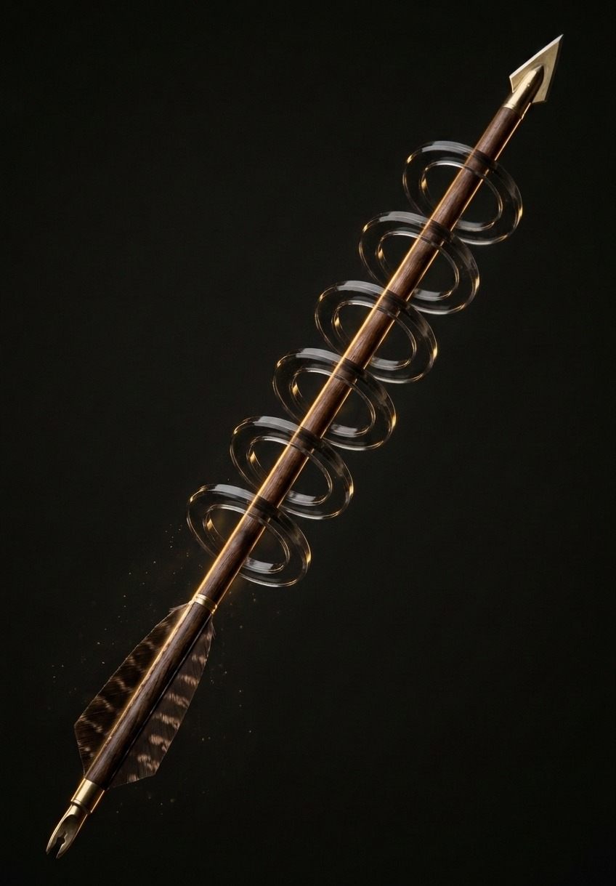

# Part VI — Introduction

<figure class="stoch-art-plate stoch-art-plate--hero" data-part="part-vi">
  

    
  

  <figcaption class="stoch-art-plate-copy">
    

      Part VI · Chapters 86–92 · T1–T7
      VI
    

    

      <strong class="stoch-art-plate-title">The Trajectory of Aim</strong>
      Single-shot laminar anatomy from pre-draw framing to post-impact verdict, isolating one guard site per chapter along irreversible flight.
    

  </figcaption>
</figure>

*This page states once how the seven chapters of Part VI trace one shot from pre-draw posture to post-impact verdict, isolating one guard site per chapter. It argues nothing the chapters do not argue.*

## From layers to a single flight

Part IV walked one running institutional case through Filters I–III. Part V tested thirty-five knowledge orders across all $\binom{7}{3} = 35$ three-guard combinations.

Part VI keeps the exact same three-plane mediation circuit—World ($P\_1$), Archive ($P\_2$), and Institution ($P\_3$)—and its $n = P(P - 1) + 1 = 7$ guard sites ([Chapter 29, *Aim and the Three Planes*](29-aim-and-the-three-planes.md); [Chapter 41, *The Triad and the Minimum*](41-the-triad-and-the-minimum.md)). Instead of adding new parts, Part VI slows down a **single chronological shot** from first framing to final audit.

That single-shot lens recalls Antipater of Tarsus's classical archer, who separates disciplined aim from where the wind blows the arrow (Stobaeus 1884; Plutarch *c.* 100 CE; Cicero 45 BCE). It converges with Sunzi's self-secured stance before battle (Griffith 1963) and the *Bhagavad Gītā*'s disciplined action freed from clinging to outcomes (Radhakrishnan 1948). It likewise echoes the *Qhipnayra* and *Whakataukī* traditions that place visible past precedent right before the archer's eyes before release (Núñez & Sweetser 2006; Rameka 2016).

## Three tapes in one step: what was prepared, what happened, what was written down

Formal syntax in [Appendix B](appendix-b-architecture-verification.md) (§B.1, the grammar and five-stage predicate) models each shot at step $t$ as a triple $\sigma\_t = (\mathbf{u}\_t, \mathbf{w}\_t, \mathbf{m}\_t)$. Read in plain English, those three objects separate three distinct things.

**$\mathbf{u}\_t$ — What was prepared (the control tape, *télos*).** These are the pre-shot commitments sealed *before* impact, fixing which questions enter the ledger, which cutoffs govern action, and which brakes stay armed.

**$\mathbf{w}\_t$ — What happened outside (the contingency tape, *skopós*).** These are the external events that unfold *after* release, such as crosswinds, hits, misses, or shocks. The five-stage predicate $\mathcal{A}$ never peeks at $\mathbf{w}\_t$ when judging whether preparation was sound ([Chapter 92](92-sealed-bow-and-uncommuted-verdict.md), uncommuted pre-outcome verdict).

**$\mathbf{m}\_t$ — What was written down (the native margins).** These are the numeric health readings recorded on each of the three axes before pass/fail thresholds run.

Once step $t$ finishes, whatever happened outside ($\mathbf{w}\_{t-1}$) pushes forward physically into the next step's reserve $R\_t$, archive $O\_t$, and external reception-perimeter capacity (audited ex post via $\Theta\_{\mathrm{basin}, t}$; [Chapter 94](94-yesterdays-crosswind-in-the-string.md), multi-step pushforwards). Inside step $t$ itself, pre-shot custody keeps preparation separate from luck.

## Slow-motion walk from `T1` through `T7`

Chapters 86 through 92 walk that single shot in slow motion, isolating one guard site per chapter ([Appendix E](appendix-e-lexicon.md), Table E.1) so each site's core theorem stands clear before all seven collide in Part VII:

| Chapter | Guard & Crossing | Moment of the Shot | What This Chapter Protects in Plain English |
| :--- | :--- | :--- | :--- |
| [Chapter 86](86-posture-before-bowstring-draws.md) | `T1` ($P\_3 \to P\_2$) | Before draw | Keeps the question honest, discloses standpoint gaps, and exposes door bias that committees cannot average out |
| [Chapter 87](87-aiming-against-counterfactual-winds.md) | `T2` ($P\_2 \to P\_1$) | Aiming | Tests claims continuously with *e*-processes, sharp Manski bounds, and proofs of why offline $\mathrm{DRO}$ balls break |
| [Chapter 88](88-what-the-wind-leaves-on-stone.md) | `T3` ($P\_1 \to P\_2$) | Counting | Audits selective archives, additive design effects, unseen counts, vintages, and MNAR $\mathrm{CVaR}\_p$ tail saturation |
| [Chapter 89](89-curvature-of-the-flight-path.md) | `T4` ($P\_2 \to P\_3$) | Formalizing | Separates invariant box checks from scale-warped rankings under curved losses and power-law heavy tails |
| [Chapter 90](90-crosswind-clock-and-vessel.md) | `T5` ($P\_1 \to P\_3$) | Racing the clock | Forces survival time to beat recovery time across variance drain, queues, allostatic wear, and ruin bounds |
| [Chapter 91](91-when-the-target-reads-the-archer.md) | `T6` ($P\_3 \to P\_1$) | Reactive release | Guards against Goodhart gaming, performative $\mathrm{DRO}$ collapse, oscillating rules, and perimeter strain |
| [Chapter 92](92-sealed-bow-and-uncommuted-verdict.md) | `T7` (Closure) | Sealing the verdict | Seals $\mathbf{u}\_t$ via external custody, forbids commuting stages, bounds minimum bias, and calibrates $\mathrm{IUT}$ |

## What laminar isolation leaves open

Walking `T1` through `T7` sequentially assumes framing ends before release, archive counts (`T3`) cleanly feed tests (`T2`), scoring charts stay single-period, human review remains unflooded ([Chapter 95](95-collision-at-ten-bits-per-second.md), ten-bits-per-second collision), and temporary overrides expire until `T7` unseals.

That laminar baseline isolates door bias (`T1`), $\mathrm{DRO}$ failure (`T2`), MNAR tail saturation (`T3`), chart-invariance and `OLC` (`T4`), survival pre-emption (`T5`), performative drift (`T6`), and five-stage non-commutation beside Intersection-Union Testing ($\mathrm{IUT}$, `T7`) before Part VII collides all seven guards simultaneously.

The flight opens in [Chapter 86 — Posture Before the Bowstring Draws](86-posture-before-bowstring-draws.md).
