# Stochology — Course Syllabus (The CAPIBA Protocol)

> **Status.** This syllabus (also rendered as Appendix E of the book) is an **authorial pedagogical extension** of the repository (`AGENTS.md` §II.C, rule 7). The *three-tempo cycle* (Detachment → Abstraction → Return) and the *five Movements* below are a teaching frame laid over the existing book (`book-src/`) and code (`crates/`). They are **not** part of the CAPIBA Protocol and add no bridge, gate, or invariant. Every formula, symbol, laboratory, and negative proof cited here exists in the current codebase; every number carries its provenance class.

---

## 1. Catalog Description

Stochology is the discipline of judgment and decision-making under uncertainty when the decision must be made before the outcome exists. The course separates three ontological layers: the World ($L_1$), the formal Model ($L_2$), and the Decision-maker who answers for the error ($L_3$). It studies the six ordered pairs that connect them. Each unit suspends the technical reflex of "fitting a model to data", raises the problem to its structural tension (finite representation, temporal irreversibility, curvature of consequence, performative reflexivity, relationality, and buffering), and returns to the equation and the executable algorithm as a rigorous, auditable materialization of that tension. Students work with a pure-Rust apparatus under a fixed seed (`seed = 2026`), structured Epistemological Cards, and algorithmic gates that reject flawed claims.

**Prerequisites.** Introductory probability and statistics; reading knowledge of a programming language (Rust fluency is not required: students run and read the laboratories, and the 90-hour track adds guided modification).

---

## 2. Conceptual Objectives

By the end of the course, the student will be able to:

1. **Type every probability by its layer** ($L_1$ frequency, $L_2$ symmetry or model output, $L_3$ credence) and refuse to treat one as another.
2. **Distinguish four kinds of not-knowing**: aleatory noise, epistemic parameter uncertainty, epistemic specification discrepancy, and Knightian uncertainty, and choose the matching tool for each.
3. **Apply the five transversal lenses** (Information, Time, Scale and Tail, Structure and Invariance, Decision and Calibration) as invariants that hold before any bridge between layers is crossed.
4. **Keep the six ordered pairs apart**: the three implemented forward bridges ($L_1 \to L_2$, $L_2 \to L_3$, $L_3 \to L_1$) and the three reverse reading frames ($L_2 \to L_1$, $L_3 \to L_2$, $L_1 \to L_3$).
5. **Obey the Four Prohibitions**: no unstructured prose between agents, no lone mean, no confusion of learning with performativity, no dogmatic extremes or omitted attempts.
6. **Write, seal, and audit an Epistemological Card** that passes the 4-Filter Eliminatory Funnel and the 8-step SIGA Roadmap, and **falsify a claim** with a negative defect proof.
7. **Label the provenance of every number** they publish (Measured, Simulated, Assumed, Literature-informative) and never set one class against another as if it were the same kind of evidence.

---

## 3. Pedagogical Architecture: the Three-Tempo Cycle

Every unit runs in three tempos.

| Tempo | Name | What happens | Exit condition |
| :---: | --- | --- | --- |
| 1 | **Detachment** (suspending the tool) | Show that no statistical or computational technique, by itself, answers where the observation came from, what was lost on the way, or what the action will do to the world. | The student can state what the familiar technique *cannot* tell them. |
| 2 | **Abstraction** (the pure structural tension) | Place the problem in the three layers, the five lenses, and the six ordered pairs. | The student can name the layer or bridge where the system fails and the Stirling-Walker uncertainty class. |
| 3 | **Return** (the formula as guardian of the nuance) | Return to the equation and the Rust symbol, run the laboratory, then run the negative defect proof that shows the naive method failing. | The student reproduces the positive result (`exit 0`) and the negative proof (`exit 1`). |

The Return is not a recipe: a tension often has more than one legitimate formalization (Manski vs. Lee bounds; BBSE vs. MLLS vs. DFM vs. OTTER under label shift). The formula is *a* rigorous, auditable materialization of the nuance, chosen and recorded on the card.

---

## 4. Scaling: Invariant Abstraction, Modulated Technical Depth

| Track | Hours | Tempos 1–2 (abstraction) | Tempo 3 (return) |
| --- | :---: | --- | --- |
| **Core** | 30 h | All five Movements in full | One **archetype equation** per pair (§6, marked ★), practiced in the Funnel on `card_01`–`card_04` |
| **Full** | 90 h | All five Movements in full | Every return listed in §6, including the frontier syntheses, plus guided modification of a laboratory |

The abstraction is preserved in full in both tracks; only the technical depth of the Return changes.

### 4.1. Competency Graph and the 27 Pathways

The tracks above are a **depth tag**, not a route. The course itself is an acyclic graph of competencies (`docs/competencies.toml`, an authorial frame over the book). There are no reader-role tracks: a learner chooses the negative proofs they must be able to explain, and the union of those proofs' **pathways** is the reading plan. Each pathway is the prerequisite closure of the competency that carries one proof, so there are 27 of them, and each ends at a test that must exit with code `1`. The **Core track** is the union of the 13 Core pathways plus the Core practicum (the Funnel, the real-data synthesis, and the verification suite). The **Full track** adds the other 14 pathways and Protocol Profiles. The graph and the table below are generated from the data and checked by `crates/stochology-cli/tests/competency_dag.rs`: each pathway's depth and Movement must agree with §5–§6. Dashed boxes are Full competencies; thick boxes carry a negative proof (⊥).

```mermaid
flowchart TB
  subgraph part0["Part I"]
    layers_six_pairs["Separate World, Model, and Decision, and name the six ordered pairs<br/><small>Ch 1</small>"]
    uncertainty_typing["Type uncertainty as aleatory, parametric, structural, or Knightian<br/><small>Ch 2 · ⊥ sniedovich</small>"]
    natural_frequencies["Translate probabilities into natural frequencies and decibans<br/><small>Ch 2</small>"]
  end
  subgraph part1["Part II"]
    convexity_jensen["Reason with quantiles and Jensen's inequality instead of the mean<br/><small>Ch 3</small>"]
    markov_dags["Read Markov chains, stochastic time, and causal DAGs<br/><small>Ch 4</small>"]
    dynamics_odes["Integrate open dynamical systems with RK4 and read entropy production<br/><small>Ch 5</small>"]
    sampling_unit["Find the independent unit and estimate through a sampling design<br/><small>Ch 6</small>"]
    approximation_spectral["Bound what a finite model can approximate with bases, spectra, and minimax rates<br/><small>Ch 7</small>"]
    severe_testing["Test severely and keep evidence valid under continuous monitoring<br/><small>Ch 8 · ⊥ peeking</small>"]
    multiplicity_ebh["Control false discoveries over many e-values with e-BH and name every discarded hypothesis<br/><small>Ch 8 · ⊥ multiplicity</small>"]
    var_es_backtest["Backtest VaR and Expected Shortfall with e-values<br/><small>Ch 8 · ⊥ var_underreport</small>"]
    lens_information["Apply the Information lens: data processing inequality, contraction, and Fano's floor<br/><small>Ch 9</small>"]
    lens_time["Apply the Time lens: Itô variance drain, Kelly fraction, and ruin<br/><small>Ch 9</small>"]
    lens_tail["Apply the Tail lens: Hill index, moment regimes, and tail quantiles<br/><small>Ch 9</small>"]
    lens_invariance["Apply the Invariance lens: ICP and nonlinear NILE across environments<br/><small>Ch 9</small>"]
    anchor_regression["Trade in-sample fit for shift robustness with anchor regression and read anchor stability<br/><small>Ch 9 · ⊥ anchor_extrapolation</small>"]
    lens_decision["Apply the Decision lens: cost-loss boundary, EVPI, and CORP-Murphy decomposition<br/><small>Ch 9 · ⊥ brier_dominance</small>"]
  end
  subgraph part2["Part III"]
    missingness_bounds["Bound what the world did not show: Meng's identity, Rubin's classes, Manski and Lee bounds<br/><small>Ch 10 · ⊥ lee_point_estimate</small>"]
    authentic_form["Separate structural core from residual: Kennedy-O'Hagan discrepancy and Authentic Model Form<br/><small>Ch 11 · ⊥ machine</small>"]
    seeds_acceptance["Build seeded null models and accept claims across many seeds<br/><small>Ch 12</small>"]
    analog_wave["Audit physical computing worlds: the analog wall, noise-aware training, and wave solvers<br/><small>Ch 13 · ⊥ analog_wall</small>"]
    triadic["Test the triadic synthesis of phase, fractal scale, and toroidal recurrence<br/><small>Ch 14 · ⊥ triadic_technium</small>"]
  end
  subgraph part3["Part IV"]
    curvature_scoring["Score curved consequences: Jensen's gap, CRPS, proper scores, and the Cromwell floor<br/><small>Ch 15 · ⊥ cromwell</small>"]
    crps_decomposition["Decompose the CRPS of continuous forecasts into miscalibration, discrimination, and uncertainty<br/><small>Ch 15 · ⊥ crps_miscalibration</small>"]
    thresholds_evidence["Turn calibrated probability into action within the human attention budget<br/><small>Ch 16</small>"]
    card_preregistration["Put the analyst's choices on record: card, attempt counter, and SHA-256 pre-registration<br/><small>Ch 17</small>"]
    critical_rationality["Expose what instrumental stochastic reason silences: amputated tails and correlational parrots<br/><small>Ch 18 · ⊥ instrumental_reason</small>"]
  end
  subgraph part4["Part V"]
    performativity["Separate performative stability from optimality and audit RRM contraction and Goodhart<br/><small>Ch 19 · ⊥ performativity</small>"]
    performative_power["Measure a lower bound on performative sensitivity from randomized action arms<br/><small>Ch 19 · ⊥ understated_epsilon</small>"]
    synthetic_recursion["Keep recursive training anchored: Accumulate versus Replace<br/><small>Ch 19 · ⊥ replace_collapse</small>"]
    clustering_neff["Count tail information in clusters: Moulton-Campbell n_eff(p)<br/><small>Ch 20 · ⊥ moulton</small>"]
    resolution_phi5["Match the question's resolution to the decision unit (Phi5)<br/><small>Ch 20 · ⊥ phi5</small>"]
    fairness["Name who pays for error under Chouldechova's impossibility<br/><small>Ch 20 · ⊥ chouldechova</small>"]
    multicalibration["Audit calibration inside every subgroup and bin, and say when the cells are too small to tell<br/><small>Ch 20 · ⊥ subgroup_miscalibration</small>"]
    bitemporal_clock["Keep event time and availability time apart with a synthetic canary<br/><small>Ch 21 · ⊥ clock</small>"]
    real_time_vintages["Backtest on the data vintages that existed at decision time<br/><small>Ch 21 · ⊥ vintage_leak</small>"]
    temporal_vault["Open a sealed out-of-time reserve exactly once<br/><small>Ch 21 · ⊥ vault</small>"]
    drift_adaptation["Detect and adapt to covariate, label, and concept drift<br/><small>Ch 21 · ⊥ concept_drift</small>"]
    relational_complex["Model relations and open systems: Brusselator, Schelling, and Daisyworld<br/><small>Ch 22</small>"]
    stocks_cybernetics["Govern with stocks and buffers, and judge process apart from outcome<br/><small>Ch 23 · ⊥ stochary_cybernetics</small>"]
  end
  subgraph part5["Part VI"]
    strategic_accommodation["Repair the six AI shortcuts across all six ordered pairs<br/><small>Ch 24 · ⊥ strategic_accommodation</small>"]
    coupled_society["Close the stock-flow loop between a public regulator and private credit<br/><small>Ch 25 · ⊥ coupled_society</small>"]
  end
  subgraph part6["Part VII"]
    funnel_siga["Prune a question through the 4 Filters and run the 8-step SIGA Roadmap<br/><small>Ch 26</small>"]
    protocol_profiles["Shape the protocol's clay for a new application with a pre-registered profile<br/><small>Ch 17, Ch 26</small>"]
    empirical_synthesis["Face every lens and bridge with the 14 real datasets<br/><small>Ch 27</small>"]
  end
  subgraph part7["Appendices"]
    verification_suite["Run the gates, the negative proofs, and the full verification suite<br/><small>App. A, App. B</small>"]
  end
  layers_six_pairs --> uncertainty_typing
  layers_six_pairs --> natural_frequencies
  layers_six_pairs --> convexity_jensen
  convexity_jensen --> markov_dags
  convexity_jensen --> dynamics_odes
  uncertainty_typing --> sampling_unit
  convexity_jensen --> sampling_unit
  sampling_unit --> approximation_spectral
  sampling_unit --> severe_testing
  severe_testing --> multiplicity_ebh
  severe_testing --> var_es_backtest
  markov_dags --> lens_information
  markov_dags --> lens_time
  sampling_unit --> lens_tail
  markov_dags --> lens_invariance
  approximation_spectral --> lens_invariance
  lens_invariance --> anchor_regression
  convexity_jensen --> lens_decision
  natural_frequencies --> lens_decision
  sampling_unit --> missingness_bounds
  lens_information --> authentic_form
  lens_invariance --> authentic_form
  severe_testing --> seeds_acceptance
  missingness_bounds --> seeds_acceptance
  authentic_form --> seeds_acceptance
  dynamics_odes --> analog_wave
  seeds_acceptance --> analog_wave
  analog_wave --> triadic
  lens_tail --> triadic
  lens_decision --> curvature_scoring
  curvature_scoring --> crps_decomposition
  curvature_scoring --> thresholds_evidence
  severe_testing --> thresholds_evidence
  missingness_bounds --> card_preregistration
  thresholds_evidence --> card_preregistration
  card_preregistration --> critical_rationality
  lens_tail --> critical_rationality
  lens_invariance --> critical_rationality
  lens_decision --> performativity
  markov_dags --> performativity
  severe_testing --> performativity
  performativity --> performative_power
  performativity --> synthetic_recursion
  seeds_acceptance --> synthetic_recursion
  lens_tail --> clustering_neff
  clustering_neff --> resolution_phi5
  thresholds_evidence --> fairness
  fairness --> multicalibration
  severe_testing --> bitemporal_clock
  lens_information --> bitemporal_clock
  bitemporal_clock --> real_time_vintages
  bitemporal_clock --> temporal_vault
  card_preregistration --> temporal_vault
  bitemporal_clock --> drift_adaptation
  curvature_scoring --> drift_adaptation
  lens_invariance --> drift_adaptation
  dynamics_odes --> relational_complex
  lens_information --> relational_complex
  lens_time --> stocks_cybernetics
  performativity --> stocks_cybernetics
  relational_complex --> stocks_cybernetics
  seeds_acceptance --> strategic_accommodation
  card_preregistration --> strategic_accommodation
  performativity --> strategic_accommodation
  clustering_neff --> strategic_accommodation
  stocks_cybernetics --> coupled_society
  missingness_bounds --> coupled_society
  fairness --> coupled_society
  resolution_phi5 --> funnel_siga
  seeds_acceptance --> funnel_siga
  temporal_vault --> funnel_siga
  funnel_siga --> protocol_profiles
  funnel_siga --> empirical_synthesis
  seeds_acceptance --> verification_suite
  classDef full stroke-dasharray: 5 4
  classDef proof stroke-width: 3px
  class dynamics_odes,multiplicity_ebh,anchor_regression,analog_wave,triadic,crps_decomposition,critical_rationality,performative_power,synthetic_recursion,multicalibration,real_time_vintages,drift_adaptation,relational_complex,stocks_cybernetics,strategic_accommodation,coupled_society,protocol_profiles full
  class uncertainty_typing,severe_testing,multiplicity_ebh,var_es_backtest,anchor_regression,lens_decision,missingness_bounds,authentic_form,analog_wave,triadic,curvature_scoring,crps_decomposition,critical_rationality,performativity,performative_power,synthetic_recursion,clustering_neff,resolution_phi5,fairness,multicalibration,bitemporal_clock,real_time_vintages,temporal_vault,drift_adaptation,stocks_cybernetics,strategic_accommodation,coupled_society proof
```

<!-- competency-dag:begin -->

<!-- competency-dag:end -->

<!-- competency-pathways:begin -->
| # | Pathway (negative proof) | Pillar | Depth | Competencies | Route (chapters, in order) |
| :-: | --- | --- | :-: | :-: | --- |
| 1 | `sniedovich` — Type uncertainty as aleatory, parametric, structural, or Knightian | I · Invariant | Core | 2 | Ch 1 → Ch 2 |
| 2 | `peeking` — Test severely and keep evidence valid under continuous monitoring | A · Anytime-valid | Core | 5 | Ch 1 → Ch 2 → Ch 3 → Ch 6 → Ch 8 |
| 3 | `multiplicity` — Control false discoveries over many e-values with e-BH and name every discarded hypothesis | A · Anytime-valid | Full | 6 | Ch 1 → Ch 2 → Ch 3 → Ch 6 → Ch 8 |
| 4 | `var_underreport` — Backtest VaR and Expected Shortfall with e-values | A · Anytime-valid | Core | 6 | Ch 1 → Ch 2 → Ch 3 → Ch 6 → Ch 8 |
| 5 | `anchor_extrapolation` — Trade in-sample fit for shift robustness with anchor regression and read anchor stability | I · Invariant | Full | 8 | Ch 1 → Ch 2 → Ch 3 → Ch 4 → Ch 6 → Ch 7 → Ch 9 |
| 6 | `brier_dominance` — Apply the Decision lens: cost-loss boundary, EVPI, and CORP-Murphy decomposition | C · Calibrated | Core | 4 | Ch 1 → Ch 2 → Ch 3 → Ch 9 |
| 7 | `lee_point_estimate` — Bound what the world did not show: Meng's identity, Rubin's classes, Manski and Lee bounds | I · Invariant | Core | 5 | Ch 1 → Ch 2 → Ch 3 → Ch 6 → Ch 10 |
| 8 | `machine` — Separate structural core from residual: Kennedy-O'Hagan discrepancy and Authentic Model Form | I · Invariant | Core | 9 | Ch 1 → Ch 2 → Ch 3 → Ch 4 → Ch 6 → Ch 7 → Ch 9 → Ch 11 |
| 9 | `analog_wall` — Audit physical computing worlds: the analog wall, noise-aware training, and wave solvers | A · Auditing | Full | 14 | Ch 1 → Ch 2 → Ch 3 → Ch 4 → Ch 5 → Ch 6 → Ch 7 → Ch 8 → Ch 9 → Ch 10 → Ch 11 → Ch 12 → Ch 13 |
| 10 | `triadic_technium` — Test the triadic synthesis of phase, fractal scale, and toroidal recurrence | A · Auditing | Full | 16 | Ch 1 → Ch 2 → Ch 3 → Ch 4 → Ch 5 → Ch 6 → Ch 7 → Ch 8 → Ch 9 → Ch 10 → Ch 11 → Ch 12 → Ch 13 → Ch 14 |
| 11 | `cromwell` — Score curved consequences: Jensen's gap, CRPS, proper scores, and the Cromwell floor | C · Calibrated | Core | 5 | Ch 1 → Ch 2 → Ch 3 → Ch 9 → Ch 15 |
| 12 | `crps_miscalibration` — Decompose the CRPS of continuous forecasts into miscalibration, discrimination, and uncertainty | C · Calibrated | Full | 6 | Ch 1 → Ch 2 → Ch 3 → Ch 9 → Ch 15 |
| 13 | `instrumental_reason` — Expose what instrumental stochastic reason silences: amputated tails and correlational parrots | A · Auditing | Full | 16 | Ch 1 → Ch 2 → Ch 3 → Ch 4 → Ch 6 → Ch 7 → Ch 8 → Ch 9 → Ch 10 → Ch 15 → Ch 16 → Ch 17 → Ch 18 |
| 14 | `performativity` — Separate performative stability from optimality and audit RRM contraction and Goodhart | P · Performative-aware | Core | 9 | Ch 1 → Ch 2 → Ch 3 → Ch 4 → Ch 6 → Ch 8 → Ch 9 → Ch 19 |
| 15 | `understated_epsilon` — Measure a lower bound on performative sensitivity from randomized action arms | P · Performative-aware | Full | 10 | Ch 1 → Ch 2 → Ch 3 → Ch 4 → Ch 6 → Ch 8 → Ch 9 → Ch 19 |
| 16 | `replace_collapse` — Keep recursive training anchored: Accumulate versus Replace | P · Performative-aware | Full | 16 | Ch 1 → Ch 2 → Ch 3 → Ch 4 → Ch 6 → Ch 7 → Ch 8 → Ch 9 → Ch 10 → Ch 11 → Ch 12 → Ch 19 |
| 17 | `moulton` — Count tail information in clusters: Moulton-Campbell n_eff(p) | A · Anytime-valid | Core | 6 | Ch 1 → Ch 2 → Ch 3 → Ch 6 → Ch 9 → Ch 20 |
| 18 | `phi5` — Match the question's resolution to the decision unit (Phi5) | A · Anytime-valid | Core | 7 | Ch 1 → Ch 2 → Ch 3 → Ch 6 → Ch 9 → Ch 20 |
| 19 | `chouldechova` — Name who pays for error under Chouldechova's impossibility | A · Auditing | Core | 10 | Ch 1 → Ch 2 → Ch 3 → Ch 6 → Ch 8 → Ch 9 → Ch 15 → Ch 16 → Ch 20 |
| 20 | `subgroup_miscalibration` — Audit calibration inside every subgroup and bin, and say when the cells are too small to tell | A · Auditing | Full | 11 | Ch 1 → Ch 2 → Ch 3 → Ch 6 → Ch 8 → Ch 9 → Ch 15 → Ch 16 → Ch 20 |
| 21 | `clock` — Keep event time and availability time apart with a synthetic canary | B · Bitemporal | Core | 8 | Ch 1 → Ch 2 → Ch 3 → Ch 4 → Ch 6 → Ch 8 → Ch 9 → Ch 21 |
| 22 | `vintage_leak` — Backtest on the data vintages that existed at decision time | B · Bitemporal | Full | 9 | Ch 1 → Ch 2 → Ch 3 → Ch 4 → Ch 6 → Ch 8 → Ch 9 → Ch 21 |
| 23 | `vault` — Open a sealed out-of-time reserve exactly once | B · Bitemporal | Core | 15 | Ch 1 → Ch 2 → Ch 3 → Ch 4 → Ch 6 → Ch 8 → Ch 9 → Ch 10 → Ch 15 → Ch 16 → Ch 17 → Ch 21 |
| 24 | `concept_drift` — Detect and adapt to covariate, label, and concept drift | C · Calibrated | Full | 14 | Ch 1 → Ch 2 → Ch 3 → Ch 4 → Ch 6 → Ch 7 → Ch 8 → Ch 9 → Ch 15 → Ch 21 |
| 25 | `stochary_cybernetics` — Govern with stocks and buffers, and judge process apart from outcome | A · Auditing | Full | 14 | Ch 1 → Ch 2 → Ch 3 → Ch 4 → Ch 5 → Ch 6 → Ch 8 → Ch 9 → Ch 19 → Ch 22 → Ch 23 |
| 26 | `strategic_accommodation` — Repair the six AI shortcuts across all six ordered pairs | A · Auditing | Full | 21 | Ch 1 → Ch 2 → Ch 3 → Ch 4 → Ch 6 → Ch 7 → Ch 8 → Ch 9 → Ch 10 → Ch 11 → Ch 12 → Ch 15 → Ch 16 → Ch 17 → Ch 19 → Ch 20 → Ch 24 |
| 27 | `coupled_society` — Close the stock-flow loop between a public regulator and private credit | A · Auditing | Full | 19 | Ch 1 → Ch 2 → Ch 3 → Ch 4 → Ch 5 → Ch 6 → Ch 8 → Ch 9 → Ch 10 → Ch 15 → Ch 16 → Ch 19 → Ch 20 → Ch 22 → Ch 23 → Ch 25 |
<!-- competency-pathways:end -->

---

## 5. Schedule Overview

| Unit | Movement | Book chapters | Core (30 h) | Full (90 h) |
| :---: | --- | --- | :---: | :---: |
| 0 | Orientation: seed, gates, and the card | Preface §4–§6, App. B | 1 h | 2 h |
| I | The Act of Conjecture and the Ontology of Uncertainty | Preface, Ch. 1–2 | 4 h | 8 h |
| II | The Five Laws of Conservation and Deformation of the Real | Ch. 3–9 | 5 h | 18 h |
| III | Representation and Materiality: World ⇄ Model | Ch. 10–14 | 5 h | 16 h |
| IV | Rationality, Curvature, and Critique: Model ⇄ Decision | Ch. 15–18 | 5 h | 14 h |
| V | Praxis, Relationality, and Buffering: Decision ⇄ World | Ch. 19–23, 25 | 6 h | 20 h |
| P | Practicum thread: Funnel, SIGA, cards, verification | Ch. 24, 26–27, App. A–C | 4 h (cross-cutting) | 12 h (cross-cutting) |
| | **Total** | | **30 h** | **90 h** |

The practicum (Unit P) covers Part VII and the appendices of the book, plus the strategic synthesis of Part VI as a Full-track capstone, and runs **across** Units I–V; it is not a sixth Movement.

---

## 6. Detailed Program

Notation: ★ = archetype equation taught in the Core track; symbols are Rust items in `crates/`; `--defect <name>` is the negative proof run with `cargo run --release --bin gates -- --defect <name>` (expected `exit 1`).

### Unit 0 — Orientation (Preface §4–§6, Appendix B)

- **Content.** Reproducible chance with `SplitMix64` (`seed = 2026`, $\Phi_1$); the 8 gates `G1`–`G8`; the Four Prohibitions; `scripts/verify.sh`.
- **Practice.** `cargo run --release --bin gates` (`exit 0`); `cargo run --release --bin labs -- --all`.

### Movement I — The Act of Conjecture and the Ontology of Uncertainty (Preface, Ch. 1–2)

- **Detachment.** Suspend the idea that "probability" is a single, self-evident number computed from past data.
- **Abstraction.** Judgment precedes truth: every consequential decision is taken before the outcome exists. Aiming at an invisible target (*stókhos*) with structured reason requires separating what the world is ($L_1$), what our formal language says about it ($L_2$), and who decides and answers for the error ($L_3$). Not-knowing comes in qualitatively distinct kinds.
- **Return.**
  - ★ The five interpretations of probability, typed by layer (Ch. 2, §2.1).
  - Internal coherence vs. external calibration: the Ramsey-de Finetti Dutch Book (Ch. 2, §2.1) set against calibration (Ch. 15).
  - Base-rate neglect: natural-frequency trees (`NaturalFrequencyMemorandum`) and Turing-Good additive weight of evidence in decibans, $W = 10\log_{10}\mathrm{LR}$ (Ch. 2, §2.1; `AlertFatigueAudit`, developed in Ch. 16).
  - ★ The four kinds of uncertainty: aleatory ($L_1$); epistemic parameter ($L_2$); anchored Kennedy-O'Hagan structural discrepancy $\delta(x) \sim \mathcal{GP}(0, k)$ (`KennedyOHaganDiscrepancy`, $L_2$); Info-Gap robustness horizons with the Wald-Sniedovich global Maximin floor (`InfoGapOption`, $L_3$).
- **Laboratory.** `labs -- --uncertainty`.
- **Negative proof.** `--defect sniedovich` (Info-Gap "No-Man's Land").

### Movement II — The Five Laws of Conservation and Deformation of the Real (Ch. 3–9)

- **Detachment.** Suspend the fragmented view of separate disciplines (information theory, stochastic processes, extreme-value theory, causal inference, decision theory).
- **Abstraction.** Before crossing any bridge, five structural invariants hold:
  1. *Irreversibility of compression*: every transformation of data can only lose information about the state of the world.
  2. *Non-ergodicity of time*: the average over many parallel observers is not the trajectory lived by one agent who accumulates gains, losses, and ruin.
  3. *Dominance of the extreme*: far from Gaussian equilibrium, the tail outweighs the center.
  4. *Invariance under intervention*: correlations change with context; causal mechanisms stay stable when we act on the system.
  5. *Consequential asymmetry*: no probabilistic belief is neutral; its value depends on the curvature of harm and on separating genuine resolution from false confidence.
- **Return** (Ch. 9 is the hub; Ch. 3–8 supply the tools by layer).
  - *Irreversibility* → ★ Data Processing Inequality $I(W;Z) \le I(W;Y) \le I(W;X)$ and the strong contraction hierarchy (`DpiMarkovChain`); channel capacity (`blahut_arimoto_capacity`); Fano's error floor (`fano_error_floor`).
  - *Non-ergodicity* → ★ Itô variance drain $g_{\text{time}} = \mu - \tfrac{1}{2}\sigma^2$ (`ito_time_growth_rate`); Kelly fraction under asymmetric returns $f^* = \frac{p}{a} - \frac{1-p}{b}$ (`asymmetric_kelly_fraction`). *Authorial link (Full track):* Huber innovation-weighted Kalman filtering under heavy-tailed glitches (`RobustKalmanControlAudit`) lives in the strategic synthesis (Ch. 24, §24.6), not in the Time lens.
  - *Dominance of the extreme* → ★ Hill tail index (`hill_estimator`) and moment-existence regimes; the moment (DEdH) estimator and $\mathrm{ES}_{0.99}$ (Ch. 9).
  - *Invariance* → Pearl's ladder and DAGs (Ch. 4); ★ Invariant Causal Prediction and nonlinear ICP/NILE over an orthonormal Hermite basis (`run_nonlinear_icp_nile`). *Authorial link (Full track):* `do`-Shapley vs. Rung-1 observational Shapley (`ShapleyCausalAudit`) lives in the strategic synthesis (Ch. 24, §24.2).
  - *Consequential asymmetry* → ★ cost-loss boundary $p^* = \frac{C}{\eta L}$ (`critical_cost_loss_threshold`), EVPI (`calculate_evpi`), Richardson's relative value, and the isotonic CORP-Murphy decomposition $\mathrm{BS} = \mathrm{REL}_{\mathrm{CORP}} - \mathrm{RES}_{\mathrm{CORP}} + \mathrm{UNC}_0$ (`CorpPavDecomposition`, `MurphyDiagram`).
  - Severe testing, multiplicity, e-processes, and conformal prediction (Ch. 8) as the $L_3$ toolset.
- **Laboratory.** `labs -- --lenses`.
- **Negative proofs.** `--defect brier_dominance` (Brier ranking vs. Murphy uniform dominance; Ch. 9), `--defect peeking` and `--defect var_underreport` (optional stopping and VaR/ES underreporting; Ch. 8). Full track adds `--defect multiplicity` (e-BH over many e-values; Ch. 8) and `--defect anchor_extrapolation` (anchor regression; Ch. 9).

### Movement III — Representation and Materiality: World ⇄ Model (Ch. 10–14)

- **Detachment.** Let go of the illusion that a database is a faithful portrait of nature, and that computation runs in an immaterial ether at no energetic or physical cost.
- **Abstraction.**
  - *World Models, $L_1 \to L_2$:* the world reaches the model through an invisible filter. What was not observed did not vanish at random; silence has structure. Where the world fell silent, the model must choose between declaring the interval of its ignorance and lying with a point estimate. To be authentic, it must separate the invariant structural core from the specification residual.
  - *Model Worlds, $L_2 \to L_1$ (reading frame):* the model returns to the world first as simulated worlds, where chance must be reproducible and tested across many seeds, and second as physical computing worlds, where the digital separation of memory and processing meets thermodynamic and data limits.
- **Return.**
  - $L_1 \to L_2$: ★ Meng's identity $\bar{Y}_n - \bar{Y}_N = \rho_{R,Y}\sqrt{\frac{N-n}{n}}\,\sigma_Y$ (`MengAudit`). *Measured worked example:* on `cps_observational.csv` ($n = 15{,}992$) under an imposed 25% lower-tail MNAR attrition, Meng's effective sample size falls to $n_{\mathrm{eff,Meng}} = 4.5$ (`EmpiricalCoupledSocietyAudit`, `labs -- --all`). Rubin's MCAR/MAR/MNAR taxonomy; ★ non-parametric Manski bounds (`ManskiBounds`) and fractional Lee (2009) trimming bounds; Authentic Model Form $\delta(x) + \hat{S}^*$ (`AuthenticModelForm`, `DiscardedAtomRecord`) and the $(\varepsilon, \delta)$-Almost-Perfect Machine (`AlmostPerfectMachine`).
  - $L_2 \to L_1$: ★ `SplitMix64` substreams and fork-join trees (`MonteCarloSplitTreeAudit`); multi-seed acceptance (20 development seeds `2026..=2045`, 200 sealed confirmation seeds; `stochology_lenses::acceptance`). *Full track:* RK4 ODE isomorphism, the analog wall and noise-aware training, `HP-INV` / `BlockAMC`, SIREN on the Helmholtz PDE (`AnalogWaveComputingSynthesis`); the Triadic synthesis $\mathbb{C} \times \text{Fractals} \times \mathbb{T}^d$ (`ComplexFractalToroidalTechniumSynthesis`). Energy, token, and noise-curve constants in these chapters are **Literature (informative)**.
- **Laboratory.** `labs -- --layers`.
- **Negative proofs.** `--defect lee_point_estimate`, `--defect machine`; Full track adds `--defect analog_wall`, `--defect triadic_technium`.

### Movement IV — Rationality, Curvature, and Critique: Model ⇄ Decision (Ch. 15–18)

- **Detachment.** Let go of summarizing uncertainty by the expected mean, and of the positivist belief that quantitative modeling is a neutral bureaucratic act free of human choice and power.
- **Abstraction.**
  - *Decision Models, $L_2 \to L_3$:* the map from world state to human harm or benefit is rarely a straight line; evaluating a decision by the mean erases the curvature where catastrophe lives. The model's signal must also cross the narrow bottleneck of conscious human attention without alarm fatigue, and stay valid under continuous monitoring.
  - *Model Decisions, $L_3 \to L_2$ (reading frame):* every model carries the fingerprint of the analyst's prior choices: what was included, how many specifications were tried, how the result is narrated. Unrecorded, natural language launders adjectives. At a deeper level, a stochastic reason that keeps only what fits within well-behaved deviations reifies the existing and silences the singular event.
- **Return.**
  - $L_2 \to L_3$: ★ Jensen's gap $\Delta_J = \mathbb{E}[f(X)] - f(\mathbb{E}[X])$ with median, $q_{05}$, $q_{95}$, and CRPS (`NonlinearSummary`; Prohibition 2). *Measured worked example:* on `bank_calls.csv` (164 days, squared daily calls), $\Delta_J = +9.03 \times 10^6$, about $0.85\%$ of $f(\mathbb{E}[X])$. Strictly proper scores (Brier, Log, CRPS) with the Cromwell floor $p \in [\varepsilon, 1-\varepsilon]$ (`apply_cromwell_floor`); anytime-valid evidence: `aGRAPA`/`GRO` betting martingales (`EvidenceProcess`) and SAVI confidence sequences (`SaviConfidenceSequence`) against peeking; VaR/ES e-backtesting (`VarEsEBacktest`); deciban alarm triage against the human conscious bottleneck (`AlertFatigueAudit`). The $10\text{ bit/s}$ figure is **Literature (informative)** (Zheng & Meister); the operating point $\mathrm{TPR} = 0.82$, $\mathrm{FPR} = 0.045$ is **Assumed**.
  - $L_3 \to L_2$: ★ the Duhem-Quine-Lakatos attempt counter $K \ge 1$, the structured Epistemological Card (`EpistemologicalCard`) replacing free prose, and SHA-256 pre-registration. *Full track:* the critical theory of stochastic rationality (`CriticalStochasticRationalitySynthesis`): the naive positivist arm (truncated-Gaussian VaR, correlational "parrot" predictor) is a **simulated** contrast under seeded acceptance, not a measurement of any named real system.
- **Laboratory.** `labs -- --siga` (cards as $L_3 \to L_2$ records).
- **Negative proofs.** `--defect cromwell`; Full track adds `--defect instrumental_reason` and `--defect crps_miscalibration` (CORP decomposition of the CRPS; Ch. 15). The anytime-valid proofs `--defect peeking` and `--defect var_underreport` are run in Movement II, where Ch. 8 develops the tools.

### Movement V — Praxis, Relationality, and Buffering: Decision ⇄ World (Ch. 19–23, 25)

- **Detachment.** Let go of the passive external observer (who believes that forecasting the world does not change it) and of methodological individualism (agents and events as isolated billiard balls in a static void).
- **Abstraction.**
  - *World Decisions, $L_3 \to L_1$:* acting on the world through a model moves the world. Populations react strategically to the deployed rule, indicators turn into gamed targets, and systems that feed recursively on their own synthetic outputs without physical anchoring degenerate.
  - *Decision Worlds, $L_1 \to L_3$ (reading frame):* the world returns three constraints to the decision: (i) individuals are interdependent networks, not isolated atoms, so clustering shrinks independent information in the tails; (ii) time is bitemporal, crossed by regime drift and by irreconcilable fairness criteria; (iii) in open, dissipative, non-ergodic systems, survival requires joining the art of aiming (*stókhos*) to the architecture of stocks, reserves, and buffers, judging the decision-maker by the integrity of the internal process (*Telos*) and not by the luck of the outcome (*Skopos*).
- **Return.**
  - $L_3 \to L_1$: ★ Performative Stability $\theta_{\mathrm{PS}}$ vs. Stackelberg Optimality $\theta_{\mathrm{PO}}$ and the RRM contraction condition $\frac{\varepsilon\beta}{\gamma} < 1$ (`PerformativeSystem`); the four Goodhart variants (`GoodhartTaxonomyAudit`); Accumulate vs. Replace synthetic recursion (`GerstgrasserAccumulateAudit`, Ch. 19, §19.3), whose Accumulate error is bounded by the Basel-problem series $\sum_g g^{-2} < \pi^2/6$ (unrelated to the Basel III banking accords).
  - $L_1 \to L_3$: ★ Moulton-Campbell tail design effect $n_{\mathrm{eff}}(p) = \frac{n}{1 + (\tilde{m}-1)\rho_I(p)}$ (`ExceedanceDesignEffect`); $\Phi_5$ resolution parity (`verify_resolution_phi5`); ★ the bitemporal clock $t_{\text{disp}} \ge t_{\text{ev}}$ with a synthetic canary $I(\text{Canary};Y) = 0$ (`BitemporalClockAudit`) and the single-opening `TemporalVault`; drift adaptation (ExTRA-WCP-T, online ACI, the four label-shift estimators); Chouldechova's impossibility (`ChouldechovaAudit`).
  - Axis syntheses (Full track): relational ontology and complex systems (`RelationalComplexSystemsSynthesis`: Brusselator RK4 entropy production, Schelling, Daisyworld); ★ (Core, conceptual only) the PATE Telos/Skopos matrix and, in the Full track, the full stochary-conjectural cybernetic synthesis (`StocharyConjecturalCyberneticSynthesis`: the four ontological stock axioms, TTS/TTR, VSM `S3*`); the coupled public-private stock-flow consistent society (`CoupledPublicPrivateSocietySynthesis`, `SfcFlowMatrix`; Ch. 25). Results in these syntheses are **simulated** and gated by seeded multi-seed acceptance; claims listed in `discarded_claims` must be taught as refuted.
- **Laboratories.** `labs -- --invariants`, `labs -- --governance`.
- **Negative proofs.** Core: `--defect performativity`, `--defect moulton`, `--defect phi5`, `--defect clock`, `--defect vault`, `--defect chouldechova`. Full adds `--defect replace_collapse`, `--defect concept_drift`, `--defect stochary_cybernetics`, `--defect coupled_society`, `--defect understated_epsilon` (measured performative power; Ch. 19), `--defect subgroup_miscalibration` (multicalibration; Ch. 20), `--defect vintage_leak` (real-time data vintages; Ch. 21).

### Unit P — Practicum Thread (Ch. 24, 26–27, Appendices A–C; runs across Units I–V)

- **Content.** The 4 Eliminatory Filters and the 8-step SIGA Roadmap (Ch. 26); the transversal empirical synthesis across the 14 datasets (Ch. 27, `labs -- --real-data`); architecture and verification (Appendices A–B); data sources and sealed reserves (Appendix C).
- **Case studies.** `card_01_atlantic_storms_evacuation.yaml`, `card_02_bank_queue_staffing.yaml`, `card_03_nyc_flights_holding.yaml`, `card_04_dpi_civil_defense_triage.yaml`, each audited with `gates -- --audit-card <card>`.
- **Full-track capstone.** The Strategic AI six-pair accommodation synthesis (`StrategicAiAccommodationSynthesis`, Ch. 24), read as an authorial frame across all six pairs; negative proof `--defect strategic_accommodation`.

Across both tracks, the 27 negative defect proofs are distributed with no repetition: Movement I (1), II (5), III (4), IV (3), V (13), Practicum (1). The same assignment appears in each chapter's three-tempo block.

---

## 7. Assessment

| Component | Weight | Description |
| --- | :---: | --- |
| Pair diagnoses | 20% | For five short cases, answer the Three Questions (layer/bridge, Stirling-Walker class, severe test). |
| Laboratory reproductions | 25% | Reproduce one positive laboratory and one negative proof per Movement; explain why the naive method fails. |
| Provenance audit | 15% | Label every number in a supplied derived text (Measured / Simulated / Assumed / Literature) and flag violations of `AGENTS.md` §II.C. |
| Capstone Epistemological Card | 40% | Write a new card on one of the 14 datasets, declare $K \ge 1$ and discarded findings, seal it with SHA-256, and pass the 4-Filter Funnel. Filter 4 cross-authorship: a peer acts as `adversarial_reviewer`. |

---

## 8. Core Bibliography

The primary text is the course book (`book-src/SUMMARY.md`, Preface, Chapters 1–27, and Appendices A–E) together with `docs/PROTOCOL.md` and `docs/syntheses/`. Primary sources are listed per chapter and in Appendix C; the empirical datasets and their provenance are in `data/SOURCES.md`.
