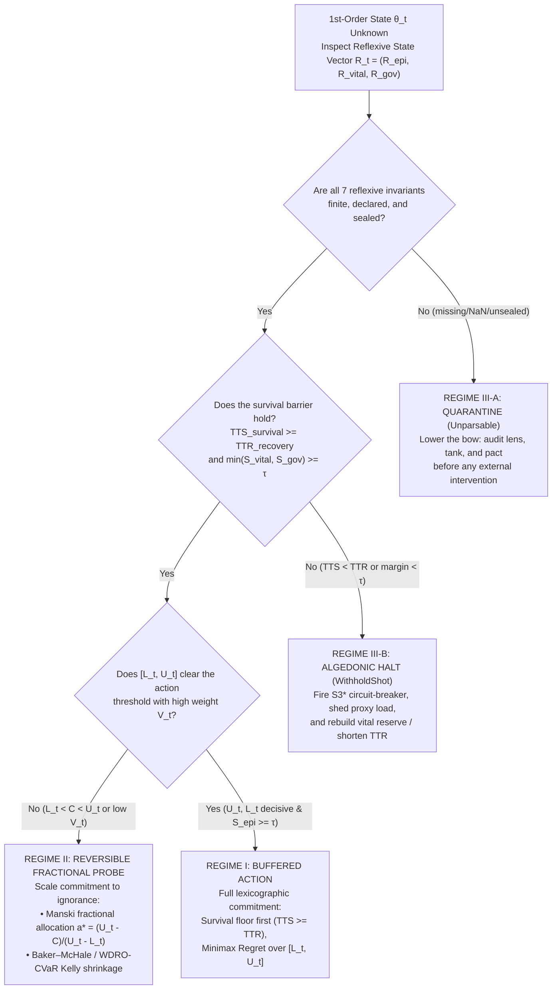

# **What Must Be Known When We Do Not Know**

*(Reflexive Invariants, Finite Regress, and the Three Regimes of Action Under Opacity)*

---

## **Abstract**

This note formulates the epistemic-reflexive core of **Stochology** at the acute instant of decision: **what must an agent know when they do not know the first-order state of the world?** Whenever action must precede the outcome, attempting to cure first-order ignorance of an external event ($\theta_t$) by estimating second-order parameters of the external world—and then third-order hyperpriors over those parameters—triggers a vicious infinite regress that ends either in dogmatic fabrication or in skeptical paralysis. We show that this regress terminates if and only if inquiry pivots from **projective omniscience over the external target (*skopós*)** to **reflexive self-knowledge of the agent's own mediation circuit (*télos*)**. Even when the wind is unknown, an acting person or institution has a strict epistemic and moral obligation to know three trunk invariants of their own shot, which unfold 1-to-1 into the seven guard sites (`3/2/2`) of [`The Grammar of Aim.md`](The%20Grammar%20of%20Aim.md): (1) *what my lens excludes* (the unrecorded fraction $1-f$, the physical support $[y_{\min}, y_{\max}]$, and the cluster design effect $\mathrm{DEFF}$ that determine the partial-identification interval $[L_t, U_t]$ and Keynesian weight $V$); (2) *how much error my breath can absorb before breaking* (the convexity gap $\Delta_J$, current reserve $R_t$, utilization headroom $1-\rho_t$, and whether Time-to-Survive exceeds Time-to-Recover, $\mathrm{TTS}_{\mathrm{survival}} \ge \mathrm{TTR}_{\mathrm{recovery}}$); and (3) *who pays for the error and who can halt me* (cost-loss asymmetry, unobstructed $S3^*$ algedonic braking with $\delta_{\mathrm{cred}} = 0$, and *ex-ante* sealing in a `TemporalVault`). From this reflexive audit emerge three exhaustive regimes of action in the dark: **Buffered Action** (full commitment within the survival-safe envelope), **Reversible Fractional Probe** (scaled commitment proportional to evidential weight and interval width when ambiguity straddles the threshold), and **Lowering the Bow / Quarantine** (mandatory refusal to shoot when survival slack fails or reflexive invariants are themselves unknown).

**Keywords:** learned ignorance (*docta ignorantia*); reflexive invariants; infinite regress; *télos* and *skopós*; partial identification; survival-time barrier; fractional probing; Stochology.

*Note on Provenance and Notation:* In strict alignment with `AGENTS.md` §III, every quantitative claim in this document carries one of the four canonical provenance tags: **`[Measured]`** for empirical computations on sealed datasets in `data/*.csv` (`data/SHA256SUMS`), **`[Simulated]`** for deterministic outputs of `CommunityReserveEnv` under `DEFAULT_SEED = 2026` (`crates/stochology/src/engine.rs`), **`[Assumed]`** for stipulated parameters and deductively proved mathematical identities/theorems, and **`[Literature]`** for findings cited from published scholarship.

*Position in the Repository:* The five documents in `notes/` perform distinct jobs. [`Aiming Between Mirrors.md`](Aiming%20Between%20Mirrors.md) establishes the ethical and interpersonal refusals; [`The Ethics of Aim.md`](The%20Ethics%20of%20Aim.md) maps the three-plane institutional circuit, the Nuclear Triad, and the three collapse propositions; [`The Grammar of Aim.md`](The%20Grammar%20of%20Aim.md) defines the formal syntax over complete trajectories. This fourth note isolates the **pre-shot epistemic transformation** that makes the first three possible: how an agent converts "I do not know what will happen" into a finite, auditable inventory of what *must* be known before the arrow leaves the bow. [`The Multilayer Graph of Knowledge and Aim.md`](The%20Multilayer%20Graph%20of%20Knowledge%20and%20Aim.md), the fifth, then stratifies the same seven guard sites into the 35 orders of knowledge.

---

## **1. The Paradox of the Infinite Regress and the Limits of Contemplative *Docta Ignorantia***

Across the history of Western philosophy, the recognition of one's own ignorance has repeatedly been praised as the threshold of wisdom. In Plato's *Apology* (21d), Socrates distinguishes himself from the politicians, poets, and artisans of Athens not by possessing positive knowledge of the highest matters, but by refusing to think he knows what he does not know (*hóti hò mḕ oîda oudè oíomai eidénai*). Nearly nineteen centuries later, in *De Docta Ignorantia* (1440), Nicholas of Cusa gave this posture a mathematical and epistemological name: **learned ignorance** (*docta ignorantia*)—the disciplined recognition that a finite intellect approaches an infinite or unexhausted reality only by taking the measure of its own structural disproportion, as an inscribed polygon approaches a circle whose curvature it never coincides with.

Yet a decisive boundary separates contemplative epistemology from practical judgment under irreversible time. For the contemplative philosopher, discovering that a proposition is underdetermined by the evidence licenses indefinite suspension of assent—the Pyrrhonian *epokhē* (Sextus Empiricus, *Outlines of Pyrrhonism* I.10). In the domain of the **conjectural arts** (**στοχαστικαὶ τέχναι, *stokhastikaì tékhnai***)—clinical medicine, navigation, infrastructure stewardship, judicial protection, and organizational governance—time does not stop while the intellect contemplates its limits. Under the Hippocratic condition of **καιρός (*kairós*)** (*Aphorisms* I.1: "the critical instant is acute"), **not acting is already an action** with physical and distributional consequences: leaving the floodgate open or closed, admitting or discharging the febrile patient, releasing or withholding the community reserve.

When a decision-maker in an open historical system confesses *"I do not know the state of the world $\theta_t$,"* standard decision theory attempts to repair this first-order ignorance by climbing a ladder of higher-order representations of the external world:

1. **Level 1 (Point ignorance):** The true outcome or parameter $\theta_t \in \Theta$ is unknown; replace $\theta_t$ with a known probability distribution $P_t$ over $\Theta$.
2. **Level 2 (Distributional ambiguity):** In non-stationary, heavy-tailed, or selectively recorded worlds, $P_t$ is also unknown; replace $P_t$ with a second-order hyperprior $\mu_t$ or a parameterized family of distributions $\mathcal{P}_t(\eta)$.
3. **Level 3 (Higher-order hyper-ambiguity):** The hyperparameter $\eta$—the exact selection correlation $\rho_{R,Y}$, the true tail exponent $\alpha$, or the structural drift of the environment—is itself unknown, requiring a third-order distribution over $\eta$, and so on *ad infinitum*.

This is the **Paradox of Projective Ignorance**: if knowing how to act when we do not know $\theta_t$ requires knowing a higher-order statistical law of the *same opaque external world*, then first-order ignorance is never resolved—it is merely pushed one floor up the building, where the air is thinner and the sample size is even smaller. In practice, institutions escape this infinite regress by a silent fraud: at some arbitrary level $k$, they freeze an unverified assumption into a point dogma, mistaking the exhaustion of their patience for the closure of the world.

A genuine discipline of non-knowledge—a rigorous answer to *"what must I know when I do not know?"*—is possible only if the regress terminates on a qualitatively different ground.

---

## **2. The Principle of Reflexive Termination: Turning from *Skopós* to *Télos***

Why does the ladder of external meta-uncertainty regress without end? Because every rung on that ladder keeps asking the same projective question: *what is the wind doing out there?*

In the Stoic archery figure formulated by Antipater of Tarsus (Stobaeus, *Eclogae* II.7.6a; Cicero, *De Finibus* III.22) and formalized in [`The Grammar of Aim.md`](The%20Grammar%20of%20Aim.md) (§5), the external wind belongs to the **contingency tape (*skopós*)**, whereas the posture of the archer, the tension of the bow, and the rules of engagement belong to the **control tape (*télos*)**. Stochology resolves the infinite regress of ignorance by applying this same split to epistemology itself:

> **Principle of Reflexive Termination (`[Assumed]`).** *When the first-order state of the external world $\theta_t$ is unknown, the second-order quantities required to license rational action are not higher-order forecasts of the external world (*skopós*), but **reflexive invariants of the agent's own mediation circuit (*télos*)**: the exclusion boundaries of the agent's own archive, the physical absorption and braking latencies of the agent's own vessel, and the liability and halt structure of the agent's own institution.*

To see why this pivot stops the regress in a single step, compare the two questions across each plane of the mediation circuit:

- **On the plane of the archive ($S_{\mathrm{epi}}$):** I cannot know the values $Y_i$ of the citizens my survey failed to reach (*skopós*). Trying to guess their conditional distribution without assumptions is impossible. What I *can and must* know is a reflexive fact about **my own counting apparatus (*télos*)**: how many people entered my register versus the population frame ($f = n/N$, leaving $1-f$ unrecorded), what physical or logical bounds $[y_{\min}, y_{\max}]$ define the scale of measurement, and how my sampling design grouped observations into clusters ($\mathrm{DEFF}$). Those three reflexive facts—none of which requires reading the minds of the uncounted—suffice to construct Manski's sharp worst-case identification interval $[L_t, U_t]$ and Keynes's evidential weight $V$ in closed form (`[Assumed]`).
- **On the plane of irreversible time and matter ($S_{\mathrm{vital}}$):** I cannot know the exact hour or magnitude of the next extreme surge (*skopós*). Trying to predict the exact realization of a Pareto tail with $\alpha < 2$ is a contradiction in terms. What I *can and must* know is a reflexive fact about **my own physical vessel and steering mechanism (*télos*)**: how much reserve $R_t$ currently sits in my tank, what fraction of capacity $\rho_t$ I am currently consuming, how non-linearly my system's harm curves under load ($\Delta_J$), and how many hours my own recovery/braking loop requires to take effect ($\mathrm{TTR}_{\mathrm{recovery}}$) compared to how long my current reserve lasts under stress ($\mathrm{TTS}_{\mathrm{survival}}$). I do not know the storm, but I have no excuse for not knowing the draft of my hull and the turning radius of my rudder.
- **On the plane of institutional deliberation ($S_{\mathrm{gov}}$):** I cannot foresee every strategic adaptation of a reactive society (*skopós*). What I *can and must* know before issuing a directive is a reflexive fact about **my own constitutional pact (*télos*)**: who will bear the cost if my conjecture fails ($C$ vs. $L_{\mathrm{inst}}$ vs. citizen harm), whether frontline operators hold an unobstructed algedonic channel to halt the operation ($S3^*$ with $\delta_{\mathrm{cred}} = 0$), and whether my hypotheses and error rules have been sealed *ex ante* (`TemporalVault`) so that I cannot rewrite the target after the arrow lands.

Formally, let $\Omega_{\mathrm{ext}}$ be the unbounded space of unknown external states and higher-order priors, and let $\mathcal{R}_t$ be the **Reflexive State Vector** of the agent's own circuit at step $t$:

$$\mathcal{R}_t = \bigl(\mathcal{R}_{\mathrm{epi}, t},\; \mathcal{R}_{\mathrm{vital}, t},\; \mathcal{R}_{\mathrm{gov}, t}\bigr) \in \mathcal{X}_{\mathrm{reflexive}}, \qquad \text{\texttt{[Assumed]}}$$

where every coordinate of $\mathcal{R}_t$ is observable *inside* the agent–archive–institution apparatus prior to step $t$'s outcome. Two foundational consequences follow immediately:

1. **Finite Epistemic Floor:** Because $\mathcal{R}_t$ measures the agent's own instrument, buffer, and contract rather than the unobserved future, checking $\mathcal{R}_t$ requires zero clairvoyance about $\theta_t$. Ignorance of the world is no alibi for ignorance of one's own apparatus.
2. **Reflexive Blindness as Mandatory Halt:** If an agent does not know $\theta_t$ *and also refuses or fails to know $\mathcal{R}_t$*—acting without knowing who is missing from their archive, without knowing whether $\mathrm{TTS}_{\mathrm{survival}} \ge \mathrm{TTR}_{\mathrm{recovery}}$, or without knowing who bears the downside of error—then the agent is not "taking a calculated risk." In the syntax of [`The Grammar of Aim.md`](The%20Grammar%20of%20Aim.md) (§4), a shot with an undeclared or non-finite reflexive state is **`Unparsable` (Quarantine)**: the bow must be lowered before the shot is released.

---

## **3. The Three Trunk Questions and the Seven Reflexive Invariants (`3/2/2`)**

What, specifically, must I know when I do not know? The reflexive inventory is organized as a **two-level hierarchy**: at the immediate deliberative level stand **Three Trunk Questions**—one per axis of the Nuclear Triad—which unfold at the technical level into the **Seven Guard Sites (`3/2/2`)** of [`crates/stochology/src/grammar.rs`](../crates/stochology/src/grammar.rs).

### **3.1. Trunk Question I ($S_{\mathrm{epi}}$): *"What Does My Lens Exclude?"***

When I do not know the true parameter of the world, I must know the geometry and blind spots of my own inquiry and archive across three sites:

1. **`T1Framing` — Asymmetric Error Stakes and Premise Openness (`EpistemicMarginState::from_inquiry_framing`):**
   Before consulting a single datum, I must know the ratio of the cost of precautionary action $C$ to the loss of unbuffered failure $L$ (modulated by intervention efficacy $\eta_{\mathrm{eff}}$), which fixes the severe probability threshold
   $$p^* = \frac{C}{\eta_{\mathrm{eff}} \cdot L} \qquad \text{\texttt{[Assumed]}},$$
   and I must know whether institutional framing has insulated the problem from the stakes of affected citizens (Simon's Premise-Rigging Index $\mathrm{PRI}$ and Type III error: solving the wrong problem precisely while global net social impact is negative).
2. **`T2Severity` — Sharp Assumption-Free Identification Bounds (`EpistemicMarginState::from_ate_bounds`):**
   When selection, attrition, or censoring obscures outcomes, I do not know the missing values, but I must know the **sharp partial-identification interval $[L_t, U_t]$** compatible with the observed data and the physical support $[y_{\min}, y_{\max}]$ without fabrication (Manski 2003; Lee 2009; Peterson 1976), alongside the anytime-valid Ville *e*-process evidence $\mathcal{E}_t$ and Deborah Mayo's severity $\mathrm{SEV}$ against substantive alternatives.
3. **`T3Archive` — Unrecorded Fraction, Cluster Echoes, and Evidential Weight (`EpistemicMarginState::from_archive_clusters`):**
   I do not know what the silent population would have said, but I must know my archive's sampling fraction $f = n/N$, its intra-cluster homogeneity $\rho_{\mathrm{intra}}$ (yielding Campbell–Moulton $\mathrm{DEFF} = 1 + (\bar{m}-1)\rho_{\mathrm{intra}}$), its Kish weighting inefficiency $\mathrm{DEFF}_{\mathrm{Kish}}$, its Chao lower bound $\hat{n}_{00}$ on unseen dark-archive incidences, and its bitemporal revision history. These yield the harmonic effective sample size and Keynesian weight of argument:
   $$\frac{1}{n_{\mathrm{eff}}} = \frac{\mathrm{DEFF}}{n} + \left(\frac{1 - f}{f}\right)\rho_{R,Y}^2, \qquad V(n_{\mathrm{eff}}) = \frac{n_{\mathrm{eff}}}{n_{\mathrm{eff}} + n_0} \in [0, 1) \qquad \text{\texttt{[Assumed]}}.$$
   While $p$ estimates the balance of favorable to unfavorable possibilities, $V$ measures **how much of the relevant reality has actually been weighed**.

### **3.2. Trunk Question II ($S_{\mathrm{vital}}$): *"How Much Error Can My Breath Absorb Before Breaking?"***

When I cannot predict the size or timing of the next shock, I must know the convexity, headroom, and recovery clock of my own system across two sites:

4. **`T4Formalization` — Convexity of Harm and Tail Thickness (`VitalMarginState::from_heavy_tails_and_asymmetry`):**
   Even if I do not know tomorrow's realization $X_{t+1}$, I must know whether my loss or harm function $\phi(X)$ is convex over the support of $X$. Under convexity ($\phi'' > 0$), evaluating danger at the average $\phi(\mathbb{E}[X])$ systematically understates expected harm by **Jensen's Gap**:
   $$\Delta_J = \mathbb{E}[\phi(X)] - \phi(\mathbb{E}[X]) \ge 0 \qquad \text{\texttt{[Assumed]}}.$$
   Coupled with Hill's tail-index estimator $\hat{\alpha}$ (especially when $\hat{\alpha} \le 2$, where variance is infinite and sample means destabilize), $\Delta_J$ tells the decision-maker how severely point summaries lie about tail exposure.
5. **`T5Temporal` — Reserve Headroom, Non-Ergodic Drain, and the Survival Inequality (`VitalMarginState::from_queue_basin_and_survival`):**
   I do not know when the surge will arrive, but I must know: (i) my current utilization $\rho_t$ relative to Kingman's hyperbolic queue knee $\rho_{\mathrm{crit}}$ ($\mathbb{E}[W_q] \propto \frac{\rho}{1-\rho}\frac{c_a^2+c_s^2}{2}$); (ii) my multiplicative leverage $f_t$ relative to the Itô variance drain $\frac{1}{2}f_t^2\sigma^2$ and estimation-error shrinkage; (iii) my ecological attraction-basin width $D_t / D_0$ under cumulative allostatic load; and above all (iv) the **Simchi-Levi Survival Inequality**:
   $$\mathrm{TTS}_{\mathrm{survival}} \ge \mathrm{TTR}_{\mathrm{recovery}} \qquad \text{\texttt{[Assumed]}}.$$
   If the time my reserve can survive a worst-case plausible disruption ($\mathrm{TTS}_{\mathrm{survival}}$) is shorter than the time required for my institution to detect, deliberate, and deploy recovery ($\mathrm{TTR}_{\mathrm{recovery}}$), no epistemic refinement can save the trajectory from absorption at the ruin barrier.

### **3.3. Trunk Question III ($S_{\mathrm{gov}}$): *"Who Pays for the Error, and Who Can Halt Me?"***

When I cannot foresee every reactive twist of the social world, I must know the constitutional rules and asymmetries governing my own intervention across two sites:

6. **`T6Performative` — Calibration, Causal Invariance, and Proxy Pressure (`GovernanceState::from_ex_ante_gate`):**
   Before turning an indicator into a policy rule, I must know whether my probability forecasts are calibrated on finite samples (`CORP-PAV` decomposition $\mathrm{BS} = \mathrm{REL} - \mathrm{RES} + \mathrm{UNC}$), whether the causal mechanism is invariant across environments (`ICP`), and how much high-powered incentive pressure $\beta_{\mathrm{proxy}, t}$ is being applied to a single proxy target—because under Goodhart's Law and Perdomo's performative prediction, optimizing a proxy beyond its causal support corrupts the very phenomenon it measures.
7. **`T7Liability` — Risk Symmetry, Algedonic Veto, and Bitemporal Sealing (`GovernanceState::from_real_time_and_ex_post_gates`, `TemporalVault`):**
   Before acting, I must know three institutional facts: (i) **who bears the downside** if the conjecture fails (whether decision-makers are shielded by limited liability while third parties bear irreversible harm, or bound by Holmström–Innes downside clawbacks); (ii) **who can halt me in real time** (whether Beer's $S3^*$ algedonic channel and List–Pettit conjunctive veto are active with zero testimonial discount $\delta_{\mathrm{cred}, t} = 0$, protected from alert fatigue by Zheng–Meister two-tier cognitive queuing inside the $\sim 10\text{ bits/s}$ `[Literature]` human throughput limit); and (iii) **whether my premises are sealed** in an append-only `TemporalVault` *before* outcomes are observed, enabling Sosa's `TelicGrade` to separate competent aim (*télos*) from moral luck (*skopós*).

| Trunk Question & Triad Axis | Guard Site (`grammar.rs`) | Transit (`CircuitTransit`) & Stratum (`S1`–`S7`) | What Is Unknown (*Skopós* · 1st Order) | What Must Be Known Reflexively (*Télos* · 2nd Order) | Governing Rust Operator (`crates/stochology/src/`) |
| :--- | :---: | :--- | :--- | :--- | :--- |
| **I. What does my lens exclude?** ($S_{\mathrm{epi}}$) | `T1Framing` | `Institution -> Archive` (`S2`) | Whether the hazard will materialize on this shift | Cost-loss asymmetry $p^* = C/(\eta_{\mathrm{eff}} L)$, citizen vs. institutional framing gap, Type III exposure | `EpistemicMarginState::from_inquiry_framing` |
| **I. What does my lens exclude?** ($S_{\mathrm{epi}}$) | `T2Severity` | `Archive -> World` (`S4`) | True latent values of missing / censored outcomes | Sharp identification interval $[L_t, U_t]$ over physical support $[y_{\min}, y_{\max}]$, Ville *e*-value $\mathcal{E}_t$, severity $\mathrm{SEV}$ | `EpistemicMarginState::from_ate_bounds` |
| **I. What does my lens exclude?** ($S_{\mathrm{epi}}$) | `T3Archive` | `World -> Archive` (`S5`) | Behavior of the uncounted population | Sampling fraction $f$, cluster $\mathrm{DEFF}$, Kish floor, Chao $\hat{n}_{00}$, harmonic $n_{\mathrm{eff}}$, Keynes weight $V$ | `EpistemicMarginState::from_archive_clusters` |
| **II. How much error can my breath absorb?** ($S_{\mathrm{vital}}$) | `T4Formalization` | `Archive -> Institution` (`S3`) | Exact magnitude of the next tail realization | Harm convexity gap $\Delta_J = \mathbb{E}[\phi(X)] - \phi(\mathbb{E}[X])$, Hill tail index $\hat{\alpha}$, ordinal invariance | `VitalMarginState::from_heavy_tails_and_asymmetry` |
| **II. How much error can my breath absorb?** ($S_{\mathrm{vital}}$) | `T5Temporal` | `World -> Institution` (`S1`) | Exact arrival time and duration of future shocks | Reserve $R_t$, utilization headroom $1-\rho_t$, Kelly shrinkage, basin ratio $D_t/D_0$, $\mathrm{TTS}_{\mathrm{survival}} \ge \mathrm{TTR}_{\mathrm{recovery}}$ | `VitalMarginState::from_queue_basin_and_survival` |
| **III. Who pays for the error, and who can halt me?** ($S_{\mathrm{gov}}$) | `T6Performative` | `Institution -> World` (`S6`) | Exact strategic adaptation of all social actors | Finite-sample `CORP-PAV` $\mathrm{REL}_{\mathrm{debiased}}$, `ICP` invariance status, proxy pressure $1-\beta_{\mathrm{proxy}, t}$ | `GovernanceState::from_ex_ante_gate` |
| **III. Who pays for the error, and who can halt me?** ($S_{\mathrm{gov}}$) | `T7Liability` | `World <-> Archive <-> Institution` (`S7`) | Exogenous wind that will hit the arrow after release | Downside liability symmetry, active $S3^*$ brake ($\delta_{\mathrm{cred}, t}=0$), cognitive queue slack, `TemporalVault` seal | `GovernanceState::from_real_time_and_ex_post_gates` |

*Table 1: The two-level anatomy of what must be known when first-order facts are unknown (`3` Trunk Questions $\to$ `7` Guard Sites across `3 + 3 + 1 = 7` circuit transits and `7` knowledge strata).*

---

## **4. The Three Regimes of Action in the Dark**

Knowing one's own reflexive invariants $\mathcal{R}_t$ does not magically manufacture point certainty about the world. Instead, it partitions the space of admissible decisions into **three operational regimes**, preventing the twin pathologies that destroy institutions under uncertainty: **reckless full-scale commitment on a mirage** on one side, and **agnotological paralysis** ("waiting for complete certainty while the reserve burns") on the other.

Let the reflexive audit at step $t$ return the Partial-Identification interval $[L_t, U_t]$, the Keynesian evidential weight $V_t = n_{\mathrm{eff}, t}/(n_{\mathrm{eff}, t} + n_0)$, the survival-recovery gap $\Delta_{\mathrm{surv}, t} = \mathrm{TTS}_{\mathrm{survival}, t} - \mathrm{TTR}_{\mathrm{recovery}, t}$, and the three normalized triad margins $(S_{\mathrm{epi}, t}, S_{\mathrm{vital}, t}, S_{\mathrm{gov}, t})$ with Leontief bottleneck $M_{\mathrm{Leontief}, t} = \min(S_{\mathrm{epi}, t}, S_{\mathrm{vital}, t}, S_{\mathrm{gov}, t})$ relative to threshold $\tau \in (0, 1)$.

### **4.1. Regime I — Buffered Action (*BufferedAction*)**

**Condition:** All seven reflexive invariants are declared and finite; the vital and institutional safeguards clear the floor ($\mathrm{TTS}_{\mathrm{survival}, t} \ge \mathrm{TTR}_{\mathrm{recovery}, t}$ and $M_{\mathrm{Leontief}, t} \ge \tau$); and the epistemic bounds $[L_t, U_t]$ together with evidential weight $V_t$ support protective provisioning across the entire identification region.

**Prescription:** The agent acts at full buffered scale using Stochology's **two-stage lexicographic rule** (`[Assumed]`, [`The Ethics of Aim.md`](The%20Ethics%20of%20Aim.md) §1.1, §4.2):
1. *Stage 1 (Hard survival filter):* Exclude every action $a$ that violates $\mathrm{TTS}_{\mathrm{survival}}(a) \ge \mathrm{TTR}_{\mathrm{recovery}}(a)$ or pushes utilization above the heavy-traffic knee $\rho_{\mathrm{crit}}$.
2. *Stage 2 (Minimax regret over $[L_t, U_t]$):* Provision capacity and reserve buffer $B_t$ against the upper bound of plausible community need $U_t$ modulated by $V_t$, minimizing maximum opportunity loss across $\theta \in [L_t, U_t]$.

Here, not knowing the exact point realization $S_t$ causes neither paralysis nor undersizing: because the agent knows the width of $[L_t, U_t]$ and preserves physical headroom $1 - \rho_t$, the unknown shock is absorbed inside the vital margin.

### **4.2. Regime II — Reversible Fractional Probe (*ReversibleProbe*)**

**Condition:** The agent's reflexive invariants are intact and the survival barrier is respected ($\mathrm{TTS}_{\mathrm{survival}, t} \ge \mathrm{TTR}_{\mathrm{recovery}, t}$), **but** first-order ignorance is too wide for all-or-nothing commitment: either the partial-identification interval $[L_t, U_t]$ straddles the per-unit cost threshold $C$ ($L_t < C < U_t$), or the Keynesian weight of argument $V_t = n_{\mathrm{eff}, t}/(n_{\mathrm{eff}, t} + n_0)$ is small, or tail thickness $\hat{\alpha}$ indicates severe estimation fragility.

**Prescription:** When you do not know whether an intervention's net effect is above or below cost, both total abstention ($a = 0$, which treats the worst case $L_t$ as certain) and full-scale rollout ($a = 1$, which treats the best case $U_t$ as certain) are dogmatic errors. So long as the step is reversible and $\mathrm{TTS}_{\mathrm{survival}} \ge \mathrm{TTR}_{\mathrm{recovery}}$, the agent executes a **fractional probe whose caliber is strictly bounded by the known degree of non-knowledge**:

1. **Manski Minimax-Regret Fractional Allocation (`[Assumed]`):** When a treatment's identified benefit lies in $[L_t, U_t]$ with $L_t < C < U_t$, the action that minimizes maximum regret across the identification region is the exact interior fraction
   $$a_{\mathrm{MMR}}^* = \frac{U_t - C}{U_t - L_t} \in (0, 1) \qquad \text{\texttt{[Assumed]}},$$
   which scales treatment adoption strictly by the positive share of the uncertainty interval and simultaneously generates new two-arm empirical observations to narrow $[L_{t+1}, U_{t+1}]$ in the next shift.
2. **Epistemic and Tail-Robust Multiplicative Shrinkage (`[Assumed]`):** In sequential compounding over irreversible time, when drift and variance are estimated from an effective sample size $n_{\mathrm{eff}}$, plug-in Kelly sizing $f_{\mathrm{plug}}$ overbets into the Itô variance drain. Under thin tails ($\hat{\alpha} > 2.2$), Baker and McHale (2013) shrink exposure by the reflexive weight of evidence:
   $$f_{\mathrm{BM}}^* = \left(\frac{n_{\mathrm{eff}}}{n_{\mathrm{eff}} + 1}\right)^{\!k} f_{\mathrm{plug}} \qquad \text{\texttt{[Assumed]}};$$
   and when heavy tails are detected ($\hat{\alpha} \le 2.2$, `KellySizingRegime::TailRobustWdroCvarKelly` in [`vital.rs`](../crates/stochology/src/vital.rs)), exposure contracts further to the Wasserstein Distributionally Robust CVaR fraction $f_{\mathrm{WDRO\text{-}CVaR}}^* \ll f_{\mathrm{plug}}$.

In Regime II, **what I know about how little I know ($U_t - L_t$, $n_{\mathrm{eff}}$, $\hat{\alpha}$) directly sets the throttle of my action**.

### **4.3. Regime III — Lowering the Bow / Quarantine (*WithholdShot* & `Unparsable`)**

**Condition:** At least one of two critical failures occurs in the reflexive audit:
- **Regime III-A (`Unparsable` / Reflexive Blindness):** The agent does not even know $\mathcal{R}_t$—for example, the archive's missingness or physical support is undeclared ($L_t > U_t$ or non-finite), provisioned capacity or reserve is non-positive, the action writes outside its authorized scope, or the control tape is unsealed (`UnparsableReason` in [`grammar.rs`](../crates/stochology/src/grammar.rs)).
- **Regime III-B (*WithholdShot* / Survival Breach):** The agent knows $\mathcal{R}_t$, and $\mathcal{R}_t$ reveals that the vessel cannot survive the latency of its own correction ($\mathrm{TTS}_{\mathrm{survival}, t} < \mathrm{TTR}_{\mathrm{recovery}, t}$, or $\min(S_{\mathrm{vital}, t}, S_{\mathrm{gov}, t}) < \tau$).

**Prescription:** Ernest Sosa (2015) showed that *fully apt agency* in archery resides not merely in shooting accurately when conditions are favorable, but in the **meta-competence to withhold the shot** when crosswinds and range exceed one's reliable skill (`TelicGrade` in [`governance.rs`](../crates/stochology/src/governance.rs)). In Regime III, firing into the dark is forbidden. The only legitimate action is internal and restorative:
- Trigger the $S3^*$ algedonic circuit-breaker and halt external expansion;
- Shed non-essential load to lower utilization $\rho_t$ and widen $\mathrm{TTS}_{\mathrm{survival}}$;
- Repair the archive's counting instrument and seal the `TemporalVault` before resuming external shots.

---

## **5. Empirical and Simulated Instantiation Across Sealed Archives and `CommunityReserveEnv`**

Every quantity in the reflexive vector $\mathcal{R}_t$ and every boundary between Regimes I, II, and III is instantiated in [`crates/stochology`](../crates/stochology) and verified against the 14 sealed datasets in [`data/SHA256SUMS`](../data/SHA256SUMS) (`cargo run --release --bin stochology`):

1. **Knowing the Lens vs. Point Mirage (`T1Framing`–`T3Archive`):**
   - *Cost-loss framing (`T1Framing`, `[Assumed]`):* In Chapter 43 (`epistemic.rs`), an institution that evaluates a community hazard using only its own bureaucratic loss ($C = 100, L_{\mathrm{inst}} = 200, \eta_{\mathrm{eff}} = 0.85$) demands a probability of $p_{\mathrm{inst}}^* = 0.588$ (`EVPI = 12.60`) before acting, whereas evaluating the same hazard under affected-citizen loss ($L_{\mathrm{cit}} = 800$) sets the bar at $p_{\mathrm{cit}}^* = 0.147$ (`EVPI = 82.00`), exposing a $0.441$ threshold gap and a Premise-Rigging Index of $\mathrm{PRI} = 0.864 > 0.20$ (`[Assumed]`). Knowing $p^*$ and $\mathrm{PRI}$ requires zero knowledge of whether the hazard will strike tonight; it requires only honesty about whose losses are counted.
   - *Partial identification and fractional probing (`T2Severity`, `[Measured]` & `[Assumed]`):* On the LaLonde benchmark (`data/nsw_experimental.csv` vs. `data/cps_observational.csv`, Chapter 44), the experimental RCT benchmark is $\$1794$ ($n_t = 185, n_c = 260$, `[Measured]`), while the naive observational CPS difference is $-\$8498$ ($n_{\mathrm{cps}} = 15{,}992$, `[Measured]`). Under non-random positive-wage selection (`re78 > 0`: $140/185$ treated vs. $168/260$ control), Lee's (2009) sharp bounds are $[\$-1142, \$2621]$ (width $\$3763$, `[Measured]`); under two-arm survey attrition ($15/200$ and $30/290$), Manski's worst-case bounds are $[\$-487, \$3439]$ (width $\$3926$, `[Assumed]`) and Lee's monotone bounds narrow to $[\$872, \$1996]$ (`[Assumed]`). When Manski's interval $[\$-487, \$3439]$ straddles a positive program cost $C$, the decision-maker stands in **Regime II (*ReversibleProbe*)**, scaling rollout by $a_{\mathrm{MMR}}^* = (U_t - C)/(U_t - L_t)$ rather than trusting the $-\$8498$ observational mirage.
   - *Unrecorded archive and cluster echoes (`T3Archive`, `[Measured]` & `[Assumed]`):* In Meng's Big Data Paradox benchmark ($N = 10\text{M}, n = 2.3\text{M}, \rho_{R,Y} = -0.05$, Chapter 45), a $2.3$-million-row archive has an effective sample size of only $n_{\mathrm{eff}} = 119.5$ and Keynesian weight $V = 0.046$ (`[Assumed]`), whereas on real clustered archives (`data/cps_observational.csv` with $\mathrm{DEFF} = 10.37, n_{\mathrm{eff}} = 1542.0, V = 0.984$ `[Measured]`; `data/bank_calls.csv` with $\mathrm{DEFF} = 8.19, n_{\mathrm{eff}} = 3384.5, V = 0.971$ `[Measured]`) and real macroeconomic vintages (`data/rtdsm_routput_vintages.csv`, $Q = 241$ quarters across $244$ vintages: mean revision $1.47\text{ pp}$, max revision $8.02\text{ pp}$, sign flips $6.6\%$, `[Measured]`), the reflexive operator measures the exact compression and revision instability of the archive before any policy is locked in.

2. **Knowing the Vessel's Breath and Brake (`T4Formalization`–`T5Temporal`):**
   - *Convexity and heavy tails (`T4Formalization`, `[Measured]`):* On `data/danish_fire.csv` ($n = 2167$, Chapter 46), Hill's tail index is $\hat{\alpha} = 1.39$ ($95\%\text{ CI} = [1.17, 1.61]$, `FiniteMeanInfiniteVariance`, `[Measured]`), and Jensen's convexity gap is $\Delta_J = \mathbb{E}[\phi(X)] - \phi(\mathbb{E}[X]) = 1.613 - 0.598 = 1.015$ (`[Measured]`). An operator who does not know which building will burn tomorrow still knows from $\hat{\alpha} = 1.39$ and $\Delta_J = 1.015$ that sizing reserves on $\phi(\mathbb{E}[X])$ underfunds expected convex harm by more than $60\%$.
   - *Non-ergodic shrinkage and survival vs. recovery (`T5Temporal`, `[Measured]` & `[Assumed]`):* Across $T = 37{,}930$ trading days of `data/djia_1885_2023.csv` (Chapter 47), arithmetic ensemble drift is $+0.000243/\text{day}$ while time-average trajectory growth is $+0.000186/\text{day}$—an Itô variance drain of $23.6\%$ (`[Measured]`). Reflexive epistemic shrinkage (`Baker–McHale`) reduces plug-in Kelly leverage from $2.12$ to $1.99$ (shrinkage factor $0.9416$, `[Measured]`), and under heavy-tail ambiguity ($\alpha = 1.65 \le 2.2$, `[Assumed]`) **Regime II** contracts leverage from naive $1.0000$ down to `WDRO_CVaR95_f = 0.0314` (`[Assumed]`).
   - *The Regime I vs. Regime III boundary on real infrastructure (`data/vic_elec.csv`, $n = 52{,}608$ half-hours, `[Measured]` quantiles with `[Assumed]` ODE parameters):* When the Victoria electricity grid operates in the stressed regime ($\rho = 96.9\%$), Kingman queue waiting explodes to $31.2\times$ ($16.17\text{h}$), ecological basin width contracts to $D_t / D_0 = 0.46$, and $\mathrm{TTS}_{\mathrm{survival}} = 2.6\text{h} < \mathrm{TTR}_{\mathrm{recovery}} = 8.0\text{h}$ (`survives = false`, `[Measured]`/`[Assumed]`)—placing the operator in **Regime III-B (*WithholdShot*)**, where emergency load-shedding and reserve restoration must precede normal dispatch. In the buffered regime ($\rho = 47.2\%$), Kingman wait drops to $0.9\times$ ($0.46\text{h}$), basin width holds at $D_t / D_0 = 0.92$, and $\mathrm{TTS}_{\mathrm{survival}} = 16.5\text{h} \ge \mathrm{TTR}_{\mathrm{recovery}} = 4.8\text{h}$ (`survives = true`, `[Measured]`/`[Assumed]`), licensing **Regime I (*BufferedAction*)**.

3. **Knowing the Pact and the Full Sequential Loop (`T6Performative`–`T7Liability` & `CommunityReserveEnv`):**
   - *Ex-ante calibration and fairness trade-offs (`[Measured]`):* On `data/atlantic_storms.csv` ($n_{\mathrm{transitions}} = 19{,}025$, Chapter 48), the +6h storm intensification forecast satisfies the exact CORP-PAV Brier identity $\mathrm{BS} = 0.0731 = \mathrm{REL}\,(0.0028) - \mathrm{RES}\,(0.1171) + \mathrm{UNC}\,(0.1873)$ (`REL_debiased = 0.0026`, `IdentifiedInvariantSet` at $n_{\mathrm{eff}}/\text{env} = 184.5$, `[Measured]`). On `data/toronto_arrests.csv` ($n = 5226$, Chapter 49), Chouldechova's impossibility identity is audited directly (`prev_Black = 0.259` vs `prev_White = 0.142`; classifier `FPR_Black = 0.409` vs `FPR_White = 0.256`; `[Measured]`), proving that unequal base rates force an explicit institutional choice over error allocation rather than a technical fix.
   - *Trajectory verification in `CommunityReserveEnv` (`DEFAULT_SEED = 2026`, $T = 24$ shifts, $R_0 = 45.0$, `[Simulated]`):* In Chapter 42 and Chapter 50, every agent faces the *exact same unknown sequence of external demand shocks*. The `NaiveOptimizer` (`000`), which treats the biased archive mean as first-order truth and ignores its own reflexive state $\mathcal{R}_t$, suffers $16.7\%$ coverage, mean harm $125.83$, and permanent absorbing ruin at shift $t = 2$ (`[Simulated]`). Removing any single reflexive question triggers its corresponding collapse:
     - Ignoring Trunk Question I (`NoEpistemicMargin: 011`) drops coverage to $25.0\%$ ($0.0\%$ on tail shocks), nearly triples mean harm to $4.49$, and erodes the reserve to $R_{24} = 27.21 < R_0 = 45.0$ (`[Simulated]`);
     - Ignoring Trunk Question II (`NoVitalMargin: 101`) achieves $95.8\%$ epistemic coverage ("impotent lucidity") yet hits absorbing ruin at shift $t = 10$ with mean harm $77.19$ (`[Simulated]`);
     - Ignoring Trunk Question III (`NoGovernance: 110`) weaponizes uncertainty and pillages the reserve under proxy pressure, hitting ruin at shift $t = 12$ with mean harm $68.01$ (`[Simulated]`);
     - Holding all three reflexive invariants intact (`StochologicalAgent: 111`) achieves $95.8\%$ overall coverage ($75.0\%$ on tail shocks), reduces mean social harm to $1.59$, avoids ruin across $100/100$ seeds, and finishes with terminal reserve $R_{24} = 58.17 > R_0 = 45.0$ (`[Simulated]`).

---

## **6. Conclusion**

The science of non-knowledge is neither the promise to turn opacity into crystal nor the skeptical refusal to move until the fog lifts. Both postures worship the same idol: the belief that responsible action requires foreknowledge of the external outcome (*skopós*).

When we do not know what the world will do next, we are relieved of the duty to be prophets, but we are bound all the more strictly to the duty of knowing our own shot (*télos*). The infinite regress of higher-order uncertainty stops the moment we turn the lamp upon our own mediation circuit and answer three questions that lie entirely within our reach: *What did my lens leave out? How much error can my reserve absorb before recovery comes too late? And who will bear the wound if my conjecture fails?* Where those three reflexive invariants are known and buffered, we can act—either at full buffered scale (Regime I) or through a reversible fractional probe calibrated to the width of our doubt (Regime II). Where we do not even know the boundaries of our own lens, the depth of our own tank, or the bearer of our own error, the only rational act is to lower the bow (Regime III). Wisdom in the dark is not seeing through the night; it is knowing the measure of one's lantern, the length of one's rope, and the name of the person tied to the other end.

---

## **References**

BAKER, Rose D.; McHALE, Ian G. (2013). Optimal betting under parameter uncertainty: improving the Kelly criterion. **Decision Analysis**, v. 10, n. 3, pp. 189–199.

BERNOULLI, Jacob (2006 [1713]). **The Art of Conjecturing, Together with Letter to a Friend on Sets in Court Tennis**. Translated by Edith Dudley Sylla. Baltimore: Johns Hopkins University Press.

CANGUILHEM, Georges (1991 [1966]). **The Normal and the Pathological**. Translated by Carolyn R. Fawcett. New York: Zone Books.

CICERO, Marcus Tullius (1914). **De Finibus Bonorum et Malorum**. Translated by H. Rackham. Cambridge, MA: Harvard University Press. (Loeb Classical Library).

CUSA, Nicholas of (1981 [1440]). **Nicholas of Cusa on Learned Ignorance: A Translation and an Appraisal of De Docta Ignorantia**. Translated by Jasper Hopkins. Minneapolis: Banning Press.

HANSSON, Sven Ove (2013). **The Ethics of Risk: Ethical Analysis in an Uncertain World**. Basingstoke: Palgrave Macmillan.

KEYNES, John Maynard (1921). **A Treatise on Probability**. London: Macmillan.

LEE, David S. (2009). Training, wages, and sample selection: estimating sharp bounds on treatment effects. **Review of Economic Studies**, v. 76, n. 3, pp. 1071–1102.

MANSKI, Charles F. (2003). **Partial Identification of Probability Distributions**. New York: Springer.

MANSKI, Charles F. (2013). **Public Policy in an Uncertain World: Analysis and Decisions**. Cambridge, MA: Harvard University Press.

MAYO, Deborah G. (2018). **Statistical Inference as Severe Testing: How to Get Beyond the Statistics Wars**. Cambridge: Cambridge University Press.

MENG, Xiao-Li (2018). Statistical paradises and paradoxes in big data (I): Law of large populations, big data paradox, and the 2016 US presidential election. **Annals of Applied Statistics**, v. 12, n. 2, pp. 685–726.

PLATO (1914). **Euthyphro. Apology. Crito. Phaedo. Phaedrus**. Translated by Harold North Fowler. Cambridge, MA: Harvard University Press. (Loeb Classical Library). [*Apology* 21d.]

SCANLON, Thomas M. (1998). **What We Owe to Each Other**. Cambridge, MA: Belknap Press of Harvard University Press.

SIMCHI-LEVI, David; SCHMIDT, William; WEI, Yehua (2014). From superstorms to factory fires: managing unpredictable supply-chain disruptions. **Harvard Business Review**, v. 92, n. 1–2, pp. 96–101.

SOSA, Ernest (2015). **Judgment and Agency**. Oxford: Oxford University Press.

ZHENG, Jieyu; MEISTER, Markus (2025). The unbearable slowness of being: Why do we live at 10 bits/s? **Neuron**, v. 113, n. 2, pp. 192–204.

*Companion documents:* [`Aiming Between Mirrors.md`](Aiming%20Between%20Mirrors.md) (the foundational ethical refusals), [`The Ethics of Aim.md`](The%20Ethics%20of%20Aim.md) (the programmatic treatise), and [`The Grammar of Aim.md`](The%20Grammar%20of%20Aim.md) (the formal syntax layer executed in [`crates/stochology/src/grammar.rs`](../crates/stochology/src/grammar.rs)).
